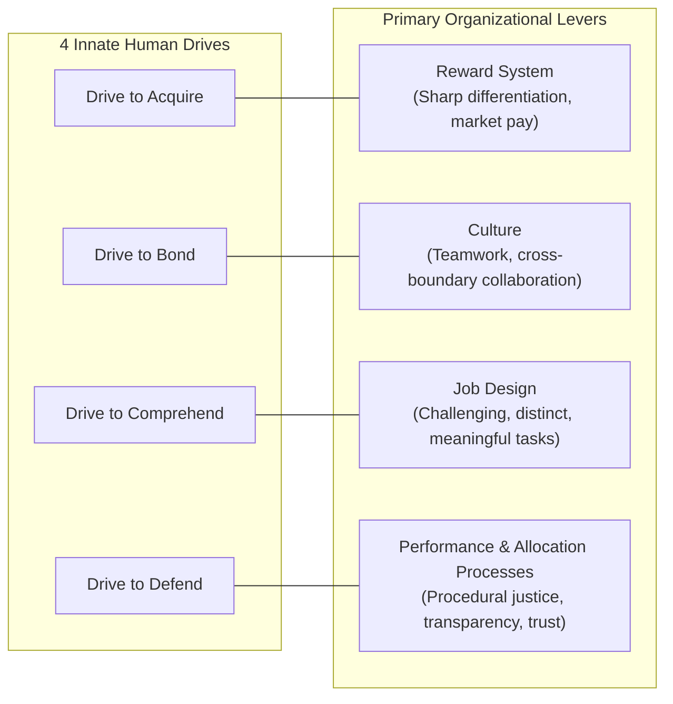

> [!NOTE] Assignment Context & Attribution
>
> - **Course:** MK1 Organizational Behaviour & Managing People — Week 03
> - **Source Prompt:** `archive/courses/mk1/week-03/Pre Assignment Week 3.pdf` & `Syndicate 9 - Pre Assignment Week 3.docx`
> - **Reference Attribution:** Analytical synthesis contributed by **F9 (Class F / Syndicate 9)** & **the Portal Maintainer**
> - **Parent Lecture:** [[courses/mk1-organizational-behavior-managing-people/week-03/index|Week 03 Master Lecture Hub]]
> - **Associated Reading Satellite:** [[courses/mk1-organizational-behavior-managing-people/week-03/reading-employee-motivation-powerful-new-model|Reading: Employee Motivation — A Powerful New Model]]

---

## 📋 Part 1: Official Assignment Prompt & Skim Map

- **Executive Objective:** Evaluate baseline syndicate comprehension of evolutionary motivation theory, the four-drive architecture, non-compensatory motivational systems, and frontline managerial scope prior to the Week 03 seminar.
- **Target Deliverable:** Analytical problem set evaluating the three core questions derived from Nohria, Groysberg, and Lee (HBR 2008).
- **Core Diagnostic Questions & Reading Map:**
  1. _Question 1:_ Nohria, Groysberg, and Lee (2008) say that people at work are moved by four basic drives, and that a company has to look after all four together. In your own words, what are the four drives? For each one, which organisational lever do the authors say meets it best? — **Where to look:** [[courses/mk1-organizational-behavior-managing-people/week-03/reading-employee-motivation-powerful-new-model|Reading Note]] § The Four Evolutionary Drives & Organizational Levers.
  2. _Question 2:_ Bob Nardelli’s time at Home Depot is one of the examples the authors use. Why, in their view, could a strong push on one drive not make up for neglecting the others? — **Where to look:** [[courses/mk1-organizational-behavior-managing-people/week-03/reading-employee-motivation-powerful-new-model|Reading Note]] § Case Vignette: Bob Nardelli at Home Depot.
  3. _Question 3:_ The authors found that employees look to their direct manager to meet the same four drives, and that they weigh the manager about as heavily as the organisation’s policies. Think about the financial services manager described in the article. He did better than his peers on three of the four drives, yet his team was less engaged and less committed than the rest of the company. Why did that happen? And what does his case suggest about what a manager can, and cannot, change within the limits set by the organisation? — **Where to look:** [[courses/mk1-organizational-behavior-managing-people/week-03/reading-employee-motivation-powerful-new-model|Reading Note]] § Frontline Managers vs. Corporate Systems & Financial Services Case.

---

## 💡 Part 2: Reference Solution & Strategic Analysis

### Question 1: The Four Drives and Their Organizational Levers

1. **The Drive to Acquire**:
   - _Definition:_ The innate biological and social impulse to obtain scarce resources, encompassing physical goods (wealth, property, compensation) and intangible social assets (status, promotions, formal authority, and executive recognition).
   - _Primary Organizational Lever:_ The **Reward System**. Organizations meet this drive by designing compensation and incentive architectures that sharply differentiate top performers from average and low performers, clearly tying rewards to measurable outcomes and maintaining external market competitiveness.
2. **The Drive to Bond**:
   - _Definition:_ The evolutionary need to form enduring connections, reciprocal relationships, mutual reliance, and emotional belonging with colleagues, teams, and the larger institution.
   - _Primary Organizational Lever:_ **Culture**. Organizations meet this drive by cultivating a collaborative climate that prizes teamwork, breaks down insular departmental silos, fosters mutual friendship, and encourages the enterprise-wide sharing of best practices.
3. **The Drive to Comprehend**:
   - _Definition:_ The cognitive urge to satisfy curiosity, master complex challenges, comprehend one's environment, and make a meaningful, tangible contribution to the organization and society.
   - _Primary Organizational Lever:_ **Job Design**. Organizations meet this drive by structuring individual roles so that they are distinct, vital to overall enterprise success, cognitively stimulating, and imbued with clear line-of-sight to customer impact.
4. **The Drive to Defend**:
   - _Definition:_ The natural protective instinct to shield oneself, one's ideas, status, and achievements from external threats, while demanding equity, institutional fairness, and moral justice.
   - _Primary Organizational Lever:_ **Performance-Management and Resource-Allocation Processes**. Organizations meet this drive by establishing complete transparency, procedural fairness, objective evaluation criteria, and trustworthy appeals processes that protect employees from arbitrary managerial whim or credit theft.

---

### Question 2: Bob Nardelli at Home Depot — The Fallacy of Motivational Substitution

- **Analytical Stance:** Bob Nardelli failed because the four drives stem from distinct evolutionary origins and function as an **independent, non-compensatory system**. An organization cannot offset severe deficits in three drives by doubling down on compensation and aggressive metrics.
- **The Core Failure Mechanism:**
  - Nardelli pushed relentlessly on the **Drive to Acquire** by establishing hyper-aggressive, metric-driven financial incentives for store managers and penalizing missed quotas.
  - However, his operational policies simultaneously destroyed the other three drives:
    1. _Thwarted Drive to Comprehend:_ He replaced full-time, knowledgeable craftspersons and tradespeople with cheaper, part-time retail clerks. This stripped the workforce of deep product mastery, degraded customer service, and turned a once-rewarding consultative job into monotonous checkout labor.
    2. _Thwarted Drive to Bond:_ He instituted intense, cutthroat competition across stores and departments, squelching internal camaraderie, teamwork, and collaborative pride.
    3. _Thwarted Drive to Defend:_ He created a hostile, autocratic climate of fear where questioning executive directives was punished, performance evaluations felt arbitrary, and employees felt stripped of procedural protection.
  - Because employee motivation operates multiplicatively, crushing Bond, Comprehend, and Defend triggered massive frontline disengagement, soaring customer complaints, market-share losses to Lowe's, and Nardelli's eventual forced departure by the board of directors.

---

### Question 3: The Financial Services Manager — The Bottleneck of Procedural Injustice

- **Why the Team Disengaged:**
  - The branch manager excelled on three dimensions: he paid competitive bonuses (Acquire), fostered high camaraderie and lively social events (Bond), and assigned intellectually engaging client projects (Comprehend).
  - However, his score on the **Drive to Defend fell below the corporate average**. He allocated lucrative client accounts arbitrarily, demonstrated visible favoritism, and lacked transparent criteria for project grading.
  - Because the drive to defend governs **psychological safety and trust**, failing to satisfy it creates chronic insecurity. Employees concluded that regardless of their talent or effort, their career outcomes were hostage to managerial caprice. This single unmet drive created an operational bottleneck that neutralized the motivational benefits of high pay and camaraderie.
- **What a Manager CAN and CANNOT Change:**
  - **What Managers Cannot Change (Macro Constraints):** Frontline managers cannot unilaterally alter corporate base-pay scales, executive pension structures, enterprise culture, structural job architectures, or corporate budget allocations.
  - **What Managers Directly Govern (Local Psychological Climate):** Frontline leaders retain immense discretion over how corporate systems are translated on the ground. They control transparent task allocation, equitable shift scheduling, fair credit attribution, daily recognition, and team psychological safety. The financial services manager failed because he neglected the exact lever under his direct operational control: procedural justice.

---

## 🔬 Part 3: Methodological Rigor & Analytical Nuances

| Analytical Dimension   | Baseline Intuition                                                                                    | Rigorous Methodological Nuance (F9 / Maintainer Synthesis)                                                                                     |
| :--------------------- | :---------------------------------------------------------------------------------------------------- | :--------------------------------------------------------------------------------------------------------------------------------------------- |
| **Drive to Acquire**   | Viewed purely as monetary cash compensation and annual bonuses.                                       | Recognized as inherently relative and status-driven; employees constantly evaluate pay against peer benchmarks and internal equity.            |
| **System Interaction** | Assumed to be additive (e.g., "Paying huge bonuses compensates for a stressful, toxic work culture"). | Proven to be **non-compensatory and multiplicative**: a near-zero score on Defend bottlenecks overall engagement and triggers employee flight. |
| **Managerial Agency**  | Assumes frontline managers are helpless victims of restrictive corporate HR policies.                 | Proves frontline managers dictate **50% of employee motivation** through the local micro-climate and transparent operational execution.        |

---

## 🎙️ Part 4: Classroom Cold-Call & Faculty Debrief Strategy

- **Faculty Angle (SBM ITB Panel):** _"In Indonesian state-owned enterprises (BUMN) where base pay is heavily constrained by civil-service salary bands and firing poor performers is difficult, how can a manager meet the Drive to Acquire?"_
- **High-Signal 30-Second Recitation Script:**
  > "Because the Drive to Acquire is relative and status-driven rather than purely financial, effective BUMN leaders satisfy it through non-monetary recognition and developmental capital. They allocate high-visibility strategic task forces, sponsor high-performers for prestigious international executive training, provide direct access to board-level presentations, and publicly celebrate individual operational breakthroughs. In high-power-distance cultures, public executive endorsement and career sponsorship satisfy the Drive to Acquire just as powerfully as incremental cash bonuses."
- **Indonesian Corporate Reality:**
  - In family-owned businesses and PMA environments (as seen in the _Rudi dan Kana_ case), founder-centric nepotism routinely violates the Drive to Defend, making procedural transparency the single most critical retention lever for top professional talent.

---

## 🔗 Knowledge Graph & Curriculum Bridges

- Return to **[[courses/mk1-organizational-behavior-managing-people/week-03/index|Week 03 Masterclass Hub]]**
- Subsequent Assignment: **[[courses/mk1-organizational-behavior-managing-people/week-03/assignment-post-four-drives|W03 Post-Assignment: Four Drives & Dual-Career Debrief]]**
- Standalone Business Case:
  - [[courses/mk1-organizational-behavior-managing-people/week-03/case-rudi-dan-kana|Case Study: Rudi dan Kana (IBCC SBM ITB, 2016)]]
- Theoretical Reading Satellite:
  - [[courses/mk1-organizational-behavior-managing-people/week-03/reading-employee-motivation-powerful-new-model|Reading: Employee Motivation — A Powerful New Model]]
- Featured Entities:
  - Dr. Nitin Nohria
  - Dr. Boris Groysberg
