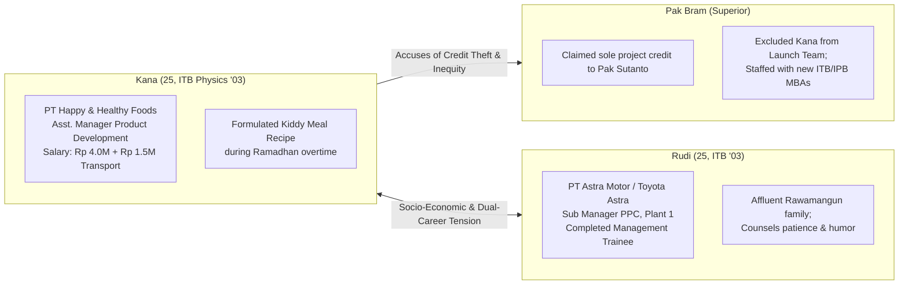
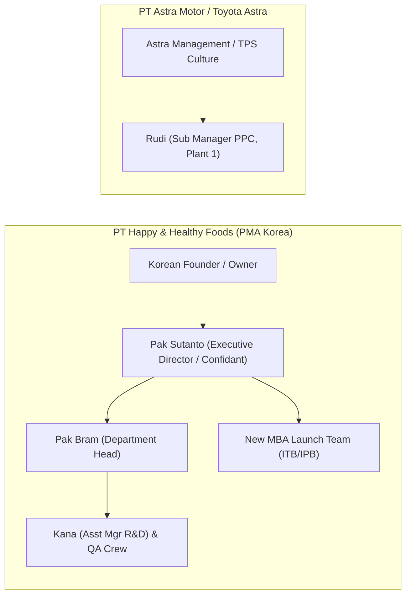
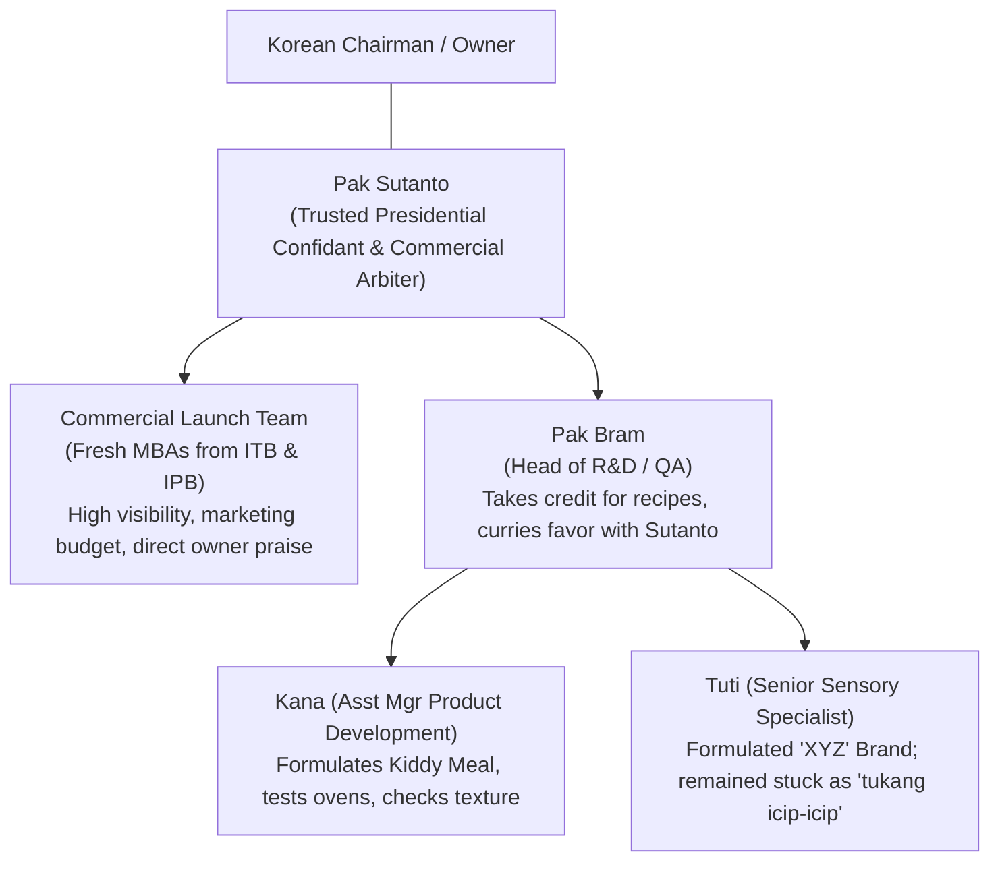
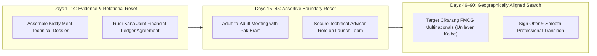

## 🚨 The Executive Dilemma

_"Pokoknya, saya mau keluar saja dari perusahaan ini!"_

The words exploded repeatedly from Kana as she slammed the car door and hurled her handbag and work files onto the backseat. Outside, the industrial haze of the **Cikarang–Cibarusah** manufacturing corridor hung heavy in the late afternoon heat.

Rudi sat silently behind the wheel of his car. He was physically and mentally drained. That afternoon, during a grueling Production Planning and Control (PPC) meeting at **PT Astra Motor (Toyota Astra Plant 1)**, missing component deliveries had triggered heated confrontations between PPC and the plant assembly floor. Rudi was starving—he had missed lunch resolving the assembly crisis—and was bracing for the notorious gridlock of the Cikarang–Jakarta toll road.

Yet looking at his fiancée’s tear-streaked face and incandescent fury, he swallowed his own exhaustion.

### The Immediate Flashpoint: Credit Theft on Project _Kiddy Meal_

Kana and Rudi had been sweethearts since graduating together from **Institut Teknologi Bandung (ITB)** in 2003. After three years of building their initial careers, they had recently become engaged and scheduled their wedding for late 2006.

Kana had joined **PT Happy & Healthy Foods**, a South Korean foreign direct investment (PMA) confectionery and snack manufacturer in Cikarang, starting in Quality Assurance (QA) in 2003 before being promoted to **Assistant Manager Product Development** in 2005.

Her direct superior, **Pak Bram**, had initially been an encouraging mentor. He had sponsored Kana for technical training in South Korea in 2005, from which Kana had brought back innovative snack samples. During the Ramadhan fasting season—taking advantage of idle industrial ovens and extrusion machinery—Kana and her QA/development crew sacrificed their evenings to formulate, bake, and test hundreds of recipe variations.

The resulting snack, branded **"Kiddy Meal"**, showed exceptional market potential.

However, during a high-level executive review with **Pak Sutanto** (the most influential confidant of the Korean owner), Pak Bram claimed sole personal ownership of the project. Bram positioned the breakthrough as his personal triumph, completely erasing Kana’s technical contribution. Bram had a documented history of opportunistic credit theft; he had previously stolen credit for the successful _XYZ_ brand launch from another product specialist, Tuti, who remained relegated to routine sensory tasting.

To compound Kana's humiliation, Pak Sutanto assembled a prestigious, high-visibility **Commercial Launch Team** to execute marketing and distribution. The team was staffed entirely by new hires holding prestigious MBA degrees from ITB and IPB. Kana was excluded:

> _"Coba lihat sekarang banyak anak-anak baru dari IPB dan ITB yang katanya udah MBA pada baru masuk dan ikut serta di timnya Pak Sutanto. Mereka sibuk uji coba produk baru dan kemasan baru. Sementara aku, iya emang jabatan Assistant Manager, tapi apa coba? Cuma uprek-uprek di mesin produksi, nyoba rasa ini, nyoba rasa itu, naikin suhu sekian, tambah ini sekian. Teksturnya enak tidak, keras, renyah? Giliran ada yang bagus, yang nampang anak-anak MBA itu!"_

### The Relational Escalation & Dual-Career Impasse

Kana announced her intention to immediately resign and call her ITB alumni network to secure a position at multinational food conglomerates like **PT Nestlé** or **PT Danone**.

When Rudi attempted to calm her—suggesting that Bram had historically been a good boss and advising her not to act rashly—Kana turned her anger onto him:

> _"Kamu ini Rudi, enggak pernah serius, bercanda mulu! Iya kamu enak, udah bisa jalan bareng makan siang sama bosmu, aku... mana?! Kamu emang dasar anak orang kaya, enggak ngerti orang susah!"_

The accusation struck at the core of their unspoken socio-economic divergence:

- **Kana's Reality**: Raised in a modest family in Sukabumi. Her father was aging and chronically ill; their traditional family retail shop was steadily failing against competition from modern supermarket chains. Kana carried an unyielding moral obligation to fund the university tuition of her **three younger siblings**, even after marriage. Her base salary was **Rp 4.0 million/month** with a **Rp 1.5 million** transport allowance. She could not afford to be without an income.
- **Rudi's Reality**: Raised in an affluent, well-connected family in Rawamangun. His father was an established professional with senior corporate connections (including senior directors at Danone). Rudi had completed Astra’s elite Management Trainee program, had already been promoted to Sub Manager, and enjoyed high career security and strong institutional mentorship.
- **The Dual-Career Conflict**: The couple was saving to buy a home in Cikarang before their wedding. However, Nestlé and Danone operated their major processing facilities in **Tangerang / Cikupa**, on the exact opposite side of Greater Jakarta. If Kana switched to Tangerang while Rudi remained anchored to Toyota in Cikarang, their housing plan, daily commute, and emerging marriage would face immediate geographic fracture.

---

## 🏢 Enterprise & Industry Background

### 1. PT Happy & Healthy Foods (PMA South Korea, Cikarang)

- **Business Model**: FMCG confectionery and packaged snacks (biscuits, extruded snacks, candies) targeting children and youth segments.
- **Corporate Governance & Culture**: Highly centralized, founder-centric PMA hierarchy. Formal titles (_Assistant Manager_) mask informal power dynamics. Pak Sutanto acts as the gatekeeper to the Korean ownership family.
- **Internal Politics**: Career progression depends heavily on proximity to Pak Sutanto and visible "commercial flair" rather than factory-floor R&D. Pak Bram exploits this dynamic by stealing technical innovations from laboratory staff to present to Sutanto.

### 2. PT Astra Motor / Toyota Astra (Plant 1, Cikarang)

- **Business Model**: Automotive body component manufacturing and assembly operating under the disciplined **Toyota Production System (TPS)**.
- **Corporate Governance & Culture**: Institutionalized meritocracy, structured Management Trainee tracks, standardized problem-solving (_A3 Thinking_, _Kaizen_), and explicit conflict-resolution norms. Professional disagreements in PPC morning meetings do not destroy personal collegiality.

---

## 📈 Quantitative Exhibits & Financial Breakdown

### Exhibit 1: Rudi vs. Kana Comparative Career, Financial & Family Ledger (2006)

| Parameter                        | Kana (Fiancée)                                                  | Rudi (Fiancé)                                                | Analytical & Relational Variance                           |
| :------------------------------- | :-------------------------------------------------------------- | :----------------------------------------------------------- | :--------------------------------------------------------- |
| **Alma Mater & Degree**          | ITB Physics (Graduated 2003)                                    | ITB Engineering (Graduated 2003)                             | Equal baseline academic pedigree.                          |
| **Employer & Sector**            | PT Happy & Healthy Foods (PMA FMCG)                             | PT Astra Motor / Toyota (Automotive)                         | Korean PMA vs. Elite Astra Conglomerate.                   |
| **Current Title**                | Assistant Manager Product Development                           | Sub Manager PPC, Plant 1                                     | Rudi has higher corporate rank and formal span of control. |
| **Tenure**                       | 3 Years (Joined QA 2003, Promoted 2005)                         | 2 Years (Joined 2004, MT Graduate)                           | Kana has longer operational tenure in Cikarang.            |
| **Base Salary**                  | **Rp 4,000,000 / month**                                        | **Rp 6,500,000 / month** (Est. Sub Mgr)                      | Rudi earns ~62% higher base compensation.                  |
| **Allowances**                   | Rp 1,500,000 / month (Transport)                                | Comprehensive vehicle + health package                       | Kana depends on Rudi for daily carpooling.                 |
| **Family Background**            | Modest family, Sukabumi                                         | Affluent family, Rawamangun (Jakarta)                        | Acute socio-economic divide.                               |
| **Parental Economic Status**     | Father sick; small retail shop failing vs. supermarkets         | Father senior corporate executive; mother homemaker          | Kana's family has negative cash-flow risk.                 |
| **Family Financial Liabilities** | **Committed to funding college tuition for 3 younger siblings** | Zero family liabilities; receives parental financial backing | **Major financial friction point post-marriage.**          |
| **Current Residence**            | Aunt's house in Cawang (Jakarta Timur)                          | Parents' home in Rawamangun (Jakarta Timur)                  | Both commute ~45 km daily to Cikarang.                     |
| **Housing Goal (Late 2006)**     | Saving for DP on house in Cikarang                              | Saving for DP on house in Cikarang                           | Joint target: Rp 40M DP for Cikarang cluster home.         |

---

### Exhibit 2: Organizational Power & Influence Map (Happy & Healthy Foods)

- **Structural Vulnerability**: Kana’s position mimics **Tuti’s historical trap**. In founder-driven FMCG firms, functional laboratory personnel are systematically exploited as "backroom technicians" while business development executives harvest commercial credit.

---

### Exhibit 3: Commute, Location & Dual-Career Logistics Matrix

| Parameter                    | Status Quo (Cikarang Hub)                                  | Alternative Scenario (Kana in Tangerang / Nestlé)                                                                          |
| :--------------------------- | :--------------------------------------------------------- | :------------------------------------------------------------------------------------------------------------------------- |
| **Rudi's Workplace**         | Toyota Astra Plant 1, Cikarang                             | Toyota Astra Plant 1, Cikarang                                                                                             |
| **Kana's Workplace**         | Happy & Healthy Foods, Cikarang                            | PT Nestlé / PT Danone, Tangerang / Cikupa                                                                                  |
| **Distance Between Plants**  | ~5 km (Within same industrial zone)                        | **~85 km across Greater Jakarta toll network**                                                                             |
| **Daily Commute Synergy**    | Single vehicle carpool; 1.5 hrs each way from East Jakarta | **Zero carpool synergy**; 3.0+ hrs daily each way across Jakarta congestion                                                |
| **Target Residence**         | Cikarang (Near both manufacturing plants)                  | Impasse: Cikarang forces Kana into 4-hr commute; Tangerang forces Rudi into 4-hr commute; Central Jakarta compromises both |
| **Wedding & Savings Impact** | Joint savings on fuel, toll, and housing                   | Double vehicle maintenance, separate housing/boarding costs, depleted sibling tuition buffer                               |

---

## ⚖️ Strategic Alternatives Matrix

| Strategic Option                                                                | Pros                                                                                                                                                                              | Cons & Operational Risks                                                                                                                                            | Financial & Family Impact                                                               | Organizational Feasibility                                                 |
| :------------------------------------------------------------------------------ | :-------------------------------------------------------------------------------------------------------------------------------------------------------------------------------- | :------------------------------------------------------------------------------------------------------------------------------------------------------------------ | :-------------------------------------------------------------------------------------- | :------------------------------------------------------------------------- |
| **Option A: Impulsive Rage Quit to Nestlé / Danone (Tangerang)**                | - Immediate psychological catharsis. - Cuts ties with toxic superior (Pak Bram). - Potential company car and corporate prestige.                                            | - Severely disrupts dual-career logistics with Rudi. - Geographic separation (Cikarang vs. Tangerang). - Unvetted corporate culture at new firm.              | **High Risk**: Resigning without signed contract endangers sibling tuition payments.    | **Low**: Commute across Jakarta creates acute marital strain.              |
| **Option B: Formal Escalation & Whistleblowing to Pak Sutanto**                 | - Corrects the historical record on _Kiddy Meal_ recipe formulation. - Exposes Bram's serial credit theft (citing Tuti precedent).                                             | - Violates Indonesian cultural deference (_asal bapak senang_). - High risk of retaliatory sabotage if Sutanto backs Bram. - Brands Kana as a "troublemaker". | Neutral short-term; severe career risk if escalation backfires.                         | **Moderate to Low**: Requires concrete, incontrovertible written evidence. |
| **Option C: Strategic Boundary Negotiation with Pak Bram & Launch Integration** | - Preserves current employment, income stability, and Cikarang commute. - Secures formal role on Commercial Launch Team. - Establishes adult-to-adult boundaries with Bram. | - Requires high emotional intelligence and swallowing immediate pride. - Bram may resist sharing commercial spotlight.                                           | **High Positive**: Protects wedding savings and uninterrupted sibling tuition.          | **High**: Bram needs Kana’s technical problem-solving during scaling.      |
| **Option D: Structured Dual-Career Job Search in Cikarang Industrial Corridor** | - Preserves geographic alignment with Rudi. - Targets multinational FMCG firms in Cikarang (Unilever, Kalbe, Mayora). - Moves only after signing binding offer.             | - Requires disciplined patience (2–4 months search). - Kana must continue working under Bram temporarily.                                                        | **Optimal**: Protects cash flow, secures higher compensation, preserves marriage plans. | **High**: Strong market demand for ITB-trained food development engineers. |

---

## 🎯 Executive Recommendation & Implementation Roadmap

Kana and Rudi must execute a coordinated, two-pronged strategy: **internal professional boundary resetting** followed by a **disciplined, geographically aligned external career transition**.

### 1. The Relational Reconciliation (Rudi & Kana)

- **Acknowledge the Socio-Economic Reality**: Rudi must validate Kana’s profound financial anxiety rather than brushing it off with jokes. Her commitment to her siblings is non-negotiable; Rudi must treat her family obligations as a shared marital budgeting reality.
- **Joint Financial Blueprint**: Establish a clear pre-marital financial plan:
  - Kana’s salary (Rp 4M) allocates Rp 2.0M directly to sibling tuition and parents' healthcare.
  - Remaining Rp 2.0M + Rudi’s salary (Rp 6.5M) funds joint wedding savings, Cikarang housing DP, and living expenses.
  - Agree on a **Zero Unilateral Resignation Rule**: Kana will not resign without a signed, binding employment contract in hand.

### 2. The Internal Boundary Negotiation with Pak Bram (Days 15–30)

- **Compile the Technical Dossier**: Kana must quietly assemble all lab notebooks, batch test logs, oven temperature curves, and Korean ingredient formulation files from Ramadhan, proving her authorship of the _Kiddy Meal_ recipe.
- **Execute an "Adult-to-Adult" Negotiation**: Kana requests a closed-door meeting with Pak Bram:
  - _Scripted Tone:_ Non-confrontational, firm, and value-focused.
  - _The Leverage:_ _"Pak Bram, Kiddy Meal is scaling to commercial mass production. As you know from the Ramadhan bake tests, the dough texture and moisture content destabilize if the extrusion temperature shifts by more than 2 degrees. The new MBA launch team does not possess this formulation knowledge. I want to ensure this launch succeeds for both of us and for Pak Sutanto. To guarantee production stability, I must be formally designated as the **Technical Product Lead on the Launch Team**, co-presenting operational readiness alongside the MBAs."_
  - _The Dynamic:_ Bram knows he cannot fake formulation chemistry. Yielding a co-lead spot protects his reputation with Sutanto while resolving Kana's exclusion.

### 3. The Controlled External Pivot (Days 30–90)

- Kana must leverage her ITB alumni network to target food manufacturers located **strictly within the Cikarang–Karawang corridor** (e.g., PT Unilever Indonesia Cikarang, PT Kalbe Farma Cikarang, PT Mayora Indah, or PT Nippon Indosari Corpindo).
- This delivers the career upgrade, multinational culture, and salary increase Kana desires while protecting her geographic proximity to Rudi, preserving their shared commute and Cikarang housing strategy.

---

## 🎙️ Classroom Cold-Call & Boardroom Defense

### 1. Theoretical Analysis under Adams' Equity Theory

$${\frac{O_{\text{Kana}}}{I_{\text{Kana}}}} \ll {\frac{O_{\text{Bram}}}{I_{\text{Bram}}}} \quad \text{and} \quad {\frac{O_{\text{Kana}}}{I_{\text{Kana}}}} < {\frac{O_{\text{MBAs}}}{I_{\text{MBAs}}}}$$

- **Inputs ($I$):** High technical training (ITB Physics), evening/weekend overtime during Ramadhan, physical labor in test kitchens, Korean trip knowledge transfer.
- **Outcomes ($O$):** Low base pay (Rp 4M), zero commercial visibility, exclusion from the launch team, denial of credit, relegation to repetitive operational tasks.
- **Psychological Reaction:** When individuals perceive acute negative inequity, Adams’ theory predicts specific behavioral responses:
  1. _Reducing inputs_ (quiet quitting, refusing to formulate new recipes).
  2. _Attempting to change outcomes_ (demanding a raise or credit).
  3. _Distorting perceptions of self or others_.
  4. _Leaving the field_ (resignation). Kana’s rage and desire to quit is the textbook manifestation of negative equity distress.

---

### 2. Diagnosis under Lawrence & Nohria's [[concepts/four-drive-model|Four-Drive Model]]

| Motivational Drive      | Status in Kana's Work Reality | Underlying Organizational Cause                                                                                                                   |
| :---------------------- | :---------------------------: | :------------------------------------------------------------------------------------------------------------------------------------------------ |
| **Drive to Acquire**    |     **Severely Thwarted**     | Compensation (Rp 4M) is insufficient for heavy family liabilities; denied organizational status, title recognition, and launching team perks.     |
| **Drive to Bond**       |     **Severely Thwarted**     | Betrayed by her primary mentor (Pak Bram); alienated from newly hired MBA cohort; relational friction spilling over into partnership with Rudi.   |
| **Drive to Comprehend** |     **Severely Thwarted**     | Relegated to repetitive sensory testing and machine calibration (_"uprek-uprek mesin"_); denied strategic learning on the commercial launch team. |
| **Drive to Defend**     |    **Violently Triggered**    | Lack of procedural justice and transparency at Happy & Healthy Foods; vulnerable to credit theft without institutional recourse.                  |

---

### 3. Dual-Career Partnership Dynamics

- **The Spillover Effect**: Kana’s acute organizational frustration creates emotional contagion, spilling over into her personal relationship with Rudi.
- **The Social Comparison Barrier**: Rudi’s ease in corporate navigation triggers Kana’s latent socio-economic insecurity (_"kamu anak orang kaya"_). Resolving dual-career crucibles requires moving beyond tactical career advice to deep empathy for family obligations and shared financial transparency.

---

## 🔗 Knowledge Graph & Curriculum Bridges

- Master Lecture Hub: [[courses/mk1-organizational-behavior-managing-people/week-03/index|Week 03 Masterclass: Motivation at Work]]
- Associated Required Reading:
  - [[courses/mk1-organizational-behavior-managing-people/week-03/reading-employee-motivation-powerful-new-model|Nohria, Groysberg & Lee: Employee Motivation — A Powerful New Model]]
- Relevant Syndicate Assignments:
  - [[courses/mk1-organizational-behavior-managing-people/week-03/assignment-pre-employee-motivation|W03 Pre-Assignment: Employee Motivation & Managerial Levers]]
  - [[courses/mk1-organizational-behavior-managing-people/week-03/assignment-post-four-drives|W03 Post-Assignment: Four Drives & Dual-Career Debrief]]
- Case Author & Faculty Profile:
  - [[entities/yuni-ros-bangun|Dr. Ir. Madju Yuni Ros Bangun (SBM ITB)]]
