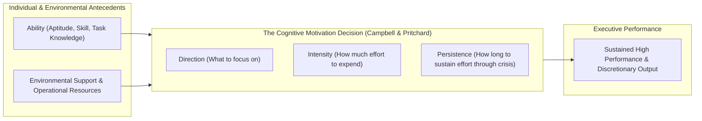
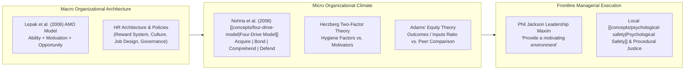
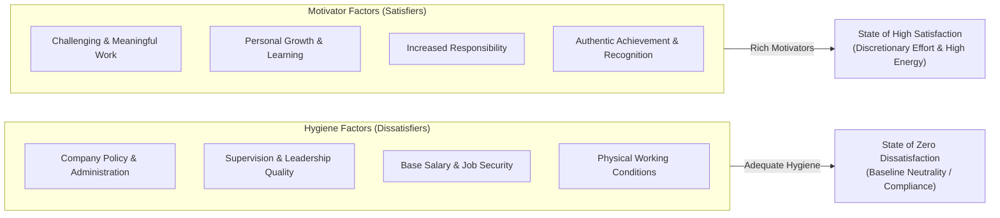
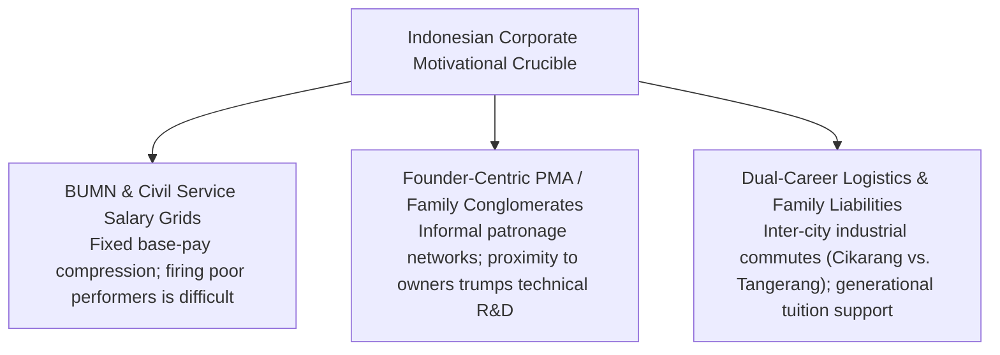
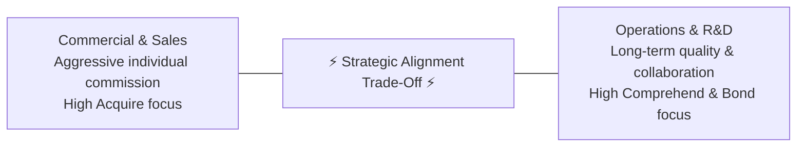

> [!NOTE] Curricular & Faculty Metadata
>
> - **Course:** MK1 Organizational Behaviour & Managing People — Week 03
> - **Teaching Team:** Muhammad Yorga Permana, Ph.D., Widhyawan Prawiraatmadja, Ph.D., Dr. Ir. Madju Yuni Ros Bangun, Yudo Anggoro, Ph.D.
> - **Primary Curricular Spine:** Week 3 - Motivation (Student Version) Rev 01 (5 Slides + Core Readings)
> - **Direct Satellites & Problem Sets:**
>   - [[courses/mk1-organizational-behavior-managing-people/week-03/case-rudi-dan-kana|Case Study: Rudi dan Kana (IBCC SBM ITB, 2016)]]
>   - [[courses/mk1-organizational-behavior-managing-people/week-03/reading-employee-motivation-powerful-new-model|Reading: Employee Motivation — A Powerful New Model]]
>   - [[courses/mk1-organizational-behavior-managing-people/week-03/assignment-pre-employee-motivation|Pre-Assignment: Employee Motivation & Managerial Levers]]
>   - [[courses/mk1-organizational-behavior-managing-people/week-03/assignment-post-four-drives|Post-Assignment: Four Drives & Dual-Career Debrief]]

---

## 1. Executive Overview & Foundations of Motivation at Work

Why do employees who possess exceptional technical intelligence routinely withhold their discretionary effort, while others with modest capabilities move mountains to deliver breakthrough results?

Traditional management treats motivation as an emotional mystery—something to be solved with motivational speeches, corporate offsites, or arbitrary spot bonuses. Modern organizational behavior decisively reframes this premise: **motivation is not an emotional feeling; it is a rational cognitive decision**.

### The Performance Function: Campbell & Pritchard (1976)

Decades of industrial-organizational research formalize performance as a multiplicative function of capability and motivation:

$$\mathbf{\text{Performance}} = f\Big(\text{Ability} \times \text{Motivation}\Big)$$

- **Ability** represents the individual’s physiological and cognitive capacity:
  $$\text{Ability} = \text{Aptitude} \times \text{Skill} \times \text{Task Understanding}$$
- **Motivation** represents the deliberate choice regarding energy allocation:
  1. **Choice to expend effort**: Deciding to engage rather than check out.
  2. **Choice of degree of effort**: Assessing: _"Is it worth my time and energy? What will I gain if I put in more effort?"_
  3. **Choice to persist**: Deciding to sustain energy when confronted by technical bottlenecks, bureaucratic friction, or fatigue.

Because the relationship is multiplicative, **zero motivation completely nullifies elite ability**. An enterprise staffed by the most brilliant engineers or financial analysts produces zero performance if those professionals conclude that extra effort is unrewarded or betrayed.

---

## 2. Theoretical Architecture & Core Frameworks

Executive leadership requires mastering four integrated theoretical frameworks that govern workplace human energy:

### 1. The AMO Model of High-Performance Work Systems (Lepak et al., 2006)

High-performance human resource architecture operates through three interdependent pillars:

$$\mathbf{\text{Organizational Performance}} = f\Big(\text{Ability}, \text{Motivation}, \text{Opportunity}\Big)$$

1. **Ability-Enhancing Practices**: Comprehensive recruitment, rigorous onboarding, continuous technical upskilling, and professional development.
2. **Motivation-Enhancing Practices**: Performance-contingent rewards, clear promotional pathways, meritocratic career progression, and executive recognition.
3. **Opportunity-Enhancing Practices**: Empowering job design, autonomous decision rights, cross-functional collaboration channels, and employee voice mechanisms.

Even highly capable (A) and motivated (M) employees fail to deliver enterprise performance if rigid bureaucratic hierarchies deny them the operational **Opportunity (O)** to act.

---

### 2. The [[concepts/four-drive-model|Four-Drive Model]] (Lawrence & Nohria, 2002; Nohria et al., 2008)

Rooted in evolutionary biology, human beings possess four innate, hardwired motivational drives:

$$\mathbf{\text{Employee Motivation}} = f\Big(\text{Acquire} \times \text{Bond} \times \text{Comprehend} \times \text{Defend}\Big)$$

| Drive                   | Core Human Impulse                                                                          | Primary Organizational Lever                                                                         | Strategic Failure Mode                                                                    |
| :---------------------- | :------------------------------------------------------------------------------------------ | :--------------------------------------------------------------------------------------------------- | :---------------------------------------------------------------------------------------- |
| **Drive to Acquire**    | Obtaining scarce goods, wealth, social status, and authority. Inherent relative comparison. | **Reward System**: Pay differentiation, performance-tied bonuses, external market benchmarks.        | Compressed salary bands where top and bottom performers receive identical pay.            |
| **Drive to Bond**       | Developing emotional attachments, mutual reliance, and group belonging.                     | **Culture**: Fostering mutual reliance, cross-boundary collaboration, sharing best practices.        | Hyper-competitive internal ranking systems that foster departmental silos and sabotage.   |
| **Drive to Comprehend** | Mastering challenges, satisfying curiosity, and making a meaningful contribution.           | **Job Design**: Structuring roles that are distinct, vital, cognitively challenging, and purposeful. | Monotonous, repetitive labor without line-of-sight to the broader organizational mission. |
| **Drive to Defend**     | Protecting oneself, one's ideas, and status; demanding equity and institutional justice.    | **Performance Management & Allocation**: Transparent, objective, and fair procedural justice.        | Opaque promotions, favoritism, arbitrary account allocation, and managerial credit theft. |

> [!CAUTION] The Non-Compensatory Law of Motivation
> The four drives function as a **multiplicative joint system**. Organizations cannot buy their way out of a toxic, unfair culture (broken Drive to Defend) by doubling annual cash bonuses (Drive to Acquire). An unaddressed deficit in any single drive caps overall organizational engagement.

---

### 3. Herzberg’s Two-Factor Theory (Frederick Herzberg, 1959)

Workplace factors operate along two distinct, parallel continua:

- **Hygiene Factors**: Hygiene factors do not motivate. If flawed (unfair compensation, abusive supervision, unsafe conditions), they cause severe dissatisfaction. If perfected, they merely produce baseline neutral compliance (_"zero dissatisfaction"_).
- **Motivator Factors**: True motivation emerges solely from intrinsic job factors (achievement, recognition, the work itself, responsibility, advancement).
- **Mapping to the Four Drives**: Herzberg’s Hygiene factors align directly with the **Drive to Defend**, while Motivators serve the **Drives to Comprehend and Acquire**.

---

### 4. Adams’ Equity Theory (J. Stacy Adams, 1963)

Employees constantly evaluate the fairness of their work exchange by comparing their perceived outcome-to-input ratio against reference others:

$$\mathbf{\frac{\text{Outcomes}_{\text{Self}}}{\text{Inputs}_{\text{Self}}}} \quad \longleftrightarrow \quad \mathbf{\frac{\text{Outcomes}_{\text{Referent}}}{\text{Inputs}_{\text{Referent}}}}$$

- **Inputs ($I$):** Effort, education, technical competence, overtime, loyalty, and emotional labor.
- **Outcomes ($O$):** Base salary, bonuses, title, public recognition, corner offices, and career visibility.
- **Equity Distress:**
  - When $\frac{O_A}{I_A} < \frac{O_B}{I_B}$ (**Negative Inequity**), employees experience acute anger and distress.
  - Behavioral remediation: Employees reduce their inputs (quiet quitting), attempt to increase outcomes (demanding raises), sabotage referent others, or leave the organization entirely.

---

### 5. Extrinsic Crowding-Out & Kerr's Reward Trap (Cerasoli et al., 2014; Kerr, 1995)

While incentives are necessary, poorly designed extrinsic reward systems can actively destroy performance:

- **The Crowding-Out Effect**: When tasks require heuristic, complex problem-solving, introducing high-powered direct extrinsic incentives crowds out intrinsic motivation. Employees narrow their cognitive focus purely to metric optimization, ignoring task quality and cross-functional collaboration.
- **Kerr's Classic Paradox**: _"On the Folly of Rewarding A, While Hoping for B"_. Organizations hope for teamwork and long-term innovation, but reward short-term individual billing hours or quarterly production volumes.

---

### 6. The Phil Jackson Leadership Maxim: Engineering the Motivating Climate

In elite sports and enterprise leadership, legendary coach Phil Jackson summarized the frontline manager’s true mandate:

> [!TIP] The Phil Jackson Principle
> _"You cannot motivate someone. All you can do is provide a motivating environment, and the players will motivate themselves."_

Frontline managers do not possess magic psychological levers to inject energy into others. Instead, their job is to **remove demotivating organizational friction**—eliminating procedural injustice, providing transparent feedback, designing challenging tasks, and fostering mutual trust.

---

## 3. Managerial Crucible: Indonesian Enterprise & BUMN Context

Translating motivation theory into Indonesian corporate governance exposes distinct structural tensions:

1. **Overcoming Fixed Salary Band Compression in BUMNs**:
   In state-owned enterprises, base compensation is anchored to rigid civil-service grades (_golongan_), making monetary differentiation difficult. Savvy BUMN executives satisfy the **Drive to Acquire** by distributing **developmental capital and institutional status**: assigning high-performers to board-level task forces (e.g., Danantara holding restructurings), sponsoring executive overseas education, and providing fast-track leadership visibility.
2. **The Peril of Patronage & Credit Theft in PMAs**:
   In founder-led foreign direct investment firms (as vividly demonstrated in the _Rudi dan Kana_ case at PT Happy & Healthy Foods), formal management systems are often subordinated to informal patron-client networks (_Pak Sutanto_). Department heads curry favor with executive confidants by taking credit for the laboratory breakthroughs of junior specialists. This completely shatters the **Drive to Defend**, causing catastrophic brain drain among top technical talent.
3. **Dual-Career Logistics in Greater Jakarta's Industrial Belt**:
   Professional couples frequently face geographic gridlock. Navigating automotive manufacturing in **Cikarang (Bekasi)** versus FMCG processing in **Tangerang / Cikupa** creates multi-hour daily commute penalties that exhaust human energy, turning dual-career marriage into a major source of workplace friction unless strategically coordinated.

---

## 4. Cross-Functional Implementation & Strategic Trade-offs

Managing workplace motivation requires navigating structural trade-offs between competing organizational priorities:

1. **Individual Incentive vs. Team Collaboration**:
   - Tying bonuses purely to individual output stimulates aggressive effort, but destroys the Drive to Bond, sparking internal hoarding of client leads and operational sabotage.
   - Mitigate by utilizing **hybrid incentive pools**: 60% contingent on individual performance, 40% contingent on cross-functional team delivery.
2. **Short-Term Quarterly Demands vs. Task Craftsmanship**:
   - When leadership prioritizes immediate quarterly production, employees are forced to take procedural shortcuts that destroy task meaningfulness (Drive to Comprehend).
   - High-performing organizations protect dedicated innovation capacity (e.g., Google’s 20% time; 3M’s 15% rule; structured hackathons).
3. **Centralized HR Compliance vs. Frontline Managerial Autonomy**:
   - Central corporate HR enforces standardized salary scales and promotion timelines to maintain legal compliance.
   - Frontline managers need flexibility to reward exceptional individual initiative. High-performing firms grant managers localized discretionary recognition budgets.

---

## 📚 Required Readings & In-Depth Satellites

| Document Title                                | Author / Institution                                                                         | Core Methodological Contribution                                                                                                                                                                                                                      | Study Note / Case Dossier                                                                                                                         |
| :-------------------------------------------- | :------------------------------------------------------------------------------------------- | :---------------------------------------------------------------------------------------------------------------------------------------------------------------------------------------------------------------------------------------------------- | :------------------------------------------------------------------------------------------------------------------------------------------------ |
| **Employee Motivation: A Powerful New Model** | **Nitin Nohria, Boris Groysberg & Linda-Eling Lee** _Harvard Business Review (2008)_      | The [[concepts/four-drive-model                                                                                       \| Four-Drive Model]] (Acquire, Bond, Comprehend, Defend); non-compensatory joint system; 50/50 corporate vs. managerial split. | [[courses/mk1-organizational-behavior-managing-people/week-03/reading-employee-motivation-powerful-new-model\|Open Nohria et al. Deep-Dive Note]] |
| **Case Study: Rudi dan Kana**                 | **Dr. Ir. Madju Yuni Ros Bangun** _Indonesia Business Case Center (IBCC), SBM ITB (2016)_ | Interpersonal conflict, equity theory, credit theft (_Kiddy Meal_), and dual-career marital crossroads in Cikarang.                                                                                                                                   | [[courses/mk1-organizational-behavior-managing-people/week-03/case-rudi-dan-kana\|Open Rudi dan Kana Case Dossier]]                               |
| **W03 Pre-Assignment Guide**                  | **F9 Syndicate & Maintainer** _SBM ITB MBA_                                               | Post-class debrief analyzing the Four Drives, Bob Nardelli at Home Depot, and the financial services manager paradox.                                                                                                                                 | [[courses/mk1-organizational-behavior-managing-people/week-03/assignment-pre-employee-motivation\|Open W03 Pre-Assignment]]                       |
| **W03 Post-Assignment Guide**                 | **F9 Syndicate & Maintainer** _SBM ITB MBA_                                               | Theoretical revisions integrating Herzberg, AMO, and Campbell & Pritchard, cross-applied to the _Rudi dan Kana_ case.                                                                                                                                 | [[courses/mk1-organizational-behavior-managing-people/week-03/assignment-post-four-drives\|Open W03 Post-Assignment]]                             |

---

## 📂 Primary Source Media & Digital Archives

| Material Title                                |       Media Type        | Direct Repository Reference                                                           |
| :-------------------------------------------- | :---------------------: | :------------------------------------------------------------------------------------ |
| **Week 3 Masterclass: Motivation at Work**    |  Presentation (`.pdf`)  | `raw/courses/mk1/week-03/Week 3 - Motivation (Student Version) Rev 01.pdf` (5 Slides) |
| **Case Study: Rudi dan Kana for Student**     |  SBM ITB Case (`.pdf`)  | `raw/courses/mk1/week-03/Rudi dan Kana for Student.pdf` (IBCC Case 114-02-07-16)      |
| **Employee Motivation: A Powerful New Model** |  HBR Article (`.pdf`)   | `raw/courses/mk1/week-03/Employee Motivation-A Powerful New Model.pdf`                |
| **Week 3 Pre-Assignment Brief**               | SBM ITB Brief (`.pdf`)  | `raw/courses/mk1/week-03/Pre Assignment Week 3.pdf`                                   |
| **Syndicate 9 Pre-Assignment Submission**     | Word Document (`.docx`) | `raw/courses/mk1/week-03/Syndicate 9 - Pre Assignment Week 3.docx`                    |
| **Syndicate 9 Post-Assignment Submission**    | Word Document (`.docx`) | `raw/courses/mk1/week-03/Syndicate 9 - Post Assignment Week 3.docx`                   |

---

## 🔗 Knowledge Graph & Curriculum Bridges

- **Featured Business Case Study**:
  - [[courses/mk1-organizational-behavior-managing-people/week-03/case-rudi-dan-kana|Case Study: Rudi dan Kana (Dr. Yuni Ros Bangun, SBM ITB)]]
- **Academic Reading Satellite**:
  - [[courses/mk1-organizational-behavior-managing-people/week-03/reading-employee-motivation-powerful-new-model|Reading: Employee Motivation — A Powerful New Model (Nohria, Groysberg & Lee)]]
- **Cohort Problem Sets & Assignment Guides**:
  - [[courses/mk1-organizational-behavior-managing-people/week-03/assignment-pre-employee-motivation|Pre-Assignment: Employee Motivation & Managerial Levers]]
  - [[courses/mk1-organizational-behavior-managing-people/week-03/assignment-post-four-drives|Post-Assignment: Four Drives & Dual-Career Debrief]]
- **Featured Theorists & Thought Leaders**:
  - [[entities/yuni-ros-bangun|Dr. Ir. Madju Yuni Ros Bangun (SBM ITB)]]
  - Dr. Nitin Nohria (Harvard Business School)
  - Dr. Boris Groysberg (HBS)
- **Antecedent Curricular Module**: Week 02: [[courses/mk1-organizational-behavior-managing-people/week-02/index|Who Am I at Work? Identity, Personality & Individual Differences]]
- **Next Curricular Module**: Week 04: [[courses/mk1-organizational-behavior-managing-people/week-04/index|Leading with [[concepts/growth-mindset|Growth Mindset]] & [[concepts/emotional-intelligence|Emotional Intelligence]]]] _(Scheduled / Ingestion Pending)_
- Return to **[[courses/mk1-organizational-behavior-managing-people/index|MK 1 Course Overview]]**
