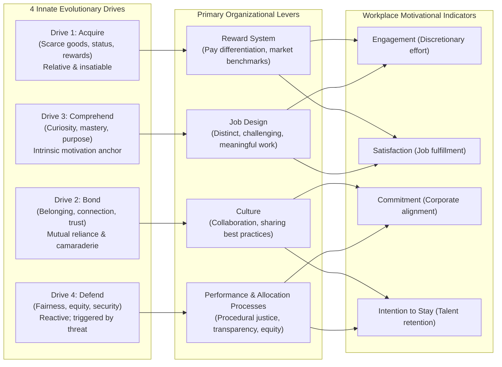
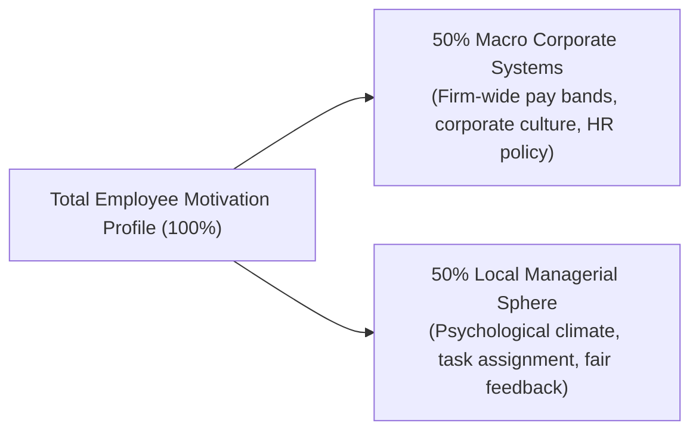
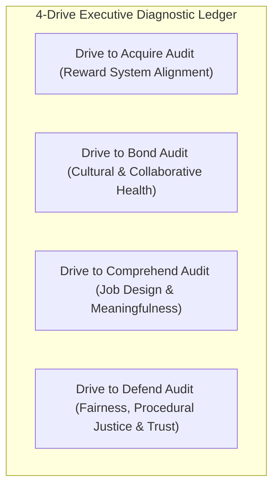

## 📄 Executive Synopsis & Context

- **Source Reference**: Nitin Nohria, Boris Groysberg, and Linda-Eling Lee, _"Employee Motivation: A Powerful New Model"_, **Harvard Business Review** (July–August 2008, Vol. 86, Iss. 7/8, pp. 78–84).
- **Author Background**:
  - **Dr. Nitin Nohria**: Former Dean of Harvard Business School (2010–2020) and George F. Baker Professor of Business Administration.
  - **Dr. Boris Groysberg**: Professor of Business Administration at Harvard Business School and leading expert on executive talent management.
  - **Dr. Linda-Eling Lee**: Former Research Director at Harvard Business School and Global Head of ESG Research at MSCI.
- **Core Thesis**: What truly motivates employees to bring their full discretionary energy to work? Decades of management literature presented fragmented answers—Maslow’s hierarchy, Herzberg’s hygiene factors, McClelland’s needs, and Vroom’s expectancy theory. Nohria, Groysberg, and Lee ground motivation in **evolutionary biology**, establishing that human nature is governed by **four innate, independent, and hardwired drives**: the drive to **Acquire (A)**, **Bond (B)**, **Comprehend (C)**, and **Defend (D)**.

  These four drives operate as a **non-compensatory system**: a company or manager cannot offset a failure in one drive by over-indexing on another. Achieving elite organizational motivation requires simultaneously aligning four macro organizational levers:
  1. **Reward System** $\rightarrow$ Drives to **Acquire**
  2. **Culture** $\rightarrow$ Drives to **Bond**
  3. **Job Design** $\rightarrow$ Drives to **Comprehend**
  4. **Performance Management & Resource Allocation** $\rightarrow$ Drives to **Defend**

  Crucially, the authors' empirical research reveals that **employees weigh their direct manager almost equally with the organization's overarching policies (a 50/50 split)**. Even within a rigid, bureaucratic corporate structure, a skilled frontline leader retains substantial discretion to optimize all four drives within their team’s micro-climate.

---

## 🧠 Complete Conceptual Architecture

### 1. The Four Evolutionary Drives

Rooted in Paul Lawrence and Nitin Nohria’s landmark evolutionary treatise (_Driven: How Human Nature Shapes Our Choices_, 2002), the model posits four hardwired emotional drivers:

1. **The Drive to Acquire**:
   - _Nature:_ The evolutionary impulse to obtain physical commodities (food, shelter, wealth) and intangible social assets (status, authority, prestige, recognition).
   - _Workplace Reality:_ This drive is inherently **relative** rather than absolute. Employees constantly benchmark their compensation against peers and industry competitors. It is insatiable—attainment creates a temporary baseline before aspirations adjust upward.
2. **The Drive to Bond**:
   - _Nature:_ The desire to form enduring emotional attachments, mutual reliance, and reciprocal friendships with individuals and collectives.
   - _Workplace Reality:_ Drives camaraderie, pride in the institution, and willingness to collaborate across functions. When thwarted, employees feel isolated, leading to cynical withdrawal; when unmanaged, in-group bonding can mutate into insular departmental silos.
3. **The Drive to Comprehend**:
   - _Nature:_ The fundamental urge to satisfy intellectual curiosity, make sense of our environment, master complex challenges, and contribute meaningfully to the world.
   - _Workplace Reality:_ Anchors intrinsic motivation. Employees are demoralized when confined to monotonous, repetitive tasks (_"uprek-uprek mesin"_); they are energized by intellectual autonomy, creative problem-solving, and knowing their work matters.
4. **The Drive to Defend**:
   - _Nature:_ The protective instinct to shield oneself, one's ideas, status, family, and accomplishments from external threats, while demanding equity and moral justice.
   - _Workplace Reality:_ Unlike the other three proactive drives, the drive to defend is primarily **reactive**. When fulfilled, it creates psychological safety and trust; when violated (through arbitrary evaluations, credit theft, or opaque promotion decisions), it triggers visceral fear, cynicism, and acute resistance to organizational change.

---

### 2. The Non-Compensatory Principle & The Mathematical Equation

A central empirical discovery of Nohria, Groysberg, and Lee is that the four drives operate in an **independent, non-compensatory joint system**:

$$\mathbf{\text{Employee Motivation}} = f\Big(\text{Acquire} \times \text{Bond} \times \text{Comprehend} \times \text{Defend}\Big)$$

- **The Multiplicative Bottleneck**: High compensation (Acquire) _cannot_ compensate for a toxic, paranoid culture (Defend) or boring, soul-crushing tasks (Comprehend).
- An organization that scores in the 90th percentile on three drives but fails on the fourth will see its overall employee motivation profile plummet:

$$\text{Motivation Score} \propto \min(\text{Drive}_A, \text{Drive}_B, \text{Drive}_C, \text{Drive}_D)$$

#### Empirical Findings Across Fortune 500 Enterprises:

- Companies performing in the **top quartile across all four drives** achieved average employee motivation metrics of **60%**, compared with only **20%** for companies in the bottom quartile.
- Individual drives map to distinct organizational indicators:
  - _Reward System (Acquire)_ strongly influences **Job Satisfaction**.
  - _Culture (Bond)_ strongly drives **Organizational Commitment**.
  - _Job Design (Comprehend)_ strongly influences **Employee Engagement**.
  - _Performance Processes (Defend)_ strongly dictates **Retention & Intention to Stay**.

---

### 3. Frontline Managers vs. Corporate Systems (The 50/50 Split)

A common executive rationalization is: _"My hands are tied by corporate HR; I cannot motivate my people because I don't control the budget."_

Nohria et al. decisively disprove this myth:

- Employees evaluate their **direct manager's execution** of the four drives almost as heavily as the entire corporate infrastructure.
- **What Frontline Managers Cannot Change:** Corporate salary bands, stock option programs, structural business models, and formal company policies.
- **What Frontline Managers Directly Govern:**
  - _Acquire:_ Public recognition, non-monetary perks, stretch project allocations.
  - _Bond:_ Encouraging mutual support, resolving peer conflicts, modeling vulnerability.
  - _Comprehend:_ Explaining the strategic "why" behind assignments, designing diverse tasks, connecting frontline work to customer impact.
  - _Defend:_ Procedural fairness in shifts, transparent grading, advocating for the team upward, and never stealing credit.

---

## 🏢 Real-World Executive Case Vignettes

### Case Vignette 1: Bob Nardelli’s Failure at Home Depot

- **Context**: Bob Nardelli, former GE executive, assumed the CEO role at Home Depot in 2000. He implemented GE-style Six Sigma rigor, metric tracking, and high-powered financial incentives.
- **The Breakdown**: Nardelli aggressively targeted the **Drive to Acquire** by tying store managers' compensation to narrow cost-cutting and revenue metrics. However, he simultaneously decimated the other three drives:
  - _Gutted Comprehend:_ Replaced experienced, full-time hardware specialists with cheap part-time clerks, degrading customer advice and product mastery.
  - _Destroyed Bond:_ Pitted stores and managers against each other in hyper-competitive rankings, destroying store-level camaraderie.
  - _Thwarted Defend:_ Created an autocratic culture of fear where bad news was punished and metrics were manipulated.
- **Outcome**: Customer satisfaction plummeted, store turnover skyrocketed, and Home Depot's stock stagnated while rival Lowe's surged. Nardelli was forced out by the board in January 2007. High monetary incentives could not compensate for destroying the other three drives.

### Case Vignette 2: Sonoco Products — Balanced Excellence

- **Context**: Sonoco, an industrial packaging manufacturer, established exemplary performance across all four drives.
- **Execution**:
  - _Acquire:_ Transparent, market-benchmarked pay-for-performance.
  - _Bond:_ Corporate culture framed around "People Build Businesses", encouraging high cross-functional collaboration.
  - _Comprehend:_ Comprehensive job-rotation and apprenticeship programs that taught employees end-to-end manufacturing and management skills.
  - _Defend:_ Transparent grievance processes, joint union-management councils, and open-book management.
- **Outcome**: Top-tier employee retention, sustained profitability, and national recognition as one of the best corporate cultures in the United States.

### Case Vignette 3: The Financial Services Manager Paradox

- **Context**: In Nohria’s study, a branch manager at a global financial services firm received stellar performance reviews. His team scored in the top 10% on meeting the drives to Acquire, Bond, and Comprehend (generous performance bonuses, lively social gatherings, engaging client challenges).
- **The Anomaly**: Despite these advantages, his unit’s overall **engagement and retention were lower than the firm-wide average**.
- **Root Cause**: The manager scored in the bottom 20% on the **Drive to Defend**. He allocated client accounts arbitrarily, played favorites, and was perceived as politically self-serving. Team members lived in constant anxiety that their success was subject to managerial whim, nullifying the motivational benefits of high pay and interesting work.

---

## 🛠️ Complete Diagnostic Worksheets & Toolkits

### Toolkit: The 4-Drive Organizational Motivation Audit

Evaluate your corporate division, branch, or team across the four drives using the following diagnostic scale (**1 = Completely Disagree / Severe Deficit; 5 = Exemplary / Industry Leading**):

#### Diagnostic Evaluation Matrix

| Category                | Diagnostic Statement                                                                    | Score (1–5) | Operational Evidence & Remedial Action                                      |
| :---------------------- | :-------------------------------------------------------------------------------------- | :---------: | :-------------------------------------------------------------------------- |
| **Drive to Acquire**    | 1. Compensation sharply differentiates between top, average, and poor performers.       |   \_\_\_    | Tie variable bonuses to audited performance rather than seniority.          |
| _(Reward System)_       | 2. Base pay and benefits match or exceed external market competitors.                   |   \_\_\_    | Commission regular market salary benchmarking studies.                      |
| **Drive to Bond**       | 3. Cross-functional collaboration is actively rewarded over departmental tribalism.     |   \_\_\_    | Institute cross-boundary project incentives and shared KPIs.                |
| _(Culture)_             | 4. Team members demonstrate high mutual trust, camaraderie, and psychological safety.   |   \_\_\_    | Schedule structured retrospective debriefs and celebrate team milestones.   |
| **Drive to Comprehend** | 5. Individual job roles are distinct, cognitively challenging, and meaningful.          |   \_\_\_    | Eliminate redundant bureaucracy; enrich task scope through job crafting.    |
| _(Job Design)_          | 6. Employees clearly understand how their daily tasks impact customers and strategy.    |   \_\_\_    | Bring client/customer testimonials directly into team operational meetings. |
| **Drive to Defend**     | 7. Resource allocation, promotions, and project assignments are completely transparent. |   \_\_\_    | Publish clear rubric criteria before allocating resources or promotions.    |
| _(Performance Mgmt)_    | 8. Employees trust leadership to act ethically and protect them against unfair threats. |   \_\_\_    | Enforce zero tolerance for managerial credit theft; protect whistleblowers. |

---

## 📊 Comparative Exhibits & Framework Tables

### Exhibit 1: Classical Motivation Models vs. The Four-Drive Framework

| Dimension              | Maslow's Need Hierarchy (1943)                                                 | Herzberg's Two-Factor Theory (1959)                                               | Nohria, Groysberg & Lee (2008)                                                    |
| :--------------------- | :----------------------------------------------------------------------------- | :-------------------------------------------------------------------------------- | :-------------------------------------------------------------------------------- |
| **Core Structure**     | 5-stage vertical hierarchy (Physiological to Self-Actualization).              | 2 independent factors: Hygiene Factors vs. Motivators.                            | 4 innate, evolutionary drives (Acquire, Bond, Comprehend, Defend).                |
| **Progression Logic**  | Sequential: lower-order needs must be satisfied before higher needs activate.  | Dual-continuum: Hygiene prevents dissatisfaction; Motivators create satisfaction. | **Non-compensatory joint system**: All 4 drives must be satisfied simultaneously. |
| **Role of Money**      | Lower-order (Physiological / Security need).                                   | Hygiene factor (prevents unhappiness, does not motivate long-term).               | Serves the **Drive to Acquire**, but is relative and status-driven.               |
| **Managerial Action**  | Diagnose employee's current hierarchical level and tailor rewards.             | Ensure basic hygiene (pay, security), then enrich job content.                    | **Align all 4 organizational levers** (Rewards, Culture, Job Design, Processes).  |
| **Empirical Validity** | Weak in workplace settings; individuals violate the strict hierarchical order. | Moderate; strong qualitative support, criticized for attribution bias.            | **Strong**: Validated across Fortune 500 employee survey datasets.                |

---

## 💬 Classroom Cold-Call & Discussion Strategy

### Discussion Question 1: "Why could Bob Nardelli not buy his way out of motivational collapse at Home Depot?"

- **Crisp Cold-Call Answer:**
  > "Because human motivation is a non-compensatory multiplicative system, not an additive one. Nardelli's aggressive extrinsic bonuses satisfied only the Drive to Acquire, while his operational policies actively pulverized the drives to Bond, Comprehend, and Defend. As Nohria et al. prove, over-indexing on compensation cannot compensate for a toxic climate of fear and the destruction of technical craftsmanship."

### Discussion Question 2: "What does the financial services manager case teach us about frontline managerial limits?"

- **Crisp Cold-Call Answer:**
  > "It proves that direct managers govern 50% of employee motivation through their local psychological climate. The manager excelled at bonuses, camaraderie, and interesting work, but failed on procedural justice (the Drive to Defend). Unfair account allocation and perceived favoritism acted as an operational bottleneck, nullifying the team's engagement despite superior performance on the other three drives."

---

## 🔗 Knowledge Graph & Bridges

- Master Lecture Note: [[courses/mk1-organizational-behavior-managing-people/week-03/index|Week 03 Masterclass Hub]]
- Standalone Business Case Study:
  - [[courses/mk1-organizational-behavior-managing-people/week-03/case-rudi-dan-kana|Case Study: Rudi dan Kana (Dr. Yuni Ros Bangun, SBM ITB)]]
- Associated Syndicate Problem Sets:
  - [[courses/mk1-organizational-behavior-managing-people/week-03/assignment-pre-employee-motivation|W03 Pre-Assignment: Employee Motivation & Managerial Levers]]
  - [[courses/mk1-organizational-behavior-managing-people/week-03/assignment-post-four-drives|W03 Post-Assignment: Four Drives & Dual-Career Debrief]]
- Featured Entities:
  - Dr. Nitin Nohria (Harvard Business School)
  - Dr. Boris Groysberg (HBS)
