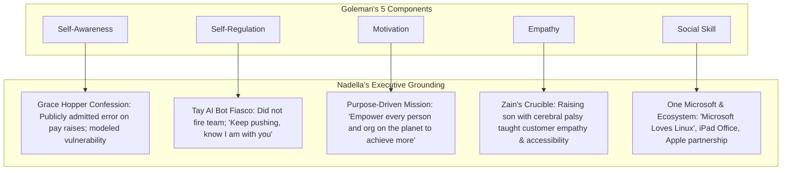

> [!NOTE] Assignment Context & Attribution
>
> - **Course:** MK1 Organizational Behaviour & Managing People — Week 04
> - **Source Prompt:** `archive/courses/mk1/week-04/Syndicate 9 - Post Assignment Week 4.docx`
> - **Reference Attribution:** Analytical synthesis contributed by **F9 (Class F / Syndicate 9) & the Portal Maintainer** _(all personal student names and identifiers strictly anonymized)_
> - **Parent Lecture:** [[courses/mk1-organizational-behavior-managing-people/week-04/index|Week 04 Master Lecture Hub: Leadership & Culture Transformation]]
> - **Direct Case Study:** [[courses/mk1-organizational-behavior-managing-people/week-04/case-satya-nadella-microsoft|Case Study: Satya Nadella at Microsoft — Instilling a [[concepts/growth-mindset|Growth Mindset]]]]
> - **Direct Reading Satellites:**
>   - [[courses/mk1-organizational-behavior-managing-people/week-04/reading-leadership-outlook-2026|Reading: Leadership Outlook 2026 (SBM ITB & DDI)]]
>   - [[courses/mk1-organizational-behavior-managing-people/week-04/reading-what-makes-a-leader|Reading: What Makes a Leader? (Daniel Goleman, HBR)]]

---

## 📋 Part 1: Official Assignment Prompt & Skim Map

- **Executive Objective:** Re-evaluate and elevate baseline pre-assignment answers by integrating the core theoretical frameworks from the Week 04 masterclass—including **McKinsey's CEO Excellence ("Be Bold")**, **David Epstein's Generalist-Specialist Dynamic Capability**, **Carol Dweck's [[concepts/growth-mindset|Growth Mindset]]**, and **Satya Nadella's cultural turnaround at Microsoft**.
- **Deliverable Requirements:** For each of the four pre-assignment questions, provide:
  1. _Original Answer_ (baseline pre-assignment response).
  2. _Revised Answer_ (reconstructed with class frameworks, case evidence, and strategic models).
  3. _Reflection on What Changed and Why_ (explicitly articulating the cognitive and methodological shift).

---

## 💡 Part 2: Reference Solution & Framework Revisions (Post-Class Mode)

### Item 1: SBM ITB Leadership Outlook — The Central Leadership Gap

#### Original Answer (Pre-Assignment Baseline)

> The central leadership gap identified in the report is a structural imbalance between strong operational execution and weak strategic foresight, compounded by an evaluation system that rewards operational stability over transformative change. Indonesian leaders consistently demonstrate high mastery in traditional operational domains, specifically Finance, Operations, and Commercial functions. Furthermore, organizational assessment practices heavily favor competencies centered on execution and stability, such as Leadership Impact, Business Skills, and Interpersonal Effectiveness.
>
> Meanwhile, strategic capabilities, most notably Technology/Digital and Human Resources (SDM), consistently rank at the bottom of technical competencies. Crucial transformative drivers such as Contributing to Society, innovation under uncertainty, and risk management are evaluated by very few organizations relative to baseline standards. A sectoral gap also exists, where the goods/manufacturing sector lags significantly behind the services sector in leadership maturity.
>
> Operational competence helps organisations meet today's targets, but weak digital and HR capabilities limit their ability to integrate technology, develop talent, collaborate across functions, and adapt to disruption. Therefore, improving digital and HR competence is not merely about adding support functions; it is necessary to make transformation sustainable while also strengthening day-to-day performance.

#### Revised Answer (Integrating Class Frameworks & Microsoft Case)

The central leadership gap identified in the SBM ITB and Daya Dimensi Indonesia report is a profound structural imbalance: Indonesian leaders demonstrate strong mastery in operational execution (Finance, Operations, and Commercial) but remain critically deficient in strategic and transformative capabilities (Technology/Digital and HR/Talent Management). This issue is further aggravated by corporate assessment systems that heavily measure operational stability (_Leadership Impact_ and _Business Skills_, evaluated by over 230 firms) while almost entirely ignoring transformative social impact (_Contributing to Society_, evaluated by only 13 firms, or ~6% of the baseline).

This imbalance directly threatens organizational transformation. Meeting short-term operational targets preserves today's business, but long-term survival in an era of disruption requires frameworks identified in class as **"dynamic capability" (David Epstein)** and the executive courage to **"Be Bold"** in vision and resource reallocation **(McKinsey’s CEO Excellence)**.

A clear historical parallel is **Microsoft's "lost decade" under Steve Ballmer**. Microsoft remained operationally and financially robust—doubling profits and tripling revenue—yet drifted toward irrelevance because a rigid culture of internal competition ("stack ranking"), siloed fiefdoms, and an obsession with short-term numbers crushed innovation and human talent. Without elevated digital acumen and strategic people management, Indonesian organizations risk falling into this exact operational trap: maintaining short-term efficiency while losing the capacity to innovate and adapt.

#### Reflection: What Changed, and Why?

- **What Changed:** The revised answer integrates McKinsey's _CEO Excellence_ framework ("Set the Direction / Be Bold"), David Epstein's concept of breadth over narrow specialization (_Range_), and the real-world case study of Microsoft's pre-2014 stagnation.
- **Why:** The change elevates the response from a localized data summary to an applied strategic diagnosis. Referencing Microsoft's lost decade illustrates that strong financial and operational numbers can mask a fatal lack of strategic agility, proving why the Indonesian leadership gap is an existential business issue rather than an administrative HR concern.

---

### Item 2: SBM ITB Leadership Outlook — The Narrowing Gap Analysis

#### Original Answer (Pre-Assignment Baseline)

> The narrowing gap between the Operational and Strategic competency groups between 2022 and 2024 was not caused by genuine improvement in Strategic competencies; rather, it was driven by a steep decline in Operational competencies alongside broader stagnation.
>
> In 2022, the Operational competency group averaged 4.32, while the Strategic group averaged 4.09, resulting in a gap of 0.23. By 2024, the Operational group dropped sharply by 0.61 points to 3.71, while the Strategic group dropped by 0.55 points to 3.54, narrowing the gap to 0.17. Across the broader 2022–2025 period, average technical competence across all dimensions fell by 0.58 points (-13.6%). Technology and HR competencies did not surge; instead, they remained locked in the bottom two ranking positions (ranks 4 and 5) across the entire multi-year tracking period.
>
> The narrowing gap reflects a downward convergence across leadership capabilities rather than an elevation of strategic agility, reinforcing the urgent need for targeted investment in digital and talent capabilities as strategic growth engines rather than mere back-office support functions.

#### Revised Answer (Integrating [[concepts/growth-mindset|Growth Mindset]], Grit & Serendipity)

The narrowing gap between the Operational and Strategic competency groups from 0.23 in 2022 to 0.17 in 2024 was not driven by genuine progress in Strategic capabilities, but by a steep decline in Operational competencies alongside broad-based stagnation. Empirically, the Operational group average dropped from 4.32 to 3.71 (-0.61 points), while the Strategic group fell from 4.09 to 3.54 (-0.55 points). Over the broader 2022–2025 period, average technical competence dropped by 13.6% (-0.58 points), with Technology and HR locked at the bottom (ranks 4 and 5) across all years.

This represents a problematic **"downward convergence."** When external disruptions intensified, organizations failed to pivot because they lacked what Carol Dweck and Satya Nadella term a **"[[concepts/growth-mindset|growth mindset]]"**—the dynamic learning orientation needed to master unfamiliar domains. Instead, organizations operated with a fixed mindset, retreating into short-term operational defense without developing the strategic **grit (Angela Duckworth)** or cross-functional orchestration **(Christian Busch's Serendipity Mindset)** needed to build resilient technological and human architectures. The narrowing gap is therefore a warning sign of systemic capability decay, demonstrating that operational prowess cannot be sustained when strategic capabilities are neglected.

#### Reflection: What Changed, and Why?

- **What Changed:** While retaining the accurate empirical breakdown (4.32 to 3.71 vs. 4.09 to 3.54), the revised answer frames this downward convergence through Carol Dweck's growth vs. fixed mindset (from the Nadella case) and the concepts of Grit (Duckworth) and Serendipity Orchestration (Busch).
- **Why:** The original answer explained _what_ happened statistically. The revised answer explains _why_ it happened behaviorally: when firms over-index on operational routine without investing in a learning culture, crises do not catalyze strategic growth; instead, they erode operational competence itself.

---

### Item 3: Goleman's [[concepts/emotional-intelligence|Emotional Intelligence]] — Components & Sine Qua Non

#### Original Answer (Pre-Assignment Baseline)

> Daniel Goleman distinguishes [[concepts/emotional-intelligence|emotional intelligence]] (EI) from IQ and technical expertise by defining the latter two as "threshold capabilities", the baseline, entry-level competencies required to secure an executive role. While technical skill and raw cognitive intellect are necessary to analyze business problems, they do not differentiate high performers from average performers once individuals reach managerial ranks. [[concepts/emotional-intelligence|Emotional intelligence]] functions as the primary differentiator because leadership fundamentally involves mobilizing people, navigating ambiguity, and executing change through collective effort rather than individual technical output.
>
> Goleman terms [[concepts/emotional-intelligence|emotional intelligence]] the sine qua non (indispensable element) of leadership because an executive can possess world-class training, an incisive analytical mind, and an endless stream of smart ideas, but without [[concepts/emotional-intelligence|emotional intelligence]], they will still fail to inspire teams, foster collaboration, or sustain organizational impact.
>
> Goleman categorizes [[concepts/emotional-intelligence|emotional intelligence]] into three internal self-management skills and two relationship-management skills:
>
> - Self-Awareness: The capacity to recognize and understand one's own moods, emotions, and drives, as well as their ripple effect on others. Its hallmarks include realistic self-assessment, candor regarding strengths and limitations, self-confidence, and a self-deprecating sense of humor.
> - Self-Regulation: The ability to control, manage, or redirect disruptive impulses and volatile moods, coupled with the tendency to suspend hasty judgment and think before acting. Key hallmarks are integrity, trustworthiness, comfort with ambiguity, and resilience during organizational change.
> - Motivation: An internal drive to achieve for the intrinsic sake of achievement, operating beyond external incentives like financial compensation or status. Hallmarks include a passion for the work itself, high energy, relentless pursuit of improvement, optimism in the face of failure, and organizational commitment.
> - Empathy: The skill of thoughtfully discerning the emotional makeup of other people and considering their feelings alongside business data when making decisions. Essential hallmarks include talent retention, cross-cultural sensitivity, and attuned service to clients and team members.
> - Social Skill: Friendliness with a purpose—the adept management of relationships to build networks, establish rapport, and move people in a desired strategic direction. Hallmarks include persuasiveness, effective team leadership, and expertise in orchestrating change initiatives.

#### Revised Answer (Grounding EI in Satya Nadella's Executive Actions)

Daniel Goleman differentiates [[concepts/emotional-intelligence|emotional intelligence]] (EI) from IQ and technical skill by defining the latter two as "threshold capabilities"—the baseline, entry-level requirements for executive roles. While technical mastery and intellect secure a seat at the table, they do not differentiate star performers from average ones because leadership fundamentally requires mobilizing people to achieve shared goals. Goleman calls EI the _sine qua non_ (indispensable element) of leadership because an executive can have top-tier technical training and sharp analytical ideas, but will still fail without the capacity to inspire and align others.

Goleman divides EI into five components, which find direct expression in the leadership transformation led by Satya Nadella at Microsoft and the Week 04 lecture models:

1. **Self-Awareness (Understanding one’s emotions, strengths, and limits)**: Hallmarks include realistic self-assessment and candor. Nadella embodied this by publicly admitting his misstep at the Grace Hopper conference regarding women’s pay raises, modeling vulnerability rather than defensive arrogance.
2. **Self-Regulation (Managing disruptive impulses, suspending hasty judgment, and adapting to change)**: Hallmarks include integrity and comfort with ambiguity. Rather than terminating projects or firing engineers when the Tay AI chatbot failed publicly in 2016, Nadella calmly supported his team to learn and iterate (_"Keep pushing, and know that I am with you"_).
3. **Motivation (An intrinsic passion to achieve beyond money or status)**: Hallmarks include unflagging energy and organizational commitment. This aligns directly with the slide concept of **"Purpose-Driven Leadership"** and Nadella's reframing of Microsoft's mission to _"empower every person and organization on the planet to achieve more."_
4. **Empathy (Considering employees’ feelings alongside business variables when deciding)**: Hallmarks include talent development and cross-cultural sensitivity. Nadella traced his leadership philosophy to raising his son Zain (who had severe cerebral palsy), noting that empathy is essential to understanding customer pain points and fostering psychological safety.
5. **Social Skill (Friendliness with a purpose to move people in a shared direction)**: Hallmarks include persuasiveness and team building. This reflects **Adam Grant’s "Being a Giver"** and **Jonah Berger’s "Mobilizing People"**: Nadella dismantled internal rivalries to build "One Microsoft," actively partnering with former arch-rivals Apple, Linux, and Salesforce.

#### Reflection: What Changed, and Why?

- **What Changed:** In addition to presenting Goleman’s theoretical definitions and hallmarks, the revised answer directly grounds each of the five components in Satya Nadella's specific practices at Microsoft, Adam Grant's "Giver" model, and Jonah Berger's intentional communication.
- **Why:** In isolation, EI frameworks can easily sound like abstract HR platitudes. Connecting Goleman's components to tangible business actions—such as how empathy drives customer obsession and how self-regulation turns product failures into learning opportunities—demonstrates how [[concepts/emotional-intelligence|emotional intelligence]] operates as an engine of multi-billion dollar organizational turnarounds.

---

### Item 4: Goleman's 90% Claim — Methodological Critique & Art vs. Science

#### Original Answer (Pre-Assignment Baseline)

> Goleman’s claim that nearly 90% of the difference between star and average senior performers is attributable to [[concepts/emotional-intelligence|emotional intelligence]] is supported directionally, but it has significant academic and methodological limitations. To support this assertion, Goleman draws on cross-sectional data from competency models developed across 188 large global organizations. When comparing stars against average senior leaders, capabilities associated with [[concepts/emotional-intelligence|emotional intelligence]] appeared far more frequently than cognitive or technical capabilities. He also cites McClelland's 1996 study of a global food and beverage company: divisions led by managers with a critical mass of EI capabilities exceeded annual earnings goals by 20%, whereas divisions led by those without it fell short by almost the same amount, across regions.
>
> These findings support an association between EI and leadership outcomes, but the article does not provide enough methodological detail to independently assess how the 90% was calculated or how other influences were separated. Some models relied on senior managers' judgments, and division results may also reflect market conditions, resources, team quality, or prior performance.

#### Revised Answer (Integrating Range Restriction & Leadership Art/Science)

Goleman’s claim that nearly 90% of the difference between star and average senior performers is attributable to [[concepts/emotional-intelligence|emotional intelligence]] is directionally compelling, but it suffers from major methodological and academic limitations. Goleman supports his claim by analyzing competency models across 188 global companies and citing McClelland’s 1996 study, which showed that divisions led by managers with high EI outperformed annual earnings goals by 20%, whereas those lacking it underperformed by 20%. Qualitatively, this dynamic is validated by Microsoft's experience: as Nadella noted at an executive retreat, Microsoft had abundant bandwidth, talent, and raw IQ, yet struggled because **people spent their time poking holes in each other's ideas rather than collaborating**. Pure IQ without [[concepts/emotional-intelligence|emotional intelligence]] created toxic gridlock.

However, the specific "90%" figure is contested due to three key academic limitations:

1. **The Range-Restriction (Threshold) Effect**: Senior executives are already heavily filtered for superior cognitive ability and technical expertise. Because IQ variance is artificially compressed at the top, emotional factors naturally explain the majority of remaining variation among finalists. Attributing 90% of overall success to EI conflates residual variance in an elite sample with absolute real-world importance.
2. **Construct Overlap and Subjective Evaluation**: Many corporate competency models evaluated in Goleman's study used subjective ratings from senior managers that conflated cognitive skills (such as "strategic vision" or "conceptual thinking") with emotional traits (such as "initiative" or "leading change").
3. **Confounding Organizational Variables**: Observational studies like McClelland's rarely isolate confounding market dynamics, brand legacy, macroeconomic shifts, or team quality from individual executive capability.

Ultimately, effective leadership represents the **synthesis of both science** (sound analytical reasoning, technical rigor, and structured metrics) **and art** ([[concepts/emotional-intelligence|emotional intelligence]], humility, empathy, and moral purpose). Goleman’s 90% figure serves as a memorable managerial heuristic rather than an irrefutable psychometric fact.

#### Reflection: What Changed, and Why?

- **What Changed:** The critique was deepened by explicitly articulating the statistical "range restriction" effect and incorporating the overarching "Leadership: Art vs. Science" debate. It also balances the critique by using Nadella’s observation (_"all this IQ in one place... poking holes in each other's ideas"_) to show where Goleman's insight rings true in practice.
- **Why:** A robust academic review must neither blindly accept bold percentages nor dismiss practical truths. Connecting Goleman’s study with Microsoft’s cultural reality shows why IQ alone is insufficient, while pointing out statistical range restriction demonstrates rigorous critical thinking.

---

## 🔬 Part 3: Methodological Rigor & Key Analytical Nuances

| Dimension              | Baseline Syndicate Intuition                              | Advanced Post-Class Synthesis (F9 & Maintainer)                                                                                                                    |
| :--------------------- | :-------------------------------------------------------- | :----------------------------------------------------------------------------------------------------------------------------------------------------------------- |
| **Leadership Deficit** | Identifies Indonesian gaps in IT and HR.                  | Bridges gap to **McKinsey CEO Excellence** and **Microsoft's Lost Decade**: proves that high operational numbers mask fatal cultural decay.                        |
| **Statistical Spread** | Analyzes gap as a simple arithmetic delta (0.23 to 0.17). | Exposes **downward capability convergence**: links decay to fixed mindset (Dweck) and lack of dynamic capabilities (Epstein).                                      |
| **EI Architecture**    | Memorizes Goleman's 5 definitions and hallmarks.          | Maps each dimension to **concrete corporate turnarounds**: connects empathy to accessibility/Zain, self-regulation to Tay AI, and social skill to "One Microsoft." |
| **Empirical Validity** | Generic skepticism of McClelland's 90% claim.             | Formalizes **psychometric range restriction**: proves why high-IQ environments artificially elevate the predictive power of emotional competencies.                |

---

## 🎙️ Part 4: Classroom Cold-Call & Faculty Debrief Strategy

- **Faculty Angle (Art vs. Science):** _"Can leadership ever truly be a science, or is it fundamentally an art?"_
  - **High-Signal Response:** _"Leadership is an empirical science in its diagnostics and an art in its execution. The science provides structured models—such as SBM ITB's competency metrics, Dweck's [[concepts/growth-mindset|growth mindset]], and McClelland's financial correlation data. But the execution requires high [[concepts/emotional-intelligence|emotional intelligence]]—empathy, active listening, and moral vulnerability. As Satya Nadella proved, an organization with unlimited engineering science will still paralyze itself if the human art of empathy and psychological safety is absent."_
- **Faculty Angle (Application to Indonesian SOEs):** _"How can an Indonesian BUMN break out of downward capability convergence?"_
  - **High-Signal Response:** _"By fundamentally altering the assessment architecture. Currently, over 230 firms evaluate operational stability while only 13 evaluate societal contribution or transformative agility. BUMN holding companies (Danantara, MIND ID, PTPN) must follow Nadella's playbook: abolish forced-curve compliance, tie executive bonuses to digital transformation and talent development, and protect psychological safety so teams can innovate without fear of administrative retaliation."_

---

## 🔗 Knowledge Graph & Curriculum Bridges

- **Master Lecture Note**: [[courses/mk1-organizational-behavior-managing-people/week-04/index|Week 04 Master Lecture Hub: Leadership & Culture Transformation]]
- **Pre-Assignment Reference**: [[courses/mk1-organizational-behavior-managing-people/week-04/assignment-pre-leadership-outlook-eq|Pre-Assignment: SBM ITB Leadership Gap & Goleman EQ Analysis]]
- **Applied Case Study**: [[courses/mk1-organizational-behavior-managing-people/week-04/case-satya-nadella-microsoft|Case Study: Satya Nadella at Microsoft — Instilling a [[concepts/growth-mindset|Growth Mindset]]]]
- **Direct Readings**:
  - [[courses/mk1-organizational-behavior-managing-people/week-04/reading-leadership-outlook-2026|Reading: Leadership Outlook 2026 (SBM ITB & DDI)]]
  - [[courses/mk1-organizational-behavior-managing-people/week-04/reading-what-makes-a-leader|Reading: What Makes a Leader? (Daniel Goleman, HBR)]]
- **Curriculum Bridge**: Return to **[[courses/mk1-organizational-behavior-managing-people/index|MK1 Course Overview]]**
