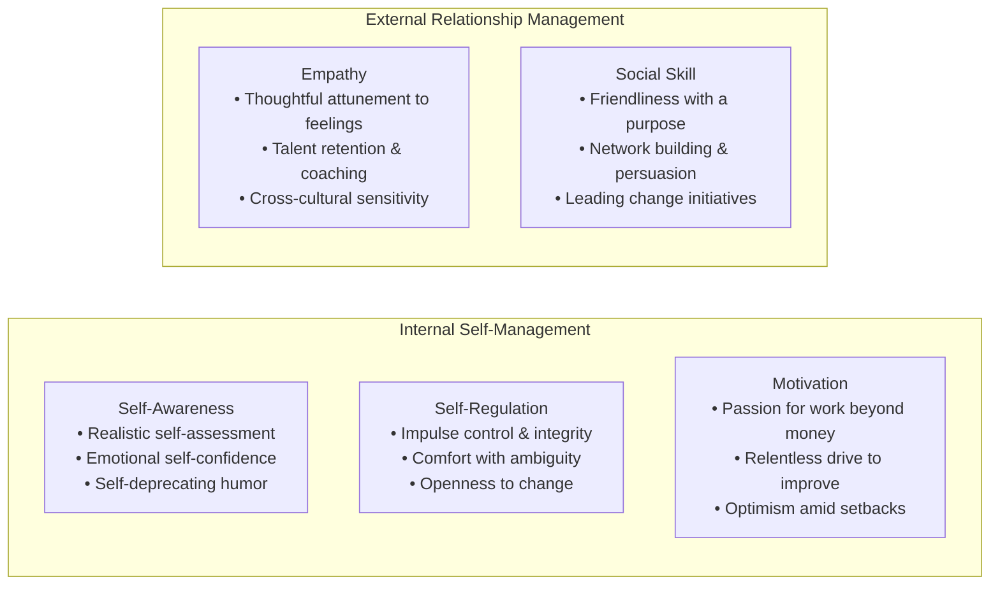

> [!NOTE] Assignment Context & Attribution
>
> - **Course:** MK1 Organizational Behaviour & Managing People — Week 04
> - **Source Prompt:** `archive/courses/mk1/week-04/Pre Assignment Week 4.pdf`
> - **Reference Attribution:** Analytical synthesis contributed by **F9 (Class F / Syndicate 9) & the Portal Maintainer** _(all personal student names and identifiers strictly anonymized)_
> - **Parent Lecture:** [[courses/mk1-organizational-behavior-managing-people/week-04/index|Week 04 Master Lecture Hub: Leadership & Culture Transformation]]
> - **Direct Reading Satellites:**
>   - [[courses/mk1-organizational-behavior-managing-people/week-04/reading-leadership-outlook-2026|Reading: Leadership Outlook 2026 (SBM ITB & DDI)]]
>   - [[courses/mk1-organizational-behavior-managing-people/week-04/reading-what-makes-a-leader|Reading: What Makes a Leader? (Daniel Goleman, HBR)]]

---

## 📋 Part 1: Official Assignment Prompt & Skim Map

- **Executive Objective:** Evaluate structural leadership imbalances within the Indonesian corporate landscape using empirical survey data (SBM ITB / DDI), and critique the psychological foundations of leadership effectiveness through Daniel Goleman's [[concepts/emotional-intelligence|Emotional Intelligence]] framework.
- **Target Deliverable:** Written analytical brief addressing four core diagnostic questions across two seminal readings.

### Core Diagnostic Questions & Source Map

1. **Leadership Outlook 2026 (Question 1):** _Based on the report's findings, describe the central leadership gap identified in Indonesia's business landscape. Which competency areas remain strong, which are lagging, and why does this imbalance matter for organisational transformation?_
   - _Where to look:_ `archive/courses/mk1/week-04/Leadership Outlook 2026.pdf` (Pages 1–4, Gambar 1, Gambar 5, Gambar 6).
2. **Leadership Outlook 2026 (Question 2):** _The report shows that the gap between Operational and Strategic competency groups narrowed between 2022 and 2024. Based on the evidence in the report, is this narrowing mainly because Strategic competencies (Digital and HR) genuinely improved, or because Operational competencies declined? Explain your answer using specific evidence from the report._
   - _Where to look:_ `archive/courses/mk1/week-04/Leadership Outlook 2026.pdf` (Pages 2–3, Gambar 2, Gambar 4).
3. **What Makes a Leader? (Question 3):** _According to Goleman, what distinguishes [[concepts/emotional-intelligence|emotional intelligence]] from IQ and technical skill as ingredients of effective leadership? Describe the five components of [[concepts/emotional-intelligence|emotional intelligence]] and explain why he calls it the “sine qua non” of leadership._
   - _Where to look:_ `archive/courses/mk1/week-04/What Makes a Leader.pdf` (Pages 1–6).
4. **What Makes a Leader? (Question 4):** _Goleman claims that at senior levels, nearly 90% of the difference between star and average performers is attributable to [[concepts/emotional-intelligence|emotional intelligence]] rather than cognitive ability. Drawing on the evidence he presents, including McClelland's 1996 study, do you find this claim well-supported? What limitations, if any, do you see in how it is argued?_
   - _Where to look:_ `archive/courses/mk1/week-04/What Makes a Leader.pdf` (Pages 2–4).

---

## 💡 Part 2: Reference Solution & Strategic Analysis (Post-Class Mode)

### Question 1: The Central Leadership Gap in Indonesia's Business Landscape

#### Analytical Stance

The central leadership gap in Indonesia is an institutionalized structural imbalance between strong operational execution and weak strategic foresight, actively reinforced by corporate evaluation systems that reward operational stability over transformative change.

#### Synthesis & Evidence

- **Areas of High Mastery (Operational Core)**: Indonesian leaders consistently demonstrate superior competence in traditional execution domains—specifically **Finance, Operations, and Commercial functions**. Organizational assessment practices heavily favor competencies centered on immediate execution and control, such as _Leadership Impact_, _Business Skills_, and _Interpersonal Effectiveness_, which are evaluated by over 230 enterprises.
- **Areas of Severe Deficit (Strategic Enablers)**: Strategic capabilities—most notably **Technology/Digital Acumen** and **Human Resources (SDM)**—consistently rank at the bottom of technical competencies (ranks 4 and 5). Transformative drivers such as _Contributing to Society_ (evaluated by only 13 firms, or ~6% of baseline), _Innovation under Uncertainty_, and _Risk Management_ are assessed by a negligible fraction of organizations.
- **Cross-Sectoral Divide**: A profound sectoral gap exists, where the goods and manufacturing sector lags substantially behind the services sector in leadership maturity and adaptability.
- **Why the Imbalance Threatens Transformation**: Operational competence allows organizations to meet today's quarterly financial budgets. However, weak digital and HR capabilities fundamentally restrict an enterprise's ability to integrate modern technologies, build cross-functional agile teams, attract scarce digital talent, and pivot business models during external disruption. Developing digital and HR competence is therefore not merely about adding support staff; it is an existential requirement to ensure organizational survival while safeguarding daily operational throughput.

---

### Question 2: Deconstructing the "Narrowing Gap" (2022–2024)

#### Analytical Stance

The narrowing gap between the Operational and Strategic competency groups between 2022 and 2024 was **not caused by genuine improvement in Strategic competencies; rather, it was driven by a steep decline in Operational competencies alongside broad-based stagnation**.

#### Reconstructed Empirical Evidence Matrix

| Metric Dimension                       | 2022 Baseline | 2024 Level | Absolute Change ($\Delta$) | Trend Interpretation        |
| :------------------------------------- | :-----------: | :--------: | :------------------------: | :-------------------------- |
| **Operational Competency Average**     |     4.32      |    3.71    |      **-0.61 points**      | Steep Operational Collapse  |
| **Strategic Competency Average**       |     4.09      |    3.54    |      **-0.55 points**      | Severe Stagnation / Decline |
| **Mathematical Spread (Gap)**          |   **0.23**    |  **0.17**  |      **-0.06 points**      | **Downward Convergence**    |
| **Overall Technical Drop (2022–2025)** |     4.23      |    3.65    | **-0.58 points (-13.6%)**  | Systemic Capability Decay   |
| **Digital & HR Relative Ranking**      |  Rank 4 & 5   | Rank 4 & 5 |         No change          | Locked at Bottom            |

#### Strategic Implication

The narrowing gap reflects a dangerous **downward capability convergence** across Indonesian enterprise leadership. Strategic capabilities (Technology and HR) did not surge to meet high operational benchmarks; instead, operational routines broke down under post-pandemic macroeconomic volatility because organizations lacked the strategic agility and digital resilience to support them. Treating this narrowing gap as a sign of progress is a fatal managerial misinterpretation.

---

### Question 3: Goleman's [[concepts/emotional-intelligence|Emotional Intelligence]] as the _Sine Qua Non_

#### Analytical Stance

Daniel Goleman distinguishes [[concepts/emotional-intelligence|Emotional Intelligence]] (EI) from IQ and technical skills by categorizing the latter two as **"threshold capabilities"**—the entry-level baseline competencies required to enter managerial ranks. While technical expertise and raw cognitive intelligence secure the executive seat, they do not differentiate star performers from average performers once individuals reach leadership tiers. [[concepts/emotional-intelligence|Emotional intelligence]] functions as the primary differentiator because leadership is fundamentally the art of mobilizing human energy, navigating ambiguity, and executing strategy through collective collaboration.

Goleman terms EI the **sine qua non** (indispensable element) of leadership: an executive can possess elite academic training, an incisive analytical mind, and an endless stream of brilliant strategic ideas, but without [[concepts/emotional-intelligence|emotional intelligence]], they will still fail to inspire teams, navigate organizational politics, or sustain enterprise results.

#### The Five Core Dimensions of [[concepts/emotional-intelligence|Emotional Intelligence]]

1. **Self-Awareness**: Recognizing moods, emotions, and drives, as well as their ripple effects on others. Hallmarks: candor regarding strengths and limits, realistic self-assessment, self-confidence.
2. **Self-Regulation**: The ability to control disruptive impulses and volatile moods; thinking before acting. Hallmarks: trustworthiness, integrity, comfort with ambiguity, adaptability.
3. **Motivation**: An internal drive to achieve for the intrinsic sake of achievement beyond financial rewards or status. Hallmarks: passion for the craft, unflagging energy, organizational commitment.
4. **Empathy**: Discerning the emotional makeup of others and factoring their feelings into decisions. Hallmarks: talent development, cross-cultural sensitivity, service attunement.
5. **Social Skill**: Managing relationships to build networks, establish rapport, and guide people in a desired strategic direction. Hallmarks: persuasiveness, team leadership, change orchestration.

---

### Question 4: Critique of Goleman's "90% Star Performer" Claim

#### Analytical Stance

Goleman’s assertion that nearly 90% of the difference between star and average senior performers is attributable to [[concepts/emotional-intelligence|emotional intelligence]] is **supported directionally, but suffers from significant methodological and psychometric limitations**.

#### Evidence Presented by Goleman

1. **Competency Models Across 188 Corporations**: Goleman analyzed corporate profiles and found that capabilities associated with [[concepts/emotional-intelligence|emotional intelligence]] appeared far more frequently than cognitive or technical capabilities among senior star performers.
2. **David McClelland’s Landmark 1996 Study**: In a global food and beverage conglomerate, divisions led by managers with a critical mass of EI capabilities exceeded annual corporate profit targets by **20%**, whereas divisions led by managers lacking EI fell short by nearly **20%**. This spread was consistent across North America, Europe, and Asia.

#### Methodological Limitations & Critical Critique

- **The Range-Restriction (Threshold) Effect**: Senior executives are already heavily pre-selected for high cognitive ability and elite technical expertise. Because IQ variance is artificially compressed at the top of an organization, emotional factors naturally explain the majority of remaining variance. Attributing 90% of overall success to EI conflates residual variance in an elite sample with absolute real-world importance.
- **Subjective Rating & Halo Effects**: Many corporate competency models evaluated in Goleman's research relied on subjective performance ratings from superiors and peers. Evaluators often conflate interpersonal charm and likeability with operational effectiveness, introducing a systematic halo effect.
- **Failure to Isolate Confounding Variables**: Observational studies like McClelland’s do not cleanly isolate confounding macroeconomic shifts, capital expenditure allocations, brand legacy, or subordinate team quality from individual executive capability.

---

## 🔬 Part 3: Methodological Rigor & Key Analytical Nuances

| Analytical Dimension      | Baseline Student Intuition                                                                        | Rigorous Methodological Nuance (F9 & Maintainer Synthesis)                                                                                                                                                |
| :------------------------ | :------------------------------------------------------------------------------------------------ | :-------------------------------------------------------------------------------------------------------------------------------------------------------------------------------------------------------- |
| **SBM ITB Narrowing Gap** | Assumes the narrowing gap indicates positive convergence between operations and digital strategy. | Proves **downward capability convergence**: Operational competencies collapsed by 0.61 points while strategic capabilities stagnated, signaling systemic organizational decay.                            |
| **Assessment Bias**       | Notes that firms prefer evaluating traditional business skills.                                   | Quantifies institutional myopia: Stability clusters are evaluated in >230 firms, whereas _Contributing to Society_ is assessed by only 13 firms (6%), structurally disincentivizing transformation.       |
| **Goleman 90% Claim**     | Accepts the 90% statistic verbatim as empirical proof that IQ is unimportant.                     | Identifies the statistical **range-restriction artifact**: IQ is a necessary threshold; EI explains residual variance among elite peers, serving as a heuristic rather than an absolute psychometric law. |
| **Biological Learning**   | Views EI training as ordinary classroom seminar learning.                                         | Distinguishes **Neocortical vs. Limbic neurobiology**: Neocortex learns via logic/reading; Limbic system requires motivation, prolonged deliberate practice, and emotional feedback loops.                |

---

## 🎙️ Part 4: Classroom Cold-Call & Faculty Debrief Strategy

- **Faculty Angle (SBM ITB Study):** _"If Indonesian leaders are so good at operations, why did operational competence drop by 0.61 points in just two years?"_
  - **High-Signal Response:** _"Because operational prowess in modern volatile environments is not autonomous—it depends directly on digital infrastructure and talent agility. When supply chains broke and markets shifted, leaders could no longer rely on routine operational playbooks. Without digital tools to re-route logistics or agile HR systems to reallocate labor, the operational routines themselves broke down. Operational excellence cannot survive without strategic capability."_
- **Faculty Angle (Goleman EI):** _"Can an abrasive, low-empathy CEO like Steve Jobs or Elon Musk succeed, directly violating Goleman's EI mandate?"_
  - **High-Signal Response:** _"Yes, because extreme cognitive visionary brilliance can temporarily compensate for low interpersonal empathy in early-stage founder-led product sprints. However, as organizations scale into complex multi-billion-dollar institutions, unaddressed emotional deficiencies trigger massive executive turnover, political silos, and organizational burnout. Even Steve Jobs had to undergo significant emotional maturation between his Apple ouster in 1985 and his triumphant return in 1997."_

---

## 🔗 Knowledge Graph & Curriculum Bridges

- **Parent Lecture**: [[courses/mk1-organizational-behavior-managing-people/week-04/index|Week 04 Master Lecture Hub: Leadership & Culture Transformation]]
- **Post-Assignment Synthesis**: [[courses/mk1-organizational-behavior-managing-people/week-04/assignment-post-leadership-transformation|Post-Assignment: Synthesis of Nadella Case, CEO Excellence & Leadership Science]]
- **Applied Case Study**: [[courses/mk1-organizational-behavior-managing-people/week-04/case-satya-nadella-microsoft|Satya Nadella at Microsoft: [[concepts/growth-mindset|Growth Mindset]] & Culture Turnaround]]
- **Direct Academic Readings**:
  - [[courses/mk1-organizational-behavior-managing-people/week-04/reading-leadership-outlook-2026|Reading: Leadership Outlook 2026 (SBM ITB & DDI)]]
  - [[courses/mk1-organizational-behavior-managing-people/week-04/reading-what-makes-a-leader|Reading: What Makes a Leader? (Daniel Goleman, HBR)]]
- **Curriculum Bridge**: Return to **[[courses/mk1-organizational-behavior-managing-people/index|MK1 Course Overview]]**
