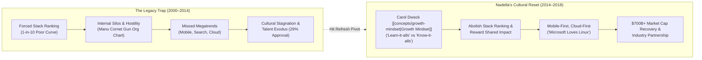
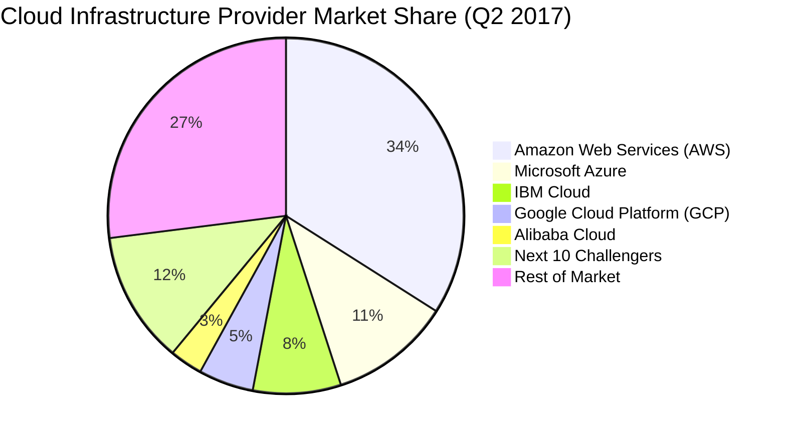
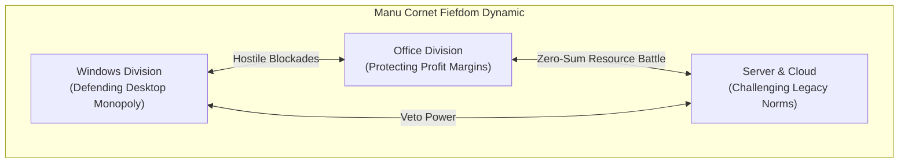
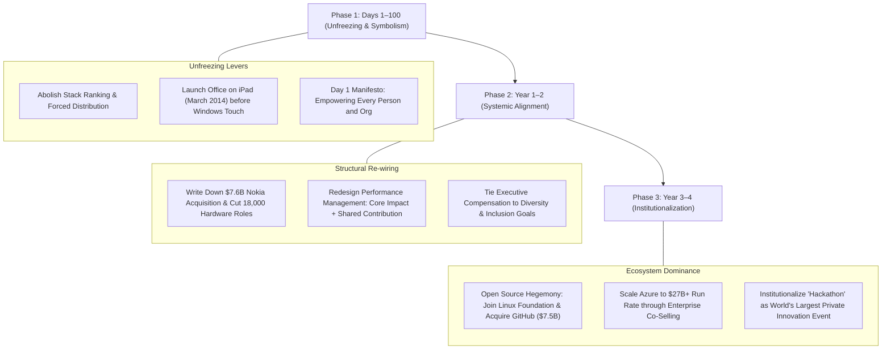

## 🚨 The Executive Dilemma

On February 4, 2014, Satya Nadella was appointed as the third Chief Executive Officer in Microsoft's 39-year history, succeeding Steve Ballmer. Nadella inherited a massively profitable technology titan—generating over $77 billion in annual revenue and doubling profits during Ballmer's 14-year reign—that was nevertheless widely perceived as entering permanent, irreversible strategic decline.

The immediate organizational dilemma was not financial insolvency, but cultural bankruptcy and strategic obsolescence:

1. **The "Lost Decade" (2000–2014)**: Microsoft had missed every major consumer and enterprise computing paradigm shift of the 21st century—mobile smartphones (dominated by Apple iOS and Google Android), search and digital advertising (dominated by Google), tablet computing, and modern social networks. Its stock price had hovered between $25 and $30 for over a decade.
2. **Management by Character Assassination**: Internal collaboration was actively penalized by Microsoft's infamous **stack ranking** performance evaluation system. A forced grading curve (requiring 1 in 10 engineers to be rated as poor regardless of absolute team output) incentivized engineers to sabotage peers, hoard critical code, and focus on political survival rather than customer value.
3. **The "Know-It-All" Culture**: Deeply ingrained arrogance anchored to the historical Windows monopoly created an insular "not invented here" hostility toward external innovation. Ballmer had publicly branded open-source Linux a "cancer that attaches itself to everything it touches." Talented engineers were fleeing to Google, Facebook, and emerging SaaS startups at rates faster than Microsoft could recruit.
4. **Internal Civil War**: Rival divisional leaders managed their business units as independent fiefdoms, famously satirized in Manu Cornet's viral organizational cartoon showing Microsoft divisions aiming handguns at one another.

Nadella faced a critical fork in the road: Should he execute a classic structural restructuring and financial engineering campaign (cutting costs, divesting hardware, executing aggressive stock buybacks), or could an engineer who spent 22 years inside the belly of the beast orchestrate a deep anthropological reset—transforming Microsoft from a culture of "know-it-alls" into a culture of "learn-it-alls"?

---

## 🏢 Enterprise & Industry Background

### 1. From Desktop Hegemony to the Mobile Abyss

Founded in 1975 by Bill Gates and Paul Allen, Microsoft established the personal computer revolution through MS-DOS and Windows. By tying its productivity suite (Microsoft Office) to Windows, Microsoft captured over 90% desktop operating system market share throughout the 1990s.

However, the antitrust battles of the late 1990s and Steve Ballmer's ascension in January 2000 coincided with the tech bubble burst. While Ballmer grew revenues from $23 billion to $78 billion, Microsoft missed consumer mobility. Steve Ballmer famously laughed on camera at the launch of Apple's iPhone in 2007, claiming a $500 phone with no keyboard had no chance of appealing to business customers. By 2014, Windows Phone held less than 3% global smartphone market share, and Microsoft was forced to write down $7.6 billion from its disastrous acquisition of Nokia's mobile handset business.

### 2. The Internal Fiefdoms and the Stack Ranking Trap

Under Ballmer, Microsoft was structured into powerful product divisions:

- Windows & Windows Live
- Server & Tools
- Online Services (Bing)
- Microsoft Business Division (Office)
- Interactive Entertainment (Xbox)

Each division had its own P&L, HR, and marketing teams. Rather than cooperating to build unified customer solutions, divisions actively sabotaged one another. For instance, when an internal team developed an innovative e-book reader in 1998, Office executives killed the initiative because it did not use the Windows desktop software stack.

The stack ranking system made internal politics paramount:

- Every manager was mandated to assign a fixed percentage of ratings: Top (20%), Good (20%), Average (40%), Below Average (10%), Poor (10%).
- High-performing engineers refused to work together on the same project because only one could receive a top rating, while someone in the group was mathematically guaranteed a career-limiting poor rating.
- Former product managers described the workplace as "designing software by committee" and "management by character assassination."

### 3. Satya Nadella: The Consummate Insider

Born in Hyderabad, India in 1967, Nadella joined Microsoft in 1992 after working at Sun Microsystems. Over 22 years, he led server software, Bing search engineering, and the Server and Tools Business (STB). In 2011, Ballmer tasked Nadella with pivoting STB into the cloud—building Microsoft Azure.

Under Nadella's leadership, Azure revenues grew from a negligible base to over $20 billion, establishing Microsoft as the credible enterprise challenger to Amazon Web Services (AWS). Crucially, Nadella accomplished this by breaking Microsoft dogma: he allowed Linux and open-source databases to run natively on Azure servers, recognizing that enterprise customers demanded heterogeneous computing environments.

---

## 📈 Quantitative Exhibits & Financial Breakdown

### Exhibit 1: Evolution of Microsoft Financials & Market Capitalization (2000–2018)

| Metric                           | 2000 (Ballmer Start) |   2011 (Low Morale)   | 2014 (Nadella Start) | 2018 (Case Milestone) |
| :------------------------------- | :------------------: | :-------------------: | :------------------: | :-------------------: |
| **Annual Revenue**               |    $22.96 Billion    |    $69.94 Billion     |    $77.85 Billion    |    $110.36 Billion    |
| **Net Income**                   |    $9.42 Billion     |    $23.15 Billion     |    $22.07 Billion    |   $16.57 Billion\*    |
| **Share Price (Split-Adjusted)** |       ~$35.00        |        ~$26.00        |       ~$36.00        |       ~$101.00        |
| **Market Capitalization**        |    ~$280 Billion     |     ~$220 Billion     |    ~$300 Billion     |   **~$780 Billion**   |
| **CEO Glassdoor Approval**       |         N/A          | **29%** (vs Page 94%) |         46%          |        **95%**        |
| **Commercial Cloud Run Rate**    |          $0          |      Negligible       |     $4.4 Billion     |  **$27.0+ Billion**   |

_\*Note: 2018 GAAP Net Income was temporarily impacted by a one-off $13.7B tax charge related to the US Tax Cuts and Jobs Act; adjusted operational earnings exceeded $35B._

### Exhibit 2: Global Cloud Infrastructure Market Share Benchmark (Q2 2017)

_(Source: Synergy Research Group / London Business School Case Exhibit 2)_

- **Azure Year-over-Year Revenue Growth**: **+93% YoY** (fastest among top enterprise cloud providers, outpacing AWS's +42% growth rate).
- **Strategic Cloud Inflection**: In 2017, commercial cloud gross margin improved from 42% to 57%, demonstrating operational operating leverage and massive scale efficiency.

### Exhibit 3: Manu Cornet's Organizational Structure Cartoon Analysis

In 2011, French cartoonist and software engineer Manu Cornet published an satirical diagram comparing corporate organizational charts:

- **Amazon**: Rigid customer-centric hierarchy with individual functional pods.
- **Google**: Open network web of interconnected product teams.
- **Apple**: Single concentrated nucleus revolving around Steve Jobs.
- **Facebook**: Flat, chaotic social graph with lateral ties.
- **Oracle**: Vast legal department towering over a tiny engineering dot.
- **Microsoft**: Three isolated departmental buildings pointing revolvers and shotguns at each other across courtyards.

The case notes that this cartoon was framed and hung on the walls of Microsoft's Redmond headquarters by engineers as a badge of resigned cynicism—and later cited by Nadella as the exact structural dysfunction that had to be eradicated.

### Exhibit 4: Satya Nadella's Day-1 Memo to All Employees (Feb 4, 2014)

Nadella chose to ground his opening communication not in EBITDA targets, but in philosophical self-examination structured around four questions:

1. **Who am I?** (Personal humility, family grounding, intellectual curiosity, lifelong learning).
2. **Why am I here?** (To change the world through technology that empowers people).
3. **Why are we here?** (Reframing the 1975 mission "A PC on every desk and in every home" to empowering every individual and organization to "do more").
4. **What do we do next?** (Embracing clarity of purpose, ruthlessly prioritizing innovation in a "mobile-first, cloud-first" world, and driving culture change).

### Exhibit 5: Cultural Pillars from _Hit Refresh_ (2017)

Nadella codified the transformation across three interlocking commitments:

- **Customer Obsession**: Shifting from inward-looking divisional battles to deep customer empathy, listening to what clients need rather than dictating what they should buy.
- **Diversity and Inclusion**: Creating an environment where employees bring their authentic selves, actively seeking diverse perspectives to avoid corporate blind spots.
- **One Microsoft**: Eradicating divisional silos, aligning incentive compensation to company-wide performance rather than localized P&L metrics.

---

## ⚖️ Strategic Alternatives Matrix

Upon taking leadership in 2014, Nadella had three distinct strategic postures available to resolve Microsoft's stagnation:

| Strategic Dimension             | Option A: Cultural Reset & [[concepts/growth-mindset                                                                                                                                                    | Growth Mindset]] _(Selected)_                                                                                                                                         | Option B: Pure Structural Reorganization & Cost Cutting                                                                                                           | Option C: Financial Engineering & Cash Extraction |
| :------------------------------ | :------------------------------------------------------------------------------------------------------------------------------------------------------------------------------------------------------ | :-------------------------------------------------------------------------------------------------------------------------------------------------------------------- | :---------------------------------------------------------------------------------------------------------------------------------------------------------------- | ------------------------------------------------- |
| **Core Strategic Thesis**       | Transform internal behavior and human systems from "know-it-alls" to "learn-it-alls"; anchor innovation around customer empathy and cloud ubiquity.                                                     | Break down divisional silos through top-down functional reorganization; slash underperforming units (Nokia, Bing); enforce strict headcount targets.                  | Accept mature utility status; milk Windows and Office cash cows; execute massive debt-funded stock buybacks and dividend distributions.                           |
| **Pros & Strategic Upside**     | - Revitalizes innovation and talent attraction. - Rebuilds cross-functional collaboration. - Opens massive addressable markets (open source, iOS, Android). - Sustainable long-term growth. | - Immediate reduction in operational overhead. - Clear lines of functional accountability. - Signals decisive executive action to Wall Street within 90 days. | - Immediate boost to Earnings Per Share (EPS). - Cheered by activist investors (ValueAct Capital). - Requires minimal cultural or operational disruption. |
| **Cons & Implementation Risks** | - Culture change is notoriously slow, intangible, and difficult to measure. - Risk of cynicism among cynical legacy veterans. - Requires high executive vulnerability.                          | - Treats symptoms rather than root causes. - Functional reorganization triggers intense political turf wars. - Does not solve toxic evaluation incentives.    | - Guarantees long-term irrelevance. - Starves R&D in AI and cloud infrastructure. - Accelerates brain drain of top software engineers.                    |
| **Impact on Stack Ranking**     | **Abolished completely**; replaced with holistic impact reviews assessing individual output, shared contribution, and leverage of others' work.                                                         | Retained or tweaked into regional quotas to maintain performance pressure.                                                                                            | Intensified to identify bottom 10% for annual severance programs.                                                                                                 |
| **Platform Ecosystem Posture**  | **Multi-Platform**: Launch Office on Apple iPad and Android; join Linux Foundation; embrace open-source GitHub.                                                                                         | Proprietary Windows Lock-in: Restrict new Office features to Windows devices to force hardware adoption.                                                              | Channel Preservation: Maintain legacy OEM licensing agreements with PC manufacturers.                                                                             |
| **Organizational Feasibility**  | High if led by a respected insider who understands engineering pain points and models emotional intelligence.                                                                                           | Medium; high risk of bureaucratic paralysis and passive-aggressive resistance.                                                                                        | Low sustainability; triggers rapid terminal decline similar to Kodak, BlackBerry, or Sears.                                                                       |

---

## 🎯 Executive Recommendation & Implementation Roadmap

Nadella decisively executed **Option A**, using Carol Dweck's [[concepts/growth-mindset|growth mindset]] framework not as a human resources slogan, but as the operational blueprint for an enterprise turnaround.

### 1. Phased Transformation Roadmap

### 2. Concrete Managerial Levers Executed by Nadella

#### A. Re-engineering Performance Management (Abolishing Stack Ranking)

In November 2013 (prior to appointment, spearheaded with HR chief Kathleen Hogan), Microsoft formally terminated stack ranking. In its place, Hogan and Nadella designed **Connects**:

- Regular, forward-looking coaching conversations rather than backward-looking post-mortems.
- **The Tripartite Impact Rubric**: Employees were evaluated on three equal dimensions:
  1. _Individual Results_: What business outcomes did you directly deliver?
  2. _Leveraging Others_: How did you build upon the ideas, tools, or code of teammates across Microsoft?
  3. _Contributing to Others_: How did you actively help other teams succeed?
- _Managerial Outcome_: Sabotaging a peer now mathematically damaged one's own performance rating, because "contributing to others" carried 33% of the total evaluation weight.

#### B. The [[concepts/psychological-safety|Psychological Safety]] Crucible: The Tay AI Fiasco (March 2016)

In March 2016, Microsoft released **Tay**, an experimental AI Twitter chatbot designed to learn from conversational engagement with youth audiences. Within 24 hours, internet trolls exploited Tay's machine learning vulnerabilities, training the bot to post misogynistic, racist, and anti-Semitic tweets. Under Ballmer-era norms, the engineering team would have been publicly humiliated, reprimanded, or fired.

Nadella took the opposite approach. He sent a personal email to the entire Tay engineering team:

> _"Keep pushing, and know that I am with you. The key is to keep learning and keep improving. Take the criticism in stride, figure out what went wrong, and make the system better."_

By transforming a public relations disaster into a [[concepts/psychological-safety|psychological safety]] case study, Nadella proved that the [[concepts/growth-mindset|growth mindset]] was genuine. That same team iterated to build Microsoft's enterprise cognitive services and world-class AI safety filters, laying the foundation for Microsoft's multi-billion dollar partnership with OpenAI.

#### C. Humility in Public Leadership: The Grace Hopper Misstep (October 2014)

At the Grace Hopper Celebration of Women in Computing, interviewer Maria Klawe asked Nadella what advice he had for women uncomfortable asking for pay raises. Nadella responded that women should not ask for raises, but instead have "faith that the system will give you the right raises as you go along" and rely on "good karma."

The backlash was swift and fierce. Rather than issuing a defensive corporate PR statement or blaming the interviewer, Nadella sent an unreserved apology to Microsoft staff that evening:

> _"I answered that question completely wrongly... I believe men and women should get equal pay for equal work. And when it comes to advice on raises, if you think you deserve a raise, you should just ask."_

Nadella used his own failure as a visible teaching moment for the [[concepts/growth-mindset|growth mindset]], subsequently tying senior executive annual bonuses directly to measurable gender and minority representation and promotion milestones.

---

## 🎙️ Classroom Cold-Call & Boardroom Defense

### 1. Opening Cold-Call Script (30-Second Executive Summary)

> **Professor**: _"You are in Satya Nadella's shoes on February 4, 2014. Microsoft has $77B in revenue and billions in free cash flow, but your stock price is dead and your culture is toxic. What is your first move?"_
>
> **Student Response**: _"My first move is to dismantle the internal incentive structure that makes collaboration career suicide: abolish stack ranking immediately. Steve Ballmer's financial success masked cultural decay. Microsoft was operating under a fixed mindset of 'know-it-alls,' where engineers hoarded ideas to avoid the bottom 10% forced curve. I would replace stack ranking with an evaluation rubric that weights 'contributing to others' and 'leveraging others' equally with individual output. Simultaneously, I would signal a multi-platform pivot by launching Office on the Apple iPad before Windows touch tablets, proving to our customers and developers that Microsoft serves their productivity rather than defending a legacy operating system monopoly."_

### 2. Anticipated Faculty Challenges & Counter-Defenses

#### Challenge A: _"Isn't '[[concepts/growth-mindset|Growth Mindset]]' just soft HR jargon to distract from massive layoffs and cloud capital expenditure?"_

- **Defense**: The financial record disproves this cynicism. Nadella wrote down $7.6B from the Nokia deal and eliminated 18,000 hardware jobs within his first six months. The [[concepts/growth-mindset|growth mindset]] was not a substitute for tough operational decisions; it was the mechanism that enabled remaining employees to pivot without organizational paralysis. By measuring whether employees leveraged and contributed to others, Microsoft transformed Azure from an insular Windows server clone into an open cloud where over 50% of virtual machines run Linux. The [[concepts/growth-mindset|growth mindset]] directly drove the commercial cloud run rate from $4.4B in 2014 to over $27B in 2018.

#### Challenge B: _"Why couldn't an external CEO have done this faster?"_

- **Defense**: An outsider would have lacked the deep credibility required to untangle Microsoft's engineering fiefdoms. As an insider who spent 22 years building server architectures and search infrastructure, Nadella possessed technical legitimacy. Engineers knew Nadella was "one of them." Furthermore, an outsider would have likely executed a financial restructuring or spun off Xbox and Bing (as Wall Street actively demanded in 2014), destroying the cross-functional ecosystem synergies that powered Microsoft's subsequent enterprise AI dominance.

### 3. Indonesian Enterprise & BUMN Crucible Parallels

- **BUMN Silo Paralysis**: State-owned enterprises (BUMN) in Indonesia frequently suffer from the same "Manu Cornet gun-pointing" dynamic, where holding company subsidiaries (e.g., in mining, healthcare, or logistics) fiercely compete against sibling entities for government budget allocations rather than collaborating for national market share.
- **AKHLAK Alignment**: Nadella's "Learn-it-all" [[concepts/growth-mindset|growth mindset]] mirrors the **Amanah, Kompeten, Harmonis, Loyal, Adaptif, Kolaboratif (AKHLAK)** core values mandated by the Ministry of BUMN. However, as demonstrated by the SBM ITB Leadership Outlook study, Indonesian firms chronically evaluate operational execution (Leadership Impact) while neglecting transformative collaboration and social contribution. Instilling a [[concepts/growth-mindset|growth mindset]] in Indonesian SOEs requires moving beyond compliance sloganeering to redesigning executive key performance indicators (KPIs) that penalize internal bureaucratic sabotage.

---

## 🔗 Knowledge Graph & Curriculum Bridges

- **Parent Lecture**: [[courses/mk1-organizational-behavior-managing-people/week-04/index|Week 04 Master Lecture Hub: Leadership & Culture Transformation]]
- **Applied Concepts**:
  - [[concepts/growth-mindset|Growth Mindset vs. Fixed Mindset (Carol Dweck)]]
  - [[concepts/emotional-intelligence|Emotional Intelligence in Executive Leadership (Daniel Goleman)]]
- **Related Course Readings**:
  - [[courses/mk1-organizational-behavior-managing-people/week-04/reading-what-makes-a-leader|What Makes a Leader? (Daniel Goleman, HBR)]]
  - [[courses/mk1-organizational-behavior-managing-people/week-04/reading-leadership-outlook-2026|Leadership Outlook 2026: SBM ITB & DDI Research]]
- **Syndicate 9 Debriefs**:
  - [[courses/mk1-organizational-behavior-managing-people/week-04/assignment-pre-leadership-outlook-eq|Pre-Assignment: SBM ITB Leadership Gap & Goleman EQ Analysis]]
  - [[courses/mk1-organizational-behavior-managing-people/week-04/assignment-post-leadership-transformation|Post-Assignment: Synthesis of Nadella Case, CEO Excellence & Leadership Science]]
- **Return to Course Overview**: [[courses/mk1-organizational-behavior-managing-people/index|MK1 Course Overview: Organizational Behaviour & Managing People]]
