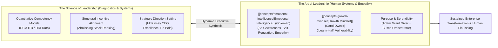
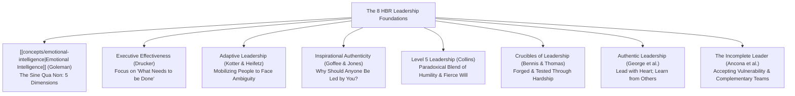
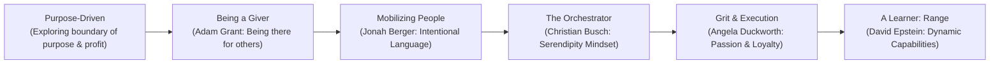
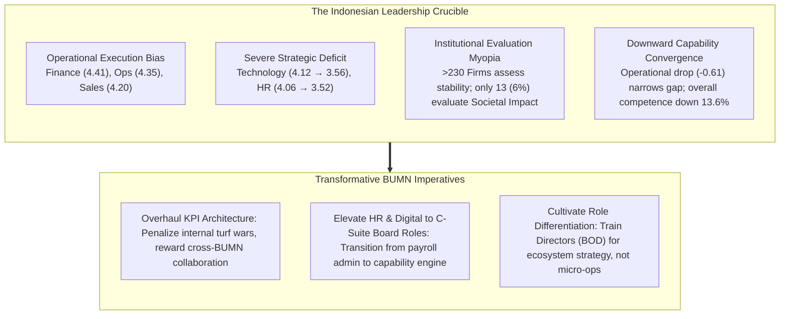

> [!NOTE] Curricular & Faculty Metadata
>
> - **Course:** MK1 Organizational Behaviour & Managing People — Week 04
> - **Teaching Team:** Muhammad Yorga Permana, Ph.D., Widhyawan Prawiraatmadja, Ph.D., Dr. Ir. Madju Yuni Ros Bangun, Yudo Anggoro, Ph.D.
> - **Primary Curricular Spine:** `Week 4 - Leadership (Student Version).pdf` (10 core slide exhibits)
> - **Direct Satellites & Problem Sets:**
>   - [[courses/mk1-organizational-behavior-managing-people/week-04/case-satya-nadella-microsoft|Case Study: Satya Nadella at Microsoft — Instilling a [[concepts/growth-mindset|Growth Mindset]]]]
>   - [[courses/mk1-organizational-behavior-managing-people/week-04/reading-what-makes-a-leader|Academic Reading: What Makes a Leader? (Daniel Goleman, HBR)]]
>   - [[courses/mk1-organizational-behavior-managing-people/week-04/reading-leadership-outlook-2026|Academic Reading: Leadership Outlook 2026 (SBM ITB & DDI Research)]]
>   - [[courses/mk1-organizational-behavior-managing-people/week-04/assignment-pre-leadership-outlook-eq|Pre-Assignment: SBM ITB Leadership Gap & Goleman EQ Analysis]]
>   - [[courses/mk1-organizational-behavior-managing-people/week-04/assignment-post-leadership-transformation|Post-Assignment: Synthesis of Nadella Case, CEO Excellence & Leadership Science]]

---

## 1. Executive Overview & Foundations of Transformative Leadership

The central inquiry of Week 04 confronts an age-old executive paradox: **Is leadership fundamentally an art or an empirical science?**

Traditional management theory treated leadership as a science of control—optimizing financial controls, maximizing throughput, and enforcing rigid operational compliance. Yet contemporary empirical data decisively demonstrates that firms governed purely through operational mechanics frequently implode. An organization can double profits, triple revenues, and strictly hit every quarterly budget, yet drift into catastrophic strategic obsolescence because its internal culture has become toxic, fearful, and insular.

This dynamic is demonstrated across two pivotal curricular lenses in Week 04:

1. **The Global Tech Titan Crucible (Satya Nadella at Microsoft)**: How Microsoft stagnated throughout its "lost decade" (2000–2014) under Steve Ballmer despite doubling profits, because a hyper-competitive **stack ranking** system turned engineers into political infighters who sabotaged colleagues rather than innovating for customers. Satya Nadella's multi-hundred-billion-dollar turnaround was built upon an anthropological reset: shifting 120,000 employees from a fixed mindset of "know-it-alls" to a Carol Dweck [[concepts/growth-mindset|growth mindset]] of "learn-it-alls."
2. **The Indonesian Enterprise Reality (SBM ITB Leadership Outlook 2026)**: Comprehensive research across ~1,000 technical assessments and ~15,000 leadership evaluations reveals a systemic **downward capability convergence** across Indonesian state-owned and private enterprises. Leaders demonstrate high competence in traditional operational domains (Finance, Operations, Commercial), but suffer severe deficits in transformative capabilities—specifically **Technology/Digital** and **Human Resources (SDM)**. Because corporate evaluation systems overwhelmingly reward operational stability while ignoring innovation and social impact, Indonesian firms risk repeating Microsoft's pre-2014 stagnation.

Transformational leadership requires the synthesis of both dimensions: **science** to diagnose capability gaps and design aligned incentive architectures, and **art**—grounded in Daniel Goleman's [[concepts/emotional-intelligence|emotional intelligence]]—to cultivate empathy, [[concepts/psychological-safety|psychological safety]], and authentic purpose.

---

## 2. Theoretical Architecture & Core Frameworks

### 1. The Eight HBR Perspectives on Leadership

The lecture architecture builds upon eight foundational leadership traditions codified across decades of Harvard Business Review research:

### 2. McKinsey CEO Excellence: Setting Direction & "Be Bold"

Drawing from McKinsey & Company's study of the world's most successful CEOs (_CEO Excellence_, Carolyn Dewar, Scott Keller, Vikram Malhotra):

- **Setting the Direction**: High-performing executives do not tweak operational margins; they embrace bold strategic visions. They reallocate more than 50% of corporate capital over their tenure into future-defining strategic vectors.
- **The Operational Trap**: Average CEOs focus on downside defense and incremental quarterly compliance. Exceptional leaders actively embrace calculated strategic risks, pivoting resources into high-growth horizons before legacy cash cows enter terminal decline.

### 3. The Six Pillars of Modern Executive Leadership

The core lecture slides synthesize modern leadership into six interconnected, actionable pillars:

#### Pillar 1: Purpose-Driven Leadership

> _"Being authentically purpose-driven can be a powerful business strategy. But you can’t decide to be authentic because it will be good business. That wouldn’t be authentic. Becoming authentically purpose-driven is all about exploring the boundary between purpose and profit—about choosing to do the right thing and then fighting hard to find the business case to make it possible."_ (p. 94–95)

#### Pillar 2: Being a Giver (Adam Grant)

- In _Give and Take_, Adam Grant demonstrates that professionals operate under three reciprocity styles: Takers, Matchers, and Givers.
- While self-sacrificing givers can burn out at the bottom of organizations, **strategic givers dominate the very top of executive success metrics**.
- As Grant notes: _"You never know where somebody’s going to end up. It’s not just about building your reputation; it really is about being there for other people."_

#### Pillar 3: Mobilizing People with Intentional Language (Jonah Berger)

- In _Magic Words_, Jonah Berger demonstrates that leadership influence is mediated through specific linguistic choices:
  - **Agency over Passivity**: Asking _"Can you be a voter?"_ rather than _"Will you vote?"_ leverages identity-based commitment.
  - **Concreteness over Abstraction**: Abstract goals (_"Let's be more innovative"_) paralyze execution; concrete directives (_"Spend 30 minutes every Friday testing one new customer workflow"_) mobilize action.
  - **Emotional Roller Coaster**: Stories that balance vulnerability and hardship with triumph produce significantly higher cognitive and emotional retention.

#### Pillar 4: The Orchestrator & Serendipity Mindset (Christian Busch)

- Serendipity is not blind, passive luck; it is an active capability.
- In _The Serendipity Mindset_, Christian Busch defines serendipity as **active smart luck**:
  $$\mathbf{\text{Serendipity}} = \mathbf{\text{Random Spark / Trigger}} \times \mathbf{\text{Human Agency (Connecting the Dots)}}$$
- Leaders act as institutional bridge-builders, observing unconnected data points across disparate business units and orchestrating cross-functional synergies.

#### Pillar 5: Grit & Execution Discipline (Angela Duckworth)

- In _Grit: The Power of Passion and Perseverance_, Angela Duckworth proves that talent is over-emphasized while effort and loyalty are under-valued:
  $$\text{Talent} \times \text{Effort} = \text{Skill} \quad \implies \quad \text{Skill} \times \text{Effort} = \text{Achievement}$$
- Grit is not merely working hard; it is staying loyal to a high-order enterprise mission across years of operational setbacks: _"It's doing what you love, but not just falling in love—staying in love."_

#### Pillar 6: A Learner with Dynamic Capability & Range (David Epstein)

- In _Range: Why Generalists Triumph in a Specialized World_, David Epstein challenges the hyper-specialization cult (the "10,000-hour rule" in kind learning environments):
- In volatile, wicked business environments, over-specialized experts develop cognitive tunnel vision. Exceptional executive leaders maintain **breadth, diverse experiences, interdisciplinary curiosity, and delayed specialization**, enabling them to synthesize insights across engineering, human behavior, finance, and geopolitics.

---

## 3. Managerial Crucible: Indonesian Enterprise & BUMN Context

Applying these global frameworks to the Indonesian enterprise landscape exposes significant structural friction, illuminated by SBM ITB's _Leadership Outlook 2026_ report:

### 1. The BUMN Operational Trap

Indonesian state-owned enterprises (BUMN) control strategic national assets across banking, mining, energy, logistics, and agriculture. However, because Directors and Commissioners face severe regulatory and political scrutiny, leadership defaults to **defensive compliance and short-term operational execution**. Executives are heavily evaluated on immediate budget compliance and audit readiness (_Leadership Impact_ and _Business Skills_), while risk-taking experimentation (_Innovation under Uncertainty_) and long-term societal value creation (_Contributing to Society_) are actively disincentivized.

### 2. Resolving Downward Capability Convergence

The narrowing gap between Operational and Strategic competencies from 0.23 in 2022 to 0.17 in 2024 is a flashing warning sign of capability decay. To reverse this downward convergence, holding companies like **Danantara**, **MIND ID**, and **PTPN Holding** must execute an anthropological reset modeled on Satya Nadella's Microsoft playbook:

- **Abolishing Compliance Fear**: Creating [[concepts/psychological-safety|psychological safety]] so project leaders can report experimental failures without fear of criminalization or career destruction.
- **Rewiring Executive Incentives**: Weighting cross-functional collaboration and digital talent development equally with short-term operational targets.

---

## 4. Cross-Functional Implementation & Strategic Trade-offs

Executing culture and leadership transformation triggers acute inter-departmental tensions:

| Functional Conflict                       | Operational Defense View (Status Quo)                                                          | Transformational Strategic View ([[concepts/growth-mindset                                                   \| Growth Mindset]])          | Resolution Mechanism                                                                                                                     |
| :---------------------------------------- | :--------------------------------------------------------------------------------------------- | :----------------------------------------------------------------------------------------------------------------------------------------- | :--------------------------------------------------------------------------------------------------------------------------------------- |
| **Finance vs. R&D / Digital**             | "Cut digital experimentation budgets to safeguard this quarter's EBITDA and dividend payout."  | "Starving digital and talent development leads to permanent obsolescence within 5 years."                                                  | Ring-fence transformative capital expenditure; evaluate digital bets on a multi-year milestone gate rather than immediate quarterly P&L. |
| **Operations vs. Cross-Functional Teams** | "Engineers must dedicate 100% of working hours to plant throughput and immediate maintenance." | "Engineers must allocate 15% time to cross-functional hackathons and customer empathy visits."                                             | Adopt Google's 20% time or Microsoft's annual enterprise Hackathon to spark serendipitous cross-silo innovation.                         |
| **HR vs. Line Management**                | "HR handles payroll, administrative contracts, and disciplinary sanctions."                    | "Strategic HR co-designs culture, builds succession pipelines, and coaches [[concepts/emotional-intelligence \| emotional intelligence]]." | Elevate Chief Human Capital Officers (CHCO) to full voting Board of Directors status; tie executive bonuses to talent retention.         |

---

## 📚 Required Readings & In-Depth Satellites

| Document Title                                                                                 | Author / Institution                                              | Core Focus / Methodological Contribution                                                                                                                                                                                                                            | Study Note                                                                                                                       |
| :--------------------------------------------------------------------------------------------- | :---------------------------------------------------------------- | :------------------------------------------------------------------------------------------------------------------------------------------------------------------------------------------------------------------------------------------------------------------ | :------------------------------------------------------------------------------------------------------------------------------- |
| \*\*Satya Nadella at Microsoft: Instilling a [[concepts/growth-mindset \| Growth Mindset]]\*\* | Prof. Herminia Ibarra et al. (London Business School / HBP, 2018) | The lost decade, stack ranking abolition, cloud/AI pivot, and cultural turnaround from "know-it-alls" to "learn-it-alls."                                                                                                                                           | [[courses/mk1-organizational-behavior-managing-people/week-04/case-satya-nadella-microsoft\|Open Case Study Dossier]]            |
| **What Makes a Leader?**                                                                       | Daniel Goleman (Harvard Business Review, 1998/2004)               | [[concepts/emotional-intelligence                                                                                                    \| Emotional Intelligence]] as the _sine qua non_ of leadership; threshold capabilities vs differentiators; 5 core dimensions. | [[courses/mk1-organizational-behavior-managing-people/week-04/reading-what-makes-a-leader\|Open Deep-Dive Note]]                 |
| **Leadership Outlook 2026**                                                                    | SBM ITB Leadership Research & Daya Dimensi Indonesia (2025)       | Empirical study across ~1,000 technical and ~15,000 leadership BUMN data points; downward convergence; operational vs strategic gap.                                                                                                                                | [[courses/mk1-organizational-behavior-managing-people/week-04/reading-leadership-outlook-2026\|Open Deep-Dive Note]]             |
| **Pre-Assignment Debrief: Leadership Outlook & EQ**                                            | F9 (Class F / Syndicate 9) & the Portal Maintainer                | Comprehensive analytical debrief on the Indonesian leadership gap and methodological critique of Goleman's 90% claim.                                                                                                                                               | [[courses/mk1-organizational-behavior-managing-people/week-04/assignment-pre-leadership-outlook-eq\|Open Assignment Guide]]      |
| **Post-Assignment Debrief: Leadership Art vs Science**                                         | F9 (Class F / Syndicate 9) & the Portal Maintainer                | Full post-class synthesis incorporating McKinsey CEO Excellence, Range, and Satya Nadella's tangible executive actions.                                                                                                                                             | [[courses/mk1-organizational-behavior-managing-people/week-04/assignment-post-leadership-transformation\|Open Assignment Guide]] |

---

## 📂 Primary Source Media & Digital Archives

| Material Title                                                                                       | Media Type                       | Direct Repository Reference                                                                                               |
| :--------------------------------------------------------------------------------------------------- | :------------------------------- | :------------------------------------------------------------------------------------------------------------------------ |
| **Week 4 - Leadership (Student Version)**                                                            | Presentation Slides (`.pdf`)     | `archive/courses/mk1/week-04/Week 4 - Leadership (Student Version).pdf`                                                   |
| \*\*Satya Nadella at Microsoft: Instilling a [[concepts/growth-mindset \|       Growth Mindset]]\*\* | Case Study Document (`.pdf`)     | `archive/courses/mk1/week-04/Satya Nadella at Microsoft\_ instilling a [[concepts/growth-mindset \| growth mindset]].pdf` |
| **What Makes a Leader?**                                                                             | HBR Reading (`.pdf`)             | `archive/courses/mk1/week-04/What Makes a Leader.pdf`                                                                     |
| **Leadership Outlook 2026**                                                                          | SBM ITB Research Report (`.pdf`) | `archive/courses/mk1/week-04/Leadership Outlook 2026.pdf`                                                                 |
| **Pre-Assignment Week 4 Prompt**                                                                     | Assignment Prompt (`.pdf`)       | `archive/courses/mk1/week-04/Pre Assignment Week 4.pdf`                                                                   |
| **Syndicate 9 Pre-Assignment Submission**                                                            | Student Archive (`.docx`)        | `archive/courses/mk1/week-04/Syndicate 9 - Pre Assignment Week 4.docx`                                                    |
| **Syndicate 9 Post-Assignment Submission**                                                           | Student Archive (`.docx`)        | `archive/courses/mk1/week-04/Syndicate 9 - Post Assignment Week 4.docx`                                                   |

---

## 🔗 Knowledge Graph & Curriculum Bridges

- **Featured Frameworks in Knowledge Matrix**:
  - [[concepts/growth-mindset|Growth Mindset vs. Fixed Mindset (Carol Dweck)]]
  - [[concepts/emotional-intelligence|Emotional Intelligence in Executive Leadership (Daniel Goleman)]]
- **Theorist & Author Profiles**:
  - Daniel Goleman (Psychologist & Author)
  - [[entities/satya-nadella|Satya Nadella (CEO of Microsoft)]]
  - Prof. Herminia Ibarra (London Business School)
- **Previous Curricular Module**: [[courses/mk1-organizational-behavior-managing-people/week-03/index|Week 03: Employee Motivation, Equity Theory & Nohria [[concepts/four-drive-model|Four-Drive Model]]]]
- **Next Curricular Module**: [[courses/mk1-organizational-behavior-managing-people/week-05/index|Week 05: High-Performing Teams, [[concepts/psychological-safety|Psychological Safety]] & [[concepts/transactional-analysis|Transactional Analysis]]]]
- **Return to Course Overview**: [[courses/mk1-organizational-behavior-managing-people/index|MK1 Course Overview: Organizational Behaviour & Managing People]]
