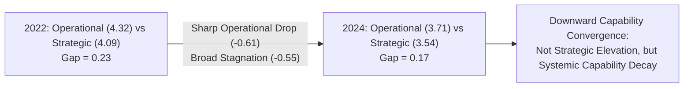

## 📄 Executive Synopsis & Context

- **Full Academic Citation**: SBM ITB & Daya Dimensi Indonesia. (2025). _Leadership Outlook 2026: Tantangan dan Strategi Pengembangan Kepemimpinan di Indonesia_. Bandung & Jakarta: Direktorat Pendidikan Profesional Berkelanjutan SBM ITB & PT Daya Dimensi Indonesia.
- **Institutional Background**:
  - **SBM ITB (Sekolah Bisnis dan Manajemen Institut Teknologi Bandung)**: Premier Indonesian business school conducting empirical leadership research across enterprise and public sectors.
  - **Daya Dimensi Indonesia (DDI)**: Leading Indonesian leadership consulting and assessment firm, strategic affiliate of Development Dimensions International (DDI global).
- **Empirical Dataset Scope**:
  - The study analyzes an unprecedented empirical dataset comprising approximately **1,000 BUMN technical competency assessments** and **15,000 BUMN leadership competency assessment data points** collected between 2020 and 2025.
  - State-Owned Enterprises (BUMN) serve as the representative proxy for national enterprise capability due to their colossal balance sheets, stewardship of critical strategic infrastructure, and central role in driving national GDP and state fiscal revenue.
- **Core Thesis**: Indonesian enterprise leadership suffers from a severe, institutionalized structural imbalance: leaders demonstrate strong mastery in operational execution (Finance, Operations, Commercial), but exhibit chronic, persistent deficits in strategic transformation capabilities—specifically **Technology/Digital** and **Human Resources (SDM)**. Furthermore, this gap is actively reinforced by organizational assessment systems that measure short-term operational stability while almost entirely ignoring transformative social impact and adaptive innovation.

```mermaid
flowchart LR
    subgraph OperationalBias["Operational Execution Bias (High Mastery)"]
        direction TB
        Fin["Finance & Cost Control"]
        Ops["Operational Throughput"]
        Com["Commercial Sales Execution"]
    end

    subgraph EvaluationSystem["Corporate Evaluation System (Stability Focus)"]
        direction TB
        Eval1["Leadership Impact (>230 Firms)"]
        Eval2["Business Skills (>230 Firms)"]
        Eval3["Interpersonal Effectiveness (>230 Firms)"]
    end

    subgraph StrategicDeficit["Strategic Transformation Deficit (Lagging)"]
        direction TB
        Dig["Technology & Digital Acumen (Rank 4/5)"]
        HR["Strategic Talent & HR (Rank 4/5)"]
        Soc["Contributing to Society (Only 13 Firms / 6%)"]
    end

    OperationalBias --> EvaluationSystem
    EvaluationSystem -.->|"Under-invests & Ignores"| StrategicDeficit
    StrategicDeficit -->|"Threatens Long-term Survival"| Risk["Downwards Capability Convergence"]
```

---

## 🧠 Complete Conceptual Architecture

### 1. The Operational vs. Strategic Competency Imbalance

The report categorizes enterprise technical competencies into two core functional groups:

1. **Operational Competency Group**: Finance, Operations, and Commercial. These represent traditional functional execution domains focused on meeting quarterly budgets, managing plant workflows, and driving top-line sales.
2. **Strategic Competency Group**: Technology/Digital and Human Capital/HR. These represent transformative enablers required to integrate new digital business models, cross-functional agile teams, and sustainable talent pipelines.

Empirically, Indonesian executives across all sectors consistently achieve high mastery scores in Operational competencies. Conversely, Technology and HR rank dead last across the entire multi-year tracking period.

### 2. The Myth of the Narrowing Gap: Downward Convergence

Between 2022 and 2024, the mathematical gap between Operational and Strategic competencies narrowed from **0.23 points to 0.17 points**.

Superficial analysis might interpret this as evidence that Indonesian enterprises successfully accelerated digital and human capital readiness. However, the empirical data exposes a far more concerning reality—**downward capability convergence**:

$$
\begin{aligned}
\text{Operational Group Average: } & 4.32 \text{ (2022)} \longrightarrow 3.71 \text{ (2024)} \quad (\Delta = -0.61 \text{ points}) \\
\text{Strategic Group Average: } & 4.09 \text{ (2022)} \longrightarrow 3.54 \text{ (2024)} \quad (\Delta = -0.55 \text{ points}) \\
\text{Overall Technical Drop (2022–2025): } & -0.58 \text{ points } (-13.6\%)
\end{aligned}
$$

The gap narrowed not because Strategic competencies surged, but because **Operational competencies experienced a severe drop**, while Strategic capabilities remained locked at the bottom. When external volatility accelerated post-pandemic, organizations failed to adapt because they lacked digital and talent infrastructure, causing operational routines themselves to degrade under pressure.

### 3. Institutionalized Evaluation Myopia: The 7 Leadership Clusters

The report cross-references 15,000 assessment data points across DDI's **7 Core Leadership Clusters** from 2020 to 2025:

- **Over-Evaluated Clusters (Stability & Execution)**:
  - _Leadership Impact_: Evaluated by over 230 enterprises.
  - _Business Skills_: Evaluated by over 230 enterprises.
  - _Interpersonal Effectiveness_: Evaluated by over 220 enterprises.
- **Under-Evaluated Clusters (Transformation & Social Contribution)**:
  - _Contributing to Society_: Evaluated by **only 13 enterprises (approximately 6% of baseline firms)**.
  - _Innovation under Uncertainty_: Evaluated by fewer than 15% of firms.
  - _Risk Management & Strategic Agility_: Evaluated by fewer than 20% of firms.

_Managerial Takeaway_: Organizations evaluate what they value. By anchoring managerial assessment almost exclusively to stability and immediate operational control, Indonesian enterprises unintentionally disincentivize leaders from making bold, transformational bets.

---

## 🏢 Real-World Executive Case Vignettes

### 1. The Cross-Sectoral Maturity Divide

The study benchmarks leadership capability across three economic sectors:

- **Services Sector (Banking, Telecommunications, Fintech)**: Demonstrates the highest leadership maturity and strategic adaptability. Fast market feedback loops and intense private-sector competition compel service leaders to invest in digital platforms and customer experience.
- **Mixed Sector (Infrastructure, Logistics, Energy)**: Demonstrates solid operational execution but struggles with bureaucratic decision-making and cross-functional friction.
- **Goods / Manufacturing Sector (Plantations, Heavy Industry, Manufacturing)**: **Lags significantly behind across all leadership dimensions.** Manufacturing and primary commodity firms remain trapped in legacy hierarchical management, vulnerable to technological disruption and commodity price shocks.

### 2. The Hierarchy Trap: Lack of Role Differentiation

When analyzing competency profiles across executive layers—**Board of Directors (BOD), BOD-1 (Executive VP / Group Head), BOD-2 (Senior VP / Division Head), and BOD-3 (Managerial Tier)**:

- While BOD and BOD-1 show slightly higher personal resilience and composure under pressure, and BOD-3 shows emerging social attunement, **the competency profiles across all four tiers are remarkably uniform**.
- _The Executive Hazard_: Indonesian corporations promote managers based on tenure and operational firefighting. Consequently, an executive promoted from Division Head (BOD-2) to Director (BOD) continues practicing the exact same micro-operational behaviors rather than shifting to long-term strategic stewardship and ecosystem orchestration.

### 3. The Generational Paradigm Shift

- **Baby Boomers**: Grounded leadership legitimacy in personal grit, hierarchical endurance, and command-and-control authority.
- **Gen Z & Emerging Millennials**: Demand **purpose-driven leadership**, environmental and social sustainability (ESG), work-life integration, and participatory psychological safety.
- _Crucible_: Indonesian enterprises whose senior leadership fails to articulate authentic purpose struggle with double-digit voluntary turnover among top young digital and engineering talent.

---

## 🛠️ Complete Diagnostic Worksheets & Toolkits

### Indonesian Enterprise Leadership Gap Diagnostic Matrix

Assess an organization's leadership development posture against SBM ITB benchmarks:

| Diagnostic Dimension         | Traditional Operational Default (High Risk)                                                  | Transformational Horizon (2026 Target)                                                         | Self-Audit Score (1–5) |
| :--------------------------- | :------------------------------------------------------------------------------------------- | :--------------------------------------------------------------------------------------------- | :--------------------- |
| **Competency Priority**      | Over-indexes on Finance, Operations, and immediate commercial sales targets.                 | Elevates Digital Acumen and Strategic HR to core C-suite growth engines.                       | [ ]                    |
| **Measurement Architecture** | 90%+ of KPIs measure quarterly stability, budget variance, and compliance.                   | Evaluates innovation under ambiguity, cross-functional collaboration, and social contribution. | [ ]                    |
| **Role Differentiation**     | Directors (BOD) micromanage daily operational disputes; identical skills across tiers.       | Clear separation: BOD focuses on enterprise ecosystem; VPs execute operations.                 | [ ]                    |
| **Digital Integration**      | IT is treated as a back-office maintenance cost center; tech leaders excluded from strategy. | Technology leaders co-design business models; digital literacy is mandatory for all BOD.       | [ ]                    |
| **Talent Strategy**          | HR is treated as administrative payroll/industrial relations; reactive recruitment.          | HR leads strategic capability building, culture architecture, and executive succession.        | [ ]                    |

---

## 📊 Comparative Exhibits & Framework Tables

### Table 1: Technical Competency Scores Across Multi-Year Tracking (2022–2025)

| Technical Competency Dimension | 2022 Score | 2024 Score |     2025 Trend     | Multi-Year Relative Rank |        Strategic Classification        |
| :----------------------------- | :--------: | :--------: | :----------------: | :----------------------: | :------------------------------------: |
| **Finance**                    |    4.41    |    3.82    | Declining (-13.4%) |        **Rank 1**        |            Operational Core            |
| **Operations**                 |    4.35    |    3.74    | Declining (-14.0%) |        **Rank 2**        |            Operational Core            |
| **Commercial**                 |    4.20    |    3.58    | Declining (-14.7%) |        **Rank 3**        |            Operational Core            |
| **Technology / Digital**       |    4.12    |    3.56    | Stagnant (-13.6%)  |        **Rank 4**        | **Strategic Transformation (Deficit)** |
| **Human Resources (SDM)**      |    4.06    |    3.52    | Stagnant (-13.3%)  |        **Rank 5**        | **Strategic Transformation (Deficit)** |
| **Average Across All Aspek**   |  **4.23**  |  **3.65**  | **-0.58 (-13.6%)** |            —             |     **Systemic Capability Decay**      |

### Table 2: Organizational Assessment Bias across 7 Leadership Clusters

| Leadership Cluster               | Evaluation Prevalence (Firms) | Assessment Focus                               | Strategic Implication for Enterprise Transformation                             |
| :------------------------------- | :---------------------------: | :--------------------------------------------- | :------------------------------------------------------------------------------ |
| **Leadership Impact**            |        > 230 Companies        | Direction setting, task authority, delivery    | Dominates corporate review cycles; rewards immediate execution.                 |
| **Business Skills**              |        > 230 Companies        | Functional acumen, budget compliance, planning | Anchors executive promotions to technical domain comfort.                       |
| **Interpersonal Effectiveness**  |        > 220 Companies        | Stakeholder handling, coordination, diplomacy  | Emphasizes smooth operational harmony and conflict avoidance.                   |
| **Innovation under Uncertainty** |        < 35 Companies         | Experimentation, risk-taking, pivoting         | Under-measured; leads to severe risk aversion in state-owned sectors.           |
| **Strategic Agility**            |        < 45 Companies         | Long-term foresight, ecosystem partnerships    | Neglected; firms struggle to respond to sudden market disruption.               |
| **Contributing to Society**      |     **13 Companies (6%)**     | Broader national impact, ESG, community value  | **Critically ignored**; reduces leadership to narrow short-term financial KPIs. |

---

## 💬 Classroom Cold-Call & Discussion Strategy

### Discussion Question 1: _"Based on the SBM ITB report, what is the fundamental leadership gap in Indonesia, and why does it threaten national enterprise transformation?"_

#### 1. High-Signal Cold-Call Response (30-Second Script)

> _"The central leadership gap is a structural disconnect between strong operational execution and severely deficient strategic foresight—specifically in Digital Acumen and Human Resources. Indonesian leaders excel at managing today's operations (Finance, Logistics, Sales), but lack the strategic capabilities needed to reinvent the business model. This imbalance is reinforced by corporate evaluation systems that reward operational stability while ignoring innovation and social impact. Meeting today's budget preserves the firm this quarter, but without digital and talent capabilities, Indonesian enterprises cannot navigate geopolitical and technological disruption, guaranteeing long-term obsolescence."_

### Discussion Question 2: _"The gap between Operational and Strategic competencies narrowed between 2022 and 2024. Isn't this clear empirical proof of strategic improvement?"_

#### 1. High-Signal Cold-Call Response (30-Second Script)

> _"No, that is a dangerous mathematical illusion. The narrowing of the gap from 0.23 to 0.17 was driven entirely by **downward capability convergence**, not strategic elevation. Between 2022 and 2024, Operational competence collapsed by 0.61 points (from 4.32 to 3.71), while Strategic competence fell by 0.55 points (from 4.09 to 3.54). Over the full period, overall technical competence fell by 13.6%, with Digital and HR remaining locked at the bottom. The gap narrowed because our operational strengths decayed under external pressure, proving that operational prowess cannot be sustained when strategic innovation and human capital are starved."_

---

## 🔗 Knowledge Graph & Bridges

- **Master Lecture Note**: [[courses/mk1-organizational-behavior-managing-people/week-04/index|Week 04 Master Lecture Hub: Leadership & Culture Transformation]]
- **Applied Case Study**: [[courses/mk1-organizational-behavior-managing-people/week-04/case-satya-nadella-microsoft|Satya Nadella at Microsoft: Instilling a [[concepts/growth-mindset|Growth Mindset]]]]
- **Syndicate 9 Debrief**: [[courses/mk1-organizational-behavior-managing-people/week-04/assignment-pre-leadership-outlook-eq|Pre-Assignment: SBM ITB Leadership Gap & Goleman EQ Analysis]]
- **Related Course Reading**: [[courses/mk1-organizational-behavior-managing-people/week-04/reading-what-makes-a-leader|What Makes a Leader? (Daniel Goleman, HBR)]]
- **Curriculum Bridge**: Return to **[[courses/mk1-organizational-behavior-managing-people/index|MK1 Course Overview]]**
