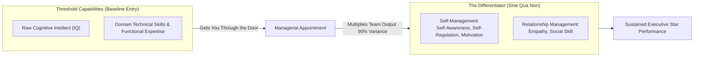
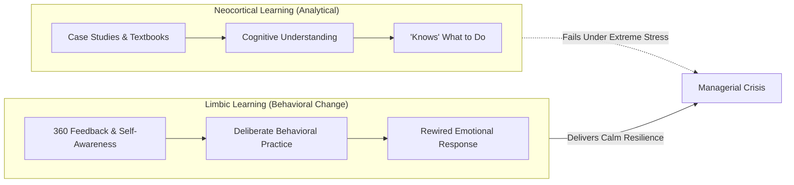
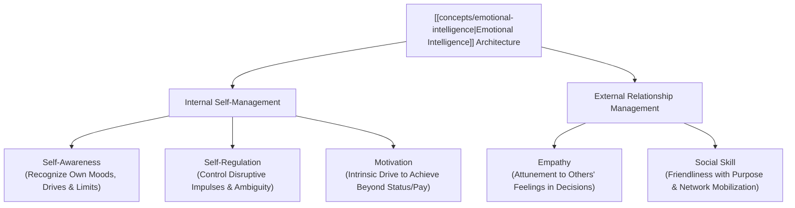

## 📄 Executive Synopsis & Context

- **Full Academic Citation**: Goleman, D. (1998, 2004). _What Makes a Leader?_ Harvard Business Review, Best of HBR, Reprint R0401H.
- **Author Background**:
  - **Dr. Daniel Goleman**: Psychologist, author, and former science journalist for _The New York Times_; co-founder of the Collaborative for Academic, Social, and Emotional Learning (CASEL) at the Yale Child Study Center; author of the groundbreaking 1995 book _[[concepts/emotional-intelligence|Emotional Intelligence]]: Why It Can Matter More Than IQ_ and _Working with [[concepts/emotional-intelligence|Emotional Intelligence]]_ (1998).
- **Core Thesis**: Traditional business orthodoxy historically assumed that effective leadership required superior intellect (IQ) and deep technical expertise. Goleman’s empirical research across 188 global corporations definitively establishes that while intellect and technical mastery are necessary **"threshold capabilities"** (entry-level baseline requirements for executive roles), they are not differentiators of star performance. **[[concepts/emotional-intelligence|Emotional intelligence]] (EI)—composed of self-awareness, self-regulation, motivation, empathy, and social skill—is the _sine qua non_ (indispensable prerequisite) of leadership.** At senior executive levels, [[concepts/emotional-intelligence|emotional intelligence]] accounts for nearly 90% of the difference between star leaders and average performers.

---

## 🧠 Complete Conceptual Architecture

### 1. Threshold Capabilities vs. Star Performance Differentiators

Goleman analyzed competency models developed by psychologists across 188 large global companies (including Lucent, British Airways, and Credit Suisse). He grouped professional capabilities into three distinct categories:

1. **Purely Technical Skills**: Accounting, coding, market sizing, financial modeling.
2. **Cognitive Abilities**: Analytical reasoning, pattern recognition, strategic conceptualization.
3. **[[concepts/emotional-intelligence|Emotional Intelligence]] Competencies**: Ability to work collaboratively, persuade, manage conflict, and navigate organizational stress.

When comparing star performers against average performers in senior leadership roles, Goleman calculated the ratio of EI competencies to cognitive and technical skills. At middle-management ranks, EI was twice as important as raw IQ. **At the highest senior executive levels, nearly 90% of the difference between top performers and peer averages was attributable to [[concepts/emotional-intelligence|emotional intelligence]] factors.**

### 2. The Neurological Substrate: Limbic System vs. Neocortex

A critical finding of Goleman's work is that [[concepts/emotional-intelligence|emotional intelligence]] is biologically distinct from cognitive ability:

- **The Neocortex (Analytical Brain)**: Governs analytical thinking, language, technical grasping, and logic. The neocortex learns rapidly through reading, lectures, and analytical exposure.
- **The Limbic System (Emotional Brain)**: Governs feelings, impulses, emotional memory, and behavioral habit. The limbic system learns through **motivation, extended practice, and continuous feedback cycles**.
- _Executive Implication_: Traditional executive education programs that teach leadership through reading case studies or memorizing bullet points train only the neocortex. Without structured limbic retraining (breaking habitual emotional reactions, practicing active listening, role-playing, and receiving candid 360-degree feedback), an executive's real-world behavioral defaults remain unchanged under pressure.

### 3. The Five Core Dimensions of [[concepts/emotional-intelligence|Emotional Intelligence]]

Goleman divides EI into three internal self-management skills and two external relationship-management skills:

#### I. Self-Awareness

The ability to accurately recognize and understand one's emotions, strengths, weaknesses, values, and motives—as well as their direct ripple effect on subordinates and colleagues.

- **Hallmarks**: Realistic self-assessment, candor, comfort discussing limitations, self-confidence without arrogance, and a healthy sense of self-deprecating humor.
- _In Practice_: A self-aware leader knows that tight deadlines cause them to become short-tempered; they plan accordingly and communicate their stress transparently rather than venting on subordinates.

#### II. Self-Regulation

The capacity to control or redirect disruptive impulses and moods, coupled with the propensity to suspend hasty judgment and think before reacting.

- **Hallmarks**: Trustworthiness, integrity, comfort with ambiguity, openness to change, and resistance to emotional hijacking.
- _In Practice_: When a critical project fails, a self-regulated leader does not scream or find scapegoats; they calmly step back, analyze the root cause, and ask: _"What does this teach us, and how do we prevent recurrence?"_

#### III. Motivation

A passion to work for reasons that go far beyond monetary compensation, prestigious job titles, or external vanity metrics. An internal drive to achieve for the intrinsic sake of achievement.

- **Hallmarks**: Unflagging energy, relentless pursuit of operational improvement, optimism in the face of setbacks, and organizational commitment.
- _In Practice_: Leaders with high intrinsic motivation view organizational turnarounds not as career risks, but as opportunities to test their limits and build enduring institutional capability.

#### IV. Empathy

The ability to thoughtfully discern the emotional makeup of other people and treat them according to their emotional reactions. Empathy does not mean adopting others' emotions as one's own or pleasing everyone; it means factoring employees' feelings into the decision-making calculus alongside financial and operational variables.

- **Hallmarks**: Expertise in attracting and retaining top talent, cross-cultural sensitivity, service orientation to clients, and coaching capability.
- _In Practice_: In cross-border M&A integrations, an empathetic leader listens to cultural anxieties of acquired staff, preventing the silent talent exodus that destroys post-merger value.

#### V. Social Skill

"Friendliness with a purpose"—the adept management of relationships to build wide networks, establish common ground, and move individuals in a desired strategic direction. Social skill is the culmination of the other four components: a leader cannot manage relationships effectively without self-awareness, self-regulation, empathy, and motivation.

- **Hallmarks**: Persuasiveness, expertise in leading change, diplomacy, and collaborative team building.
- _In Practice_: A socially skilled leader builds informal coalitions across disparate business units long before launching a major strategic change initiative.

---

## 🏢 Real-World Executive Case Vignettes

### Vignette 1: David McClelland's Landmark Food & Beverage Division Study (1996)

Goleman cites Harvard researcher **David McClelland’s** landmark study of senior executives across a global food and beverage conglomerate:

- **Methodology**: McClelland compared divisions whose division heads possessed a "critical mass" of at least six [[concepts/emotional-intelligence|emotional intelligence]] competencies against divisions whose heads lacked them.
- **Quantitative Result**: Divisions led by high-EI leaders **exceeded their annual corporate earnings targets by an average of 20%**.
- Conversely, division leaders lacking [[concepts/emotional-intelligence|emotional intelligence]] **fell short of annual corporate profit targets by almost 20%**.
- _Geographic Consistency_: This performance spread was statistically identical across North America, Europe, and Asia, proving that [[concepts/emotional-intelligence|emotional intelligence]] is a cross-cultural leadership imperative rather than a Western regional quirk.

### Vignette 2: The Toxic Wall Street Rainmaker

Goleman contrasts a brilliant, highly analytical Wall Street portfolio manager who was promoted to managing director based solely on raw IQ and trading profits:

- Once in the leadership chair, the executive belittled analysts, hoarded information, screamed at traders during market pullbacks, and ignored complaints from junior staff.
- Within 18 months, three star quantitative analysts resigned to work for direct hedge fund competitors, trading models deteriorated, and the desk underperformed.
- _Diagnosis_: High cognitive intellect and technical expertise secured the executive seat, but complete deficiency in self-regulation and empathy created an environment of fear that paralyzed collective analytical throughput.

---

## 🛠️ Complete Diagnostic Worksheets & Toolkits

### Executive [[concepts/emotional-intelligence|Emotional Intelligence]] 5-Dimension Diagnostic Matrix

Use this rubric for self-assessment and 360-degree managerial evaluation (Scored 1 = Rare, 3 = Moderate, 5 = Consistent):

| Dimension           | Diagnostic Behavioral Indicator                                               | Low Score Indicator (1–2)                                                          | High Score Indicator (4–5)                                                             |
| :------------------ | :---------------------------------------------------------------------------- | :--------------------------------------------------------------------------------- | :------------------------------------------------------------------------------------- |
| **Self-Awareness**  | Can accurately name personal emotional triggers and professional limitations. | Defensive when critiqued; blames external conditions; overestimates capability.    | Openly discusses developmental areas; seeks feedback; exhibits self-deprecating humor. |
| **Self-Regulation** | Maintains emotional composure during crises; suspends impulsive judgment.     | Yells under pressure; makes rash decisions; creates climate of anxiety.            | Reframes crises into learning opportunities; remains calm; acts with integrity.        |
| **Motivation**      | Demonstrates intrinsic passion for excellence beyond salary and status.       | Cynical; focused solely on quarterly bonuses; quits when obstacles arise.          | High energy; relentless curiosity; optimistic resilience during downturns.             |
| **Empathy**         | Senses non-verbal cues and factors team sentiment into strategic choices.     | Dismisses emotional concerns as "weakness"; treats people as interchangeable cogs. | Attuned to team burnout; coaches subordinates; excels in cross-cultural negotiation.   |
| **Social Skill**    | Mobilizes cross-functional networks to achieve complex strategic goals.       | Relies solely on formal authority and memos; alienated from peer networks.         | Master persuader; builds coalitions across silos; resolves conflicts constructively.   |

---

## 📊 Comparative Exhibits & Framework Tables

### Table 1: Goleman's Five Dimensions of [[concepts/emotional-intelligence|Emotional Intelligence]]

| Component           | Definition                                                                                                       | Observable Workplace Hallmarks                                                                                              | Direct Business Value                                                                                          |
| :------------------ | :--------------------------------------------------------------------------------------------------------------- | :-------------------------------------------------------------------------------------------------------------------------- | :------------------------------------------------------------------------------------------------------------- |
| **Self-Awareness**  | The ability to recognize and understand moods, emotions, and drives, as well as their effect on others.          | - Realistic self-assessment - Self-deprecating humor - Self-confidence - Candor regarding limits                | Prevents executive overconfidence; grounds strategic risk analysis in real organizational capabilities.        |
| **Self-Regulation** | The capacity to control or redirect disruptive impulses; the propensity to think before acting.                  | - Trustworthiness and integrity - Comfort with ambiguity - Openness to change - Impulse control                 | Creates an environment of trust and fairness; dramatically reduces political infighting and employee turnover. |
| **Motivation**      | A passion to work for reasons beyond money or status; a propensity to pursue goals with energy.                  | - Strong drive to achieve - Optimism, even in failure - Organizational commitment - Relentless improvement      | Inspires discretionary effort; sustains long-term transformation across multi-year restructuring cycles.       |
| **Empathy**         | The ability to understand the emotional makeup of other people; skill in treating people according to reactions. | - Expertise in developing talent - Cross-cultural sensitivity - Service to clients/customers - Active listening | Retains top performers; vital for managing global teams and navigating customer relationship crises.           |
| **Social Skill**    | Proficiency in managing relationships and building networks; finding common ground and building rapport.         | - Effectiveness in leading change - Persuasiveness - Team leadership - Extensive informal networks              | Breaks down operational silos; ensures cross-functional alignment and smooth strategy execution.               |

---

## 💬 Classroom Cold-Call & Discussion Strategy

### Discussion Question: _"Goleman claims that 90% of the difference between star and average senior leaders is attributable to [[concepts/emotional-intelligence|emotional intelligence]]. Is this claim scientifically sound or an overblown consulting gimmick?"_

#### 1. High-Signal Cold-Call Response (30-Second Script)

> _"Goleman's 90% claim is directionally profound but methodologically overstated due to a classical **range-restriction (threshold) effect**. At the senior executive level, candidates have already been aggressively filtered for superior IQ and technical acumen. Because cognitive variance is artificially compressed at the top, [[concepts/emotional-intelligence|emotional intelligence]] naturally explains the vast majority of the remaining variance among finalists. While 90% is an eye-catching heuristic rather than an irrefutable psychometric constant, Goleman's fundamental insight holds: an executive with world-class IQ but zero empathy or self-regulation will inevitably trigger political paralysis and team dysfunction."_

#### 2. Underlying Theoretical Mechanism

- **The Threshold Effect**: If everyone in an executive boardroom has an IQ in the top 5th percentile, raw IQ cannot predict who among them will succeed. The predictive power shifts to interpersonal and emotional competencies.
- **Subjective Halo Effects**: Goleman’s data relied in part on corporate competency models where senior managers rated their peers. Bosses tend to rate socially skilled, empathetic individuals higher on overall capability, creating a potential confounding halo effect between likeability and actual output.

#### 3. Contrarian & Critical Perspective

- In high-velocity technical domains (e.g., semiconductor lithography, advanced algorithmic trading, biopharmaceutical research), cognitive brilliance and deep functional insight occasionally trump emotional diplomacy. A leader with moderate EI but extraordinary domain insight may create more shareholder value than a high-EI diplomat who lacks strategic foresight. The highest leadership performance represents the **synthesis of technical science and emotional art**.

---

## 🔗 Knowledge Graph & Bridges

- **Master Lecture Note**: [[courses/mk1-organizational-behavior-managing-people/week-04/index|Week 04 Master Lecture Hub: Leadership & Culture Transformation]]
- **Applied Case Study**: [[courses/mk1-organizational-behavior-managing-people/week-04/case-satya-nadella-microsoft|Satya Nadella at Microsoft: [[concepts/growth-mindset|Growth Mindset]] & Culture Turnaround]]
- **Syndicate 9 Debrief**: [[courses/mk1-organizational-behavior-managing-people/week-04/assignment-pre-leadership-outlook-eq|Pre-Assignment: SBM ITB Leadership Outlook & Goleman EQ Analysis]]
- **Theorist Profile**: Daniel Goleman
- **Curriculum Bridge**: Return to **[[courses/mk1-organizational-behavior-managing-people/index|MK1 Course Overview]]**
