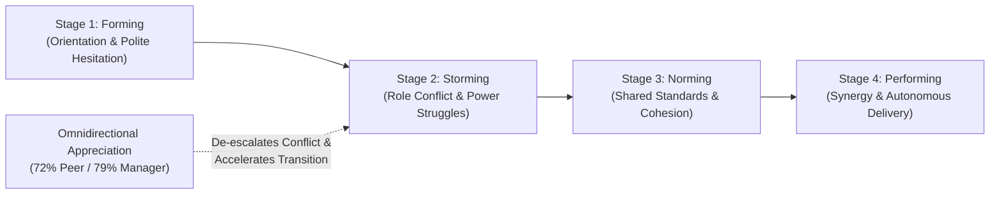
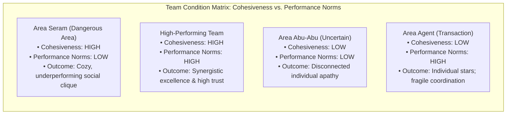
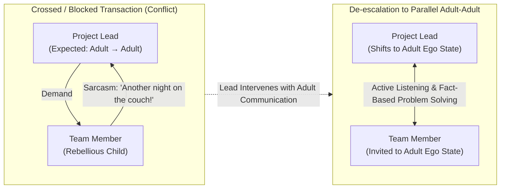

> [!NOTE] Assignment Context & Attribution
>
> - **Course:** MK1 Organizational Behaviour & Managing People — Week 05
> - **Source Prompt:** `archive/courses/mk1/week-05/Syndicate 9 - Post-Assignment Week 5.docx`
> - **Reference Attribution:** Analytical synthesis contributed by **F9 (Class F / Syndicate 9) & the Portal Maintainer** _(all personal student names and identifiers strictly anonymized)_
> - **Parent Lecture:** [[courses/mk1-organizational-behavior-managing-people/week-05/index|Week 05 Masterclass Hub: High-Performing Teams, Group Dynamics & [[concepts/transactional-analysis|Transactional Analysis]]]]
> - **Direct Reading Satellite:**
>   - [[courses/mk1-organizational-behavior-managing-people/week-05/reading-5-things-high-performing-teams-do-differently|Reading: 5 Things High-Performing Teams Do Differently (Ron Friedman, HBR)]]

---

## 📋 Part 1: Official Assignment Prompt & Skim Map

- **Executive Objective:** Revisit and elevate pre-assignment evaluations of Ron Friedman’s team behaviors by integrating the theoretical frameworks introduced during the Week 05 masterclass—specifically **Bruce Tuckman’s Stages of Group Development**, the **Team Cohesiveness vs. Performance Norms Matrix (Area Seram)**, and **Eric Berne’s [[concepts/transactional-analysis|Transactional Analysis]] & Ego State Framework**.
- **Deliverable Requirements:** For each of the three pre-assignment questions, provide:
  1. _Revised Answer_ (reconstructed with class models and behavioral frameworks).
  2. _Reflection on What Changed and Why_ (explaining how classroom theories deepened the analysis).

---

## 💡 Part 2: Reference Solution & Framework Revisions (Post-Class Mode)

### Question 1: Empirical Ranking & The Tuckman Model of Team Development

#### Syndicate Consensus Ranking (Maintained)

1. **Giving and receiving appreciation** _(Most Convincing)_
2. **Running meetings strategically**
3. **Using the telephone**
4. **Talking about non-work topics**
5. **Being authentic at work** _(Least Convincing)_

#### Revised Answer (Integrating Tuckman's Model)

Appreciation ranks first because it provides the most robust multi-dimensional survey data in Friedman’s study, showing high-performing teams receive 72% more appreciation from peers and 79% more from managers, while expressing 44% more to colleagues. Its rationale is grounded in established Self-Determination Theory, specifically how fulfilling the psychological need for relatedness makes recognition a more powerful motivator than money. Conversely, authenticity ranks last because the article provides zero quantitative figures or comparative percentages, relying entirely on qualitative descriptions like using emojis, joking, cursing, or complaining.

From the Week 05 masterclass, we integrate the **Tuckman Model of Team Development** (Forming $\rightarrow$ Storming $\rightarrow$ Norming $\rightarrow$ Performing). A culture of appreciation—directed horizontally to peers, upward to leadership, and downward to subordinates—is especially vital during the **Storming stage**. In the storming phase, team members experience friction over roles, authority, and work styles. Omnidirectional appreciation costs nothing financially, but functions as social capital that de-escalates interpersonal defensiveness, builds psychological safety, and accelerates the team's transition into cohesive Norming and Performing.

#### Reflection: What Changed from Pre-Assignment, and Why?

- **What Changed:** The revised response incorporates Bruce Tuckman’s four-stage model of team development, specifically framing appreciation not just as a static motivational tool, but as a dynamic accelerator that guides groups through the turbulent **Storming** phase into productive **Norming**.
- **Why:** The pre-assignment evaluated appreciation purely through statistical survey percentages. The post-class revision connects the data to longitudinal team development, demonstrating how intentional recognition resolves group conflict and strengthens team cohesiveness.

---

### Question 2: Non-Work Topics, Tuckman Forming & The Cohesiveness Matrix

#### Revised Answer (Integrating the Cohesiveness Matrix & "Area Seram")

Friedman’s research reveals that members of high-performing teams are 25% more likely to spend office time discussing non-work topics (sports, books, family) and significantly more likely to meet colleagues socially for drinks or coffee. In the Tuckman Model, casual non-work conversations play a critical role during the **Forming stage**, helping members establish psychological contact, identify common values, and build baseline interpersonal trust.

However, from an executive governance standpoint, three rigorous caveats must be maintained:

1. **Correlation is Not Causation**: Chatting about sports does not prove superior commercial effectiveness.
2. **Subjective Self-Reporting Bias**: The study measures zero audited financial or operational deliverables, defining "high-performing" purely through subjective 10/10 self-ratings.
3. **The Risk of Entering the "Dangerous Area" (Area Seram)**: As analyzed in the Week 05 lecture matrix (_Cohesiveness vs. Performance Norms_), high team cohesiveness without rigorous work norms creates **Area Seram (The Dangerous Zone)**. In this zone, team members are intensely bonded socially, highly protective of one another, and exceptionally cohesive—yet organizational performance and work spirit are rock-bottom. Cohesive social cliques actively resist management targets, protect poor performers, and reject accountability.

Without proof that casual discussion drives verified output rather than costly distraction, paying staff to chat remains an unproven business investment unless balanced by high performance standards.

#### Reflection: What Changed from Pre-Assignment, and Why?

- **What Changed:** The revised answer connects non-work discussions to the **Forming stage** of team development, while introducing the lecture's **Cohesiveness vs. Performance Norms Matrix** to warn of **Area Seram**.
- **Why:** The pre-assignment focused strictly on economic opportunity cost and statistical limitations. The post-class revision introduces structural organizational dynamics: high social bonding is dangerous if unaccompanied by demanding performance norms, highlighting the delicate balance required between team camaraderie and executive accountability.

---

### Question 3: The Barbed Courtesy & [[concepts/transactional-analysis|Transactional Analysis]] (Ego States)

#### Scenario Review

An analyst responds to a sudden overnight change with biting sarcasm: _"Oh wonderful! I was just hoping for an excuse to spend another night sleeping on the office couch while you rethink the numbers again."_

#### Revised Answer (Integrating Eric Berne's [[concepts/transactional-analysis|Transactional Analysis]])

The team member's sarcastic response can be interpreted through two complementary lenses:

1. **Authenticity & Relational Baseline**: High-performing teams express negative emotions more frequently because suppressing frustration is cognitively expensive. However, this is constructive _only_ when cushioned by established psychological safety, trust, and frequent mutual appreciation.
2. **[[concepts/transactional-analysis|Transactional Analysis]] (Eric Berne)**: In the Week 05 framework, human interactions occur across three distinct **Ego States**:
   - **Parent**: Controlling/Critical (_"Nobody leaves until this report is finished"_) or Nurturing (_"Let me take care of this for you"_).
   - **Adult**: Rational, objective, fact-seeking, and problem-solving (_"Let's analyze the assumptions and probabilities"_).
   - **Child**: Natural/Playful (_creative, spontaneous_), Adapted (_"Yes mam", pleasing, anxious_), or Rebellious / Little Professor (_defiant, sarcastic, manipulative_).

The analyst's sarcastic remark represents a **Rebellious Child ego state** responding to what they perceived as an unreasonable **Controlling Parent demand**. If the project lead reacts defensively (_"How dare you speak to me like that! Get back to work"_), they respond from a Critical Parent position, triggering a toxic **Crossed / Blocked Transaction** that escalates interpersonal hostility and causes communication paralysis.

#### Reconstructed Project Lead Response

> **Project Lead Response:**  
> _"I hear that the repeated assumption changes are frustrating, and asking for an overnight turnaround after you've already put in heavy hours is demanding. Let’s sit down, review your priorities objectively, and decide what can be postponed, reassigned, or adjusted so we can meet the deadline without overloading you."_

#### Managerial Mechanism

This response executes **Active Listening** and refuses to take the bait of a Critical Parent reaction. By validating feelings calmly and focusing on objective priority reallocation, the project lead operates from the **Adult ego state**, inviting the analyst to shift out of the Rebellious Child state and establishing a constructive **Parallel / Open Transaction (Adult $\longleftrightarrow$ Adult)**.

#### Reflection: What Changed from Pre-Assignment, and Why?

- **What Changed:** The analysis advanced from evaluating whether sarcasm is "healthy vs. unhealthy authenticity" to diagnosing the communication through **Ego States (Eric Berne)** and **Crossed vs. Parallel Transactions**.
- **Why:** The pre-assignment viewed the leader's role as passively tolerating or calming an emotional outburst. [[concepts/transactional-analysis|Transactional Analysis]] reveals that a leader must actively manage the structural communication pattern—recognizing ego states, avoiding Critical Parent traps, and intentionally shifting interactions back into the rational Adult state.

---

## 🔬 Part 3: Methodological Rigor & Key Analytical Nuances

| Dimension              | Pre-Assignment Baseline                                           | Advanced Post-Class Synthesis (F9 & Maintainer)                                                                                                                                                                                                                                                                      |
| :--------------------- | :---------------------------------------------------------------- | :------------------------------------------------------------------------------------------------------------------------------------------------------------------------------------------------------------------------------------------------------------------------------------------------------------------- |
| **Team Development**   | Treats appreciation as a static survey metric (72% / 79%).        | Situates appreciation within **Tuckman's Storming phase**: proves that appreciation is the social catalyst that de-escalates role friction.                                                                                                                                                                          |
| **Team Cohesiveness**  | Warns of lost working hours from casual chatting.                 | Applies the **Cohesiveness Matrix**: identifies **Area Seram**, where excessive social bonding without strong work norms breeds cozy mediocrity and insubordination.                                                                                                                                                 |
| **Conflict & Sarcasm** | Assesses sarcasm through psychological safety and cognitive load. | Analyzes interaction through \*\*[[concepts/transactional-analysis                                                                                                   \| Transactional Analysis]] (PAC Model)\*\*: diagnoses sarcasm as a Rebellious Child response and prescribes Adult-to-Adult parallel alignment. |
| **Managerial Agency**  | Suggests generic empathetic defusing.                             | Codifies structural **Ego State Shifting**: active listening combined with situation-behavior-impact (SBI) fact-finding to eliminate crossed transactions.                                                                                                                                                           |

---

## 🎙️ Part 4: Classroom Cold-Call & Faculty Debrief Strategy

- **Faculty Angle (Area Seram in BUMN):** _"In Indonesian state-owned enterprises, why do so many units fall into Area Seram (The Dangerous Zone)?"_
  - **High-Signal Response:** *"Because cultural norms of *guyub* (togetherness), *kekeluargaan* (family-like harmony), and *ewuh pakewuh* (reluctance to confront or offend colleagues) naturally drive team cohesiveness to very high levels. However, if performance norms are weak and leaders avoid holding peers accountable, the team settles into Area Seram—where everyone is comfortable and friendly, but operational throughput and strategic innovation are stagnant. High performance requires pairing relational warmth with uncompromising performance standards."*
- **Faculty Angle (Crossed Transactions):** _"What should a manager do if shifting to the Adult ego state fails to de-escalate a crossed transaction?"_
  - **High-Signal Response:** _"If a subordinate remains trapped in a defensive or rebellious state despite Adult reasoning, the manager can utilize a temporary **Ulterior Transaction** or intentional pause for 'face-saving' (menjaga muka). Stepping away from the immediate public confrontation allows emotional adrenaline to subside, after which the issue can be re-addressed privately in a neutral, Adult-to-Adult setting."_

---

## 🔗 Knowledge Graph & Curriculum Bridges

- **Master Lecture Note**: [[courses/mk1-organizational-behavior-managing-people/week-05/index|Week 05 Masterclass Hub: High-Performing Teams, Group Dynamics & [[concepts/transactional-analysis|Transactional Analysis]]]]
- **Pre-Assignment Reference**: [[courses/mk1-organizational-behavior-managing-people/week-05/assignment-pre-high-performing-teams|Pre-Assignment: Critique of Friedman's 5 Behaviors]]
- **Direct Reading Satellite**: [[courses/mk1-organizational-behavior-managing-people/week-05/reading-5-things-high-performing-teams-do-differently|Reading: 5 Things High-Performing Teams Do Differently (Ron Friedman, HBR)]]
- **Applied Concepts**:
  - [[concepts/psychological-safety|Psychological Safety in Teams (Amy Edmondson)]]
  - [[concepts/transactional-analysis|Transactional Analysis & Ego States (Eric Berne)]]
- **Curriculum Bridge**: Return to **[[courses/mk1-organizational-behavior-managing-people/index|MK1 Course Overview]]**
