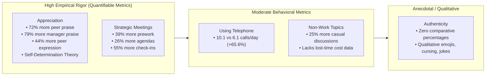

> [!NOTE] Assignment Context & Attribution
>
> - **Course:** MK1 Organizational Behaviour & Managing People — Week 05
> - **Source Prompt:** `archive/courses/mk1/week-05/Pre Assignment Week 5.pdf`
> - **Reference Attribution:** Analytical synthesis contributed by **F9 (Class F / Syndicate 9) & the Portal Maintainer** _(all personal student names and identifiers strictly anonymized)_
> - **Parent Lecture:** [[courses/mk1-organizational-behavior-managing-people/week-05/index|Week 05 Masterclass Hub: High-Performing Teams, Group Dynamics & [[concepts/transactional-analysis|Transactional Analysis]]]]
> - **Direct Reading Satellite:**
>   - [[courses/mk1-organizational-behavior-managing-people/week-05/reading-5-things-high-performing-teams-do-differently|Reading: 5 Things High-Performing Teams Do Differently (Ron Friedman, HBR)]]

---

## 📋 Part 1: Official Assignment Prompt & Skim Map

- **Executive Objective:** Critically interrogate empirical claims regarding team performance from Ron Friedman’s 2021 study, evaluate statistical evidence across behavioral dimensions, and analyze interpersonal communication under deadline friction.
- **Target Deliverable:** Written analytical brief answering three structured diagnostic questions.

### Core Diagnostic Questions & Source Map

1. **Question 1 (Empirical Ranking):** _Rank the five things that high-performing teams do differently from the most to the least convincing evidence. Explain your rationale for the top and bottom rankings, and any internal debates within your syndicate._
   - _Where to look:_ `archive/courses/mk1/week-05/5 Things High-Performing Teams Do Differently.pdf` (Pages 2–6).
2. **Question 2 (Non-Work Conversations & Commercial ROI):** _The article reveals that members of high-performing teams are 25% more likely to spend office time discussing non-work topics. How does this build teamwork? Critically evaluate whether this finding proves that casual socializing drives higher commercial performance._
   - _Where to look:_ `archive/courses/mk1/week-05/5 Things High-Performing Teams Do Differently.pdf` (Page 4).
3. **Question 3 (The Barbed Courtesy Scenario):** _A team member responds to a sudden overnight deadline change with sarcasm: 'Oh great, another night sleeping at the desk!' Is this a healthy sign of authenticity or a warning sign of dysfunction? How should the project lead respond?_
   - _Where to look:_ `archive/courses/mk1/week-05/5 Things High-Performing Teams Do Differently.pdf` (Pages 5–6).

---

## 💡 Part 2: Reference Solution & Strategic Analysis (Post-Class Mode)

### Question 1: Empirical Ranking of the Five Behavioral Dimensions

#### Syndicate Consensus Ranking (Most to Least Convincing Evidence)

1. **Giving and receiving appreciation** _(Most Convincing)_
2. **Running meetings strategically**
3. **Using the telephone**
4. **Talking about non-work topics**
5. **Being authentic at work** _(Least Convincing)_

#### Analytical Defense of Top & Bottom Rankings

- **Why Appreciation Ranks First:** Appreciation provides the most robust, multi-dimensional quantitative survey data in the paper. It captures both incoming and outgoing behaviors—demonstrating that high-performing teams receive 72% more recognition from colleagues and 79% more from managers, while expressing 44% more to their peers. Furthermore, its theoretical foundation is rigorously grounded in **Self-Determination Theory (Deci & Ryan)**, specifically showing how fulfilling the psychological need for relatedness makes social recognition a more sustainable behavioral motivator than financial bonuses.
- **Why Authenticity Ranks Last:** While the concept of authenticity is intuitively appealing and draws conceptually from cognitive load theory (the mental cost of emotional suppression), the article provides **zero comparative percentages or quantitative metrics** to substantiate the claim. Friedman relies entirely on descriptive, qualitative anecdotes (such as using emojis, GIFs, joking, cursing, or complaining). Without empirical frequency benchmarks, the claim remains anecdotal and methodologically the least convincing.
- **Syndicate Deliberation:** Our syndicate debated whether "Using the telephone" or "Talking about non-work topics" deserved the higher placement. We ultimately ranked telephone usage higher because its concrete behavioral data (**10.1 vs. 6.1 calls per day**) offered a precise, objective ratio, whereas the non-work discussion metric relied on a generalized, self-reported 25% probability figure without measuring duration or productivity loss.

---

### Question 2: Non-Work Conversations — Team Building vs. Commercial ROI

#### 1. Why Non-Work Conversations Build Teamwork

Friedman’s research indicates that members of high-performing teams are 25% more likely to spend office time discussing non-work topics (sports, books, family) and significantly more likely to meet colleagues socially outside working hours.

Psychologically, personal conversations allow teammates to uncover shared interests and vulnerabilities outside formal job titles. This activates the psychological principle of **interpersonal similarity and mutual liking**. High-performing teams are not superior because they grind continuously without pause; rather, investing time in human connection builds relational trust, which subsequently reduces friction, lowers defensive barriers, and accelerates alignment when executing high-stakes business tasks.

#### 2. Critical Methodological Critique: Does it Prove Business Performance?

From an executive standpoint, the study **fails to prove that subsidizing casual conversation yields positive commercial return on investment (ROI)** due to three critical flaws:

1. **Correlation Does Not Equal Causation**: The study cannot prove that chatting about football causes higher performance. It is equally plausible that successful teams with smooth workflows simply experience less operational panic, thereby enjoying the luxury of free time to chat casually.
2. **Subjective Self-Reporting Bias**: The study measures zero objective commercial outcomes (revenue, profit margins, project delivery timelines). It defines "high-performing" purely through **subjective self-assessment** (employees who rated their own team a perfect 10/10). This metric captures team chemistry, morale, and self-satisfaction, but does not guarantee verifiable business effectiveness.
3. **Absence of a Cost-Threshold Frontier**: The survey does not identify the boundary where healthy bonding deteriorates into costly distraction. While top teams were 25% more likely to discuss non-work topics, the study provides no data on the duration of these chats, the opportunity cost of lost working hours, or whether excessive socialization leads to groupthink and low accountability.

---

### Question 3: The "Barbed Courtesy" Scenario Analysis

#### Scenario Context

An exhausted analyst responds to a sudden overnight assumption change from the project lead with biting sarcasm: _"Oh wonderful! I was just hoping for an excuse to spend another night sleeping on the office couch while you rethink the numbers again."_

#### 1. Healthy Authenticity or Dangerous Dysfunction?

According to Friedman, this response can be either an indicator of healthy psychological safety or a severe warning sign of cultural decay, depending entirely on the **underlying relational baseline**:

- **As a Healthy Sign of Authenticity**: High-performing teams express negative emotions significantly more often because emotional suppression is cognitively expensive. In an established culture of psychological safety, delivering a "barbed courtesy" reflects the freedom to voice legitimate exhaustion without fear of executive retaliation.
- **As a Dangerous Warning Sign**: If the team lacks a strong foundation of mutual trust, frequent peer appreciation, and positive emotional safety, such sarcasm indicates toxic passive-aggressive resentment, cynicism, and impending turnover.

#### 2. Recommended Project Lead Response

> **Project Lead Response:**  
> _"Fair point—I hear you, and I know that asking for an overnight turnaround after three assumption changes is tough when you've already been burning the midnight oil. Let’s look at your plate right now: what can we push back or reassign so this gets delivered without burning you out?"_

#### Managerial Rationale

1. **Active Listening & Validation**: Acknowledging the legitimate workload pressure behind the sarcastic remark immediately defuses emotional tension rather than defensively policing the analyst's tone.
2. **Shifting to Problem-Solving**: By focusing on workload re-prioritization, the leader moves the dynamic from emotional grievance into collaborative execution, protecting psychological safety while solving the operational constraint.

---

## 🔬 Part 3: Methodological Rigor & Key Analytical Nuances

| Analytical Dimension  | Baseline Intuition                                                          | Rigorous Methodological Synthesis (F9 & Maintainer)                                                                                                  |
| :-------------------- | :-------------------------------------------------------------------------- | :--------------------------------------------------------------------------------------------------------------------------------------------------- |
| **Study Methodology** | Treats "high-performing" as an established corporate fact.                  | Exposes **subjective self-reporting limitation**: 10/10 self-rating measures internal chemistry and morale, not objective audited commercial output. |
| **Non-Work Chat**     | Assumes casual conversation is an unambiguous productivity enhancer.        | Dissects **correlation vs. causation** and opportunity cost: highlights the danger of excessive socializing without accountability.                  |
| **Barbed Courtesy**   | Treats sarcasm either as pure insubordination or pure psychological safety. | Evaluates sarcasm through the **relational baseline**: constructive only when cushioned by high positive appreciation and psychological safety.      |
| **Phone Calls**       | Considers phone calls obsolete and intrusive in modern digital work.        | Demonstrates that voice eliminates digital ambiguity and accelerates consensus, overcoming psychological misprediction.                              |

---

## 🎙️ Part 4: Classroom Cold-Call & Faculty Debrief Strategy

- **Faculty Angle (Ranking):** _"Why did your syndicate place Authenticity last when Amy Edmondson's psychological safety research is so central to modern management?"_
  - **High-Signal Response:** _"We separated the conceptual validity of authenticity from Friedman's empirical execution. Edmondson's research rigorously measures error-reporting and psychological safety scales. Friedman's article, however, offers zero quantitative data or comparative percentages for authenticity, relying entirely on qualitative mentions of emojis and cursing. We ranked it last not because psychological safety is unimportant, but because the evidence presented in this specific paper was purely anecdotal."_
- **Faculty Angle (Sarcasm in BUMN):** _"Would a junior subordinate using sarcasm with a Senior VP in an Indonesian BUMN ever be accepted as 'healthy authenticity'?"_
  - **High-Signal Response:** *"In an Indonesian enterprise context, high power-distance (*Bapakisme*) and cultural norms of *asalkan bapak senang* (keeping the boss pleased) make direct sarcasm culturally high-risk. A subordinate using open sarcasm with a Director would almost certainly be penalized as insubordinate. However, the underlying need for authentic emotional feedback remains vital. Indonesian leaders must actively create safe, private feedback spaces (e.g., informal *ngopi* sessions) so employees can express exhaustion without resorting to passive-aggressive resistance."*

---

## 🔗 Knowledge Graph & Curriculum Bridges

- **Master Lecture Note**: [[courses/mk1-organizational-behavior-managing-people/week-05/index|Week 05 Masterclass Hub: High-Performing Teams, Group Dynamics & [[concepts/transactional-analysis|Transactional Analysis]]]]
- **Post-Assignment Synthesis**: [[courses/mk1-organizational-behavior-managing-people/week-05/assignment-post-team-dynamics|Post-Assignment: Synthesis of Tuckman Model, Cohesiveness Matrix & Ego States]]
- **Direct Reading Satellite**: [[courses/mk1-organizational-behavior-managing-people/week-05/reading-5-things-high-performing-teams-do-differently|Reading: 5 Things High-Performing Teams Do Differently (Ron Friedman, HBR)]]
- **Curriculum Bridge**: Return to **[[courses/mk1-organizational-behavior-managing-people/index|MK1 Course Overview]]**
