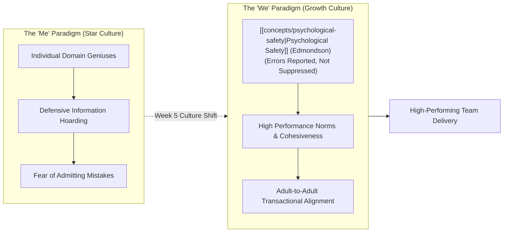
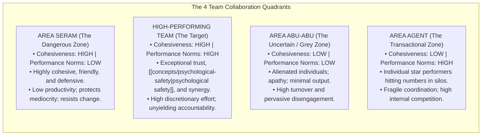
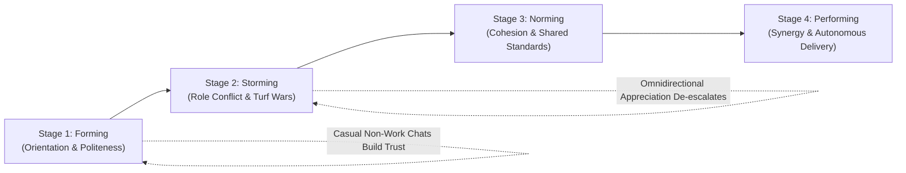
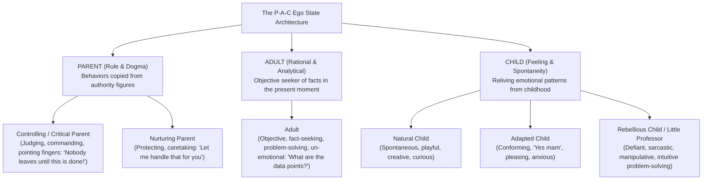
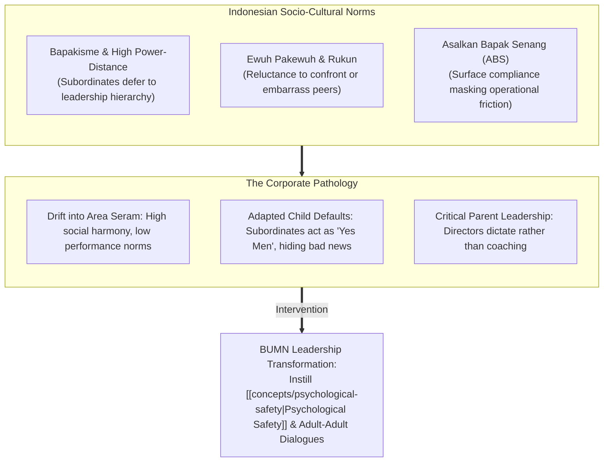

> [!NOTE] Curricular & Faculty Metadata
>
> - **Course:** MK1 Organizational Behaviour & Managing People — Week 05
> - **Teaching Team:** Muhammad Yorga Permana, Ph.D., Widhyawan Prawiraatmadja, Ph.D., Dr. Ir. Madju Yuni Ros Bangun, Yudo Anggoro, Ph.D.
> - **Primary Curricular Spine:** `Week 5 Team Dynamics (Student Version).pdf` (55 slide exhibits) & `Ego State.pdf`
> - **Direct Satellites & Problem Sets:**
>   - [[courses/mk1-organizational-behavior-managing-people/week-05/reading-5-things-high-performing-teams-do-differently|Academic Reading: 5 Things High-Performing Teams Do Differently (Ron Friedman, HBR)]]
>   - [[courses/mk1-organizational-behavior-managing-people/week-05/assignment-pre-high-performing-teams|Pre-Assignment: Critique of Friedman's 5 Behaviors]]
>   - [[courses/mk1-organizational-behavior-managing-people/week-05/assignment-post-team-dynamics|Post-Assignment: Synthesis of Tuckman Model, Cohesiveness Matrix & Ego States]]

---

## 1. Executive Overview & The Team Effectiveness Frontier

Modern enterprise strategy is rarely executed by solitary geniuses; it is won or lost in the interpersonal trenches of cross-functional teams. Yet assembling an elite roster of brilliant individuals does not guarantee a high-performing team. As Google’s landmark **Project Aristotle** and Harvard Business School researcher **Amy Edmondson** decisively demonstrated, the primary determinant of team effectiveness is not the aggregate IQ, pedigree, or individual technical mastery of its members, but the **quality of interpersonal dynamics and [[concepts/psychological-safety|psychological safety]]** that governs how members interact.

Week 05 explores the behavioral mechanics of extraordinary teams across three interconnected pillars:

1. **The Structural Architecture of Team Collaboration**: Shifting organizations from a _"Me Paradigm"_ (genius culture focused on individual star performers) to a _"We Paradigm"_ (growth culture focused on collective human potential). High performance requires navigating the delicate equilibrium between **Team Cohesiveness** and **Performance Norms**—avoiding the dangerous trap where cohesive teams degenerate into cozy, unaccountable social cliques (**Area Seram**).
2. **The Micro-Mechanics of Communication**: Why the infamous "7-38-55" Mehrabian rule (_communication is 93% non-verbal_) is widely misunderstood as an urban legend, and how high-performing teams leverage **active listening**, concrete language, and intentionality to eliminate costly coordination friction.
3. **[[concepts/transactional-analysis|Transactional Analysis]] & Ego States (Eric Berne)**: Equipping leaders with a psychodynamic framework to decode workplace communication. By analyzing human interactions through the lens of **Parent, Adult, and Child (PAC) ego states**, leaders can diagnose and resolve destructive **crossed/blocked transactions**, shifting interpersonal conflicts into collaborative, rational, fact-based **Adult-Adult problem-solving**.

---

## 2. Theoretical Architecture & Core Frameworks

### 1. The Team Condition Matrix: Cohesiveness vs. Performance Norms

The foundational lecture model establishes that team cohesiveness is not an unalloyed good. A team’s operational output is a joint function of two independent axes: **Team Cohesiveness** (interpersonal attraction and bonding) and **Performance Norms** (shared standards of excellence and accountability).

#### The Executive Paradox of "Area Seram"

- _Managerial Hazard_: Inexperienced managers frequently believe that building camaraderie is the primary job of leadership. However, increasing team cohesiveness _without_ establishing demanding performance norms pushes the team straight into **Area Seram (The Dangerous Zone)**.
- In Area Seram, members prioritize mutual comfort and social harmony over business results. They cover up each other’s mistakes, resent outside evaluation, and actively reject performance improvements because change threatens group comfort.
- _Executive Rule_: Never increase team cohesiveness without simultaneously elevating performance norms and clear accountability metrics.

### 2. Bruce Tuckman's Model of Team Development

Teams are dynamic organisms that evolve through predictable longitudinal stages:

1. **Forming**: Members are polite, tentative, and unclear on unspoken boundaries. _Key Lever_: Informal non-work conversations uncover shared interests and build baseline psychological contact.
2. **Storming**: Inevitable friction emerges over authority, priorities, credit, and working styles. Without skilled leadership, teams become stuck in destructive interpersonal loops. _Key Lever_: Omnidirectional peer appreciation de-escalates defensiveness.
3. **Norming**: Shared standards, mutual expectations, and group identity coalesce. Roles become complementary rather than competitive.
4. **Performing**: High trust and [[concepts/psychological-safety|psychological safety]] enable fluid, autonomous problem-solving and rapid cross-functional execution.

### 3. Amy Edmondson's [[concepts/psychological-safety|Psychological Safety]] Architecture

Drawing from Harvard Business School professor Amy Edmondson’s landmark hospital studies:

- **The Error Paradox**: Counterintuitively, the highest-performing medical and software teams consistently report **more mistakes and errors** than low-performing teams. They do not fail more often; rather, they foster an environment where members feel safe to speak up, report near-misses, and ask for help without fear of humiliation or retribution.
- **[[concepts/psychological-safety|Psychological Safety]] vs. Blame Culture**:
  - _Blame Culture_: Mistakes are punished $\longrightarrow$ under-reporting and concealment $\longrightarrow$ errors compound into catastrophic system failures.
  - _[[concepts/psychological-safety|Psychological Safety]]_: Mistakes are treated as learning data $\longrightarrow$ immediate transparency $\longrightarrow$ continuous process innovation.

$$\mathbf{\text{[[concepts/psychological-safety|Psychological Safety]]}} + \mathbf{\text{High Accountability}} = \mathbf{\text{High Performance Learning Zone}}$$

### 4. Communication: Debunking the Mehrabian 93% Myth & Active Listening

- **The Mehrabian Urban Legend**: Albert Mehrabian’s 1967 experiments showed 7% word choice, 38% voice tone, and 55% facial expression/body language. Popular management folklore misinterpreted this as _"93% of all communication is non-verbal."_
- As communication scholar **Lapakko (2007)** decisively noted: If meaning were truly 93% non-verbal, there would be no point in learning a language, writing legal contracts, or coding software. In high-stakes business environments, **word choice matters profoundly**.
- **Active Listening Protocols**: Moving from hearing words to understanding affective meaning:
  - _Common Traps_: Evaluating (_"That's wrong!"_), Probing (_"Why did you do that?"_), Advising (_"Here's what you should do"_), Interpreting (_"What you really mean is..."_).
  - _Active Listening Practices_: Maintain purposeful eye contact, pause before speaking, ask clarifying questions (_"Can you give an example?"_), and confirm understanding using reflective framing: _"What I hear you saying is..."_
  - **Situation-Behavior-Impact (SBI) Framework**: Structure feedback strictly by describing the _Situation_, the specific observable _Behavior_, and the measurable business _Impact_, separating behavior from an individual's personal identity.

### 5. Eric Berne's [[concepts/transactional-analysis|Transactional Analysis]] & Ego State Architecture

Psychiatrist **Eric Berne** founded [[concepts/transactional-analysis|Transactional Analysis (TA)]], establishing that every human personality operates across three dynamic **Ego States (P-A-C)**:

#### Types of Interpersonal Transactions

| Transaction Type                  | Dynamics & Structural Mechanism                                                                                                                                   | Workplace Impact                                                       | Resolution Strategy                                                                              |
| :-------------------------------- | :---------------------------------------------------------------------------------------------------------------------------------------------------------------- | :--------------------------------------------------------------------- | :----------------------------------------------------------------------------------------------- |
| **Parallel / Open Transaction**   | Stimulus and response lines are parallel (e.g., Adult $\longleftrightarrow$ Adult or Parent $\longleftrightarrow$ Child). Communication can proceed indefinitely. | Constructive alignment; clear mutual understanding.                    | Maintain Adult-to-Adult alignment for business decisions; celebrate with Natural Child.          |
| **Crossed / Blocked Transaction** | Vectors cross: Person 1 addresses Adult, but Person 2 responds from Rebellious Child or Critical Parent.                                                          | Immediate communication breakdown; defensiveness; emotional hostility. | The leader must consciously shift their own ego state to **Adult**, refusing the emotional bait. |
| **Ulterior / Hidden Transaction** | Two message levels operate simultaneously: an overt psychological Adult level masking a covert Child-Child or Parent-Child game.                                  | Sarcasm, manipulation, unvoiced political agendas.                     | Surface hidden assumptions objectively or use face-saving pauses to de-escalate tension.         |

---

## 3. Managerial Crucible: Indonesian Enterprise & BUMN Context

Applying team dynamics and [[concepts/transactional-analysis|transactional analysis]] to Indonesian corporate environments reveals unique socio-cultural crucibles:

### 1. The BUMN Drift into "Area Seram"

In Indonesian state-owned enterprises, cultural values of _kekeluargaan_ (familial warmth) and _gotong royong_ (mutual assistance) naturally produce high team cohesiveness. However, when paired with civil-service performance routines where tenure guarantees employment, the team slides directly into **Area Seram**. Subordinates refuse to critique peer underperformance because preserving _rukun_ (social harmony) takes precedence over operational targets. Leaders must counteract this by instituting transparent, objective key performance indicators (KPIs) that make accountability unavoidable while preserving relational respect.

### 2. De-escalating "Crossed Transactions" in High Power-Distance Hierarchies

When a senior Indonesian executive (BOD / VP) uses a **Controlling Parent** style (_"Saya tidak mau tahu, pokoknya laporan harus selesai malam ini!"_), junior employees typically retreat into the **Adapted Child** state (_"Siap pak, laksanakan"_). While this appears harmonious on the surface, it breeds unvoiced resentment, hidden sabotage, and project delays.

Transformative Indonesian leaders must actively model the **Adult ego state**, engaging team members as professional problem-solving partners:

> _"Target kementerian meminta laporan ini selesai besok pagi. Mari kita petakan bersama: kendala data apa yang paling kritis, dan bagian mana yang bisa kita bagi ke tim lain agar target tercapai tanpa lembur berlebihan?"_

---

## 4. Cross-Functional Implementation & Strategic Trade-offs

Leading cross-functional teams requires managing difficult organizational trade-offs:

| Strategic Trade-off                                                                                  | The Pressure Point                                                                                          | Operational Risk                                                                                | Executive Resolution Mechanism                                                                                                       |
| :--------------------------------------------------------------------------------------------------- | :---------------------------------------------------------------------------------------------------------- | :---------------------------------------------------------------------------------------------- | :----------------------------------------------------------------------------------------------------------------------------------- |
| \*\*[[concepts/psychological-safety     \| Psychological Safety]] vs. Performance Accountability\*\* | High safety without accountability breeds complacency; high accountability without safety creates anxiety.  | - Complacency (High Safety, Low Accountability) - Anxiety (Low Safety, High Accountability) | Aim for the **Learning Zone**: pair high emotional safety to report errors with demanding standards of operational excellence.       |
| **Speed vs. Voice in Critical Sprints**                                                              | Urgent project delivery deadlines tempt leaders to default to command-and-control Critical Parent dictates. | Triggers crossed transactions and passive-aggressive subordinate resistance.                    | Execute rapid Adult-Adult check-ins; explain the strategic _context_ of urgency rather than issuing blunt commands.                  |
| **Social Bonding vs. Working Time**                                                                  | Spending 25% more time on casual non-work chat risks distraction if uncontrolled.                           | Operational delay and lost working hours on critical path deliverables.                         | Time-box social interactions: utilize meeting check-ins (first 5 minutes) and dedicated coffee breaks, keeping work sprints focused. |

---

## 📚 Required Readings & In-Depth Satellites

| Document Title                                             | Author / Institution                               | Core Focus / Methodological Contribution                                                                                 | Study Note                                                                                                                                 |
| :--------------------------------------------------------- | :------------------------------------------------- | :----------------------------------------------------------------------------------------------------------------------- | :----------------------------------------------------------------------------------------------------------------------------------------- |
| **5 Things High-Performing Teams Do Differently**          | Dr. Ron Friedman (Harvard Business Review, 2021)   | Empirical survey across 1,106 US office workers; 5 differentiating behavioral habits; Self-Determination Theory.         | [[courses/mk1-organizational-behavior-managing-people/week-05/reading-5-things-high-performing-teams-do-differently\|Open Deep-Dive Note]] |
| **Pre-Assignment Debrief: Empirical Critique of Friedman** | F9 (Class F / Syndicate 9) & the Portal Maintainer | Methodological ranking of evidence; correlation vs causation critique; barbed courtesy scenario analysis.                | [[courses/mk1-organizational-behavior-managing-people/week-05/assignment-pre-high-performing-teams\|Open Assignment Guide]]                |
| **Post-Assignment Debrief: Ego States & Team Dynamics**    | F9 (Class F / Syndicate 9) & the Portal Maintainer | Full post-class synthesis incorporating Tuckman’s development stages, the Area Seram matrix, and Eric Berne's PAC model. | [[courses/mk1-organizational-behavior-managing-people/week-05/assignment-post-team-dynamics\|Open Assignment Guide]]                       |

---

## 📂 Primary Source Media & Digital Archives

| Material Title                                                                    | Media Type                   | Direct Repository Reference                                                     |
| :-------------------------------------------------------------------------------- | :--------------------------- | :------------------------------------------------------------------------------ |
| **Week 5 Team Dynamics (Student Version)**                                        | Presentation Slides (`.pdf`) | `archive/courses/mk1/week-05/Week 5 Team Dynamics (Student Version).pdf`        |
| \*\*Ego State: [[concepts/transactional-analysis  \| Transactional Analysis]]\*\* | Presentation Slides (`.pdf`) | `archive/courses/mk1/week-05/Ego State.pdf`                                     |
| **5 Things High-Performing Teams Do Differently**                                 | HBR Reading (`.pdf`)         | `archive/courses/mk1/week-05/5 Things High-Performing Teams Do Differently.pdf` |
| **Pre-Assignment Week 5 Prompt**                                                  | Assignment Prompt (`.pdf`)   | `archive/courses/mk1/week-05/Pre Assignment Week 5.pdf`                         |
| **Syndicate 9 Pre-Assignment Submission**                                         | Student Archive (`.docx`)    | `archive/courses/mk1/week-05/Syndicate 9 - Pre-Assignment Week 5.docx`          |
| **Syndicate 9 Post-Assignment Submission**                                        | Student Archive (`.docx`)    | `archive/courses/mk1/week-05/Syndicate 9 - Post-Assignment Week 5.docx`         |

---

## 🔗 Knowledge Graph & Curriculum Bridges

- **Featured Frameworks in Knowledge Matrix**:
  - [[concepts/psychological-safety|Psychological Safety in Teams (Amy Edmondson)]]
  - [[concepts/transactional-analysis|Transactional Analysis & Ego States (Eric Berne)]]
- **Theorist & Author Profiles**:
  - Prof. Amy Edmondson (Harvard Business School)
  - Dr. Eric Berne (Psychiatrist & Founder of TA)
  - Dr. Ron Friedman (Social Psychologist & Author)
- **Previous Curricular Module**: [[courses/mk1-organizational-behavior-managing-people/week-04/index|Week 04: Leadership & Culture Transformation — Satya Nadella Case]]
- **Next Curricular Module**: [[courses/mk1-organizational-behavior-managing-people/week-06/index|Week 06: Organizational Capability, Politics & LCOP Framework]]
- **Return to Course Overview**: [[courses/mk1-organizational-behavior-managing-people/index|MK1 Course Overview: Organizational Behaviour & Managing People]]
