## 📄 Executive Synopsis & Context

- **Full Academic Citation**: Friedman, R. (2021). _5 Things High-Performing Teams Do Differently: Hint: It’s not always about the work_. Harvard Business Review, Digital Article, Collaboration and Teams. Published on HBR.org October 21, 2021. Reprint H06NCN.
- **Author Background**:
  - **Dr. Ron Friedman**: Award-winning social psychologist, founder of ignite80 (a learning and development firm teaching science-based strategies for high performance), and author of _The Best Place to Work: The Art and Science of Creating an Extraordinary Workplace_ and _Decoding Greatness: How the Best in the World Reverse Engineer Success_.
- **Empirical Research Scope**:
  - In summer 2021, ignite80 partnered with communication software company Front to conduct an empirical survey across **1,106 U.S.-based office workers**.
  - **Defining "High-Performing"**: To avoid arbitrary categorization, the researchers required respondents to satisfy two rigorous filtering criteria: (1) rate their own team’s overall effectiveness a perfect **10 out of 10**, and (2) compare their team’s performance against industry competitors as a perfect **10 out of 10**. Workers satisfying both thresholds were classified as members of high-performing teams, enabling researchers to isolate their behavioral differences against the remaining population.
- **Core Thesis**: Decades of Self-Determination Theory establish that human performance requires three fundamental psychological needs: **autonomy, competence, and relatedness**. While hybrid and remote work environments have bolstered autonomy, they have severely eroded relatedness (the authentic desire to feel connected to others). The highest-performing teams do not succeed because they work continuously every minute of the workday; rather, they deliberately engineer social connection, peer appreciation, and emotional authenticity into daily workflows, lifting cognitive bandwidth and collaborative throughput.

```mermaid
flowchart LR
    subgraph SDT["Self-Determination Theory Foundations"]
        direction TB
        Aut["Autonomy (Control over when & where)"]
        Comp["Competence (Mastery of craft)"]
        Rel["Relatedness (Authentic interpersonal connection)"]
    end

    subgraph The5Behaviors["5 Differentiating Behaviors of Top Teams"]
        direction TB
        B1["Pick Up the Phone (10.1 vs 6.1 calls/day)"]
        B2["Strategic Meetings (Agendas, Prework, Check-ins)"]
        B3["Non-Work Bonding (25% More Casual Socializing)"]
        B4["Omnidirectional Appreciation (72% More Peer Praise)"]
        B5["Emotional Authenticity & Sarcasm (No Suppression Cost)"]
    end

    SDT -->|"Fueling Relatedness"| The5Behaviors
    The5Behaviors --> HighPerf["High-Performing Team Culture & Resilience"]
```

---

## 🧠 Complete Conceptual Architecture

### 1. The Challenge of Relatedness in Remote and Hybrid Work

Friedman observes that while organizations invest heavily in hiring skilled individuals (competence) and granting schedule flexibility (autonomy), **relatedness remains the trickiest psychological need to cultivate**. Physical distance deprives employees of spontaneous hallway collisions, informal water-cooler chats, and ambient social empathy. Without intentional behavioral practices, remote and hybrid teams devolve into transactional execution pods, experiencing psychological alienation and burnout.

### 2. The Five Differentiating Behavioral Practices

#### Practice 1: Picking Up the Phone (10.1 vs. 6.1 Calls per Day)

While workplace trends show email, Slack, and asynchronous chat replacing voice calls, members of high-performing teams communicate more frequently overall and rely significantly more on direct telephone calls (averaging **10.1 calls per day vs. 6.1 calls** for peer teams).

- _Psychological Mechanism_: Behavioral research demonstrates that people consistently mispredict phone calls as awkward or intrusive. In practice, voice interaction transmits vocal inflections, reduces ambiguity, accelerates complex consensus building, and builds relational warmth far faster than endless asynchronous email threads.

#### Practice 2: Running Meetings with Strategic Intentionality

Poorly structured meetings drain executive energy and cost global organizations billions annually. Top teams avoid meeting fatigue by enforcing rigorous structural protocols:

- **Prework Mandate**: **39% more likely** to require attendees to review briefing materials before entering the room.
- **Explicit Agendas**: **26% more likely** to circulate a structured agenda with clear discussion objectives.
- **Relational Check-Ins**: **55% more likely** to begin meetings with a quick personal or progress check-in, ensuring members feel heard before diving into operational tasks.

#### Practice 3: Investing Time in Non-Work Bonding

Traditional managerial intuition frowns upon employees chatting about sports, movies, or family during business hours, viewing it as lost productivity. Friedman’s data reveals the opposite:

- Members of top teams are **25% more likely** to spend office time discussing non-work topics.
- They are significantly more likely to meet colleagues socially for coffee, tea, or drinks after hours.
- _Mechanism_: Personal conversations reveal shared values and non-work interests, fostering genuine interpersonal liking. When teammates like each other personally, they demonstrate higher patience, collaborative willingness, and resilience during crisis deadlines.

#### Practice 4: Cultivating Omnidirectional Appreciation

Recognition is frequently a more potent behavioral driver than cash bonuses because it directly validates an individual's psychological relatedness and competence:

- High-performing team members report receiving **72% more appreciation from colleagues** and **79% more appreciation from direct managers**.
- Crucially, they express **44% more appreciation to peers**, proving that in top teams, appreciation is not a top-down annual HR ceremony; it is an organic, peer-to-peer cultural habit.

#### Practice 5: Authentic Emotional Expression & the Cost of Suppression

In top-performing teams, members express significantly higher positive emotions—sharing jokes, compliments, playful teasing, emojis, and GIFs in electronic communications.

Surprisingly, they also report **significantly higher expression of negative emotions**—openly cursing, complaining, and expressing sarcasm (_"barbed courtesy"_):

- _The Cognitive Cost of Suppression_: Suppressing emotional frustration requires active, continuous prefrontal cortex exertion. Forcing an employee to mask legitimate irritation drains valuable cognitive bandwidth, leaving less mental firepower for complex problem solving.
- _[[concepts/psychological-safety|Psychological Safety]] Prerequisite_: Expressing negative emotions is constructive _only_ when supported by a baseline of [[concepts/psychological-safety|psychological safety]], mutual trust, and frequent positive appreciation. Without that relational baseline, workplace sarcasm devolves into toxic passive aggression.

---

## 🏢 Real-World Executive Case Vignettes

### Vignette 1: The Remote Engineering Pod and the "Phone Call" Shift

A distributed software engineering team at a SaaS company struggled with miscommunication and passive-aggressive ticket comments on Jira. Developers spent hours writing detailed, defensive messages explaining why bugs were not their fault.

The engineering lead instituted Friedman’s "pick-up-the-phone" rule: any issue requiring more than three back-and-forth Slack replies mandated an immediate 5-minute phone or audio call. Within three weeks, cross-team ticket resolution time dropped by 34%, and developers reported feeling significantly less alienated and stressed.

### Vignette 2: The Barbed Courtesy Dilemma in an Enterprise Project

During an urgent corporate restructuring, a senior analyst is asked by the project manager to completely rebuild an operational forecast overnight after the executive board altered assumptions for the third time in 48 hours.

The analyst responds with biting sarcasm: _"Oh wonderful! I was just hoping for an excuse to spend another night sleeping on the office couch while you rethink the numbers again."_

- _Application_: If this team has high [[concepts/psychological-safety|psychological safety]] and mutual respect, the sarcastic remark is a healthy release of legitimate frustration—a "barbed courtesy" signaling exhaustion without fear of reprisal.
- _Managerial Response_: An effective leader does not reprimand the analyst's tone; they respond from an Adult ego state: _"Fair point—I hear your exhaustion, and asking for a third overnight turnaround is unfair. Let's look at your plate right now: what can we push back so you don't burn out?"_

---

## 🛠️ Complete Diagnostic Worksheets & Toolkits

### The High-Performing Team 5-Dimension Health Audit

Audit your syndicate or workplace team across Friedman's five behavioral dimensions (Scale 1 = Rarely, 3 = Sometimes, 5 = Consistently):

| Dimension                  | Diagnostic Audit Question                                                                                              | Current Practice Score (1–5) | Actionable Improvement Protocol                                                                                                                                                                                          |
| :------------------------- | :--------------------------------------------------------------------------------------------------------------------- | :--------------------------- | :----------------------------------------------------------------------------------------------------------------------------------------------------------------------------------------------------------------------- |
| **Voice Communication**    | Do we pick up the phone / jump on audio when complex issues arise, rather than hiding behind endless chat threads?     | [ ]                          | Establish a 3-message rule: if a Slack debate exceeds 3 messages, switch to an immediate 5-minute phone call.                                                                                                            |
| **Meeting Rigor**          | Do our meetings have explicit agendas, mandatory pre-read completion, and a 2-minute personal check-in?                | [ ]                          | Ban meetings without written agendas; require attendees to review slide decks prior to session.                                                                                                                          |
| **Non-Work Bonding**       | Do team members know each other's personal passions, family backgrounds, and non-work interests?                       | [ ]                          | Dedicate the first 5 minutes of weekly syncs to non-work sharing; sponsor informal coffee chats.                                                                                                                         |
| **Omnidirectional Praise** | Does recognition flow freely horizontally between peers, or does it only occur during annual top-down reviews?         | [ ]                          | Create a dedicated "peer kudos" channel; begin retrospective meetings with verbal appreciation.                                                                                                                          |
| **Emotional Authenticity** | Can team members express genuine frustration, fatigue, or disagreement without fear of being labeled "unprofessional"? | [ ]                          | Foster [[concepts/psychological-safety                                                                        \| psychological safety]]; model managerial vulnerability by admitting mistakes and listening to critique. |

---

## 📊 Comparative Exhibits & Framework Tables

### Table 1: Quantitative Behavioral Comparison: High-Performing Teams vs. Average Peers

| Behavioral Metric                   | Average / Peer Teams | High-Performing Teams (10/10) | Statistical Lift / Differential | Core Psychological Driver                                        |
| :---------------------------------- | :------------------: | :---------------------------: | :-----------------------------: | :--------------------------------------------------------------- |
| **Daily Telephone Calls**           |    6.1 calls/day     |      **10.1 calls/day**       |      **+65.6% more calls**      | Rapid clarity; reduces ambiguity and builds emotional resonance. |
| **Meeting Prework Requirement**     |       Baseline       |             High              |      **+39% more likely**       | Cognitive preparation; respects collective time bandwidth.       |
| **Structured Meeting Agendas**      |       Baseline       |             High              |      **+26% more likely**       | Prevents meeting drift; focuses execution on decisions.          |
| **Meeting Personal Check-ins**      |       Baseline       |             High              |      **+55% more likely**       | Validates psychological presence and individual state.           |
| **Non-Work Casual Discussions**     |       Baseline       |             High              |      **+25% more likely**       | Cultivates interpersonal liking and mutual relatedness.          |
| **Appreciation from Colleagues**    |       Baseline       |             High              |     **+72% more frequent**      | Fulfills psychological need for competence and belonging.        |
| **Appreciation from Managers**      |       Baseline       |             High              |     **+79% more frequent**      | Validates individual impact; builds executive trust.             |
| **Appreciation Expressed to Peers** |       Baseline       |             High              |     **+44% more frequent**      | Creates self-reinforcing horizontal culture of gratitude.        |

---

## 💬 Classroom Cold-Call & Discussion Strategy

### Discussion Question 1: _"Rank the five behaviors identified by Friedman from most to least convincing based on empirical rigor. Defend your ranking."_

#### 1. High-Signal Cold-Call Response (30-Second Script)

> _"We rank **Appreciation** first and **Authenticity** last. Appreciation offers the most robust multi-dimensional empirical data—showing top teams receive 72% more appreciation from peers and 79% from managers, supported by Self-Determination Theory. Conversely, Authenticity ranks last because Friedman provides zero comparative percentages or quantitative metrics, relying purely on qualitative anecdotes like cursing or emojis. Telephone usage and Strategic Meetings occupy the middle tiers because they provide concrete behavioral metrics, whereas casual conversation relies on a generalized 25% self-reported figure."_

### Discussion Question 2: _"Top teams spend 25% more time talking about non-work topics. As a CFO or General Manager, should you subsidize employees chatting about football and movies?"_

#### 1. High-Signal Cold-Call Response (30-Second Script)

> _"Not unconditionally. While non-work bonding builds relatedness, Friedman's study suffers from three major analytical limitations: First, **correlation is not causation**—chatting about movies does not prove higher commercial productivity. Second, the study measures zero objective financial or throughput metrics; it defines 'high-performing' entirely through **subjective self-reporting (10/10 rating)**. Third, the study cannot identify the tipping point where healthy social bonding degenerates into the **Dangerous Zone (Area Seram)**—where high team cohesiveness coupled with low performance norms destroys organizational accountability."_

---

## 🔗 Knowledge Graph & Bridges

- **Master Lecture Note**: [[courses/mk1-organizational-behavior-managing-people/week-05/index|Week 05 Masterclass Hub: High-Performing Teams, Group Dynamics & [[concepts/transactional-analysis|Transactional Analysis]]]]
- **Syndicate 9 Pre-Assignment**: [[courses/mk1-organizational-behavior-managing-people/week-05/assignment-pre-high-performing-teams|Pre-Assignment: Critique of Friedman's 5 Behaviors]]
- **Syndicate 9 Post-Assignment**: [[courses/mk1-organizational-behavior-managing-people/week-05/assignment-post-team-dynamics|Post-Assignment: Synthesis of Tuckman Model, Cohesiveness Matrix & Ego States]]
- **Related Concepts**:
  - [[concepts/psychological-safety|Psychological Safety in Teams (Amy Edmondson)]]
  - [[concepts/transactional-analysis|Transactional Analysis & Ego States (Eric Berne)]]
- **Curriculum Bridge**: Return to **[[courses/mk1-organizational-behavior-managing-people/index|MK1 Course Overview]]**
