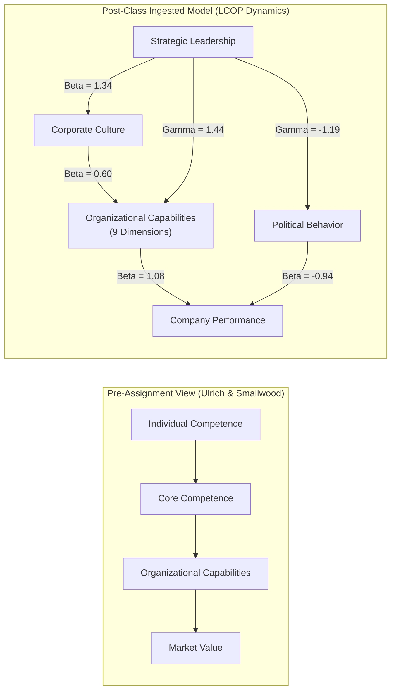
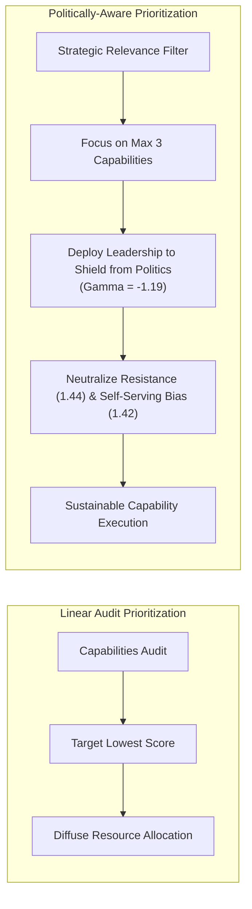

> [!NOTE] Assignment Context & Attribution
>
> - **Course:** MK1 Organizational Behaviour & Managing People — Week 06
> - **Source Prompt:** `archive/courses/mk1/week-06/.extracted/Syndicate 9 - Post-Assignment Week 6.docx.txt`
> - **Reference Attribution:** Analytical synthesis contributed by **F9 (Class F / Syndicate 9)** & **the Portal Maintainer**
> - **Parent Lecture:** [[courses/mk1-organizational-behavior-managing-people/week-06/index|Week 06 Master Lecture Hub]]
> - **Target Case:** [[courses/mk1-organizational-behavior-managing-people/week-06/case-lcop-bumn-private|Case Study: LCOP Structural Equation Model]]

---

## 📋 Part 1: Official Assignment Prompt & Skim Map

- **Executive Objective:** Re-examine baseline pre-assignment answers through the lens of in-class empirical frameworks—specifically Dr. Yuni Ros Bangun's **LCOP Model** (Leadership, Culture, Organizational Politics on Organizational Capability and Performance) and Indonesian state-owned enterprise (BUMN) dynamics.
- **Target Deliverable:** Post-class reflective synthesis demonstrating systematic intellectual progression from initial reading intuition to rigorous organizational dynamics modeling.
- **Core Curricular Map:**
  1. _Question 1 (Defining Capabilities & Market Value)_: Reconstruct through the Organizational Dynamics framework linking Leadership $\rightarrow$ Culture $\rightarrow$ Capabilities $\rightarrow$ Performance.
  2. _Question 2 (Prioritizing Capabilities & Audit Limits)_: Reconstruct by integrating the dampening effects of organizational politics, resistance to change, and self-serving bias in enterprise transformation.

---

## 💡 Part 2: Reference Solution & Framework Revisions

### Question 1: Distinguishing Capabilities & The Performance Transmission Chain

#### Pre-Assignment Baseline Answer

> Organizational capabilities represent the collective competencies, abilities, and expertise of individuals that enable an organization to effectively coordinate its people and resources. They reflect an organization’s DNA, culture, and identity, defining what it is and how it operates. Individual functional competence refers to a person's technical expertise in areas such as HR, marketing, or finance. Core competencies represent collective technical expertise related to core business, such as supply chain management. Organizational capabilities are essential to market value because they are stable, distinguish an organization from competitors, and cannot easily be imitated, as shown by IHG's 71% share price surge from regional collaboration.

#### In-Class Revised Answer (Ingesting Organizational Dynamics & LCOP)

Organizational capabilities represent the collective skills, abilities, and systemic routines that enable an organization to coordinate its human capital and operational resources effectively. They reflect the organization’s cultural DNA and identity, defining not only what an organization does, but fundamentally how it executes and delivers enduring value.

While individual functional competence provides necessary technical expertise (marketing, finance, engineering) and organizational core competencies provide collective mastery in primary business processes (e.g. logistics or risk underwriting), **organizational capabilities represent broader social and operational strengths**—including leadership bench strength, speed, collaboration, innovation, and adaptability. These capabilities act as the definitive organizational conduit that enables technical competencies to translate into commercial performance.

Crucially, as established in the **Organizational Dynamics Framework** and Dr. Yuni Ros Bangun's empirical **LCOP Model**:

1. Merely possessing competent individuals and advanced tangible assets does not guarantee superior business performance.
2. Capabilities are not created automatically; they are shaped endogenously by **Leadership** and mediated by **Organizational Culture**. In BUMN plantation enterprises (PTPN), culture serves as a vital statistical mediator ($\beta = 0.60$) through which leadership builds capability.
3. Intangible capabilities drive capital market valuation because they represent non-depreciating, causally ambiguous, and path-dependent assets that give investors confidence in future cash flow stability regardless of external commodity price turbulence.

#### Reflection: What Changed from Pre-Assignment, and Why?

Our revised analysis bridges Ulrich and Smallwood’s theoretical definitions with empirical organizational dynamics. Previously, our syndicate focused primarily on defining capabilities in isolation and reciting the IHG case study. Following class discussion, we recognized that **competitive advantage depends not on the tangible assets an organization owns, but on how leadership and culture activate those assets into capabilities**. In high-power-distance Indonesian corporate environments, leadership cannot bypass culture; cultivating shared values and adaptability is the prerequisite for building operational capabilities that directly drive enterprise ROA.

---

### Question 2: Audit Prioritization & The Reality of Organizational Politics

#### Pre-Assignment Baseline Answer

> According to Ulrich and Smallwood (2004), leaders should prioritize capabilities based on strategic importance rather than simply improving the lowest audit scores, focusing on no more than three critical capabilities (world-class in two, industry parity in others). Strengths include strategic focus and efficient resource allocation. Limitations include subjective perception biases in senior management surveys, potential neglect of capability interdependencies, and evolving business conditions. Leaders should gather multi-stakeholder feedback and regularly reassess priorities.

#### In-Class Revised Answer (Ingesting Organizational Dynamics & LCOP)

Leaders must prioritize capability investments through an outside-in strategic lens, focusing capital and executive energy exclusively on capabilities that directly impact customer value and competitive differentiation, rather than treating an audit scorecard as an internal checklist. Ulrich and Smallwood's Rule of Three (mastering two capabilities to world-class standards while elevating one bottleneck to parity) remains the benchmark for resource efficiency.

However, incorporating the **LCOP Framework** reveals profound structural limitations that standard Western HR literature overlooks:

1. **The Political Friction Tax**: In state-owned and politicized enterprises, capability improvement initiatives are frequently sabotaged by **Organizational Politics**. In BUMN plantations, political behavior exerts an enormous negative path coefficient on performance ($\beta = -0.94$).
2. **Entrenched Resistance to Change**: Factor loadings show that internal political behavior is heavily driven by **Resistance to Change** ($\lambda = 1.44$ in BUMN vs $0.98$ in private firms) and **Self-Serving Bias** ($\lambda = 1.42$ in BUMN vs $1.11$ in private firms). Even when a capabilities audit correctly identifies a critical gap, mid-level managers may actively undermine implementation if it threatens departmental turf, informal power networks, or discretionary procurement budgets.
3. **The Executive Protection Mandate**: Prioritizing capability development without strong, active **Strategic Leadership** ($\lambda = 1.81$) is futile. Strong leadership is the only structural variable proven to significantly suppress political behavior ($\gamma = -1.19$).

Therefore, successful capability prioritization requires combining multi-stakeholder audit feedback with an explicit **political containment strategy** and deliberate cultural alignment, ensuring that strategic investments are not drained by internal bureaucratic friction.

#### Reflection: What Changed from Pre-Assignment, and Why?

Our revised answer moves beyond clean textbook prioritization by incorporating the messy reality of organizational politics. In our pre-assignment, we treated capability audits as a purely technocratic exercise: measure the gap, pick three priorities, and allocate funds. The Week 6 lecture demonstrated that **organizational dynamics can either accelerate or completely paralyze capability implementation**. Recognizing that political behavior in BUMNs is significantly higher ($p = 0.000$) and highly destructive ($\beta = -0.94$) transformed our managerial perspective: strategic leaders must not only choose the right capabilities to build, but must actively expend political capital to dismantle internal resistance and protect transformation teams.

---

## 🔬 Part 3: Methodological Rigor & Key Analytical Nuances

| Analytical Dimension             | Baseline Pre-Assignment View                                     | Post-Class Ingested LCOP Synthesis (F9 / Maintainer)                                                                                           |
| :------------------------------- | :--------------------------------------------------------------- | :--------------------------------------------------------------------------------------------------------------------------------------------- |
| **Primary Driver of Capability** | Internal HR investments (training, hiring, compensation design). | **Strategic Leadership ($\gamma = 1.44$) mediated by Organizational Culture ($\beta = 0.60$)**.                                                |
| **The Role of Culture**          | General corporate identity and shared brand feeling.             | **Statistically proven mediator**; in BUMNs, leadership cannot build capability without first embedding cultural adaptability and involvement. |
| **Audit Failure Root Cause**     | Methodological survey error or changing market conditions.       | **Internal political sabotage**: resistance to change ($\lambda = 1.44$) and self-serving managerial behavior ($\lambda = 1.42$).              |
| **Performance Equation**         | $\text{Performance} = f(\text{Capabilities})$.                   | $\mathbf{\text{Performance} = 1.08(\text{Capability}) - 0.94(\text{Politics})}$. Political behavior directly offsets capability gains.         |
| **Managerial Prescription**      | Run audit $\rightarrow$ pick 3 $\rightarrow$ train staff.        | Deploy strategic leadership $\rightarrow$ suppress politics ($\gamma = -1.19$) $\rightarrow$ align culture $\rightarrow$ build capability.     |

---

## 🎙️ Part 4: Classroom Cold-Call & Faculty Debrief Strategy

- **Faculty Angle**: "Suppose the Board of Directors at PT Perkebunan Nusantara (PTPN) approves a Rp 500 billion capabilities transformation program to digitize plantation logistics. What is the single biggest threat to that investment?"
- **High-Signal 30-Second Recitation Script**:
  > "The primary threat is not technology vendor failure; it is internal political friction. Dr. Yuni Ros Bangun's LCOP model proves that in BUMN plantations, political behavior exerts a $-0.94$ negative drag on performance, driven by resistance to change ($\lambda = 1.44$) and self-serving bias ($\lambda = 1.42$). Without executive leadership actively dismantling regional operational fiefdoms and shielding project managers from external interference, the Rp 500 billion capital expenditure will be swallowed by political friction before it ever produces organizational speed or efficiency."
- **Indonesian Enterprise Context**: In the consolidation of BUMN holding companies (such as PalmCo under PTPN III Holding or the broader Danantara ecosystem), leaders must recognize that unifying corporate culture around **AKHLAK** is not corporate public relations—it is the vital empirical mediator required to convert sovereign capital into enterprise capability.

---

## 🔗 Knowledge Graph & Curriculum Bridges

- Return to **[[courses/mk1-organizational-behavior-managing-people/week-06/index|Week 06 Masterclass Hub]]**
- Applied Dissertation Case: **[[courses/mk1-organizational-behavior-managing-people/week-06/case-lcop-bumn-private|Case Study: LCOP Structural Equation Model]]**
- Foundational Reading Note: **[[courses/mk1-organizational-behavior-managing-people/week-06/reading-capitalizing-on-capabilities|Reading: Ulrich & Smallwood (2004)]]**
- Baseline Discussion: **[[courses/mk1-organizational-behavior-managing-people/week-06/assignment-pre-organizational-capabilities|Pre-Assignment: Capabilities Foundations]]**
- Subsequent Curricular Module: **[[courses/mk1-organizational-behavior-managing-people/week-07/index|Week 07: Power, Politics & Governance in State-Owned Enterprises]]**
