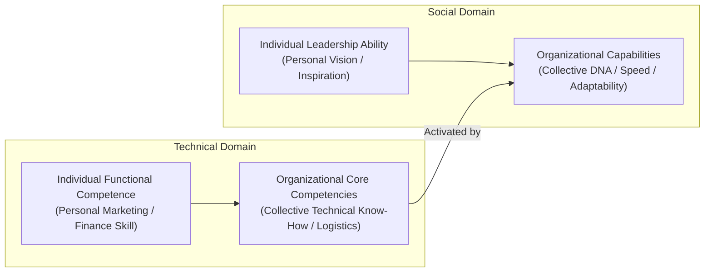
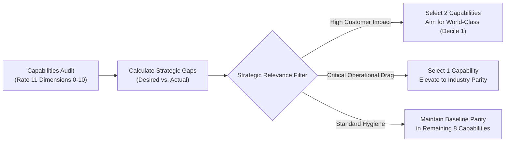

> [!NOTE] Assignment Context & Attribution
>
> - **Course:** MK1 Organizational Behaviour & Managing People — Week 06
> - **Source Prompt:** `archive/courses/mk1/week-06/Pre Assignment Week 6.pdf`
> - **Reference Attribution:** Analytical synthesis contributed by **F9 (Class F / Syndicate 9)** & **the Portal Maintainer**
> - **Parent Lecture:** [[courses/mk1-organizational-behavior-managing-people/week-06/index|Week 06 Master Lecture Hub]]
> - **Target Case:** [[courses/mk1-organizational-behavior-managing-people/week-06/case-lcop-bumn-private|Case Study: LCOP Structural Equation Model]]

---

## 📋 Part 1: Official Assignment Prompt & Skim Map

- **Executive Objective:** Master the foundational distinctions between individual functional competence, organizational core competencies, and organizational capabilities under Dave Ulrich & Norm Smallwood's framework, and evaluate how leaders prioritize intangible capability investments.
- **Target Deliverable:** Rigorous analytical debrief addressing two core strategic questions from Harvard Business Review.
- **Core Diagnostic Questions & Case Exhibit Map:**
  1. _Based on Ulrich & Smallwood (2004), explain what is meant by organizational capabilities. How do they differ from individual functional competence and organizational core competencies, and why are they considered essential to market value?_ — **Where to look:** Ulrich & Smallwood (2004), pp. 119–122, Exhibits "Organizational Capabilities Explained" and IHG Case.
  2. _How should organizational leaders prioritize which capabilities to improve? What are the strengths and limitations of this approach?_ — **Where to look:** Ulrich & Smallwood (2004), pp. 122–126, Exhibit "How to Perform a Capabilities Audit".

---

## 💡 Part 2: Reference Solution & Strategic Analysis

### Question 1: Defining Organizational Capabilities and Their Market Value Nexus

#### 1. Core Conceptual Architecture

**Organizational capabilities** represent the collective skills, abilities, and expertise of an enterprise that enable it to coordinate people and resources to accomplish strategic objectives. They constitute an organization’s cultural DNA and personality, defining not merely what an enterprise possesses, but fundamentally how it operates and delivers value.

Ulrich and Smallwood distinguish organizational capabilities across two fundamental dimensions: the level of analysis (Individual vs. Organizational) and the domain of expertise (Technical vs. Social):

- **Individual Functional Competence**: Refers to a single employee's technical expertise in a specialized functional domain (e.g., financial modeling, metallurgical engineering, software architecture).
- **Organizational Core Competencies**: Represent the collective technical know-how of an enterprise within its primary line of business (e.g., automated container terminal routing in port operations, specialized refining technology in oil and gas).
- **Organizational Capabilities**: Represent the collective social, cultural, and operational capacities (e.g., speed, agility, innovation, collaboration, accountability) that allow an enterprise to bind individual technical talent and core competencies into market results.

#### 2. The Market Value Mechanism

Capital markets price companies based on future cash-flow expectations rather than past book value. Tangible assets (factories, equipment, real estate) and technical functional skills can be readily purchased, leased, or imitated by competitors. In contrast, organizational capabilities are:

1. **Stable Over Time**: Deeply embedded in social norms, communication patterns, and administrative processes.
2. **Socially Complex & Causal Ambiguity**: Difficult for competitors to reverse-engineer or poach through individual hiring.
3. **Investor Confidence Anchors**: Reassure capital markets that the enterprise can adapt successfully when macroeconomic or industry conditions shift.

**Empirical Case Evidence**: Following its corporate spin-off in 2003, **InterContinental Hotels Group (IHG)** conducted a capabilities audit focused on cross-regional collaboration. By breaking regional operating silos and integrating marketing and procurement platforms, IHG achieved over **$100 million in annual cost savings**. In response, capital markets drove a **71% increase in IHG's share price** between April 2003 and February 2004, proving that intangible organizational capability creates measurable market equity.

---

### Question 2: Strategic Prioritization of Capability Investments

#### 1. The Recommended Prioritization Protocol

Rather than attempting to fix every operational weakness or allocating capital to the capabilities with the lowest audit scores, Ulrich and Smallwood mandate that leaders prioritize investments strictly based on **strategic relevance and competitive impact**:

- **The Rule of Three**: Leaders should focus executive attention and capital expenditure on no more than **three critical capabilities**.
- **World-Class Differentiation**: Aim to achieve top-decile, world-class excellence in **two capabilities** that directly deliver on the customer value proposition.
- **Strategic Parity**: Elevate **one critical bottleneck capability** to industry parity while maintaining acceptable baseline performance across the remaining dimensions.

#### 2. Methodological Strengths

1. **Capital and Attention Concentration**: Prevents executive exhaustion and prevents dilution of corporate resources across diffuse initiatives.
2. **Outside-In Alignment**: Forces the executive committee to evaluate capabilities through the lens of customer promises and investor expectations rather than internal vanity metrics.
3. **Structured Diagnostic Discipline**: The capabilities audit provides a concrete, quantified gap analysis that turns subjective organizational perceptions into an actionable transformation agenda.

#### 3. Methodological Limitations & Risks

1. **Perceptual and Seniority Bias**: Audit ratings often rely heavily on executive self-reporting, creating an echo chamber that masks frontline operational friction.
2. **Interdependency Blindspots**: Capabilities are structurally interdependent. For instance, focusing exclusively on _Innovation_ while neglecting _Accountability_ or _Speed_ produces uncommercialized concepts and project delays.
3. **Environmental Staticness**: Business unit audits assume a relatively stable planning horizon. If environmental turbulence surges (e.g., sudden regulatory price caps or currency shocks), prioritized capabilities may rapidly become obsolete.

---

## 🔬 Part 3: Methodological Rigor & Key Analytical Nuances

| Analytical Dimension           | Baseline Reading Intuition                                                                | Rigorous Methodological Nuance (F9 / Maintainer Synthesis)                                                                                          |
| :----------------------------- | :---------------------------------------------------------------------------------------- | :-------------------------------------------------------------------------------------------------------------------------------------------------- |
| **Capability vs. Competence**  | Treats "competence" and "capability" as interchangeable synonyms for skill.               | Disentangles individual vs. collective and technical vs. social architecture; capabilities represent the social glue activating technical know-how. |
| **Audit Prioritization Logic** | Assumes organizations should fix whatever scored lowest on the audit scorecard.           | Exposes lowest-score gap-filling as a fatal strategic error; mandates the Rule of Three aligned strictly to competitive differentiation.            |
| **Market Value Transmission**  | Assumes market value reflects tangible capital expenditure and current quarterly profits. | Recognizes that intangible capabilities explain valuation premiums (e.g. JetBlue 2x Delta valuation) by de-risking future adaptability.             |
| **Governance Feasibility**     | Assumes audit recommendations can be executed by executive decree.                        | Identifies that without organizational de-politicization and cultural buy-in, capability programs face fatal internal sabotage.                     |

---

## 🎙️ Part 4: Classroom Cold-Call & Faculty Debrief Strategy

- **Faculty Angle**: "Why do large state-owned enterprises (BUMN) with the highest concentration of technical PhDs and certified engineers often exhibit the slowest operational speed?"
- **High-Signal 30-Second Recitation Script**:
  > "Because technical functional competence in Cell 1 does not aggregate automatically into organizational capability in Cell 4. An enterprise can employ brilliant individual engineers, but if its social architecture is paralyzed by bureaucratic silos, low accountability, and fear of procedural audit penalties, its collective speed capability will be near zero. Capabilities are cultural and systemic—they cannot be hired individually; they must be built institutionally."
- **Indonesian / BUMN Reality**: In Indonesian state enterprises, capability audits must account for regulatory compliance (_BPK/KPK_ scrutiny) and multi-stakeholder governance. A capability like _Speed_ or _Innovation_ cannot be unlocked purely through private-sector managerial fiat; it requires structural protection from internal political resistance and clear alignment with national development priorities.

---

## 🔗 Knowledge Graph & Curriculum Bridges

- Return to **[[courses/mk1-organizational-behavior-managing-people/week-06/index|Week 06 Masterclass Hub]]**
- Linked Deep-Dive Reading: **[[courses/mk1-organizational-behavior-managing-people/week-06/reading-capitalizing-on-capabilities|Reading: Ulrich & Smallwood (2004)]]**
- Standalone Case Study: **[[courses/mk1-organizational-behavior-managing-people/week-06/case-lcop-bumn-private|Case Study: LCOP Structural Equation Model (PTPN vs. Private)]]**
- Integrated Post-Assignment: **[[courses/mk1-organizational-behavior-managing-people/week-06/assignment-post-indonesian-dynamics|Post-Assignment: Indonesian Dynamics & LCOP]]**
