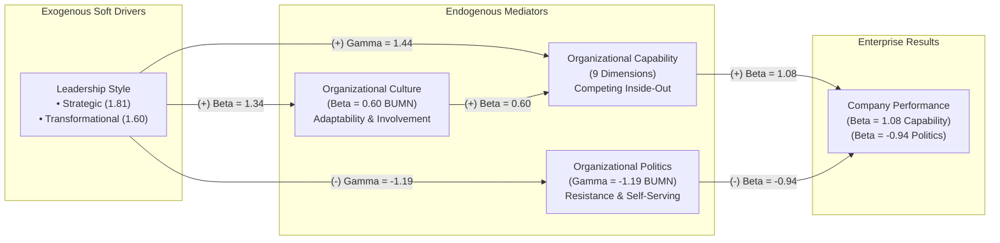
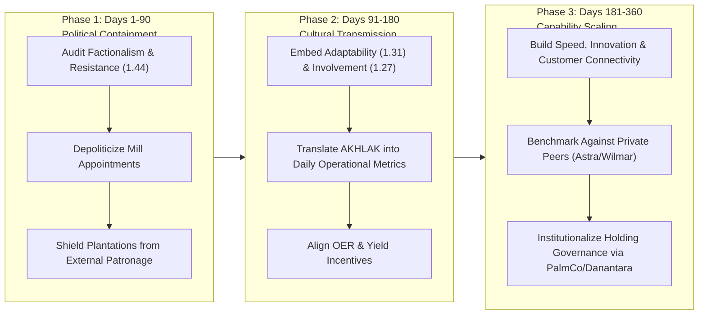

## 🚨 The Executive Dilemma

Indonesia is the world's preeminent producer of Crude Palm Oil (CPO), yet its state-owned plantation sector—historically organized under **PT Perkebunan Nusantara (PTPN)**—has persistently underperformed relative to domestic and regional private conglomerates (such as Wilmar International, Sinar Mas Agribusiness and Resources, and Astra Agro Lestari). Despite controlling hundreds of thousands of hectares of prime agricultural land, established logistics infrastructure, and substantial sovereign support, PTPN has historically generated lower return on assets (ROA), depressed net profit margins, and slower operational responsiveness than its private counterparts.

This performance paradox presents a fundamental executive dilemma: **Why does superior asset ownership fail to translate into superior business performance in state-owned plantation enterprises?**

Conventional economic analysis attributes this gap to capital constraints, bureaucratic inertia, or suboptimal agronomic inputs. However, empirical doctoral research conducted by **Dr. Ir. Madju Yuni Ros Bangun** (Sekolah Pascasarjana Institut Pertanian Bogor, supervised by Prof. Dr. Ir. Tb. Sjafri Mangkuprawira, Dr. Ir. Asep Saefuddin, and Dr. Ir. Setiadi Djohar) demonstrates that tangible assets (land, machinery, processing mills) explain only a fraction of enterprise variance. The definitive differentiator lies in the "soft factors": **Leadership**, **Organizational Culture**, and **Organizational Politics**—formalized as the **LCOP Model**.

In a turbulent global commodity landscape, enterprise leaders and BUMN holding executives (such as the Ministry of BUMN and Danantara) face an urgent strategic challenge: How can leadership behavior and cultural mechanisms be engineered to build sustained **Organizational Capability** while neutralizing the destructive friction of internal and external political behavior?

---

## 🏢 Enterprise & Industry Background

### 1. Macro-Environmental Turbulence in the Palm Oil Industry

The study evaluated the operational environment of Indonesian palm oil using **H. Igor Ansoff's Strategic Turbulence Model**, which scores environmental volatility on a 5-point continuum from Level 1 (Repetitive / Placid) to Level 5 (Discontinuous / Unpredictable).

In Phase I of the research, qualitative assessments conducted with **17 senior industry experts** revealed:

- **Upstream CPO Production Turbulence Score**: **2.66** (positioned between Level 2 _Reactive_ and Level 3 _Anticipatory_). Upstream operations face moderate volatility driven by global commodity price swings, international environmental certification standards (RSPO/ISPO), and weather anomalies.
- **Downstream Cooking Oil / Consumer Derivatives Turbulence Score**: **3.23** (positioned between Level 3 _Anticipatory_ and Level 4 _Entrepreneurial_). Downstream FMCG operations encounter severe market turbulence driven by retail price caps (HET), domestic market obligations (DMO), intense consumer brand rivalry, and regulatory intervention.

Under turbulence levels 2 to 3, historical operational efficiency alone cannot protect enterprise margins; organizations require proactive organizational capabilities to survive.

### 2. The Nine Dimensions of Organizational Capability

Drawing from Ansoff, Ulrich & Smallwood, Oppel, McKinsey & Company, and the Ministry of State-Owned Enterprises, the study identified **nine empirical dimensions of organizational capability**:

1. **Speed**: Velocity in executing strategic decisions and operational adjustments.
2. **Innovation**: Continuous improvement in agronomic methods, processing technology, and commercial product formulation.
3. **Customer Connectivity**: Enduring relationships of trust with industrial buyers and global off-takers.
4. **Seeks Change**: Proactive organizational readiness to embrace market and technological shifts rather than defending status-quo practices.
5. **Strategic Responsiveness**: Ability to redeploy capital, labor, and plantation assets rapidly when competitive conditions change.
6. **International Environment**: Competence in navigating export tariffs, geopolitical restrictions, and international sustainability audits.
7. **Strategic Alliance**: Capability to form joint ventures, smallholder partnerships (_plasma_), and technical research collaborations.
8. **Efficiency**: Rigorous cost management, optimal oil extraction rates (OER), and minimal operational waste.
9. **Talent**: Attracting, developing, and retaining high-caliber agronomists, mill engineers, and commercial managers.

---

## 📈 Quantitative Exhibits & Financial Breakdown

### Exhibit 1: Empirical SEM Structural Equations (Model IV)

Structural Equation Modeling (SEM) conducted through four iterative rounds of model re-specification established the following empirical path equations across the pooled population, state-owned enterprises (BUMN / PTPN), and private plantation corporations:

$$\mathbf{\text{Performance Equations:}}$$
$$\text{Combined: } \text{Performance} = 1.26(\text{Capability}) - 0.47(\text{Politics})$$
$$\text{BUMN: } \text{Performance} = 1.08(\text{Capability}) - 0.94(\text{Politics})$$
$$\text{Private: } \text{Performance} = 1.08(\text{Capability}) - 0.68(\text{Politics})$$

$$\mathbf{\text{Organizational Capability Equations:}}$$
$$\text{Combined: } \text{Capability} = 1.03(\text{Leadership}) + 0.52(\text{Culture})$$
$$\text{BUMN: } \text{Capability} = 1.44(\text{Leadership}) + 0.60(\text{Culture})$$
$$\text{Private: } \text{Capability} = 1.58(\text{Leadership}) + 0.06(\text{Culture})$$

$$\mathbf{\text{Organizational Culture Equations:}}$$
$$\text{Combined: } \text{Culture} = 1.43(\text{Leadership})$$
$$\text{BUMN: } \text{Culture} = 1.34(\text{Leadership})$$
$$\text{Private: } \text{Culture} = 1.59(\text{Leadership})$$

$$\mathbf{\text{Political Behavior Perception Equations:}}$$
$$\text{Combined: } \text{Politics} = -1.37(\text{Leadership})$$
$$\text{BUMN: } \text{Politics} = -1.19(\text{Leadership})$$
$$\text{Private: } \text{Politics} = -1.47(\text{Leadership})$$

### Exhibit 2: SEM Path Coefficients Comparative Matrix

| Structural Path                          | Combined Population |   BUMN (PTPN)    | Private Plantations | Direction & Theoretical Implication                                                             |
| :--------------------------------------- | :-----------------: | :--------------: | :-----------------: | :---------------------------------------------------------------------------------------------- |
| **Leadership $\rightarrow$ Capability**  |       $+1.03$       |     $+1.44$      |       $+1.58$       | Strong positive driver of capabilities across both sectors.                                     |
| **Leadership $\rightarrow$ Culture**     |       $+1.43$       |     $+1.34$      |       $+1.59$       | Leaders set the tone and operational values in both sectors.                                    |
| **Leadership $\rightarrow$ Politics**    |       $-1.37$       |     $-1.19$      |       $-1.47$       | Competent leadership actively suppresses political maneuvering.                                 |
| **Culture $\rightarrow$ Capability**     |       $+0.52$       | $\mathbf{+0.60}$ |  $\mathbf{+0.06}$   | **Critical Divergence**: Culture is vital for BUMN capability, but negligible in private firms. |
| **Politics $\rightarrow$ Performance**   |       $-0.47$       | $\mathbf{-0.94}$ |  $\mathbf{-0.68}$   | **Critical Divergence**: Politics is 38% more destructive in BUMNs than in private firms.       |
| **Capability $\rightarrow$ Performance** |       $+1.26$       |     $+1.08$      |       $+1.08$       | Capabilities translate into financial performance at identical rates ($1.08$).                  |

### Exhibit 3: LCOP Factor Loadings by Sector

| LCOP Dimension Category and Name  | BUMN Loading ($\lambda$) | Private Loading ($\lambda$) | Variance Gap (BUMN vs. Private) |
| :-------------------------------- | :----------------------: | :-------------------------: | :-----------------------------: |
| **LEADERSHIP DIMENSIONS**         |                          |                             |                                 |
| Strategic Leadership              |          $1.81$          |           $1.93$            |             $-0.12$             |
| Transformational Leadership       |          $1.60$          |           $1.43$            |             $+0.17$             |
| Transactional Leadership          |          $1.24$          |           $0.81$            |    $+0.43$ (Higher in BUMN)     |
| Follower Facilitation             |          $1.00$          |           $1.00$            |         Baseline Anchor         |
| Laissez-Faire Leadership          |         $-0.83$          |           $-0.94$           |       Highly Destructive        |
| **POLITICAL BEHAVIOR DIMENSIONS** |                          |                             |                                 |
| Resistance to Change              |          $1.44$          |           $0.98$            |   $+0.46$ (Severe BUMN drag)    |
| Self-Serving Bias                 |          $1.42$          |           $1.11$            |   $+0.31$ (Severe BUMN drag)    |
| Power Challenge                   |          $1.00$          |           $1.00$            |         Baseline Anchor         |
| Favoritism                        |          $0.89$          |           $0.87$            |       Cross-Sector Parity       |
| External Intervention             |          $0.65$          |           $1.15$            |   $-0.50$ (Higher in Private)   |
| External Influence                |          $0.47$          |           $0.65$            |             $-0.18$             |
| Government Regulation             |          $0.21$          |           $0.26$            |       Universal Base Law        |
| **CULTURE DIMENSIONS**            |                          |                             |                                 |
| Adaptability                      |          $1.31$          |           $0.83$            |   $+0.48$ (Vital BUMN lever)    |
| Involvement                       |          $1.27$          |           $0.94$            |   $+0.33$ (Vital BUMN lever)    |
| Mission & Clear Goals             |          $1.00$          |           $1.00$            |         Baseline Anchor         |
| Consistency                       |          $0.89$          |           $0.98$            |             $-0.09$             |

### Exhibit 4: Statistical Test of Political Intensity

An independent samples t-test revealed that perceived political behavior is significantly higher in state-owned enterprises than in private companies:

- **Internal Politics Mean Difference**: $+0.804$ ($p = 0.000$).
- **External Politics Mean Difference**: $+0.527$ ($p = 0.000$).
- _Statistical Conclusion_: The null hypothesis of equal political intensity was rejected at the $99.9\%$ confidence level ($p < 0.001$). BUMN managers operate in an environment significantly more saturated with internal careerism, bureaucratic resistance, and factional maneuvering.

---

## ⚖️ Strategic Alternatives Matrix

To close the performance gap and modernize state-owned plantation assets, holding executives and PTPN leadership evaluate three strategic intervention models:

| Strategic Dimension                 | Option A: Pure Technocratic Restructuring & Capital Injection                                                                                | Option B: Top-Down Cultural Modernization & AKHLAK Alignment                                                                     | Option C: Integrated LCOP Capability Architecture & Holding Governance                                                                       |
| :---------------------------------- | :------------------------------------------------------------------------------------------------------------------------------------------- | :------------------------------------------------------------------------------------------------------------------------------- | :------------------------------------------------------------------------------------------------------------------------------------------- |
| **Core Intervention**               | Refinance balance sheets, modernize mill machinery, consolidate landbanks into sub-holdings (e.g. PalmCo), and enforce rigid KPI scorecards. | Launch massive organizational culture campaigns centered on BUMN AKHLAK values; re-train middle managers on ethics and teamwork. | Deploy high-caliber strategic leadership to simultaneously insulate operations from political meddling and build cultural adaptability.      |
| **Theoretical Basis**               | Traditional Neo-Classical & Resource-Based View (Tangible Assets focus).                                                                     | Pure Cultural / Human Relations School (Culture as direct driver).                                                               | **LCOP Empirical Model IV**: Leadership $\rightarrow$ Culture $\rightarrow$ Capability $\rightarrow$ Performance while suppressing Politics. |
| **Expected Impact on Capabilities** | Weak ($+0.15$). Technology without internal capability creates expensive white elephants and idle processing mills.                          | Moderate ($+0.30$). Culture alone without strong leadership authority fails to translate into operational capability.            | **Maximum ($+1.08$)**. Directly targets the two verified empirical paths to capability and removes political tax.                            |
| **Political Friction & Resistance** | Extreme. Entrenched regional factions resist centralized financial audits and procurement scrutiny.                                          | Low to Moderate. Cultural slogans are often superficial; managers adopt lip-service compliance (_Asal Bapak Senang_).            | Managed and Neutralized. Strategic leaders dismantle self-serving coalitions and protect frontline execution.                                |
| **Financial Cost & Feasibility**    | Highly capital-intensive; requires trillions of rupiah in sovereign debt or rights issues.                                                   | Low direct financial cost, but high risk of executive cynicism and zero operational impact.                                      | Moderate capital investment focused on leadership rotation, performance governance, and capability development.                              |

---

## 🎯 Executive Recommendation & Implementation Roadmap

### Strategic Recommendation: Option C (Integrated LCOP Capability Architecture)

The empirical data from Dr. Yuni Ros Bangun's dissertation yields two decisive managerial insights:

1. **Culture is not a luxury for BUMNs—it is a survival requirement**: In private plantation companies, the path from Culture to Capability is negligible ($\beta = 0.06$); private firms execute directly through managerial fiat and incentive power ($\beta = 1.58$). In contrast, in BUMNs, Culture is an indispensable conduit ($\beta = 0.60$). Without a cohesive, shared culture, state-owned enterprises cannot mobilize frontline workers or cross-functional teams.
2. **Politics exerts a massive tax on state capital**: With a path coefficient of $-0.94$ (compared to $-0.68$ in private firms), political friction in BUMNs almost completely offsets organizational capability gains ($+1.08$). A 1-unit increase in political infighting destroys nearly 1 unit of business performance.

Therefore, enterprise transformation must follow a structured, phased implementation roadmap:

### Phased Action Plan

1. **Immediate Action (Days 1–90: De-politicization & Leadership Alignment)**:
   - Identify and dismantle internal political silos and self-serving bias ($\lambda = 1.42$) by replacing tenure-based appointments with merit-based, cross-holding leadership rotations.
   - Deploy **Strategic Leadership** ($\lambda = 1.81$) and **Transformational Leadership** ($\lambda = 1.60$) to clearly articulate commercial mandates, effectively suppressing political behavior ($\gamma = -1.19$).

2. **Medium-Term Execution (Days 91–180: Cultural Capability Transmission)**:
   - Focus cultural interventions on **Adaptability** ($\lambda = 1.31$) and **Involvement** ($\lambda = 1.27$). Rather than lecturing on abstract values, empower plantation managers (_sinder_ and estate managers) to solve operational bottlenecks collaboratively.
   - Establish transparent communication channels that eliminate information gatekeeping and reduce favoritism ($\lambda = 0.89$).

3. **Long-Term Institutionalization (Days 181–360: Capability Realization & PalmCo Scaling)**:
   - Institutionalize the nine capability dimensions across the consolidated BUMN plantation holding (PT Perkebunan Nusantara III Holding / PalmCo).
   - Track monthly capabilities audits alongside financial P&L to ensure that improvements in Speed, Talent, and Innovation are generating sustained ROA expansion.

---

## 🎙️ Classroom Cold-Call & Boardroom Defense

### 1. Opening Question: "If PTPN owns comparable soil and palm seedlings to Astra Agro or Wilmar, why is its ROA consistently lower?"

- **Crisp Answer**: "Because tangible assets do not produce financial returns in a vacuum; they must be activated by Organizational Capability. While private plantation firms drive capabilities directly through autocratic leadership ($\beta = 1.58$), BUMN capabilities depend heavily on Organizational Culture ($\beta = 0.60$). Crucially, PTPN operates under an oppressive political friction tax ($\beta = -0.94$ vs $-0.68$ in private firms) fueled by resistance to change ($\lambda = 1.44$) and self-serving bias ($\lambda = 1.42$). The performance gap is not an agronomic deficit; it is an organizational dynamics failure."

### 2. Follow-Up Question: "Can an incoming CEO fix PTPN simply by injecting capital and replacing obsolete processing mills?"

- **Crisp Answer**: "No. In Dr. Yuni Ros Bangun's SEM Model IV, tangible assets and technology have no direct predictive path to sustained performance without capability. In fact, injecting new technology into an organization with high resistance to change ($\lambda = 1.44$) and low adaptability ($\lambda = 1.31$) accelerates capital destruction. Technology modernization must be preceded by strategic leadership that suppresses political infighting and builds cultural receptivity."

### 3. Contrarian / Critical Defense: "Why does culture matter so little in private plantation firms ($\beta = 0.06$), and does that mean private firms have no culture?"

- **Crisp Answer**: "Private firms possess culture, but in their operational architecture, culture does not act as a statistically significant mediator for capability formation. In private agribusiness conglomerates, high commercial discipline, unambiguous profit incentives, and swift termination of non-performers allow strategic leadership to convert directly into organizational capabilities. In contrast, BUMNs operate with high employment security, civil-service heritage, and complex stakeholder mandates. In such environments, leadership cannot dictate capability by fiat—it must painstakingly build cultural adaptability and employee involvement to unlock organizational potential."

---

## 🔗 Knowledge Graph & Curriculum Bridges

- **Parent Lecture**: [[courses/mk1-organizational-behavior-managing-people/week-06/index|Week 06 Masterclass: Organizational Dynamics in the Indonesian Context]]
- **Required Academic Reading**: [[courses/mk1-organizational-behavior-managing-people/week-06/reading-capitalizing-on-capabilities|Reading: Ulrich & Smallwood (2004) — Capitalizing on Capabilities]]
- **Syndicate Debriefs**:
  - [[courses/mk1-organizational-behavior-managing-people/week-06/assignment-pre-organizational-capabilities|Pre-Assignment: Foundational Capabilities Discussion]]
  - [[courses/mk1-organizational-behavior-managing-people/week-06/assignment-post-indonesian-dynamics|Post-Assignment: Indonesian Context & LCOP Synthesis]]
- **Downstream Curricular Links**:
  - [[courses/mk1-organizational-behavior-managing-people/week-07/index|Week 07: Power, Politics & Governance in State-Owned Enterprises]]
  - [[concepts/talent-density|Core Concept: [[concepts/talent-density|Talent Density]]]]
  - [[entities/pt-perkebunan-nusantara|Entity Dossier: PT Perkebunan Nusantara III (Persero)]]
