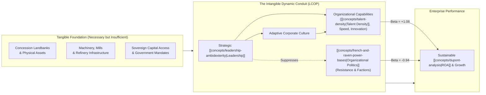
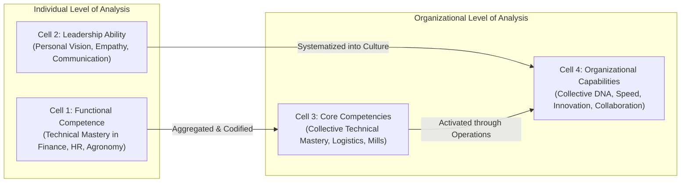
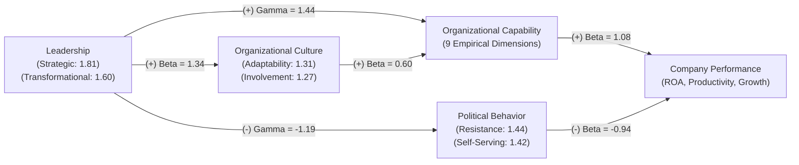
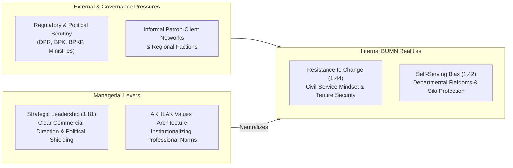

> [!NOTE] Curricular & Faculty Metadata
>
> - **Course:** MK1 Organizational Behaviour & Managing People — Week 06
> - **Teaching Team:** Dr. Ir. Madju Yuni Ros Bangun, Muhammad Yorga Permana, Ph.D., Widhyawan Prawiraatmadja, Ph.D., Yudo Anggoro, Ph.D.
> - **Primary Curricular Spine:** `archive/courses/mk1/week-06/Week 6 Organizational Dynamics in the Indonesian Context.pdf` (37 slides)
> - **Direct Satellites & Problem Sets:**
>   - [[courses/mk1-organizational-behavior-managing-people/week-06/case-lcop-bumn-private|Case Study: LCOP Structural Equation Model (BUMN vs. Private Plantations)]]
>   - [[courses/mk1-organizational-behavior-managing-people/week-06/reading-capitalizing-on-capabilities|Academic Reading: Capitalizing on Capabilities (Ulrich & Smallwood, 2004)]]
>   - [[courses/mk1-organizational-behavior-managing-people/week-06/assignment-pre-organizational-capabilities|Pre-Assignment: Foundational Capabilities Discussion (F9 Debrief)]]
>   - [[courses/mk1-organizational-behavior-managing-people/week-06/assignment-post-indonesian-dynamics|Post-Assignment: Indonesian Context & LCOP Reflective Synthesis (F9 Debrief)]]

---

## 1. Executive Overview & Foundations of Organizational Dynamics

### The BUMN Return-on-Assets Paradox

When enterprise analysts evaluate state-owned enterprises (BUMN) across Indonesia’s most strategic natural resource sectors—petroleum refining, mining, and agribusiness—they confront a glaring empirical anomaly: **massive tangible asset bases coupled with depressed capital returns**.

In the domestic oil and gas sector, national oil company PT Pertamina historically generated a return on assets (ROA) of approximately **1.04%**, significantly lagging regional and international operating peers (such as Chevron, ExxonMobil, and Petronas). In the agricultural sector, state-owned plantation holding **PT Perkebunan Nusantara (PTPN)** has historically trailed private palm oil conglomerates (Astra Agro Lestari, Wilmar International, and Sinar Mas) across operating margins, CPO yield per hectare, and capital productivity, despite PTPN possessing some of the oldest, most strategically located concession landbanks in Sumatra and Kalimantan.

Why does this persistent performance gap exist? As emphasized in Week 6 by **Dr. Ir. Madju Yuni Ros Bangun**, financial performance is not a simple function of tangible inputs:

- **Tangible Assets**: Land, processing technology, physical machinery, and financial capital represent necessary operational baselines. They are easily bought, leased, or mandated.
- **Intangible Capabilities**: The internal social architecture, routines, and cultural mechanisms that enable an enterprise to coordinate people and resources effectively under conditions of industry volatility.

Competing in turbulent markets requires **competing from the inside out**. When an enterprise lacks organizational capability, every rupiah of injected capital or modernized technology is eroded by internal political resistance, slow decision-making, and cultural paralysis.

---

## 2. Theoretical Architecture & Core Frameworks

### 1. The Competence-Capability Matrix (Ulrich & Smallwood, 2004)

To build actionable corporate capabilities, leaders must resolve common semantic confusion between skills, competencies, and capabilities across individual and organizational levels:

$$\mathbf{\text{Intangible Market Premium} = \text{Organizational Capabilities} \times \text{Strategic Unity}}$$

1. **Individual Functional Competence (Cell 1)**: Technical expertise possessed by single individuals (e.g. soil chemistry, derivatives hedging, programming).
2. **Individual Leadership Ability (Cell 2)**: The personal capacity of an executive to inspire, set direction, and motivate direct reports.
3. **Organizational Core Competencies (Cell 3)**: The collective technical mastery an enterprise possesses in its primary business lines (e.g. deepwater drilling, port container scheduling).
4. **Organizational Capabilities (Cell 4)**: The collective, intangible social capabilities—such as speed, collaboration, shared mindset, and learning—that define an enterprise's personality and allow technical competencies to generate market value.

---

### 2. The LCOP Structural Equation Model (Dr. Yuni Ros Bangun)

In her landmark empirical dissertation at Institut Pertanian Bogor, Dr. Yuni Ros Bangun established the **LCOP Model (Model Akhir IV)**, mapping the structural relationships between **Leadership**, **Organizational Culture**, **Organizational Politics**, **Organizational Capability**, and **Company Performance** across Indonesian plantation corporations:

$$\mathbf{\text{Performance Equations:}}$$
$$\text{Combined: } \text{Performance} = 1.26(\text{Capability}) - 0.47(\text{Politics})$$
$$\text{BUMN (PTPN): } \text{Performance} = 1.08(\text{Capability}) - 0.94(\text{Politics})$$
$$\text{Private Conglomerates: } \text{Performance} = 1.08(\text{Capability}) - 0.68(\text{Politics})$$

$$\mathbf{\text{Capability Formation Equations:}}$$
$$\text{Combined: } \text{Capability} = 1.03(\text{Leadership}) + 0.52(\text{Culture})$$
$$\text{BUMN (PTPN): } \text{Capability} = 1.44(\text{Leadership}) + 0.60(\text{Culture})$$
$$\text{Private Conglomerates: } \text{Capability} = 1.58(\text{Leadership}) + 0.06(\text{Culture})$$

$$\mathbf{\text{Political Behavior & Cultural Alignment:}}$$
$$\text{BUMN Culture: } \text{Culture} = 1.34(\text{Leadership}) \quad \mid \quad \text{BUMN Politics: } \text{Politics} = -1.19(\text{Leadership})$$

#### Decisive Empirical Insights from the LCOP Model

1. **Full Mediation of Leadership and Culture**: Neither Leadership nor Culture has a direct structural arrow to Performance. Their entire impact is mediated through **Organizational Capability**. Leaders cannot simply "inspire" higher profits; they must translate inspiration into institutionalized operational capabilities.
2. **The Culture Divergence (BUMN vs. Private)**: In private agribusiness conglomerates, culture has virtually zero direct effect on capability building ($\beta = 0.06$). Private firms drive capabilities through centralized leadership authority and market incentives ($\beta = 1.58$). In contrast, in BUMNs, culture is an indispensable mediator ($\beta = 0.60$). Without cultivating employee involvement and cultural adaptability, BUMN leadership cannot build capability.
3. **The Disproportionate Cost of BUMN Politics**: Political behavior is significantly higher in BUMNs ($p = 0.000$) and is **38% more destructive** to financial performance ($-0.94$ in BUMN vs. $-0.68$ in private firms). A single unit increase in internal factionalism and self-serving bias nearly wipes out an entire unit of capability gains ($+1.08$).

---

## 3. Managerial Crucible: Indonesian Enterprise & BUMN Context

### Navigating the State Enterprise Operating Environment

Indonesian BUMN leaders operate under an intense dual mandate: achieving commercial profitability while fulfilling state developmental and public service obligations (_PSO_). This environment creates distinct organizational friction points:

1. **Resistance to Change ($\lambda = 1.44$)**: Decades of tenure-based promotion and guaranteed job security have created deep organizational inertia. Frontline mill operators and plantation managers (_sinder_) frequently view process digitization and objective performance tracking as personal threats rather than operational upgrades.
2. **Self-Serving Bias ($\lambda = 1.42$)**: Middle managers often optimize for departmental preservation and discretionary procurement control rather than enterprise-wide ROA.
3. **The Role of AKHLAK as an Operational Conduit**: Introduced by the Ministry of BUMN, the **AKHLAK** core values (_Amanah, Kompeten, Harmonis, Loyal, Adaptif, Kolaboratif_) are frequently dismissed as mere corporate slogans. However, when viewed through the LCOP Model, AKHLAK addresses the exact cultural dimensions required for capability building—specifically **Adaptability** ($\lambda = 1.31$) and **Involvement** ($\lambda = 1.27$). When embedded into performance appraisals, AKHLAK directly strengthens the $\beta = 0.60$ cultural conduit to organizational capability.

---

## 4. Cross-Functional Implementation & Strategic Trade-offs

Building organizational capabilities in state-owned enterprises triggers severe cross-functional friction between operational speed, human capital governance, and legal compliance:

| Functional Tension        | The Operational Mandate (Speed & Innovation)                                                                                       | The Governance Mandate (Legal & Audit Compliance)                                                                                                       | Strategic Synthesis & Resolution                                                                                                                                             |
| :------------------------ | :--------------------------------------------------------------------------------------------------------------------------------- | :------------------------------------------------------------------------------------------------------------------------------------------------------ | :--------------------------------------------------------------------------------------------------------------------------------------------------------------------------- |
| **Procurement & Capex**   | Operations demands rapid procurement of processing machinery and fertilizer to capitalize on global CPO price spikes.              | Legal and Internal Audit (_SPI_) mandate multi-layered vendor tenders and bureaucratic reviews to prevent administrative audit findings (_temuan BPK_). | Implement pre-approved vendor frameworks, digital spot-market auctions, and transparent audit trails that preserve speed while guaranteeing compliance.                      |
| **Performance-Based Pay** | Commercial leadership seeks wide compensation spreads ($0\%$ to $12\%+$) to retain star agronomists and commercial off-takers.     | Human Resources and Labor Unions (_SP-BUMN_) demand egalitarian pay grades and seniority-based annual increases to maintain industrial peace.           | Decouple base pay from variable performance incentives; fund discretionary bonus pools directly from measurable operational productivity (e.g. Oil Extraction Rate gains).   |
| **Cross-Holding Synergy** | Holding executives (e.g. PalmCo / Danantara) seek to centralize marketing, seed research, and logistics across all regional PTPNs. | Regional subsidiaries defend historical autonomy, citing localized soil conditions and established distributor relationships.                           | Establish shared services organizations (SSO) with clear service-level agreements (SLAs), incentivizing regional managers through holding-level equity and dividend metrics. |

---

## 📚 Required Readings & In-Depth Satellites

| Document Title                     | Author / Institution                                                  | Core Focus / Methodological Contribution                                                                                            | Study Note                                                                                                                |
| :--------------------------------- | :-------------------------------------------------------------------- | :---------------------------------------------------------------------------------------------------------------------------------- | :------------------------------------------------------------------------------------------------------------------------ |
| **Capitalizing on Capabilities**   | Dave Ulrich & Norm Smallwood (_Harvard Business Review_, 2004)        | Establishes the 2x2 competence-capability matrix, the 11 core capabilities, and the capabilities audit protocol.                    | [[courses/mk1-organizational-behavior-managing-people/week-06/reading-capitalizing-on-capabilities\|Open Deep-Dive Note]] |
| **LCOP Structural Equation Model** | Dr. Ir. Madju Yuni Ros Bangun (_IPB Doctoral Dissertation / SBM ITB_) | Empirical SEM analyzing Leadership, Culture, and Politics on Capability and Performance in Indonesian BUMN vs. Private Plantations. | [[courses/mk1-organizational-behavior-managing-people/week-06/case-lcop-bumn-private\|Open Case Study Dossier]]           |

---

## 📂 Primary Source Media & Digital Archives

| Material Title                                          |      Media Type       | Source Repository & Reference Path                                                         |
| :------------------------------------------------------ | :-------------------: | :----------------------------------------------------------------------------------------- |
| **Week 6 Master Lecture Deck: Organizational Dynamics** | Presentation (`.pdf`) | `archive/courses/mk1/week-06/Week 6 Organizational Dynamics in the Indonesian Context.pdf` |
| **LCOP BUMN vs Private Research Deck**                  | Presentation (`.pdf`) | `archive/courses/mk1/week-06/LCOP BUMN PRIVATE.pdf`                                        |
| **Ulrich & Smallwood (2004) HBR Reprint**               |   Reading (`.pdf`)    | `archive/courses/mk1/week-06/Capitalizing on Capabilities.pdf`                             |
| **Syndicate 9 Pre-Assignment Submission**               |  Document (`.docx`)   | `archive/courses/mk1/week-06/Syndicate 9 - Pre-Assignment Week 6.docx`                     |
| **Syndicate 9 Post-Assignment Reflective Submission**   |  Document (`.docx`)   | `archive/courses/mk1/week-06/Syndicate 9 - Post-Assignment Week 6.docx`                    |

---

## 🔗 Knowledge Graph & Curriculum Bridges

- **Core Frameworks in Knowledge Matrix**:
  - [[concepts/talent-density|Concept: [[concepts/talent-density|Talent Density]]]]
  - [[concepts/values-congruence|Concept: Values Congruence]]
- **Theorist & Faculty Profiles**:
  - **Dave Ulrich** (Ross School of Business, University of Michigan)
  - [[entities/yuni-ros-bangun|Dr. Ir. Madju Yuni Ros Bangun]] (SBM ITB)
  - [[entities/pt-perkebunan-nusantara|PT Perkebunan Nusantara III (Persero)]]
- **Curricular Navigation**:
  - Previous Curricular Module: [[courses/mk1-organizational-behavior-managing-people/week-05/index|Week 05: High-Performing Teams & Group Dynamics]]
  - Next Curricular Module: [[courses/mk1-organizational-behavior-managing-people/week-07/index|Week 07: Power, Politics & Governance in State-Owned Enterprises]]
  - Course Syllabus Overview: **[[courses/mk1-organizational-behavior-managing-people/index|MK1 Course Overview]]**
