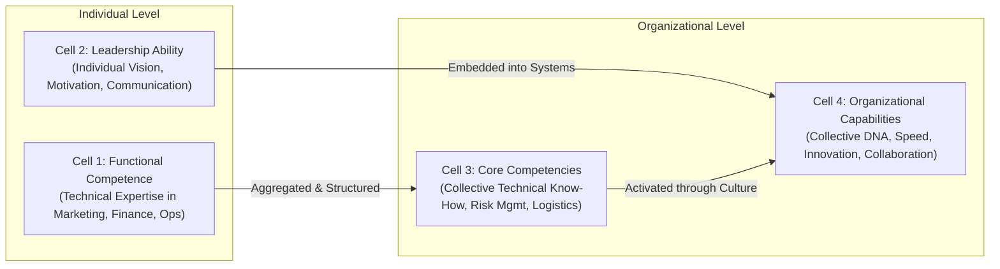
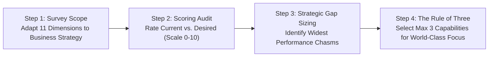

## 📄 Executive Synopsis & Context

- **Source Reference**: Ulrich, D., & Smallwood, N. (2004). _Capitalizing on Capabilities_. Harvard Business Review, 82(6), 119–127. Reprint R0406J.
- **Author Background**:
  - **Dave Ulrich**: Professor of Business Administration at the Ross School of Business, University of Michigan; globally recognized as the father of modern Human Resources; partner at The RBL Group.
  - **Norm Smallwood**: Co-founder of Results-Based Leadership (The RBL Group); leading management consultant on organization design and leadership brand.
- **Core Thesis**: Market value is increasingly driven by intangible assets rather than physical plants, equipment, or capital access. The definitive intangible asset is **Organizational Capability**—the collective skills, abilities, and expertise that enable an organization to coordinate its people and resources to accomplish work. Unlike technical competencies or individual talent, organizational capabilities form an enterprise's cultural DNA, are deeply stable over time, and are virtually impossible for competitors to copy.

---

## 🧠 Complete Conceptual Architecture

### 1. The 2x2 Competence-Capability Matrix

Ulrich and Smallwood resolve widespread semantic confusion across corporate strategy by distinguishing between analysis levels (Individual vs. Organizational) and skill domains (Technical vs. Social):

| Dimension                | Technical Domain                                                                                                                                                         | Social Domain                                                                                                                                                        |
| :----------------------- | :----------------------------------------------------------------------------------------------------------------------------------------------------------------------- | :------------------------------------------------------------------------------------------------------------------------------------------------------------------- |
| **Individual Level**     | **Cell 1: Functional Competence** Specific personal technical skills (e.g. financial modeling, statistical process control, corporate tax accounting).               | **Cell 2: Leadership Ability** A single manager's personal capacity to inspire, set direction, and motivate direct reports.                                      |
| **Organizational Level** | **Cell 3: Core Competencies** Collective technical mastery across an enterprise (e.g. Honda's engine design, Canon's optics, Port of Singapore's container routing). | **Cell 4: Organizational Capabilities** The social architecture, cultural identity, and collective ways of working (e.g. speed, shared mindset, accountability). |

> [!IMPORTANT] The Activation Principle
> An organization can possess world-class individual functional competence (Cell 1) and sophisticated core technical competencies (Cell 3), yet still fail catastrophically in the marketplace. Without **Organizational Capabilities** (Cell 4), an enterprise cannot turn its technical know-how into coordinated, rapid, and innovative market execution.

---

### 2. The 11 Core Organizational Capabilities

Well-managed global corporations build competitive advantage by excelling in select capabilities from an archetypal set of eleven dimensions:

```mermaid
flowchart LR
    subgraph Human["Human & Leadership Levers"]
        C1["Talent<br/>Competence & Commitment"]
        C2["Leadership<br/>Clear Leadership Brand"]
        C3["Learning<br/>Generating & Sharing Ideas"]
    end

    subgraph Relational["Relational & Boundary Levers"]
        C4["Collaboration<br/>Boundaryless Synergy"]
        C5["Customer Connectivity<br/>Enduring Trust Relationships"]
        C6["Shared Mindset<br/>Unified Brand Identity"]
    end

    subgraph Operational["Operational & Strategic Levers"]
        C7["Speed<br/>Velocity of Change"]
        C8["Innovation<br/>Future Content & Process"]
        C9["Efficiency<br/>Rigorous Cost Discipline"]
        C10["Accountability<br/>Pay for Real Performance"]
        C11["Strategic Unity<br/>Intellectual, Behavioral, Procedural"]
    end

    Human --- Relational --- Operational
```

1. **Talent**: Attracting, motivating, and retaining competent and committed people. Leaders manage talent through the **5 Bs**:
   - _Buy_: Recruit external talent.
   - _Build_: Develop internal personnel.
   - _Borrow_: Partner with external consultants or thought leaders.
   - _Bounce_: Remove chronic underperformers.
   - _Bind_: Retain core high-impact performers.
2. **Speed**: Velocity in making important changes happen rapidly, from concept to commercialization or from customer feedback to process adaptation. Monitored via Return-on-Time-Invested (ROTI).
3. **Shared Mindset and Coherent Brand Identity**: Consistency between the external brand promise made to customers and the internal cultural experience lived by employees.
4. **Accountability**: Real consequences for performance outcomes. Differentiated compensation where high performers receive significantly larger reward spreads (e.g. $0\%$ to $12\%$ increases rather than uniform $3.5\%$ to $4.5\%$ adjustments).
5. **Collaboration**: Cross-functional and cross-business unit synergy. Tested via "breakup value": if the sum of individual business units is worth $25\%$ more than the combined market cap, collaboration is broken.
6. **Learning**: Generating ideas through experimentation, benchmarking, and continuous improvement, and generalizing those ideas across geographic and divisional boundaries.
7. **Leadership**: Embedding a distinct **leadership brand** throughout management layers. Monitored via the _substitute-to-star ratio_ (bench strength of qualified successors for top 100 roles).
8. **Customer Connectivity**: Deep, enduring relationships of trust with the $20\%$ of key accounts that generate $80\%$ of enterprise profits.
9. **Strategic Unity**: Alignment across three distinct organizational layers: _Intellectual_ (knowing the strategy), _Behavioral_ (spending working hours on strategic priorities), and _Procedural_ (aligning operational budgets and protocols).
10. **Innovation**: Moving beyond past formulas to develop novel products, channels, business models, and administrative systems. Tracked via a _vitality index_ (% of revenues from products launched in the last 3 years).
11. **Efficiency**: Rigorous operational cost discipline that frees up capital for strategic top-line expansion.

---

## 🏢 Real-World Executive Case Vignettes

### 1. InterContinental Hotels Group (IHG) — Boundaryless Collaboration

- **Challenge**: Following its spin-off from Six Continents in 2003, IHG faced fragmented global operations across regional silos (Americas, EMEA, Asia Pacific), duplicating administrative infrastructure and confusing corporate hotel owners.
- **Intervention**: IHG executed a capabilities audit targeting **Collaboration** and shared services. It centralized global procurement, reservations technology, and marketing loyalty programs.
- **Outcome**: The initiative unlocked over **$100 million in annual cost savings**. Between April 2003 and February 2004, IHG's share price **surged by 71%**, demonstrating that investors reward intangible organizational integration over physical real estate holdings.

### 2. Boston Scientific International — Strategic Unity Diagnostic

- **Challenge**: Boston Scientific’s international division generated $45\%$ of enterprise revenues and $55\%$ of profits, but division president Edward Northup recognized that rapid global expansion was creating strategic drift across regional sales subsidiaries.
- **Audit Findings**: A 20-question capabilities survey revealed a severe **Strategic Unity gap of 0.91 points** between perceived current performance and required strategic standards. Employees were confused about product prioritization across European markets.
- **Intervention**: Management convened an executive summit to distill strategic priorities into a clear, unified commercial mandate, aligning compensation and product launch sequencing directly with target clinical markets.

### 3. General Electric (GE) — The Leadership Brand

- **Empirical Proof of Intangibles**: In October 2003, _The Economist_ calculated that nineteen former GE executives who departed to become CEOs of outside corporations immediately added a cumulative **$24.5 billion** to the combined market capitalization of the hiring companies on the day of announcement alone.
- **Mechanism**: Investors were not betting on individual charisma; they were capitalizing on GE's organizational capability of breeding disciplined, process-oriented leaders.

### 4. JetBlue vs. Delta Air Lines — The Market Valuation Paradox

- **The Discrepancy**: In 2004, upstart carrier JetBlue was valued at more than twice the market capitalization of legacy giant Delta Air Lines, despite Delta possessing massively larger flight networks, passenger revenues, and fleet tonnage.
- **Driver**: Capital markets recognized JetBlue's superior organizational capabilities in **Speed**, **Talent commitment**, and **Shared Brand Mindset**, pricing future cash flow generation far higher than Delta's distressed physical assets.

---

## 🛠️ Complete Diagnostic Worksheets & Toolkits

### The Capabilities Audit Protocol

Leaders should execute a capabilities audit at the business unit, regional, or enterprise level following a 4-step governance cycle:

### The Capabilities Audit Scoring Rubric

| Capability Dimension      | Core Audit Question                                                                       | Current Rating (0–10) | Desired Target (0–10) | Performance Gap | Strategic Priority Rank |
| :------------------------ | :---------------------------------------------------------------------------------------- | :-------------------: | :-------------------: | :-------------: | :---------------------: |
| **Talent**                | Do employees have the competence and commitment required to deliver the strategy?         |                       |                       |                 |                         |
| **Speed**                 | Can we recognize market shifts and execute operational changes rapidly?                   |                       |                       |                 |                         |
| **Shared Mindset**        | Do employees and customers share an identical image of our brand identity?                |                       |                       |                 |                         |
| **Accountability**        | Does compensation differentiate significantly between top and bottom performers?          |                       |                       |                 |                         |
| **Collaboration**         | Do business units share resources, talent, and technology without turf battles?           |                       |                       |                 |                         |
| **Learning**              | Are ideas generated through experimentation and generalized across borders?               |                       |                       |                 |                         |
| **Leadership**            | Do we possess a recognized leadership brand with a strong succession bench?               |                       |                       |                 |                         |
| **Customer Connectivity** | Do we maintain enduring relationships of trust with our top 20% key accounts?             |                       |                       |                 |                         |
| **Strategic Unity**       | Do employees share an intellectual, behavioral, and procedural agenda?                    |                       |                       |                 |                         |
| **Innovation**            | What percentage of revenues originates from new offerings launched in the last 3 years?   |                       |                       |                 |                         |
| **Efficiency**            | Are operational costs, working capital, and inventories managed with rigorous discipline? |                       |                       |                 |                         |

> [!WARNING] The Strategic Prioritization Rule
> Organizations that attempt to improve all 11 capabilities simultaneously achieve mediocrity across all of them. Ulrich and Smallwood recommend focusing on **no more than three critical capabilities**:
>
> 1. Select **two capabilities** in which the enterprise commits to achieving **world-class, industry-leading differentiation**.
> 2. Select **one capability** to lift from substandard dysfunction to **industry parity**.
> 3. Maintain competitive parity across the remaining eight capabilities.

---

## 📊 Comparative Exhibits & Framework Tables

### Individual Competence vs. Core Competence vs. Organizational Capability

| Feature                    | Individual Functional Competence                                          | Organizational Core Competence                                               | Organizational Capability                                                                            |
| :------------------------- | :------------------------------------------------------------------------ | :--------------------------------------------------------------------------- | :--------------------------------------------------------------------------------------------------- | ----------------- |
| **Unit of Analysis**       | Single employee / Specialist                                              | Business unit or functional department                                       | Entire organization / Enterprise DNA                                                                 |
| **Domain**                 | Technical know-how                                                        | Collective technical expertise                                               | Social architecture, culture, and processes                                                          |
| **Example**                | Financial modeling, coding in Python, agronomic soil testing.             | Supply chain optimization, risk hedging, engine manufacturing.               | Speed of market entry, cross-boundary collaboration, [[concepts/talent-density                       | talent density]]. |
| **Portability**            | Highly portable (walks out the door at 5 PM or switches to a competitor). | Moderately portable (can be licensed or reverse-engineered over time).       | **Non-portable and socially complex** (embedded in relationships and norms).                         |
| **Impact on Market Value** | Necessary operational input, but easily commoditized.                     | Creates product differentiation, but vulnerable to technological disruption. | **Drives sustained market valuation premium** by giving investors confidence in future adaptability. |

---

## 💬 Classroom Cold-Call & Discussion Strategy

### Discussion Question 1: "How do organizational capabilities differ from core competencies, and why do capital markets reward capabilities?"

- **Crisp Recitation**: "Individual functional competence is personal technical skill; core competence is collective technical mastery in a business domain; organizational capability is the social DNA and collective ability to coordinate people and resources. Capital markets reward capabilities because technical competencies can be bought, hired, or copied, whereas capabilities—like speed, collaboration, and learning—are socially complex, stable over time, and cannot be duplicated by competitors. They provide the only reliable predictor of future earnings under conditions of industry turbulence."
- **Underlying Mechanism**: The Resource-Based View (RBV) of the firm: capabilities fulfill Barney's VRIO criteria (Valuable, Rare, Inimitable, Organized).
- **Indonesian Context**: In Indonesian state-owned enterprises (BUMN), technical engineering competence is often high (e.g. oil extraction or metallurgy), but organizational capabilities (e.g. speed of procurement, accountability, cross-holding collaboration) historically lag, depressing enterprise ROA.

### Discussion Question 2: "Should an executive team prioritize capability investments by fixing the lowest audit scores on their scorecard?"

- **Crisp Recitation**: "No. Prioritizing by lowest audit scores is a dangerous trap that defaults to bureaucratic gap-filling. Leaders must prioritize strictly by **strategic relevance and potential impact on competitive advantage**. Ulrich and Smallwood mandate the Rule of Three: invest aggressively to become world-class in no more than two capabilities that directly drive customer value, bring one critical bottleneck to parity, and maintain industry standards in the rest. Spreading resources evenly across all weaknesses dilutes competitive focus and wastes corporate capital."

---

## 🔗 Knowledge Graph & Bridges

- **Parent Lecture**: [[courses/mk1-organizational-behavior-managing-people/week-06/index|Week 06 Masterclass: Organizational Dynamics in the Indonesian Context]]
- **Applied Case Study**: [[courses/mk1-organizational-behavior-managing-people/week-06/case-lcop-bumn-private|Case Study: LCOP Structural Equation Model (Dr. Yuni Ros Bangun)]]
- **Cohort Assignment Debriefs**:
  - [[courses/mk1-organizational-behavior-managing-people/week-06/assignment-pre-organizational-capabilities|Pre-Assignment: Capabilities Foundations]]
  - [[courses/mk1-organizational-behavior-managing-people/week-06/assignment-post-indonesian-dynamics|Post-Assignment: Indonesian BUMN Dynamics]]
- **Related Curriculum Profiles**:
  - Author Profile: Dave Ulrich
  - [[concepts/talent-density|Core Concept: [[concepts/talent-density|Talent Density]]]]
