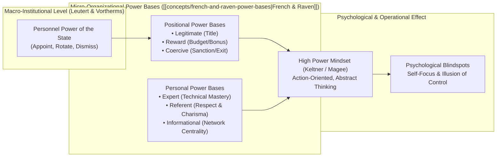
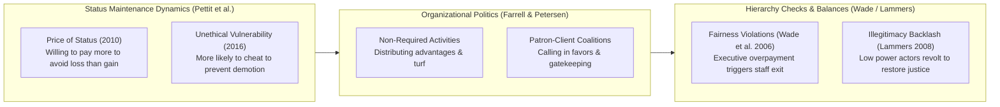

> [!NOTE] Assignment Context & Attribution
>
> - **Course:** MK1 Organizational Behaviour & Managing People — Week 07
> - **Source Prompt:** `archive/courses/mk1/week-07/.extracted/Syndicate 9 - Pre-Assignment Week 7.docx.txt` & Week 7 Lecture Masterclass
> - **Reference Attribution:** Analytical synthesis contributed by **F9 (Class F / Syndicate 9)** & **the Portal Maintainer**
> - **Parent Lecture:** [[courses/mk1-organizational-behavior-managing-people/week-07/index|Week 07 Master Lecture Hub]]
> - **Direct Reading:** [[courses/mk1-organizational-behavior-managing-people/week-07/reading-personnel-power-governing-soes|Reading: Leutert & Vortherms (2021)]]

---

## 📋 Part 1: Official Assignment Prompt & Skim Map

- **Executive Objective:** Synthesize the macro-institutional insights of Leutert & Vortherms (2021) on state enterprise "personnel power" with the micro-foundations of organizational power, status, and politics taught in the Week 7 lecture ([[concepts/french-and-raven-power-bases|French & Raven]]'s power bases, psychological traps of power, status maintenance, and ethical influence).
- **Target Deliverable:** Post-class reflective synthesis evaluating how executives build legitimate authority, manage political factions, and exercise power ethically in high-power-distance state-owned enterprises.
- **Core Curricular Map:**
  1. _Power vs. Status in Hierarchy_: Differentiating coercive resource control from voluntary prestige and admiration.
  2. _[[concepts/french-and-raven-power-bases|French & Raven]]'s [[concepts/french-and-raven-power-bases|Six Power Bases]]_: Mapping formal positional power vs. informal personal power.
  3. _The Psychology of Power_: Analyzing cognitive disinhibition, illusion of control, and managerial vulnerability under low power (Magee & Galinsky, 2008; Keltner et al., 2003).
  4. _Hierarchy Checks & Balances_: Status loss asymmetry (Pettit et al., 2010), executive pay disparity (Wade et al., 2006), and the restoration of organizational legitimacy (Lammers et al., 2008).

---

## 💡 Part 2: Reference Solution & Framework Revisions

### Question 1: From Macro Personnel Power to Micro Power Bases

#### Pre-Assignment Baseline View

> Personnel power is the government's authority to appoint, transfer, and remove SOE executives. It is an effective governance mechanism because executives control corporate strategy and resources. China operates a political-oriented system where the Central Organization Department controls top appointments, blending economic management with political loyalty.

#### In-Class Revised Analysis (Ingesting [[concepts/french-and-raven-power-bases|French & Raven]] + Psychological Mechanisms)

While Leutert and Vortherms define personnel power at the macro-state level, **the effective execution of power inside the enterprise depends on micro-foundational power bases**:

1. **Power vs. Status Differentiation**:
   - **Power**: Control over resources valued by others. Influence can be coercive; subordinates comply because they fear punishment or require budget allocations.
   - **Status**: Respect, prestige, and voluntary admiration granted by others. Influence is voluntary; subordinates comply because they admire the leader's integrity and competence.
   - _Managerial Trap_: Newly appointed BUMN executives often confuse formal positional power with status, attempting to command obedience through ministerial decree rather than building social respect.

2. **[[concepts/french-and-raven-power-bases|French & Raven]]'s Six Bases of Power (1959, 1965)**:
   - _Positional / Formal Power_:
     - **Legitimate Power**: Formal right to command based on hierarchy.
     - **Reward Power**: Ability to allocate compensation, promotions, and capital projects.
     - **Coercive Power**: Authority to demote, reassign, or dismiss non-compliant personnel.
   - _Personal / Informal Power_:
     - **Expert Power**: High-level specialized knowledge and technical credibility.
     - **Referent Power**: Perceived worthiness, ethical integrity, and charismatic appeal.
     - **Informational Power**: Control over critical data flows and strategic intelligence.
   - _Executive Synthesis_: While the state grants an SOE executive Legitimate and Reward power via ministerial decree, sustained transformation requires cultivating **Expert** and **Referent** power. Executives who rely exclusively on coercion trigger passive resistance, bureaucratic slow-downs, and informational distortion.

3. **Psychological Traps of Power (Magee & Galinsky, 2008; Keltner et al., 2003)**:
   - _High-Power Cognitive Shift_: Executives experiencing high power become more action-oriented, optimistic, and abstract in their thinking, but suffer from an **illusion of control**, excessive risk-taking, and diminished empathy for frontline workers.
   - _Low-Power Managerial Insecurity_: Middle managers who feel structurally powerless while occupying managerial titles exhibit authoritarian micromanagement, restrict subordinates, and actively hold back talented employees whom they perceive as threats to their own fragile status.

#### Reflection: What Changed from Pre-Assignment, and Why?

In our pre-assignment, we treated personnel power as an external governance tool wielded by the government. Following class discussion, we recognized that **power inside an organization is fundamentally social and psychological**. A CEO appointed via state decree has formal authority, but zero influence until they establish referent and expert power. Furthermore, understanding the psychological traps of high power (illusion of control) and low power (authoritarian insecurity among middle managers) explains why BUMN corporate transformations frequently stall: insecure middle managers sabotage change to protect their precarious status.

---

### Question 2: Hierarchy Dynamics, Status Loss & Organizational Politics

#### Pre-Assignment Baseline View

> Leaders' career outcomes are explained by economic performance (ROA) and political connectedness. Connected leaders have a 92% retention rate vs 88% for unconnected peers. The Party-state balances economic efficiency with political loyalty.

#### In-Class Revised Analysis (Ingesting Status Loss Asymmetry & Organizational Politics)

Integrating the lecture frameworks reveals the underlying behavioural drivers behind political behavior in state-owned enterprises:

1. **The Asymmetry of Status Loss (Pettit et al., 2010, 2016)**:
   - **The Price of Status**: Individuals are willing to pay significantly more resources to **avoid losing status** than to achieve an equivalent status gain.
   - **Ethical Compromise under Threat**: Experimental research proves individuals are significantly more likely to engage in deceptive, self-serving, and politically toxic behavior to **prevent a negative status demotion** than to achieve a positive promotion.
   - _Application to BUMNs_: When a holding company reorganizes subsidiaries (e.g. creating PalmCo or reorganizing Danantara), mid-level executives whose titles or autonomy are threatened will fight fiercely to preserve status, deploying political maneuvering, leaks, and foot-dragging.

2. **Defining Organizational Politics (Farrell & Petersen, 1982)**:
   - Politics consists of activities that are **not required as part of one’s formal role**, but that influence the distribution of advantages, resources, and authority within the organization.
   - Politics escalates whenever critical, limited resources are at stake and objective performance criteria are ambiguous.

3. **Countervailing Checks & Organizational Legitimacy**:
   - Hierarchies are not absolute; they contain systemic checks and balances:
     - **Fairness & Pay Dispersion (Wade, O’Reilly, & Pollock, 2006)**: When top executives receive outsized, unearned compensation relative to baseline workers, turnover among lower-level employees spikes dramatically.
     - **Illegitimacy and Resistance (Lammers et al., 2008)**: When an authority structure is perceived as illegitimate or corrupt, low-power individuals actively take risks and organize collective resistance to restore justice.

#### Reflection: What Changed from Pre-Assignment, and Why?

Our initial analysis viewed political connectedness merely as a statistical variable in Leutert & Vortherms' regression table. The lecture demonstrated that **organizational politics is a direct behavioral reaction to status anxiety**. In BUMNs where career progression has historically been tied to seniority and patron-client ties, introducing meritocratic KPIs triggers acute fear of status loss. Because people will cheat and sabotage to prevent demotion (Pettit et al., 2016), leaders cannot simply declare new rules; they must design face-saving transition pathways and ensure procedural justice to prevent destructive political revolts.

---

## 🔬 Part 3: Methodological Rigor & Reconstructed Analytical Nuances

| Analytical Dimension               | Macro Pre-Assignment View                            | Comprehensive Post-Class Synthesis (F9 / Maintainer)                                                                                                       |
| :--------------------------------- | :--------------------------------------------------- | :--------------------------------------------------------------------------------------------------------------------------------------------------------- |
| **Origin of Executive Influence**  | State appointment decree (Legitimate power).         | **Dual Alignment**: Positional power granted by the state must be validated by personal Expert and Referent power among employees.                         |
| **Driver of Political Infighting** | General human greed or lack of corporate discipline. | **Status Loss Asymmetry**: Loss aversion drives managers to sabotage reforms to prevent downward status shifts (Pettit et al., 2010).                      |
| **Executive Pay Strategy**         | Maximize market incentives for top C-suite.          | **Fairness Threshold**: Excessive executive compensation without transparency triggers frontline employee demoralization and turnover (Wade et al., 2006). |
| **Middle-Management Friction**     | Incompetence or operational laziness.                | **Psychological Insecurity**: Low-power managers in formal roles behave in authoritarian, restrictive ways due to status anxiety (Magee & Galinsky, 2008). |
| **BUMN Governance Prescription**   | Centralize authority and issue executive orders.     | Establish procedural justice, transparent evaluation metrics, and institutional checks that decouple personal loyalty from career survival.                |

---

## 🎙️ Part 4: Classroom Cold-Call & Faculty Debrief Strategy

- **Faculty Angle**: "You are appointed as the new Managing Director of a struggling BUMN business unit. You hold the formal mandate from the Minister, but the existing senior managers are veterans with 25 years of service. How do you exercise power in your first 90 days?"
- **High-Signal 30-Second Recitation Script**:
  > "I will deliberately avoid relying on coercive or legitimate power in the first 90 days. Exercising raw positional authority triggers the status loss panic described by Pettit et al. (2010), leading veteran managers to sabotage initiatives through passive resistance. Instead, I will build Expert and Referent power: conducting joint operational diagnostics, solving immediate frontline bottlenecks, and establishing transparent, objective metrics. I will align with informal leaders, give veteran managers face-saving roles in the transformation, and use positional authority only as a last resort against clear ethical or legal violations."
- **Indonesian Corporate Reality**: In Indonesian state enterprises, power dynamics are deeply intertwined with cultural norms of _Bapakisme_ (paternalistic hierarchy) and _Asal Bapak Senang_ (telling superiors only what they wish to hear). Leaders who succumb to the high-power psychological trap of self-focus and cognitive disinhibition (Keltner et al., 2003) become completely isolated from operational realities, surrounded by sycophants while frontline efficiency collapses.

---

## 🔗 Knowledge Graph & Curriculum Bridges

- Return to **[[courses/mk1-organizational-behavior-managing-people/week-07/index|Week 07 Masterclass Hub]]**
- Linked Deep-Dive Reading: **[[courses/mk1-organizational-behavior-managing-people/week-07/reading-personnel-power-governing-soes|Reading: Leutert & Vortherms (2021)]]**
- Baseline Discussion: **[[courses/mk1-organizational-behavior-managing-people/week-07/assignment-pre-personnel-power-soes|Pre-Assignment: Personnel Power in SOEs]]**
- Upstream Case Study: **[[courses/mk1-organizational-behavior-managing-people/week-06/case-lcop-bumn-private|Week 06 Case: LCOP Structural Equation Model (BUMN Plantations)]]**
- Cross-Curricular Leadership Bridge: [[concepts/leadership-ambidexterity|Concept: [[concepts/leadership-ambidexterity|Leadership Ambidexterity]]]]
