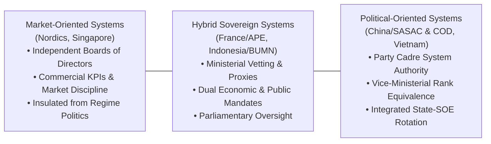
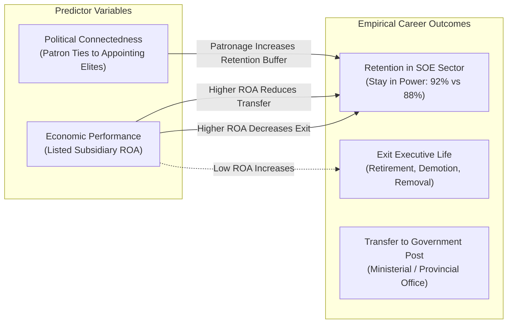

> [!NOTE] Assignment Context & Attribution
>
> - **Course:** MK1 Organizational Behaviour & Managing People — Week 07
> - **Source Prompt:** `archive/courses/mk1/week-07/Pre Assignment Week 7.pdf`
> - **Reference Attribution:** Analytical synthesis contributed by **F9 (Class F / Syndicate 9)** & **the Portal Maintainer**
> - **Parent Lecture:** [[courses/mk1-organizational-behavior-managing-people/week-07/index|Week 07 Master Lecture Hub]]
> - **Direct Reading:** [[courses/mk1-organizational-behavior-managing-people/week-07/reading-personnel-power-governing-soes|Reading: Leutert & Vortherms (2021)]]

---

## 📋 Part 1: Official Assignment Prompt & Skim Map

- **Executive Objective:** Evaluate how sovereign states leverage authority over executive appointments ("personnel power") to govern state-owned enterprises (SOEs), comparing market-oriented vs. political-oriented systems and interrogating the empirical balance between economic performance and political connectedness.
- **Target Deliverable:** Rigorous analytical debrief addressing three core governance and methodological questions from Leutert & Vortherms (2021).
- **Core Diagnostic Questions & Case Exhibit Map:**
  1. _Based on Leutert and Vortherms (2021), what is "personnel power", and why is it considered an effective governance mechanism for SOEs? How do SOE management systems vary along the spectrum from market-oriented to political-oriented, and where does China fit along this spectrum?_ — **Where to look:** Leutert & Vortherms (2021), pp. 1–3, Section "Introduction & Conceptualizing Personnel Power".
  2. _What two explanations for SOE leaders' career outcomes do the authors examine, and what does the empirical evidence suggest about each? What does this imply about the relationship between economic performance, political connectedness, and leadership continuity in state-owned enterprises?_ — **Where to look:** Leutert & Vortherms (2021), pp. 4–12, Sections on Economic Performance, Political Networks, and Logit Models.
  3. _Critically assess the research design used in the study, focusing on how economic performance and political connectedness are measured. What are the main strengths and limitations of these measurement choices, and how do they affect the validity of the authors' conclusions?_ — **Where to look:** Leutert & Vortherms (2021), pp. 6–9, Variable Definitions and Discussion of Limitations.

---

## 💡 Part 2: Reference Solution & Strategic Analysis

### Question 1: Conceptualizing Personnel Power & The SOE Governance Spectrum

#### 1. Definition and Governance Mechanism

According to Leutert and Vortherms (2021), **personnel power** refers to the state's sovereign authority to appoint, evaluate, transfer, and dismiss corporate executives in state-owned enterprises.

The authors identify personnel power as the most potent mechanism for SOE governance because:

- **Direct Strategic Leverage**: Executives possess direct decision-making control over corporate strategy, capital expenditure, organizational structure, and resource distribution.
- **Overcoming Information Asymmetry**: External regulators struggle to monitor complex industrial conglomerates through formal reporting alone. By controlling executive career trajectories, governments align the personal incentives of C-suite leaders with national economic and political priorities.
- **Dual Mandate Coordination**: It enables the state to enforce both commercial profitability targets (dividends and tax revenues) and non-commercial public missions (infrastructure development, employment stability, strategic industrial self-sufficiency).

#### 2. The Spectrum of SOE Governance

State enterprise management systems worldwide exist along an institutional spectrum defined by the degree of political integration:

- **Market-Oriented End**: Corporate boards of directors possess genuine independence in recruiting and compensating executives based on market competence. Career advancement is driven primarily by commercial financial metrics, with minimal state intervention in day-to-day managerial turnover.
- **Political-Oriented End**: The state and governing political party retain direct, centralized authority over top executive appointments. Political loyalty, ideological reliability, and relationships with ruling political elites heavily influence career mobility.
- **China's Position**: China occupies the definitive **political-oriented** position on this spectrum. While the State-owned Assets Supervision and Administration Commission (**SASAC**) provides technical and administrative oversight, top executive appointments for the 53 core central SOEs are strictly controlled by the Communist Party’s **Central Organization Department (COD)**. Leaders hold official vice-ministerial rank equivalence, integrating them directly into the state cadre management system.

---

### Question 2: Economic Performance vs. Political Connectedness in Executive Mobility

Leutert and Vortherms evaluate two competing theoretical hypotheses:

#### 1. The Economic Performance Explanation

- **Theoretical Basis**: States act as value-maximizing principals who reward executives who generate superior financial returns, which support state budgets, economic growth, and fiscal health.
- **Empirical Evidence**: The data strongly validates this explanation. Higher profitability—measured through the Return on Assets (ROA) of the enterprise’s largest listed subsidiary—**significantly decreases the probability of an executive exiting executive life**. Conversely, declining financial performance dramatically accelerates removal or forced retirement. Interestingly, stronger financial performance also _decreases_ the likelihood of transfer into government administrative roles, demonstrating that the state deliberately keeps its most capable commercial operators in charge of state assets rather than absorbing them into ministerial bureaucracy.

#### 2. The Political Connectedness Explanation

- **Theoretical Basis**: In authoritarian and state-led economies, executive mobility is driven by patron-client networks. Leaders maintain informal alliances with senior government and party officials who oversee executive evaluations, building trust, mutual protection, and political loyalty.
- **Empirical Evidence**: The empirical findings confirm that political ties provide a significant career buffer. Executives with informal ties to the appointing leadership (specifically the Central Organization Department) enjoy an estimated **92% probability of remaining in power**, compared to **88%** for unconnected peers.

#### 3. Strategic Implication for SOE Governance

These findings disprove the simplistic binary that state enterprise governance is either purely meritocratic or corruptly nepotistic. Instead, the Party-state uses personnel power to **balance economic efficiency and political stability**. The state demands bottom-line financial delivery, but relies on trusted political networks to ensure enterprise leadership remains ideologically compliant and loyal to sovereign directives.

---

### Question 3: Critical Assessment of Research Design & Measurement Limits

| Research Design Choice                                                      | Methodological Strength                                                                                                                                  | Critical Limitation & Validity Risk                                                                                                                                                                                                                           | Impact on Authors' Conclusions                                                                                                                                                |
| :-------------------------------------------------------------------------- | :------------------------------------------------------------------------------------------------------------------------------------------------------- | :------------------------------------------------------------------------------------------------------------------------------------------------------------------------------------------------------------------------------------------------------------ | :---------------------------------------------------------------------------------------------------------------------------------------------------------------------------- |
| **Measuring Economic Performance via Largest Listed Subsidiary ROA**        | Standardized, audited, and publicly verified financial metric; enables rigorous cross-firm longitudinal comparison across 53 conglomerates.              | **Crown Jewel Bias**: Listed subsidiaries represent the group's strongest productive assets, masking unlisted parent company debt, distressed legacy assets, and social overhead. Furthermore, ROA ignores non-commercial public service obligations (_PSO_). | Listed ROA likely overestimates overall conglomerate profitability; the correlation between true group-level performance and executive retention may be weaker than reported. |
| **Measuring Political Connectedness via Superior in Office at Appointment** | Replicable, objective indicator of shared institutional timing and potential patron-client sponsorship; avoids subjective rumor or unfalsifiable claims. | **Static Timing Proxy**: Appointment timing does not prove genuine personal loyalty or mutual commitment. Moreover, it fails to capture dynamic ties formed with _new_ rising political patrons after initial appointment.                                    | Provides a noisy proxy for patronage; establishes correlation rather than direct causal evidence of political favoritism.                                                     |

#### Analytical Synthesis

While the research design provides compelling empirical evidence of an **association** between economic delivery, political ties, and executive mobility, it establishes correlation rather than definitive causation. Demonstrating that personnel power directly _causes_ macroeconomic and political stability would require comprehensive group-level financial audits, direct tracking of informal political interactions, and cross-national counterfactual comparisons.

---

## 🔬 Part 3: Methodological Rigor & Key Analytical Nuances

| Analytical Dimension               | Baseline Intuition                                                                       | Rigorous Methodological Nuance (F9 / Maintainer Synthesis)                                                                                                                                      |
| :--------------------------------- | :--------------------------------------------------------------------------------------- | :---------------------------------------------------------------------------------------------------------------------------------------------------------------------------------------------- |
| **SOE Appointment Nature**         | Assumes state appointments are either 100% meritocratic or 100% corrupt cronyism.        | Demonstrates a dual-balancing equilibrium: bottom-line financial performance is a mandatory baseline, while political ties provide an 88% to 92% retention buffer.                              |
| **Government Career Transfer**     | Assumes high-performing SOE executives get promoted to government ministers as a reward. | Proves the opposite: high ROA performers are retained in the corporate sector where their commercial skills generate cash; weaker operators or generalist cadremen are rotated into government. |
| **Financial Metric Reliability**   | Accepts listed subsidiary ROA at face value as total enterprise health.                  | Identifies structural distortion: listed units represent carved-out crown jewels, obscuring parent holding company liabilities and public service burdens.                                      |
| **Personnel Power vs. Regulation** | Views regulation and compliance audits as the primary governance lever.                  | Recognizes that personnel power supersedes regulation: controlling the appointment and firing of executives controls the organization from the inside out.                                      |

---

## 🎙️ Part 4: Classroom Cold-Call & Faculty Debrief Strategy

- **Faculty Angle**: "In Indonesia's BUMN ecosystem, when the Minister of BUMN or Danantara rotates a C-suite executive, is that political interference or rational corporate governance?"
- **High-Signal 30-Second Recitation Script**:
  > "It is both, functioning as an integrated personnel power mechanism. As Leutert and Vortherms prove, state owners cannot rely on external regulatory oversight alone because of severe information asymmetry. Exercising personnel power allows the state shareholder to enforce financial discipline—removing CEOs who destroy capital—while ensuring alignment with national strategic priorities. The managerial challenge is not eliminating political authority, but preventing short-term electoral cycles from disrupting multi-year corporate capital investments."
- **Indonesian Enterprise Reality**: In Indonesia, the establishment of **Danantara** (the sovereign wealth / superholding entity) represents a structural shift along the governance spectrum toward the hybrid-market end. By consolidating state shareholding under a professional investment institution, Indonesia aims to preserve personnel power for strategic oversight while insulating operating subsidiaries (Pertamina, PLN, PTPN) from localized political patronage.

---

## 🔗 Knowledge Graph & Curriculum Bridges

- Return to **[[courses/mk1-organizational-behavior-managing-people/week-07/index|Week 07 Masterclass Hub]]**
- Linked Academic Reading: **[[courses/mk1-organizational-behavior-managing-people/week-07/reading-personnel-power-governing-soes|Reading: Leutert & Vortherms (2021)]]**
- Integrated Post-Assignment: **[[courses/mk1-organizational-behavior-managing-people/week-07/assignment-post-power-politics|Post-Assignment: Power & Politics in Organizations]]**
- Upstream Case Study: **[[courses/mk1-organizational-behavior-managing-people/week-06/case-lcop-bumn-private|Week 06 Case: LCOP Structural Equation Model (BUMN Plantations)]]**
