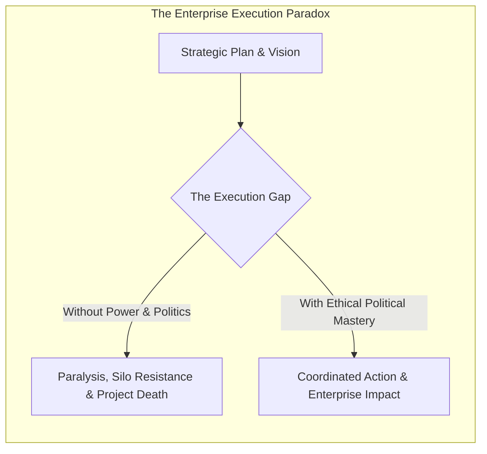
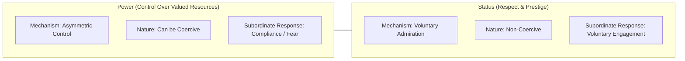
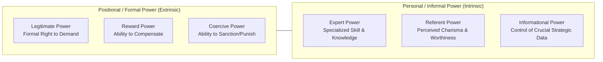
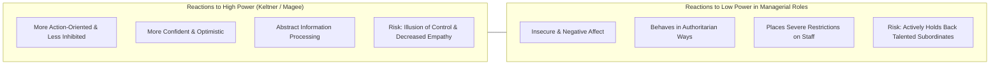
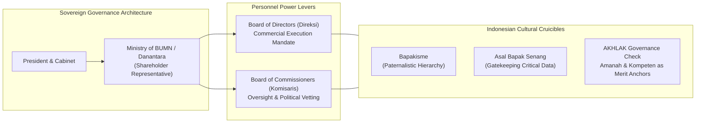

> [!NOTE] Curricular & Faculty Metadata
>
> - **Course:** MK1 Organizational Behaviour & Managing People — Week 07
> - **Teaching Team:** Dr. Ir. Madju Yuni Ros Bangun, Muhammad Yorga Permana, Ph.D., Widhyawan Prawiraatmadja, Ph.D., Yudo Anggoro, Ph.D.
> - **Primary Curricular Spine:** `archive/courses/mk1/week-07/Week 7 Power & Politics in Organizations (Student Version).pdf` (15 slides)
> - **Direct Satellites & Problem Sets:**
>   - [[courses/mk1-organizational-behavior-managing-people/week-07/reading-personnel-power-governing-soes|Academic Reading: Personnel Power: Governing State-Owned Enterprises (Leutert & Vortherms, 2021)]]
>   - [[courses/mk1-organizational-behavior-managing-people/week-07/assignment-pre-personnel-power-soes|Pre-Assignment: Personnel Power in SOEs (F9 Debrief)]]
>   - [[courses/mk1-organizational-behavior-managing-people/week-07/assignment-post-power-politics|Post-Assignment: Power & Politics in Organizations (F9 Debrief)]]

---

## 1. Executive Overview & Foundations of Power, Politics & Governance

### Why Power and Politics Matter to Enterprise Leaders

In traditional business education, organizational decision-making is often idealized as a rational, objective process: analysts build financial models, executives weigh data, and the most efficient strategic alternative is chosen.

In real-world enterprises—and most acutely within **state-owned enterprises (BUMN)** and government-linked holding entities—rationality is only half the story. Organizations are political coalitions composed of diverse individuals, competing interest groups, and shifting alliances. Resources (capital expenditure, executive promotions, headcount, strategic mandates) are inherently scarce.

To bridge the execution gap, managers must master **power**—defined as the capacity to influence others in order to get things done. Without power, leadership is merely an academic exercise.

Concurrently, leaders must navigate **organizational politics**—defined by Farrell & Petersen (1982) as _activities that are not required as part of one’s formal organizational role, but that influence, or attempt to influence, the distribution of advantages and disadvantages within the organization_. Far from being an inherently toxic defect to be eliminated, politics is the inescapable social mechanism through which competing priorities are negotiated, resources are contested, and strategic direction is forged.

### The Functions and Bases of Hierarchy

Hierarchies exist across every human civilization and complex corporation because they serve essential coordination functions:

1. **Establishes Social Order**: Reduces chaos, defines decision-making rights, and streamlines social coordination.
2. **Resolves Need for Psychological Stability**: Employees look to hierarchy for clarity, psychological safety, and clear role boundaries.
3. **Provides Incentive Structures**: Generates clear progression ladders, motivating individuals to acquire skills and deliver results to attain higher rank.

---

## 2. Theoretical Architecture & Core Frameworks

### 1. Power vs. Status: The Twin Bases of Hierarchical Differentiation

While power and status are frequently correlated in corporate hierarchies, they represent fundamentally distinct psychological and social mechanisms:

$$\mathbf{\text{Effective Influence} = \text{Positional Power} + \text{Voluntary Status}}$$

| Dimension               | Power (Resource Control)                                                                       | Status (Social Regard)                                                                      |
| :---------------------- | :--------------------------------------------------------------------------------------------- | :------------------------------------------------------------------------------------------ |
| **Source**              | Control over tangible or intangible resources valued by others (budgets, hiring, assignments). | Respect, prestige, competence, and voluntary admiration granted by peers and subordinates.  |
| **Influence Mechanism** | Can be coercive: _"Comply because I control your bonus, career, and resources."_               | Purely voluntary: _"Comply because I respect your wisdom, expertise, and moral integrity."_ |
| **Sustainability**      | Evaporates immediately if positional authority or resource control is stripped away.           | Enduring: adheres to the person across organizational and institutional boundaries.         |

---

### 2. [[concepts/french-and-raven-power-bases|French & Raven]]'s [[concepts/french-and-raven-power-bases|Six Power Bases]] (1959, 1965)

French and Raven provide the canonical taxonomy of organizational power, dividing influence into formal positional authority and personal informal strength:

1. **Legitimate Power**: The belief that a person has the formal, legal right to make demands and expect obedience based on their hierarchical title.
2. **Reward Power**: The ability to compensate others for compliance (promotions, cash bonuses, favorable project assignments).
3. **Coercive Power**: The perceived capacity to punish non-compliance (demotion, disciplinary audits, termination).
4. **Expert Power**: Influence derived from possessing specialized knowledge, technical mastery, or superior problem-solving acumen.
5. **Referent Power**: Influence derived from a person’s charisma, ethical integrity, and the desire of others to identify with and be respected by them.
6. **Informational Power**: Having access to, and control over, strategic information that others need to accomplish their tasks.

---

### 3. Psychological Traps of Power (Magee & Galinsky, 2008; Keltner et al., 2003)

Power alters the human brain. How an individual experiences their own power determines their managerial behavior and vulnerability:

- **The High-Power Mindset**: High-power individuals process information abstractly, focus on rewards rather than threats, and act with decisive speed. However, they are prone to self-centeredness, pay less attention to social cues, and suffer from an **illusion of control** that leads to reckless risk-taking.
- **The Low-Power Managerial Trap**: When an individual is placed in a formal management position but feels personally or structurally powerless, they experience acute threat anxiety. They overcompensate by becoming authoritarian, micromanaging subordinates, and actively sabotaging high-performing direct reports who might threaten their position.

---

### 4. Hierarchy Dynamics: Status Maintenance & Countervailing Checks

Hierarchies are dynamic and subject to intense behavioural friction:

1. **The Asymmetry of Status Loss (Pettit et al., 2010, 2016)**:
   - Individuals are willing to sacrifice significantly more resources to **avoid losing status** than to achieve an equivalent status gain.
   - People are significantly more likely to engage in **unethical behavior and deception** to prevent a negative status change than to obtain a positive one.
2. **Status Momentum (Pettit et al., 2013)**: Targets are judged as having higher status when they arrived at a position by ascending rather than descending, holding formal rank constant.
3. **Fairness Checks and Turnover (Wade, O’Reilly, & Pollock, 2006)**: A longitudinal study of 120 corporations proved that when top executives are excessively overpaid relative to internal benchmarks, lower-level employee turnover increases dramatically.
4. **Illegitimacy and Resistance (Lammers et al., 2008)**: When an authority structure is perceived as illegitimate, low-power individuals display heightened risk tolerance to challenge the hierarchy and restore procedural justice.

---

### 5. Macro SOE Governance: The Personnel Power Model (Leutert & Vortherms, 2021)

At the state level, governments govern complex state-owned enterprises using **personnel power**—the sovereign authority to appoint, rotate, and dismiss C-suite executives.

Empirical analysis of China's core central SOEs reveals that the state uses personnel power to balance **economic efficiency and political stability**:

- **Economic Performance (ROA)**: High subsidiary profitability significantly reduces executive exit and keeps top operators running corporate assets.
- **Political Connectedness**: Ties to elite evaluators (such as the Central Organization Department) provide an 88% to 92% retention buffer.

---

## 3. Managerial Crucible: Indonesian Enterprise & BUMN Context

### Governance Realities under the Ministry of BUMN and Danantara

In Indonesia, the exercise of personnel power and organizational politics shapes the corporate governance of hundreds of state-owned enterprises:

1. **Ministerial Personnel Power**: Under Law No. 19/2003 on State-Owned Enterprises, the Minister of BUMN exercises sovereign shareholder authority. Executive appointments to boards of directors (_Direksi_) and commissioners (_Komisaris_) represent high-stakes political-economic decisions.
2. **The Peril of _Bapakisme_ and _Asal Bapak Senang_**: In high-power-distance Indonesian corporate culture, subordinates are culturally conditioned to avoid open disagreement with superiors (_ewuh pakewuh_). Combined with the high-power psychological trap of reduced empathy (Keltner et al., 2003), executives often operate in an information vacuum where bad news is filtered out, leading to massive financial shocks (e.g. historical restructurings at Garuda Indonesia, Jiwasraya, and Krakatau Steel).
3. **Danantara as an Institutional Balance**: The establishment of **Danantara** (the Indonesian sovereign investment superholding) represents an institutional effort to shift Indonesia’s SOE management toward the professionalized, hybrid-market end of the governance spectrum—modeled after Singapore’s Temasek Holdings. By shielding operational management from direct day-to-day political lobbying, Danantara aims to tie personnel power strictly to long-term economic performance.

---

## 4. Cross-Functional Implementation & Strategic Trade-offs

| Strategic Dilemma                   | Technocratic Rationality                                                                               | Political & Organizational Reality                                                                                       | [[concepts/leadership-ambidexterity                                                                                                                      | Leadership Ambidexterity]] Resolution |
| :---------------------------------- | :----------------------------------------------------------------------------------------------------- | :----------------------------------------------------------------------------------------------------------------------- | :------------------------------------------------------------------------------------------------------------------------------------------------------- | ------------------------------------- |
| **C-Suite Succession**              | Appoint the top-ranked internal technical specialist with highest agronomic or engineering competence. | Appoint a connected executive who maintains trusted relationships with ministry regulators and parliamentary committees. | Pair a commercially and politically astute Chief Executive Officer with an unshakeable, expert Chief Operating Officer (_Duet Kepemimpinan_).            |
| **Whistleblowing & Compliance**     | Enforce zero-tolerance compliance hotlines that immediately sanction procedural deviations.            | Subordinates fear career demotion or ostracization by regional political factions (_status loss fear_).                  | Establish external, fully encrypted reporting channels backed by genuine psychological safety and anti-retaliation protections.                          |
| **Restructuring Subsidiary Boards** | Dismiss unprofitable regional directors immediately to cut administrative overhead.                    | Abrupt demotions trigger fierce bureaucratic sabotage and weaponized regulatory complaints (_BPK leaks_).                | Provide face-saving lateral rotations or advisory roles to neutralize status anxiety while transferring real operational authority to reformist leaders. |

---

## 📚 Required Readings & In-Depth Satellites

| Document Title                                         | Author / Institution                                                  | Core Focus / Methodological Contribution                                                                                                                   | Study Note                                                                                                                  |
| :----------------------------------------------------- | :-------------------------------------------------------------------- | :--------------------------------------------------------------------------------------------------------------------------------------------------------- | :-------------------------------------------------------------------------------------------------------------------------- |
| **Personnel Power: Governing State-Owned Enterprises** | Wendy Leutert & Samantha A. Vortherms (_Business and Politics_, 2021) | Empirical analysis of 53 central SOEs evaluating how states leverage executive appointment authority to balance economic delivery and political stability. | [[courses/mk1-organizational-behavior-managing-people/week-07/reading-personnel-power-governing-soes\|Open Deep-Dive Note]] |

---

## 📂 Primary Source Media & Digital Archives

| Material Title                                   |      Media Type       | Source Repository & Reference Path                                                                              |
| :----------------------------------------------- | :-------------------: | :-------------------------------------------------------------------------------------------------------------- |
| **Week 7 Master Lecture Deck: Power & Politics** | Presentation (`.pdf`) | `archive/courses/mk1/week-07/Week 7 Power & Politics in Organizations (Student Version).pdf`                    |
| **Leutert & Vortherms (2021) Research Paper**    |   Reading (`.pdf`)    | `archive/courses/mk1/week-07/Personnel Power Governing State-Owned Enterprises (Leutert & Vortherms, 2021).pdf` |
| **Syndicate 9 Pre-Assignment Submission**        |  Document (`.docx`)   | `archive/courses/mk1/week-07/Syndicate 9 - Pre-Assignment Week 7.docx`                                          |
| **Syndicate 9 Pre-Assignment Official PDF**      |   Document (`.pdf`)   | `archive/courses/mk1/week-07/Syndicate 9 - Pre-Assignment Week 7 (1).pdf`                                       |

---

## 🔗 Knowledge Graph & Curriculum Bridges

- **Featured Frameworks in Knowledge Matrix**:
  - [[concepts/leadership-ambidexterity|Concept: [[concepts/leadership-ambidexterity|Leadership Ambidexterity]]]]
  - [[concepts/values-congruence|Concept: Values Congruence]]
- **Theorist & Author Profiles**:
  - Author: Dr. Wendy Leutert
  - Author: Dr. Samantha A. Vortherms
  - [[entities/danantara|Institution: Danantara Asset Management / Superholding]]
- **Curricular Navigation**:
  - Previous Curricular Module: [[courses/mk1-organizational-behavior-managing-people/week-06/index|Week 06: Organizational Dynamics in the Indonesian Context]]
  - Next Curricular Module: Week 08: Organizational Renewal & Synthesis _(Scheduled / Ingestion Pending)_
  - Course Syllabus Overview: **[[courses/mk1-organizational-behavior-managing-people/index|MK1 Course Overview]]**
