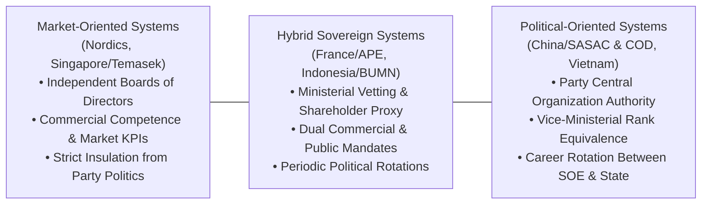
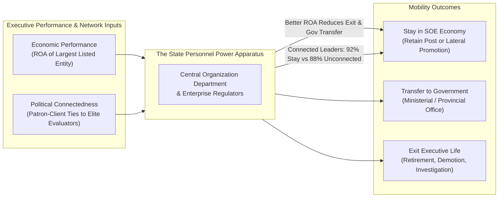

## 📄 Executive Synopsis & Context

- **Source Reference**: Leutert, W., & Vortherms, S. A. (2021). _Personnel Power: Governing State-Owned Enterprises_. Business and Politics, 23(4), 441–460. https://doi.org/10.1017/bap.2021.5.
- **Author Background**:
  - **Dr. Wendy Leutert**: Assistant Professor and GLP-Stamper Chair in China and International Affairs at Indiana University Bloomington; leading scholar on Chinese state-owned enterprise management and political economy.
  - **Dr. Samantha A. Vortherms**: Assistant Professor of Political Science at the University of California, Irvine; specialist in comparative political economy, local governance, and corporate-state relations in China.
- **Core Thesis**: Around the world, state-owned enterprises (SOEs) represent approximately one-quarter of the Fortune Global 500 and contribute massively to national GDP and public infrastructure. To resolve the agency dilemma inherent in firms pursuing dual economic (profit, efficiency) and political (employment, industrial policy, regime stability) mandates, states rely on **"personnel power"**—the sovereign authority to appoint, evaluate, transfer, and dismiss corporate executives. Analyzing a comprehensive dataset of leaders across China's 53 core central SOEs between 2003 and 2017, the authors reveal that state enterprise governance is neither pure meritocracy nor pure patronage: **states leverage personnel power to balance economic efficiency and political stability**, retaining executives who deliver positive bottom-line financial results while maintaining trusted political networks.

---

## 🧠 Complete Conceptual Architecture

### 1. The SOE Governance Spectrum

Sovereign systems for appointing and governing SOE executive leadership exist along a continuous institutional spectrum from market-oriented to political-oriented:

| Governance Model       | Board Independence                                                                                            | Primary Promotion Metric                                                                                    | Executive Career Track                                                                                            | Institutional Benchmark                                                                 |
| :--------------------- | :------------------------------------------------------------------------------------------------------------ | :---------------------------------------------------------------------------------------------------------- | :---------------------------------------------------------------------------------------------------------------- | :-------------------------------------------------------------------------------------- |
| **Market-Oriented**    | High: Commercial boards conduct professional searches without political veto.                                 | Return on Capital Employed (ROCE), shareholder return, operational efficiency.                              | Private corporate market; minimal mobility into government civil service.                                         | Temasek Holdings (Singapore), Equinor (Norway), Vattenfall (Sweden).                    |
| **Hybrid Sovereign**   | Moderate: Ministerial oversight and parliamentary scrutiny; corporate boards appointed via shareholder proxy. | Commercial profitability combined with developmental infrastructure targets and public service obligations. | Primarily corporate, with occasional political appointments to ministry directorships.                            | Agence des participations de l'État (France), Ministry of BUMN / Danantara (Indonesia). |
| **Political-Oriented** | Low: Corporate boards ratify decisions made by state and political party personnel organs.                    | Dual evaluation: financial profitability (ROA) plus political loyalty and patron-client alignment.          | Integrated political mobility; seamless rotation between enterprise executive and provincial governor / minister. | Central SOEs under SASAC & Central Organization Department (China).                     |

---

### 2. Dual Explanations for Executive Political Mobility

The study empirically tests two competing explanations for why SOE leaders retain power, transfer to ministerial posts, or exit public life:

1. **Economic Performance Hypothesis**:
   - Assumes states behave as rational economic shareholders seeking corporate dividends, tax revenues, and economic growth.
   - _Empirical Finding_: Stronger financial performance (measured via subsidiary Return on Assets) **significantly decreases the probability of exit**. Profitable executives are retained within the state corporate economy rather than being discarded. Additionally, superior financial performance reduces the likelihood of transfer into government civil service, indicating that the state prefers to keep proven corporate operators running its largest commercial assets.
2. **Political Connectedness Hypothesis**:
   - Assumes authoritarian and state-dominated regimes rely on patron-client networks (_guanxi_ or factional ties) to ensure ideological loyalty and regime stability.
   - _Empirical Finding_: Executives with informal ties to the political elites overseeing their evaluation—specifically the **Central Organization Department (COD)**—enjoy an estimated **92% probability of staying in power**, compared to **88%** for unconnected peers. Patronage acts as a powerful buffer against dismissal.

---

## 🏢 Real-World Executive Case Vignettes

### 1. China's Core Central SOEs (2003–2017 Dataset)

- **The Empirical Base**: The study examined top executives across **53 core central SOEs** designated with vice-ministerial rank equivalence (_fubuji_), encompassing global industrial titans such as China National Petroleum Corporation (CNPC), Sinopec, State Grid, China Mobile, and Baosteel.
- **Institutional Dualism**: Central SOEs are administratively supervised by the State-owned Assets Supervision and Administration Commission (**SASAC**), but executive appointments are controlled by the Communist Party’s elite **Central Organization Department (COD)**.
- **The Mobility Mechanism**: Unlike Western corporate boards where failed CEOs simply retire to private equity, Chinese central SOE leaders operate within a unified political personnel market. A successful SOE chairman may be rotated to become Governor of a major industrial province (e.g. Liaoning or Guangdong) or promoted directly to Minister of Transport or Energy.

### 2. Comparative Analysis: Indonesia's BUMN Executive Governance

The insights of Leutert and Vortherms provide a direct analytical mirror for understanding Indonesian state enterprise governance under the **Ministry of BUMN** and the sovereign wealth fund / superholding entity **Danantara**:

- **Ministerial Personnel Power**: In Indonesia, the Minister of BUMN acts as the representative of the state shareholder, exercising direct personnel power to appoint and dismiss Directors (_Direksi_) and Commissioners (_Komisaris_).
- **The Performance-Politics Balance**: Just as in China, Indonesian BUMN executive turnover reflects a delicate equilibrium between economic delivery (meeting dividend and tax targets) and political stakeholder management (navigating DPR parliamentary commissions, ministerial priorities, and regional coalitions).

---

## 🛠️ Complete Diagnostic Worksheets & Toolkits

### The Personnel Power Governance Audit

State enterprise boards, institutional investors, and sovereign holding executives can audit the governance health of an SOE using the following 5-dimension diagnostic protocol:

| Audit Dimension                  | Diagnostic Indicator                                       | High Risk (Politicized Drift)                                                                     | Low Risk (Meritocratic Balance)                                                                        |
| :------------------------------- | :--------------------------------------------------------- | :------------------------------------------------------------------------------------------------ | :----------------------------------------------------------------------------------------------------- |
| **1. Appointment Origin**        | Source of executive nomination and vetting.                | Purely ministerial or political party nomination without competitive search.                      | Independent nomination committee with transparent search and technical vetting.                        |
| **2. KPI Alignment**             | Balance between financial and non-commercial targets.      | Opaque, contradictory public service mandates without cost compensation.                          | Cleanly decoupled commercial KPIs (ROCE/EBITDA) with explicit government contract for public services. |
| **3. Turnover Volatility**       | Frequency of C-suite changes relative to electoral cycles. | Mass executive replacement immediately following cabinet reshuffles or political transitions.     | Board tenure aligned with multi-year strategic investment and capital expenditure cycles.              |
| **4. Career Portability**        | Post-tenure mobility of departing executives.              | Inward rotation of retired politicians or ministry regulators into commissioner roles.            | Two-way mobility between private enterprise, global markets, and professional state management.        |
| **5. Listed Asset Ring-Fencing** | Insulation of publicly listed subsidiaries.                | Parent holding extracts uncompensated cash or forces unprofitable loans onto listed subsidiaries. | Strict minority shareholder protection and independent audit committee oversight.                      |

---

## 📊 Comparative Exhibits & Framework Tables

### Multinomial Logit Findings: Determinants of SOE Leader Mobility

| Independent Variable                   | Probability of Staying in SOE Economy | Probability of Transfer to Government | Probability of Exiting Executive Life | Theoretical & Practical Implication                                                     |
| :------------------------------------- | :-----------------------------------: | :-----------------------------------: | :-----------------------------------: | :-------------------------------------------------------------------------------------- |
| **Higher Economic Performance (ROA)**  |       **Positive ($\uparrow$)**       |      **Negative ($\downarrow$)**      |      **Negative ($\downarrow$)**      | The state leaves top financial operators in place; poor performance triggers dismissal. |
| **Political Connectedness to COD**     | **Positive ($\uparrow$, 92% vs 88%)** |       Neutral / Slight Negative       |      **Negative ($\downarrow$)**      | Patronage ties protect leaders from demotion and retirement.                            |
| **Executive Age (Nearing Retirement)** |      **Negative ($\downarrow$)**      |        Negative ($\downarrow$)        |       **Positive ($\uparrow$)**       | Rigid institutional age limits (typically 60–63 for central SOEs) enforce exit.         |
| **Tenure in Current Post**             |        Negative ($\downarrow$)        |         Positive ($\uparrow$)         |         Positive ($\uparrow$)         | Long tenure triggers rotational mobility to prevent entrenched local corruption.        |

---

## 💬 Classroom Cold-Call & Discussion Strategy

### Discussion Question 1: "What is 'personnel power', and why is it more effective than regulatory oversight in governing state enterprises?"

- **Crisp Recitation**: "Personnel power is the sovereign authority to appoint, evaluate, transfer, and dismiss corporate executives. It is fundamentally more effective than external regulatory oversight because external regulators face severe information asymmetry and bureaucratic lag. By directly controlling executive appointments and career mobility, the state aligns the personal career incentives of CEOs with state priorities, ensuring that corporate strategy, capital expenditure, and resource allocation conform to national economic and political goals from the inside out."

### Discussion Question 2: "Does Leutert & Vortherms' study prove that SOE leadership is a pure meritocracy or a pure patron-client network?"

- **Crisp Recitation**: "Neither. The study empirically demonstrates that personnel power operates as a dual balancing mechanism. Better economic performance significantly reduces the likelihood of exit, proving that the state demands commercial efficiency and bottom-line delivery. Concurrently, political connectedness provides an additional buffer, giving connected executives a higher retention probability (92% vs 88%). The state-owned sector retains leaders who can deliver financial results while maintaining trusted political networks."

### Discussion Question 3: "What are the core methodological limitations of measuring SOE economic performance via listed subsidiary ROA?"

- **Crisp Recitation**: "First, listed subsidiaries represent the crown jewels—the cleanest, most productive assets—meaning their ROA overstates the health of the broader, unlisted parent group burdened with legacy debt and social overhead. Second, ROA fails to capture non-commercial public obligations, such as emergency disaster response, employment stabilization, and subsidized infrastructure development. Consequently, listed ROA is a standardized but incomplete proxy for overall state enterprise value creation."

---

## 🔗 Knowledge Graph & Bridges

- **Parent Lecture**: [[courses/mk1-organizational-behavior-managing-people/week-07/index|Week 07 Masterclass: Power, Politics & Governance in State-Owned Enterprises]]
- **Pre-Assignment Debrief**: [[courses/mk1-organizational-behavior-managing-people/week-07/assignment-pre-personnel-power-soes|Pre-Assignment: Personnel Power in SOEs (F9 Debrief)]]
- **Post-Assignment Debrief**: [[courses/mk1-organizational-behavior-managing-people/week-07/assignment-post-power-politics|Post-Assignment: Power & Politics in Organizations (F9 Debrief)]]
- **Upstream Connection**: [[courses/mk1-organizational-behavior-managing-people/week-06/case-lcop-bumn-private|Week 06 Case: LCOP Structural Equation Model (Dr. Yuni Ros Bangun)]]
