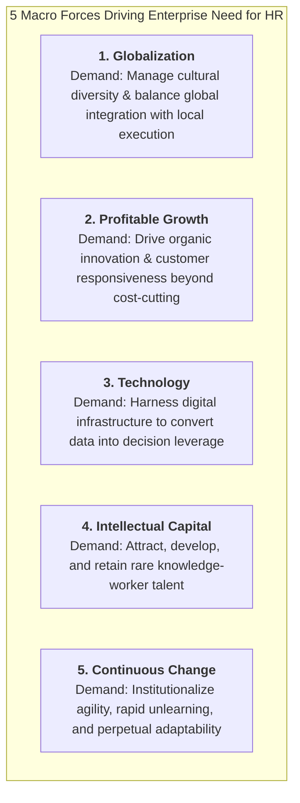
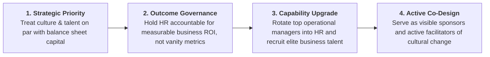
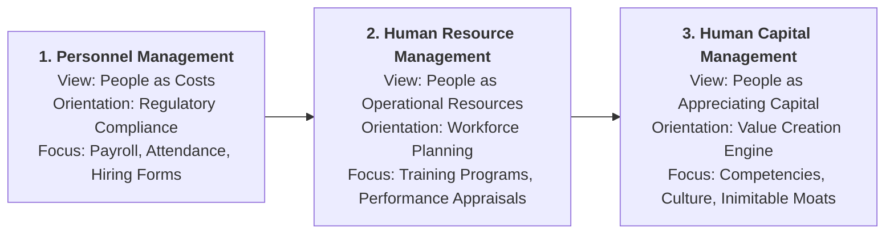

> [!NOTE] Cohort Attribution & Academic Mode
> **Analysis & Model Synthesis by:** `F9 (Class F / Syndicate 9)`  
> **Academic Status:** Post-Class Final Submission & Model Analytical Debrief  
> **Curricular Target:** Dave Ulrich (1998), _"A New Mandate for Human Resources"_, Harvard Business Review, 76(1), 124–134.

---

## 🎯 Executive Assignment Overview

In Week 08, participants dissected Dave Ulrich’s seminal Harvard Business Review article to address a foundational question in organizational leadership: **Why must human resources transcend administrative routine to become an engine of enterprise competitiveness?**

This debrief synthesizes the analytical progression from pre-class individual inquiries to the post-class collective consensus forged by Syndicate 9, incorporating in-class plenary discussions on the historical evolution of people management.

---

## 🔍 Core Analysis: The 5 Strategic Imperatives

Ulrich establishes that traditional HR fails because it focuses on internal activities (running training sessions, tracking vacation balances) rather than external business outcomes. In response to five accelerating environmental shifts, organizations must build new collective capabilities:

### Why "The Only Competitive Weapon Left is Organization"

Ulrich’s most provocative assertion is that traditional competitive barriers—access to financial capital, proprietary product designs, robotic factory automation, and cost advantages—are rapidly eroded by global competition. Competitors can reverse-engineer a physical product or secure bank financing within weeks.

Sustainable, non-replicable advantage rests in **organizational capabilities**:

- **Speed & Velocity**: How quickly can the firm translate customer insight into a launched product?
- **Shared Mindset & Culture**: Do employees across cross-functional silos act with unified purpose?
- **Learning Capacity**: Does the enterprise systematically learn from operational mistakes?

Because these collective capabilities belong to **"everyone and no one"**, they frequently fall into an organizational void. Line executives are absorbed in quarterly profit-and-loss targets, while traditional HR is absorbed in administrative paperwork. This institutional gap creates the strategic opening for a redesigned HR function.

---

## 🏛️ The 4 Roles of the New HR Agenda

To fill this capability gap, Ulrich establishes four interconnected roles:

| Role                      | Environmental Pressure Addressed  | Core Organizational Deliverable       | Concrete Line Interventions                                                                                        |
| :------------------------ | :-------------------------------- | :------------------------------------ | :----------------------------------------------------------------------------------------------------------------- |
| **Strategic Partner**     | Globalization & Profitable Growth | **Flawless Strategy Execution**       | Auditing organizational culture; diagnosing execution roadblocks; aligning incentive systems with 5-year strategy. |
| **Administrative Expert** | Technology & Process Complexity   | **Lean Administrative Efficiency**    | Reengineering workflows; deploying digital shared services; reducing transaction costs without degrading quality.  |
| **Employee Champion**     | Intellectual Capital Scarcity     | **High Employee Commitment & Morale** | Providing psychological safety; coaching frontline leaders; advocating for talent resources to top leadership.     |
| **Change Agent**          | Continuous Environmental Change   | **Capacity for Transformation**       | Guiding cultural transitions; facilitating unlearning; embedding agility into corporate operating rhythms.         |

---

## ⚖️ Leadership Accountability: The Mandate for Line Managers

Ulrich makes clear that HR cannot transform itself in isolation. A human resources department that unilaterally declares itself "strategic" will be ignored if line executives treat them as bureaucratic functionaries.

Primary accountability for human capital transformation rests with **CEOs and General Managers**, who must execute four commitments:

---

## 💡 Syndicate 9 Reflection & Curricular Synthesis

### The Three-Phase Evolution of People Management

During in-class plenary analysis, our syndicate evaluated the deeper philosophical paradigm shift underpinning Ulrich’s model:

1. **Personnel Management** treated employees as transactional overhead costs to be minimized and controlled through strict disciplinary oversight.
2. **Human Resource Management (HRM)** recognized employees as vital operating resources to be organized and deployed.
3. **Human Capital Management (HCM)** treats employees as appreciating capital whose collective knowledge, psychological commitment, and collaborative capabilities generate exponential future cash flows.

In State-Owned Enterprises (BUMN) and Indonesian corporate conglomerates, the temptation remains to rename the personnel division "Human Capital" while preserving administrative paper-pushing behaviors. Authentic transformation requires line leaders and HR partners to co-author strategy, link organizational design directly to corporate targets, and view workforce capability as the enterprise’s ultimate source of economic rent.

---

## 🔗 Related Knowledge Bridges

- Master Curricular Hub: [[courses/mk1-organizational-behavior-managing-people/week-08/index|MK1 Week 08: People & Strategy: Human Capital as Competitive Advantage]]
- Concept Note: [[concepts/ulrich-hr-model|Dave Ulrich HR Business Partner Model]]
- Corporate Case Dossier: [[courses/mk1-organizational-behavior-managing-people/week-08/case-general-motors-mary-barra-ev|General Motors: Mary Barra's Leadership in the EV Era]]
- Academic Foundation: [[courses/mk1-organizational-behavior-managing-people/week-08/reading-dave-ulrich-new-mandate-hr|Academic Reading: A New Mandate for Human Resources (Ulrich, 1998)]]
