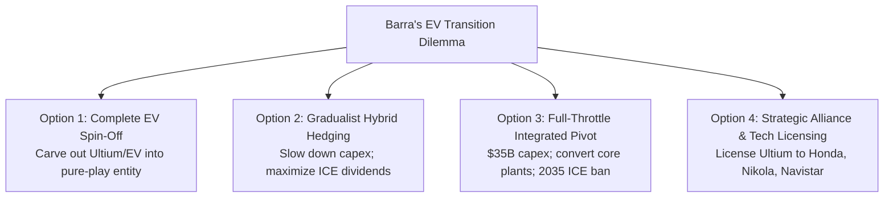

## 🚨 The Executive Dilemma

On October 25, 2021, Hertz Global Holdings announced the largest single electric vehicle purchase in automotive history: an order for 100,000 Tesla vehicles. Shortly thereafter, Tesla's market capitalization breached \$1 trillion, eclipsing the combined equity value of General Motors, Ford, and Toyota.

For **Mary Barra**, Chair and Chief Executive Officer of **General Motors Company (GM)**, Hertz's announcement was a stark competitive alert. Despite GM’s early technological milestones—including the launch of the Chevrolet Bolt EV, the development of the modular Ultium battery platform, and the acquisition of autonomous driving pioneer Cruise—Wall Street and global rental fleets continued to price GM as an incumbent dinosaur weighed down by legacy internal combustion engine (ICE) baggage, high fixed union costs, and bureaucratic engineering silos.

Barra faced a defining strategic and organizational dilemma:

1. **The Innovator's Dilemma**: How could GM aggressively cannibalize its highly lucrative internal combustion truck and SUV lines (which generated the operating cash flows required to fund capital expenditure) to accelerate a zero-emission EV future?
2. **The Human Capital Transformation**: How could a 114-year-old mechanical manufacturing culture retrain and transform its 150,000-person global workforce into software engineers, battery scientists, and agile digital innovators while navigating militant United Auto Workers (UAW) labor relations?

```mermaid
flowchart LR
    subgraph LegacyGM["Legacy Industrial Incumbent (1908–2014)"]
        direction LR
        L1["Siloed Divisions &<br/>'GM Salute' Deflection"] --> L2["ICE Truck Cash Dependency<br/>(Suburban, Silverado)"]
        L2 --> L3["Ignition Switch Crisis<br/>(Cultural Paralysis)"]
        L3 --> L4["Bankruptcy Stigma &<br/>Wall Street Valuation Discount"]
    end

    subgraph EVTransformation["Barra's EV Revolution (2014–2025)"]
        direction LR
        T1["Cultural Reset: 'Say The Thing<br/>You Think You Cannot Say'"] --> T2["$35B EV/AV Commitment<br/>& Ultium Battery Platform"]
        T2 --> T3["Software & Human Capital Pivot<br/>(Factory ZERO Retraining)"]
        T3 --> T4["Zero Crashes, Zero Emissions,<br/>Zero Congestion Vision"]
    end

    LegacyGM -.->|"Barra Leadership Engine"| EVTransformation
```

---

## 📊 Strategic Context & Case Evidence

### 1. From "Government Motors" to Cultural Reboot

When Mary Barra assumed the CEO role on January 15, 2014, she immediately inherited GM's devastating ignition switch scandal. A defective switch had caused air bags to fail during engine stalls, resulting in at least 124 deaths. The independent Valukas Report exposed an ingrained corporate pathology where employees practiced the _"GM Salute"_—crossing arms and pointing fingers at others—and the _"GM Nod"_, nodding passively in meetings while resolving to take zero action.

Barra dismantled this paralysis through structural and cultural accountability:

- Dismissing 15 senior managers and disciplining dozens more.
- Establishing an unyielding cultural imperative: _"Say the thing you think you cannot say."_
- Flattening communications and actively encouraging shop-floor workers to halt production lines if safety anomalies surfaced.

### 2. The Technological Bet: Ultium Battery Platform

Rather than retrofitting gasoline chassis with electric motors, GM engineered a clean-sheet EV architecture:

- **Modular Cells & Packaging**: Ultium pouch cells could be stacked vertically or horizontally, providing battery capacities ranging from $50\text{ kWh}$ to $200\text{ kWh}$ with up to 450 miles of range.
- **Cross-Brand Scalability**: A single platform powering the ultra-luxury Cadillac CELESTIQ, the GMC Hummer EV super-truck, the commercial BrightDrop delivery vans, and the mass-market Chevrolet Equinox EV.
- **Factory ZERO**: Transforming GM's historic Detroit-Hamtramck assembly plant into a dedicated EV manufacturing hub, proving that legacy union manufacturing plants could be repurposed for clean mobility.

### 3. Quantitative Financial & Operational Comparison (2021)

| Metric                                     | General Motors (GM)           | Tesla Inc.                         | Ford Motor Company            |
| :----------------------------------------- | :---------------------------- | :--------------------------------- | :---------------------------- |
| **Annual Vehicle Deliveries (2021)**       | $\sim 6.3\text{ million}$     | $\sim 936{,}000$                   | $\sim 3.9\text{ million}$     |
| **Total Revenue (2021)**                   | $\$127.0\text{ billion}$      | $\$53.8\text{ billion}$            | $\$136.3\text{ billion}$      |
| **Net Income (2021)**                      | $\$10.0\text{ billion}$       | $\$5.5\text{ billion}$             | $\$17.9\text{ billion}$       |
| **Peak Market Capitalization (Late 2021)** | $\approx \$85\text{ billion}$ | $\approx \$1{,}050\text{ billion}$ | $\approx \$80\text{ billion}$ |
| **P/E Ratio (Trailing)**                   | $\approx 8.5\times$           | $\approx 190\times$                | $\approx 4.5\times$           |
| **EV Global Market Share (2021)**          | $\approx 7.6\%$               | $\approx 21.0\%$                   | $\approx 2.5\%$               |

---

## 🧭 Four Strategic Decision Alternatives for Barra

| Alternative                                    | Strategic Logic                                                                             | Key Organizational Risk                                                                    |
| :--------------------------------------------- | :------------------------------------------------------------------------------------------ | :----------------------------------------------------------------------------------------- |
| **Option 1: Spin-Off EV/Ultium**               | Unlock massive Wall Street valuation multiple for an unencumbered pure-play EV stock.       | Starves the EV venture of legacy ICE cash flows; triggers intense union resistance.        |
| **Option 2: Gradualist Hybrid Hedging**        | Preserve current \$10B annual earnings; rely on plug-in hybrids until battery costs plunge. | Risks being permanently bypassed by Tesla and aggressive Chinese EV makers (BYD).          |
| **Option 3: Full Integrated Pivot (Selected)** | Leverage GM's unmatched manufacturing scale, procurement power, and dealer network.         | Immense execution complexity; cultural friction between software and mechanical engineers. |
| **Option 4: Technology Licensing**             | Turn Ultium into the "Intel Inside" of global mobility by licensing to third-party OEMs.    | Relies on external partner execution; commoditizes GM's proprietary battery advantage.     |

---

## 🎓 Cold-Call Class Discussion Guide

1. **The Cultural Pivot**: How did Barra's handling of the ignition switch crisis lay the cultural foundation for the EV transformation? Could GM have undertaken the Ultium initiative under legacy "GM Salute" leadership?
2. **HR as Strategic Partner**: Using the [[concepts/ulrich-hr-model|Dave Ulrich HR Model]], how must GM’s human resources function operate to support the software-defined vehicle era? What is the role of HR in resolving the tension between software engineers in Silicon Valley and plant workers in Detroit?
3. **Union & Labor Strategy**: Can an incumbent automaker with unionized hourly labor and pension obligations compete on unit costs against non-unionized EV entrants like Tesla in Texas or BYD in Shenzhen?

---

## 🔗 Related Knowledge Bridges

- Master Curricular Hub: [[courses/mk1-organizational-behavior-managing-people/week-08/index|MK1 Week 08: People & Strategy: Human Capital as Competitive Advantage]]
- Foundational Theory: [[concepts/ulrich-hr-model|Dave Ulrich HR Business Partner Model]]
- Leadership Profile: [[entities/mary-barra|Mary Barra Profile]]
- Strategy Execution Architecture: [[concepts/organizational-dna-framework|Organizational DNA Framework]]
