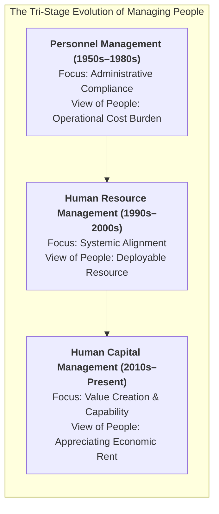
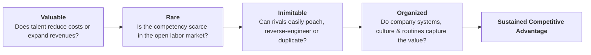
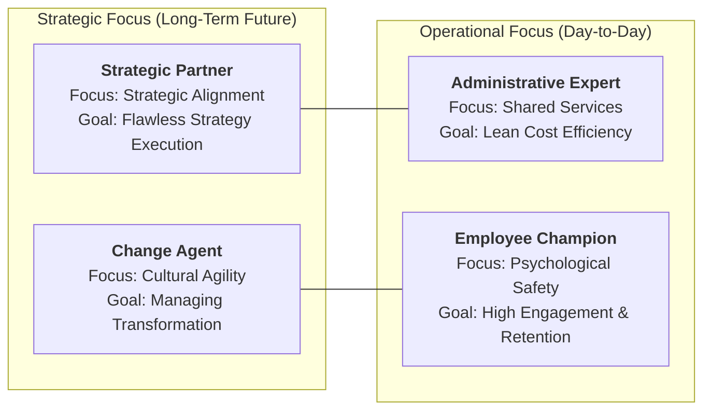
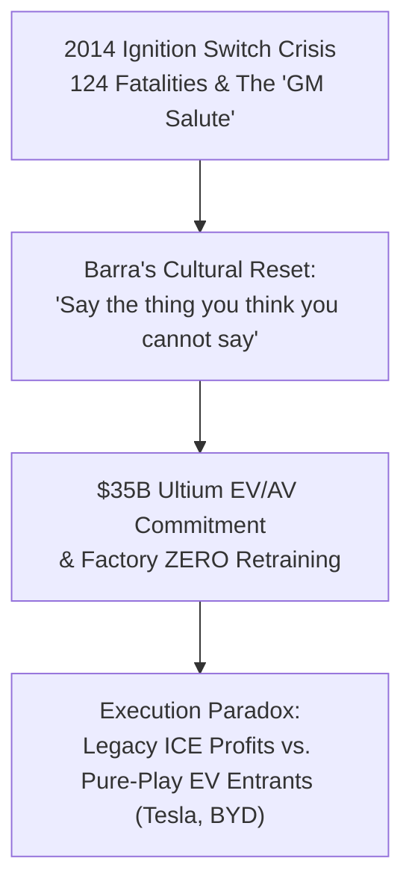

> [!NOTE] Curricular & Faculty Metadata
>
> - **Course:** MK1 Organizational Behaviour & Managing People — Week 08
> - **Teaching Team:** Dr. Ir. Madju Yuni Ros Bangun, Muhammad Yorga Permana, Ph.D., Widhyawan Prawiraatmadja, Ph.D., Yudo Anggoro, Ph.D.
> - **Primary Curricular Spine:** `archive/courses/mk1/week-08/Week 8-Student Version-People & Strategy-Human Capital as Competitive Advantage Rev.01.pdf`
> - **Direct Satellites & Problem Sets:**
>   - [[courses/mk1-organizational-behavior-managing-people/week-08/case-general-motors-mary-barra-ev|Case Study: General Motors — Mary Barra's Leadership in the Electric Vehicle Era (Ivey W31010)]]
>   - [[courses/mk1-organizational-behavior-managing-people/week-08/reading-dave-ulrich-new-mandate-hr|Academic Reading: A New Mandate for Human Resources (Dave Ulrich, 1998)]]
>   - [[courses/mk1-organizational-behavior-managing-people/week-08/assignment-syndicate-9-hr-strategy|Syndicate 9 Assignment Debrief: Strategic HR Architecture]]

---

## 1. Executive Overview: The Paradigm Shift in People Management

For decades, traditional management literature and corporate practices treated human resources as an administrative overhead unit—a back-office personnel bureaucracy charged with regulatory compliance, processing vacation slips, tracking clock-in times, and enforcing workplace dress codes.

In the contemporary knowledge-driven, volatile global economy, this legacy posture has collapsed. Tangible assets—factories, machinery, computing hardware, and access to debt capital—are instantly replicable by global competitors. As highlighted in our curricular spine, the modern enterprise competes on **organizational capability** and **strategic human capital**.

To achieve sustainable competitive advantage, organizations must shift from merely administering personnel to architecting human capital systems that fulfill Barney's **VRIO criteria** (Valuable, Rare, Inimitable, and Organized).

---

## 2. Human Capital under the VRIO Framework

Why do individual star performers fail to guarantee sustained enterprise profitability? The lecture synthesizes strategic human capital theory:

| VRIO Dimension     | Human Capital Operational Manifestation                                                                                                                          | Corporate Risk if Lacking                                                                    |
| :----------------- | :--------------------------------------------------------------------------------------------------------------------------------------------------------------- | :------------------------------------------------------------------------------------------- | ------------------------------------------------------------------------------------------------------------------- |
| **Valuable (V)**   | Employees possess specialized skills that directly improve customer satisfaction, accelerate cycle times, or optimize capital allocation.                        | Competitive Disadvantage: The firm pays above-market wages for non-differentiating skills.   |
| **Rare (R)**       | Knowledge domains (e.g., solid-state battery chemistry, high-frequency trading algorithms, complex B2B regulatory negotiation) are scarce.                       | Competitive Parity: Any competitor can hire identical commodity skills off the street.       |
| **Inimitable (I)** | The capability arises from **path dependency** (years of accumulated institutional memory) and **social complexity** (cross-functional trust and communication). | Temporary Advantage: Rivals offer signing bonuses to poach talent and replicate solutions.   |
| **Organized (O)**  | Organizational processes, incentive structures, and [[concepts/organizational-dna-framework                                                                      | Decision Rights]] enable employees to deploy their talents without bureaucratic obstruction. | Unused Competitive Potential: Brilliant individuals are paralyzed by toxic politics, red tape, and siloed friction. |

---

## 3. The Dave Ulrich 4-Role Architecture

To operationalize human capital into a sustainable competitive engine, the course analyzes the [[concepts/ulrich-hr-model|Dave Ulrich HR Business Partner Model]]. Rather than viewing HR as a uniform staff function, Ulrich establishes a two-dimensional matrix crossing **Focus** (Strategic vs. Operational) with **Target** (Processes vs. People):

As detailed in our academic reading notes on [[courses/mk1-organizational-behavior-managing-people/week-08/reading-dave-ulrich-new-mandate-hr|Dave Ulrich (1998)]], the strategic elevation of HR cannot be achieved by HR practitioners alone. **CEOs and line general managers** carry the primary responsibility for setting strategic priorities, holding HR accountable for measurable business ROI, and treating organizational culture as an appreciating balance-sheet asset.

---

## 4. Case Synthesis: General Motors & Mary Barra's Cultural Turnaround

The class examines the practical battlefield of human capital transformation through the Ivey case study on [[entities/mary-barra|Mary Barra]] and [[courses/mk1-organizational-behavior-managing-people/week-08/case-general-motors-mary-barra-ev|General Motors: Mary Barra's Leadership in the Electric Vehicle Era]].

### Key Leadership Lessons from the GM Case

1. **Dismantling Institutional Deflection**: Barra eradicated the infamous _"GM Salute"_ (crossing arms and pointing blame at adjacent departments) and _"GM Nod"_ (feigning consensus in executive suites while quietly ignoring directives).
2. **Retraining vs. Replacement**: Rather than mass-firing manufacturing veterans, GM invested in retraining legacy union workers at Factory ZERO into high-voltage battery technicians and robotics supervisors, demonstrating that industrial human capital can be successfully upgraded.
3. **The Software vs. Hardware Culture Clash**: Developing the software-defined vehicle requires GM to harmonize agile Silicon Valley software developers with century-old mechanical engineering safety standards.

---

## 5. Strategic Implications for BUMN & Indonesian Conglomerates

The strategic lessons of Week 08 hold direct relevance for Indonesian State-Owned Enterprises (BUMN) operating under Danantara governance:

1. **Transcending "Bagian Kepegawaian"**: Many Indonesian public sector organizations have rebranded their personnel departments to "Divisi Human Capital" without changing their operational behavior. Leaders must transition from administering employee leaves and disciplinary sanctions to measuring workforce capability, leadership bench strength, and cultural agility.
2. **AKHLAK as an Inimitable Competence**: In state-owned holding companies, ethical governance and public service orientation cannot remain mere marketing banners. When embedded into performance scorecards, AKHLAK values function as an organizational coordination mechanism that reduces transaction costs and bureaucratic friction across subsidiary silos.
3. **Closing the Line-Manager Accountability Gap**: Business unit heads must recognize that talent retention and psychological safety are core operational responsibilities, not outsourced tasks relegated to HR.

---

## 🔗 Week 08 Direct Curricular Bridges

- Case Dossier: [[courses/mk1-organizational-behavior-managing-people/week-08/case-general-motors-mary-barra-ev|General Motors: Mary Barra's Leadership in the EV Era (Ivey W31010)]]
- Reading Note: [[courses/mk1-organizational-behavior-managing-people/week-08/reading-dave-ulrich-new-mandate-hr|A New Mandate for Human Resources (Ulrich, 1998)]]
- Syndicate Debrief: [[courses/mk1-organizational-behavior-managing-people/week-08/assignment-syndicate-9-hr-strategy|Syndicate 9 Strategic HR Debrief (F9 Attribution)]]
- Strategic Concept: [[concepts/ulrich-hr-model|Dave Ulrich HR Business Partner Model]]
- Executive Profile: [[entities/mary-barra|Mary Barra Profile]]
- Next Lecture: [[courses/mk1-organizational-behavior-managing-people/week-09/index|Week 09: Organization Design & Strategic Workforce Planning]]
