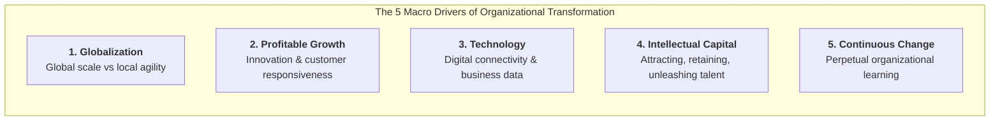
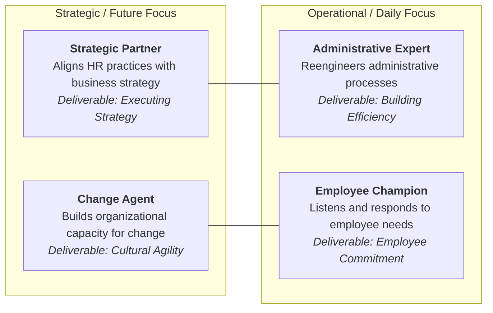

## 📖 Executive Summary & Core Provocation

In his seminal 1998 Harvard Business Review article _"A New Mandate for Human Resources"_, Professor Dave Ulrich opens with an unsettling admission:

> _"Should we do away with HR? In so many companies, HR is ineffective, incompetent, and value-sapping. If HR were to remain as it is currently configured, I would be tempted to answer yes—abolish the thing."_

Yet Ulrich immediately pivots to argue that **HR has never been more necessary**. Why? Because traditional sources of competitive advantage—such as access to capital, proprietary product features, production scale, and technology—are rapidly commoditized, copied, and competed away. In a globalized knowledge economy, **the only enduring competitive weapon left is organizational capability**: the collective capacity of an enterprise to innovate faster, adapt quicker, execute flawlessly, and retain top intellectual talent.

---

## 🌍 The 5 Competitive Forces Redefining Business

Ulrich identifies five macro-environmental pressures compelling companies to transform their human capital architecture:

1. **Globalization**: Enterprises must harmonize global operational integration with intimate local responsiveness. Managing cross-cultural teams and distributed supply networks requires sophisticated organizational architecture.
2. **Profitability Through Growth**: Cost-cutting, headcount downsizing, and financial engineering have reached mathematically diminishing returns. Profitable growth demands customer-centric innovation, market agility, and rapid new venture launch.
3. **Technology**: The explosion of digital platforms, shared enterprise data, and automated workflows transforms information into the primary currency of competitive strategy.
4. **Intellectual Capital**: In the knowledge economy, physical assets (factories, machinery) depreciate, while intellectual capital (knowledge, patents, proprietary routines, high-performing talent) appreciates and creates future enterprise value.
5. **Continuous Change**: Market cycles, consumer preferences, and geopolitical conditions shift unpredictably. Success belongs to organizations that master organizational unlearning and change execution.

---

## 🏛️ The Ulrich 4-Role Architecture

To deliver on this mandate, HR must abandon its historical obsession with transactional personnel policing and adopt an outcome-driven **2×2 functional architecture**:

| Role                      | Focus & Alignment              | Core Deliverable              | Strategic Interventions                                                                                                  |
| :------------------------ | :----------------------------- | :---------------------------- | :----------------------------------------------------------------------------------------------------------------------- |
| **Strategic Partner**     | Strategic $\times$ Processes   | **Strategy Execution**        | Conducting organizational audits; translating corporate strategy into concrete HR deliverables; identifying talent gaps. |
| **Administrative Expert** | Operational $\times$ Processes | **Administrative Efficiency** | Reengineering workflows; deploying digital HR shared services (HRSS); eliminating redundant bureaucracy.                 |
| **Employee Champion**     | Operational $\times$ People    | **Employee Commitment**       | Providing resources; fostering psychological safety; ensuring employee voice reaches executive leadership.               |
| **Change Agent**          | Strategic $\times$ People      | **Cultural Agility**          | Diagnosing resistance to change; facilitating executive alignment; institutionalizing continuous learning loops.         |

---

## 🎯 Line Executive Accountability Mandate

Ulrich places the ultimate responsibility for HR's transformation squarely on **CEOs and line business managers**:

> _"HR cannot transform itself in a vacuum. If line managers treat HR as second-class staff who plan holiday parties and manage paperwork, HR will remain second-class. Line managers are the true owners of organizational capability."_

To create a strategic HR function, general managers must take four decisive actions:

1. **Explicitly define people and culture as competitive business priorities**, dedicating equal executive review time as financial reviews.
2. **Demand clear business outcomes**, evaluating HR initiatives through ROI, employee productivity, customer satisfaction, and execution velocity.
3. **Invest in HR capability upgrades**, recruiting cross-functional business talent into HR leadership and training HR professionals in finance, operations, and corporate strategy.
4. **Partner actively in execution**, serving as co-designers and co-sponsors of organizational change initiatives.

---

## 🔗 Related Knowledge Bridges

- Master Curricular Hub: [[courses/mk1-organizational-behavior-managing-people/week-08/index|MK1 Week 08: People & Strategy: Human Capital as Competitive Advantage]]
- Concept Blueprint: [[concepts/ulrich-hr-model|Dave Ulrich HR Business Partner Model]]
- Corporate Case Dossier: [[courses/mk1-organizational-behavior-managing-people/week-08/case-general-motors-mary-barra-ev|General Motors: Mary Barra's Leadership in the EV Era]]
- Syndicate Debrief: [[courses/mk1-organizational-behavior-managing-people/week-08/assignment-syndicate-9-hr-strategy|Syndicate 9 HR Strategy Debrief]]
