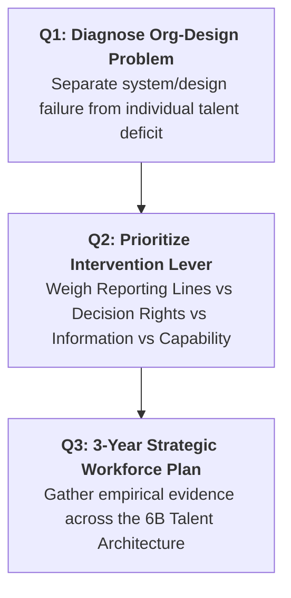
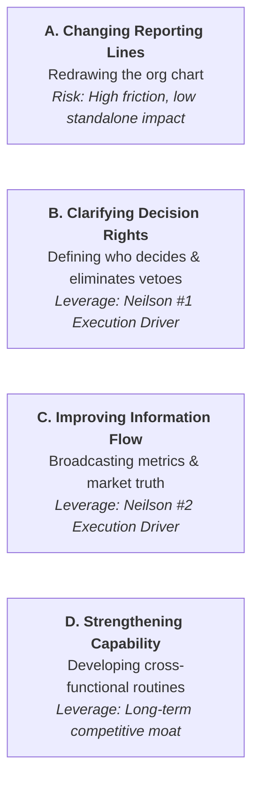

> [!IMPORTANT] Cohort Pre-Class Study Brief (_"Ini Peta, Bukan Jawaban"_)
> **Audience:** P3MD Batch I Soedirman Cohort  
> **Academic Mode:** Pre-Class Guidance & Analytical Framework Map  
> **Purpose:** This brief equips participants to build their individual one-page diagnostic submission by mapping core conceptual frameworks, diagnostic traps, and evaluation rubrics—**without prescribing specific company examples or final answers**.

---

## 🎯 Assignment Overview & Evaluation Rubric

The Week 09 pre-assignment requires participants to write a concise, one-page executive diagnosis addressing three interdependent questions:

| Dimension                           | Question Focus                                                                                                                                             | Curricular Evaluation Weight                      |
| :---------------------------------- | :--------------------------------------------------------------------------------------------------------------------------------------------------------- | :------------------------------------------------ |
| **Q1: Structural Diagnosis**        | Identify an organization with a sound strategy that fails in execution. Diagnose an organization-design breakdown distinguishing it from a lack of talent. | **40%** (Diagnostic Depth & Specificity)          |
| **Q2: Intervention Leverage**       | Evaluate four potential levers: changing reporting lines, clarifying decision rights, improving information flow, or strengthening a capability.           | **35%** (Strategic Alignment & Trade-off Defense) |
| **Q3: Workforce Planning (3-Year)** | Identify two critical skills needed in 3 years. Detail the empirical evidence required before deciding to Buy, Build, Borrow, or Automate.                 | **25%** (Evidence-Aware Reasoning & Feasibility)  |

---

## 🗺️ Question-by-Question Analytical Roadmap

### 🔍 Question 1: Systemic Design vs. Individual Talent

A common executive trap is blaming poor results on "unmotivated employees" or "poor individual talent." When diagnosing your chosen enterprise:

- **Individual Talent Deficit**: A specific person lacks the analytical, technical, or leadership skills to perform assigned duties. (Fix: training, reassignment, or hiring).
- **Organization Design Failure**: Competent, highly capable professionals work diligently, yet enterprise outcomes fail because the **coordination architecture** thwarts their efforts.

#### Guiding Diagnostic Lens: Neilson's 7 Archetypes

Review the [[concepts/organizational-dna-framework|Organizational DNA Framework]] and ask which profile fits your case:

- Is the firm **Passive-Aggressive** (nodding in meetings, stalling afterward)?
- Is it **Overmanaged** (multiple review committees second-guessing frontline decisions)?
- Is it **Outgrown** (senior founders acting as bottlenecks on routine operational approvals)?

---

### ⚖️ Question 2: Defending the Highest-Leverage Intervention

When comparing the four potential interventions, do not simply pick one arbitrarily. Build a comparative defense grounded in academic evidence:

#### Analytical Checklist for Your Defense:

1. **Explain the Tradeoff**: If you choose _Clarifying Decision Rights_, explain why simply changing reporting lines on an org chart would fail to solve the coordination bottleneck.
2. **Cite Execution Mechanisms**: Show how removing second-guessing layers increases execution velocity and restores frontline managerial accountability.
3. **Connect to Information Transparency**: Demonstrate how decision-makers cannot act effectively unless accurate operational data flows horizontally across business units.

---

### 📊 Question 3: The 6B Strategic Workforce Planning Architecture

For your two strategic capabilities, apply the **CIPD / 6B Strategic Workforce Planning Framework** to outline the empirical evidence required before deploying capital:

| Workforce Lever               | Strategic Definition                                                | Key Empirical Evidence Required Before Deciding                                                                  |
| :---------------------------- | :------------------------------------------------------------------ | :--------------------------------------------------------------------------------------------------------------- |
| **Buy** (Recruit)             | Hiring external talent from the market.                             | Is the skill completely absent internally? Does the market offer ready-to-deploy talent at reasonable cost?      |
| **Build** (Upskill)           | Developing internal employees through structured academies.         | Does the firm have sufficient lead time (12–24 months) to train employees before the market window closes?       |
| **Borrow** (Partner/Contract) | Engaging specialized consultants, contractors, or gig experts.      | Is the skill temporary or project-based? Does the firm need immediate surge capacity without long-term overhead? |
| **Bound** (Redeploy)          | Transferring redundant talent from declining units to growth units. | Are there legacy departments with surplus analytical capability that can be retrained for digital growth?        |
| **Bounce** (Exit)             | Phasing out non-aligned or obsolete roles.                          | Has a functional skill set become permanently automated or commoditized?                                         |
| **Bind** (Retain)             | Retaining rare top talent with golden handcuffs and career paths.   | What is the replacement cost and flight risk of top 5% mission-critical architects?                              |
| **Bot** (Automate)            | Replacing repetitive cognitive/manual tasks with AI/RPA.            | Can deterministic workflows or data reconciliation be performed by software agents at lower error rates?         |

---

## 💡 Pre-Class Defense Checklist

Before submitting your one-page brief, stress-test your arguments:

- [ ] Have you chosen an organization with a **genuinely viable strategy** rather than one with an inherently flawed business model?
- [ ] Did you demonstrate that employees are individually capable, proving the problem is **architectural** rather than a hiring mistake?
- [ ] Did you justify your intervention lever using empirical logic rather than intuition?
- [ ] Did you identify specific, forward-looking skills for Q3 (e.g., _battery telemetry optimization_, _AI pipeline governance_) rather than vague clichés (e.g., _"leadership skills"_)?

---

## 🔗 Related Knowledge Bridges

- Master Curricular Hub: [[courses/mk1-organizational-behavior-managing-people/week-09/index|MK1 Week 09: Organization Design & Strategic Workforce Planning]]
- Academic Foundation: [[courses/mk1-organizational-behavior-managing-people/week-09/reading-neilson-secrets-strategy-execution|Secrets to Successful Strategy Execution (Neilson et al., 2008)]]
- Theoretical Concept: [[concepts/organizational-dna-framework|Organizational DNA Framework]]
- Prior Module: [[courses/mk1-organizational-behavior-managing-people/week-08/index|Week 08: People & Strategy: Human Capital as Competitive Advantage]]
