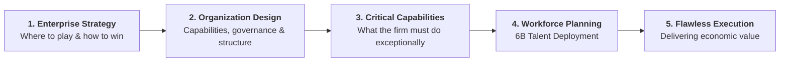
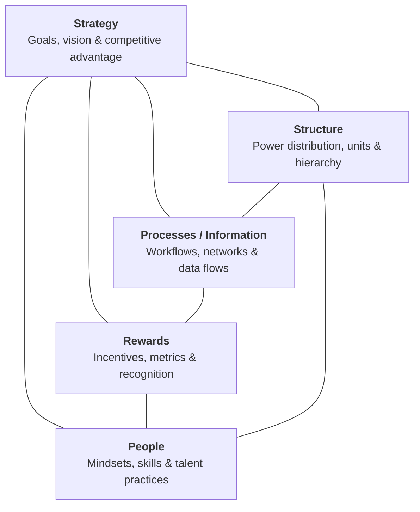
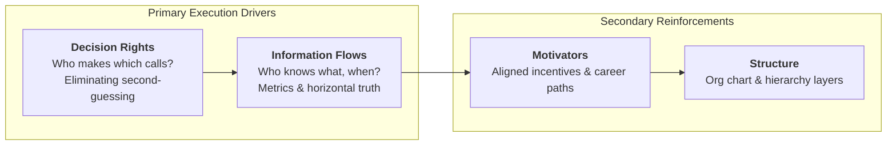
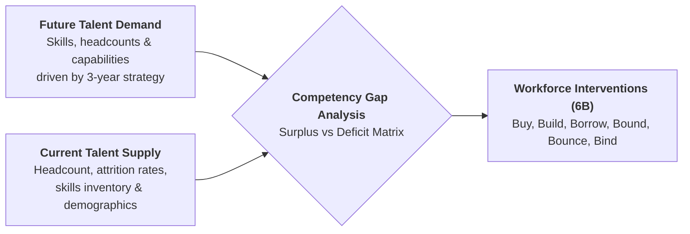
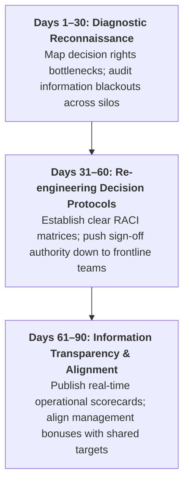

> [!NOTE] Curricular & Faculty Metadata
>
> - **Course:** MK1 Organizational Behaviour & Managing People — Week 09
> - **Teaching Team:** Dr. Ir. Madju Yuni Ros Bangun, Muhammad Yorga Permana, Ph.D., Widhyawan Prawiraatmadja, Ph.D., Yudo Anggoro, Ph.D.
> - **Primary Curricular Spine:** `archive/courses/mk1/week-09/Week 9 (Student Version)-Organization Design & Strategic Workforce Planning.pdf`
> - **Direct Satellites & Problem Sets:**
>   - [[courses/mk1-organizational-behavior-managing-people/week-09/reading-neilson-secrets-strategy-execution|Academic Reading: The Secrets to Successful Strategy Execution (Neilson, Martin & Powers, 2008)]]
>   - [[courses/mk1-organizational-behavior-managing-people/week-09/assignment-pre-assignment-brief|Cohort Pre-Class Brief: Organization Design & Workforce Planning]]

---

## 1. The Opening Puzzle: The Strategy-Structure Mismatch

The lecture opens with a persistent provocation for corporate executives:

> _"If everyone in our enterprise is competent and working hard, why does the organization still fail to execute its strategic commitments?"_

Traditional executive intuition reflexively diagnoses poor results as an individual performance problem, demanding that HR hire "better talent" or conduct motivational seminars.

As established in our curricular spine, **individual excellence cannot overcome a flawed organizational architecture**. An organization chart only reveals formal reporting hierarchies—it rarely shows how work actually gets done, where information is hoarded, or which committee acts as an operational bottleneck. To bridge this gap, leaders must master **Organization Design** and **Strategic Workforce Planning (SWP)**.

---

## 2. Foundations: Jay Galbraith's Star Model

To avoid the trap of treating organization design merely as "drawing an org chart," the course grounds structural analysis in **Jay Galbraith's Star Model**. Galbraith posits that an enterprise consists of five interconnected design policies that must be harmonized to achieve strategic alignment:

| Star Model Dimension        | Core Design Questions                                                                                          | Executive Alignment Principle                                                        |
| :-------------------------- | :------------------------------------------------------------------------------------------------------------- | :----------------------------------------------------------------------------------- | ------------------------------------------ |
| **Strategy**                | What is our formula for competitive advantage? What must our organization excel at?                            | Determines the priorities for all subsequent architectural choices.                  |
| **Structure**               | Where is formal authority located? What are the primary organizational units (functional, divisional, matrix)? | Should follow strategy, not executive ego or historical habit.                       |
| **Processes & Information** | How does information move horizontally across silos? How are cross-functional decisions coordinated?           | High-performing firms substitute information transparency for bureaucratic checking. |
| **Rewards**                 | What behaviors and outcomes are rewarded? How are individual goals aligned with corporate strategy?            | If rewards incentivize silo metrics, cross-functional collaboration will collapse.   |
| **People Practices**        | What mindsets and competencies are required? How is talent recruited, developed, and redeployed?               | Links directly to [[concepts/ulrich-hr-model                                         | Dave Ulrich's Strategic Partner]] mandate. |

---

## 3. The 4 Levers of Organizational DNA

Drawing on the research of [[courses/mk1-organizational-behavior-managing-people/week-09/reading-neilson-secrets-strategy-execution|Neilson, Martin & Powers (2008)]] and the [[concepts/organizational-dna-framework|Organizational DNA Framework]], the lecture emphasizes that **Decision Rights** and **Information Flows** provide twice the strategic leverage of formal reporting lines:

### Comparing Structural Configurations & Coordination Trade-offs

| Structural Archetype          | Primary Operational Strength                                            | Core Coordination Vulnerability                                                | Best Suited Business Context                                                     |
| :---------------------------- | :---------------------------------------------------------------------- | :----------------------------------------------------------------------------- | :------------------------------------------------------------------------------- |
| **Functional Structure**      | High functional expertise; economies of scale within specialties.       | Deep departmental silos; poor cross-functional customer responsiveness.        | Single-product firms; cost-leadership operating models in stable markets.        |
| **Divisional / BU Structure** | High responsiveness to specific markets, regions, or customer segments. | Duplication of back-office costs; inter-divisional competition for capital.    | Multi-product conglomerates; diversified geographic operations.                  |
| **Matrix Structure**          | Dual focus on functional excellence and geographic/product integration. | Dual reporting ambiguity; endless committee meetings and political paralysis.  | Complex global enterprises requiring simultaneous functional and local leverage. |
| **Agile Squads / Networks**   | Extreme speed, decentralized initiative, and cross-functional autonomy. | Difficult to scale governance; risk of fragmentation and strategic divergence. | Fast-moving digital product development; innovation labs; turnaround units.      |

---

## 4. Strategic Workforce Planning (SWP) & The 6B Framework

Strategic Workforce Planning bridges corporate strategy with tangible talent deployment over a 3- to 5-year planning horizon. It systematically measures the variance between the **talent demand** required to achieve future corporate goals and the **talent supply** currently available inside the enterprise:

### The 6B Strategic Talent Levers

When addressing capability gaps, leadership must evaluate empirical trade-offs across the 6B framework:

1. **Buy (Acquire)**: Recruiting external talent. Necessary when a capability is completely absent and time-to-market is critical, but carries high compensation premiums and onboarding friction.
2. **Build (Develop)**: Upskilling existing staff through structured corporate academies. Fosters institutional loyalty and cultural cohesion, but requires 12–24 months of lead time.
3. **Borrow (Partner/Contract)**: Engaging external consultants, specialized contractors, or joint venture partners for surge capacity or specialized one-off initiatives.
4. **Bound (Redeploy)**: Moving internal talent from mature or sunsetting business units into high-growth digital ventures, preserving organizational memory.
5. **Bounce (Exit)**: Managing out employees whose competencies are permanently redundant or misaligned with the strategic direction.
6. **Bind (Retain)**: Designing retention packages, career pathways, and equity/bonus incentives to protect the top 5% of mission-critical capability holders from competitors.

---

## 5. The 90-Day Intervention Protocol for Enterprise Leaders

The session culminates in an actionable, 90-day intervention framework for general managers seeking to resolve execution bottlenecks:

---

## 🔗 Week 09 Direct Curricular Bridges

- Academic Reading: [[courses/mk1-organizational-behavior-managing-people/week-09/reading-neilson-secrets-strategy-execution|The Secrets to Successful Strategy Execution (Neilson, Martin & Powers, 2008)]]
- Cohort Pre-Class Brief: [[courses/mk1-organizational-behavior-managing-people/week-09/assignment-pre-assignment-brief|Cohort Pre-Class Brief: Organization Design & Workforce Planning]]
- Strategic Concept: [[concepts/organizational-dna-framework|Organizational DNA Framework]]
- HR Architecture: [[concepts/ulrich-hr-model|Dave Ulrich HR Business Partner Model]]
- Prior Lecture: [[courses/mk1-organizational-behavior-managing-people/week-08/index|Week 08: People & Strategy: Human Capital as Competitive Advantage]]
- Return to [[courses/mk1-organizational-behavior-managing-people/index|MK1 Course Overview Hub]]
