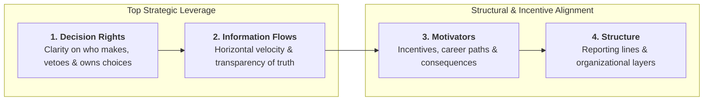
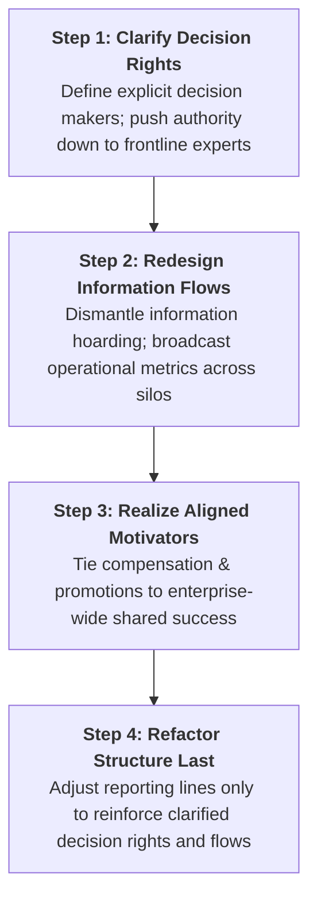

## 📖 Executive Summary & Core Thesis

In their landmark 2008 Harvard Business Review study, Gary Neilson, Karla Martin, and Elizabeth Powers synthesized survey data from more than **250,000 corporate executives across 1,000+ companies** in 50 countries to answer a persistent leadership paradox:

> _"Why do brilliant, well-crafted corporate strategies fail so consistently during execution?"_

The authors discovered that **three out of five companies (60%) rate their organization as weak at executing strategy**. When enterprises stumble, executive leadership almost instinctively reacts by redrawing lines and boxes on the organization chart—centralizing functions, decentralizing business units, eliminating middle management tiers, or announcing sweeping corporate reorganizations.

The research demonstrates that **structural reorganization in isolation is the least effective way to fix execution**. In fact, restructuring only treats the outward symptoms while ignoring the root dysfunctions. To achieve lasting execution capability, leaders must re-engineer the organization's underlying "DNA" by prioritizing **decision rights** and **information flows** before altering reporting lines.

---

## 🧬 The 4 Building Blocks of Organizational DNA

The authors conceptualize an enterprise's organizational capability through four foundational building blocks, ranked below in order of their empirical leverage on execution performance:

1. **Decision Rights (Highest Leverage)**:
   - Ensuring clear, unambiguous accountability for which role has the authority to make specific operating and capital commitments.
   - Eliminating the committee paralysis where decisions are endlessly re-debated or second-guessed by senior headquarters staff.
2. **Information Flows (Second-Highest Leverage)**:
   - Ensuring that frontline market data, competitive intelligence, and operating metrics flow horizontally across departmental silos and vertically to senior executives without defensive filtering.
   - Providing operating managers with transparent line-of-sight into the enterprise-wide financial consequences of their daily decisions.
3. **Motivators**:
   - Aligning financial bonuses, promotions, peer recognition, and accountability mechanisms with overarching corporate strategic goals rather than localized silo metrics.
4. **Structure (Lowest Standalone Leverage)**:
   - The formal organizational hierarchy and spans of control. While essential for defining baseline governance, changing reporting lines without fixing decision rights and information flows merely produces confusion and cynicism.

---

## 🏛️ The 7 Organizational DNA Archetypes

Based on executive self-assessments, the authors categorized companies into seven distinct archetypes along an execution continuum:

| Execution Status     | DNA Archetype             | Prevalence in Dataset | Diagnostic Characteristics                                                                                                              |
| :------------------- | :------------------------ | :-------------------- | :-------------------------------------------------------------------------------------------------------------------------------------- |
| **Execution-Strong** | **1. Resilient**          | $\sim 12\%$           | Agile, forward-looking, absorbs market shocks, empowers frontline managers with clear decision rights.                                  |
| **Execution-Strong** | **2. Just-in-Time**       | $\sim 9\%$            | Highly capable of heroic last-minute efforts; succeeds under pressure but lacks institutionalized process discipline.                   |
| **Execution-Strong** | **3. Military Precision** | $\sim 10\%$           | Highly disciplined command-and-control hierarchy; excels in stable environments but struggles with disruptive innovation.               |
| **Execution-Weak**   | **4. Outgrown**           | $\sim 11\%$           | Once-nimble venture that has outgrown its legacy management systems; top founders remain severe decision bottlenecks.                   |
| **Execution-Weak**   | **5. Fits-and-Starts**    | $\sim 12\%$           | Brimming with smart, entrepreneurial ideas but lacks discipline to prioritize; launches 20 initiatives and finishes none.               |
| **Execution-Weak**   | **6. Overmanaged**        | $\sim 12\%$           | Excessive management layers and staff checkers; suffers from "analysis paralysis" as managers manage other managers.                    |
| **Execution-Weak**   | **7. Passive-Aggressive** | $\sim 34\%$           | **The most common profile**. Executives nod in polite agreement during meetings, but consensus evaporates immediately outside the room. |

---

## 🛠️ The 4-Step Prescription for Executive Leaders

To transform an execution-weak enterprise into a high-performing resilient organization, Neilson et al. prescribe a sequenced intervention protocol:

---

## 🔗 Related Knowledge Bridges

- Master Curricular Hub: [[courses/mk1-organizational-behavior-managing-people/week-09/index|MK1 Week 09: Organization Design & Strategic Workforce Planning]]
- Flagship Concept: [[concepts/organizational-dna-framework|Organizational DNA Framework]]
- Cohort Pre-Class Brief: [[courses/mk1-organizational-behavior-managing-people/week-09/assignment-pre-assignment-brief|Week 09 Pre-Class Assignment Brief]]
- Prior Lecture: [[courses/mk1-organizational-behavior-managing-people/week-08/index|Week 08: People & Strategy: Human Capital as Competitive Advantage]]
