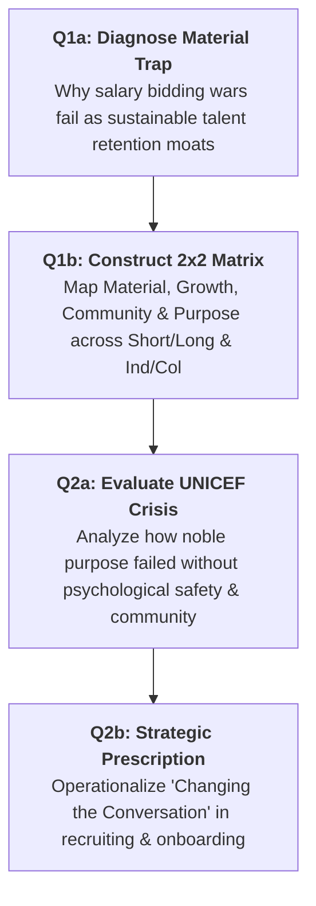
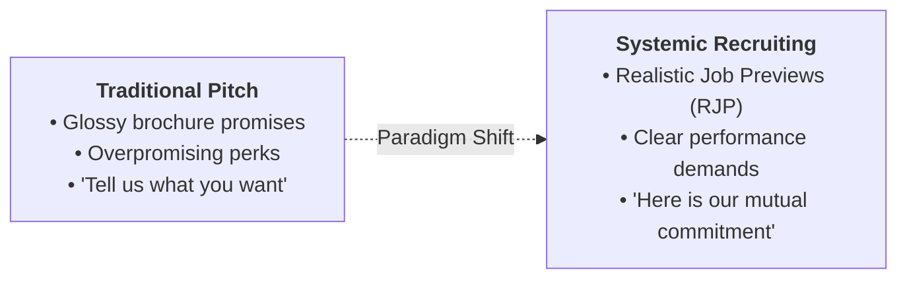

> [!IMPORTANT] Cohort Pre-Class Study Brief (_"Ini Peta, Bukan Jawaban"_)
> **Audience:** P3MD Batch I Soedirman Cohort  
> **Academic Mode:** Pre-Class Analytical Guidance & Framework Map  
> **Purpose:** This brief equips syndicates to prepare their submission for the Week 10 Pre-Assignment on **Strategic Talent Acquisition & Employer Branding** by mapping the analytical architecture, evaluation criteria, and core readings—**without prescribing final syndicate text or answers**.

---

## 🎯 Assignment Overview & Submission Rubric

The Week 10 Pre-Assignment requires syndicates to analyze Mark Mortensen and Amy C. Edmondson's 2023 Harvard Business Review article, _Rethink Your Employee Value Proposition_, addressing two foundational questions:

| Question Focus                       | Core Analytical Requirements                                                                                                                                                                   | Recommended Curricular Framing                                                                                                                                                                                                      |
| :----------------------------------- | :--------------------------------------------------------------------------------------------------------------------------------------------------------------------------------------------- | :---------------------------------------------------------------------------------------------------------------------------------------------------------------------------------------------------------------------------------- |
| **Q1a: The Material Trap**           | Explain why "asking employees what they want" is a trap; why material levers are easiest yet weakest for talent retention; risks of over-reliance.                                             | [[concepts/employee-value-proposition#2-the-4-factor-integrated-evp-matrix\|EVP Material Offerings Dimension]]; Herzberg hygiene vs motivator dynamics; bidding war escalation.                                                     |
| **Q1b: 2x2 Factor Positioning**      | Position the 4 EVP factors across Temporal (Short vs. Long-Term) and Social (Individual vs. Collective) dimensions; explain how this shifts leaders from immediate wants to sustainable needs. | [[courses/mk1-organizational-behavior-managing-people/week-10/reading-mortensen-rethink-evp#2-theoretical-architecture-the-four-factors\|Mortensen-Edmondson 2x2 Matrix]]; temporal discounting; employee life-cycle progression.   |
| **Q2a: Systemic Breakdown (UNICEF)** | Diagnose what transpired at UNICEF; demonstrate why the 4 factors must function as an interdependent system rather than isolated silos.                                                        | [[courses/mk1-organizational-behavior-managing-people/week-10/reading-mortensen-rethink-evp#3-case-analysis-systemic-failure-at-unicef\|UNICEF Case Analysis]]; passion exploitation; psychological safety collapse under pressure. |
| **Q2b: Changing the Conversation**   | Define what "changing the conversation" means operationally; explain how it transforms recruitment and onboarding processes.                                                                   | Realistic Job Previews (RJP); reciprocal psychological contracts; bidirectional expectations setting.                                                                                                                               |

---

## 🗺️ Question-by-Question Analytical Roadmap

---

### 🔍 Question 1: The Trap of "Ask People What They Want"

#### Part (a): Deconstructing the Material Trap

When crafting your syndicate's defense, consider the following analytical tensions:

1. **The Asymmetry of Managerial Levers:**
   - Why do leaders default to compensation increases, sign-on bonuses, and superficial remote perks? Because they are tangible, quantifiable, and can be executed via administrative fiat without examining culture or managerial behavior.
2. **The "Hygiene Factor" Vulnerability:**
   - Ground your answer in organizational psychology: compensation prevents dissatisfaction but does not generate intrinsic motivation or loyalty.
   - What happens when a firm builds its talent brand solely on high pay? It attracts _mercenaries_ whose loyalty ends when a competitor offers an incremental 10% raise.
3. **The Escalation Cycle:**
   - Explain the economic deadweight loss of wage inflation in tight talent markets when underlying organizational dysfunctions (poor leadership, burnout, toxic peers) remain unaddressed.

#### Part (b): The 2x2 Matrix Architecture

Structure your explanation around the four distinct quadrants:

- **Short-Term / Individual:** _Material Offerings_ (Pay, benefits, hardware, immediate perks).
- **Long-Term / Individual:** _Opportunities to Grow & Develop_ (Skills, mentorship, career trajectory).
- **Short-Term / Collective:** _Connection & Community_ (Psychological safety, team camaraderie, daily culture).
- **Long-Term / Collective:** _Meaning & Purpose_ (Societal mission, enterprise vision, customer impact).

> **Key Guiding Insight:** Explain how the 2x2 framework forces executives to recognize that employees suffer from _temporal discounting_—demanding short-term material relief when what will truly anchor their careers is long-term growth, supportive community, and authentic purpose.

---

### 🏛️ Question 2: Why a Systemic Approach Is Necessary

#### Part (a): The UNICEF Case Study Breakdown

When analyzing the UNICEF organizational crisis, structure your syndicate's response through a systemic lens:

- **The Initial Strength:** Extraordinary **Meaning & Purpose**. Top international talent was eager to serve the global mandate of protecting children.
- **The Organizational Breakdown:** Heavy field workloads, hierarchical bureaucracy, and emergency operational pressures led managers to neglect **Connection & Community**.
- **The Toxic Feedback Loop:** Junior staff suffered harassment and bullying; speaking up carried career penalties (**Growth & Development** blocked).
- **The Synthesis:** Conclude by explaining why purpose is not an antidote to a toxic workplace. When an organization exploits purpose to offset poor working conditions, the disillusionment is far more severe than in purely commercial enterprises.

#### Part (b): Operationalizing "Change the Conversation"

Show how leadership can shift from transactional seduction to authentic talent partnership:

1. **In Recruitment:**
   - Replace one-sided sales pitches with **Realistic Job Previews (RJP)**, outlining operational complexities and team expectations alongside growth opportunities.
2. **In Onboarding:**
   - Build deliberate social integration routines that foster immediate team connection, psychological safety, and mentor assignment, rather than merely processing administrative paperwork.

---

## 📋 Syndicate Defense Checklist Before Submission

- [ ] Does your PDF submission list all syndicate members and NOSIS IDs on the title page?
- [ ] Have you restated each question clearly before providing the analytical answer?
- [ ] Does your Q1b response clearly articulate both dimensions (Short vs Long, Individual vs Collective) with exact quadrant placements?
- [ ] In Q2a, have you explicitly linked the UNICEF case to the failure of _interdependence_ between purpose, community, and growth?
- [ ] In Q2b, have you clearly distinguished between traditional recruitment and the "reciprocal conversation" approach?

---

## 🔗 Related Portals

- Master Lecture Hub: [[courses/mk1-organizational-behavior-managing-people/week-10/index|Week 10 Master Lecture Hub]]
- Reading Dossier: [[courses/mk1-organizational-behavior-managing-people/week-10/reading-mortensen-rethink-evp|Mortensen & Edmondson HBR Article]]
- Core Concept: [[concepts/employee-value-proposition|Employee Value Proposition (EVP)]]
