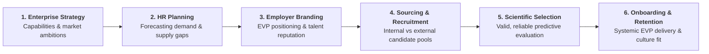
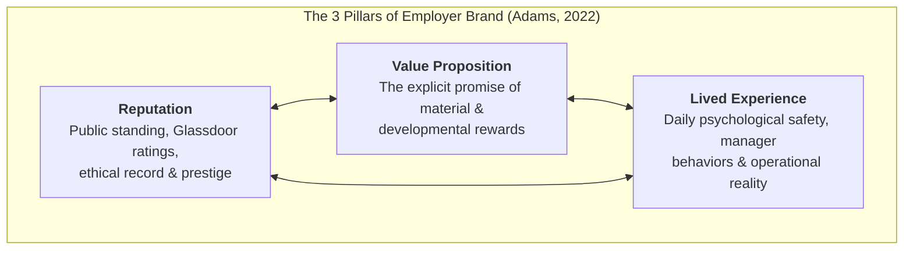
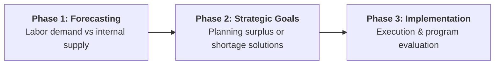
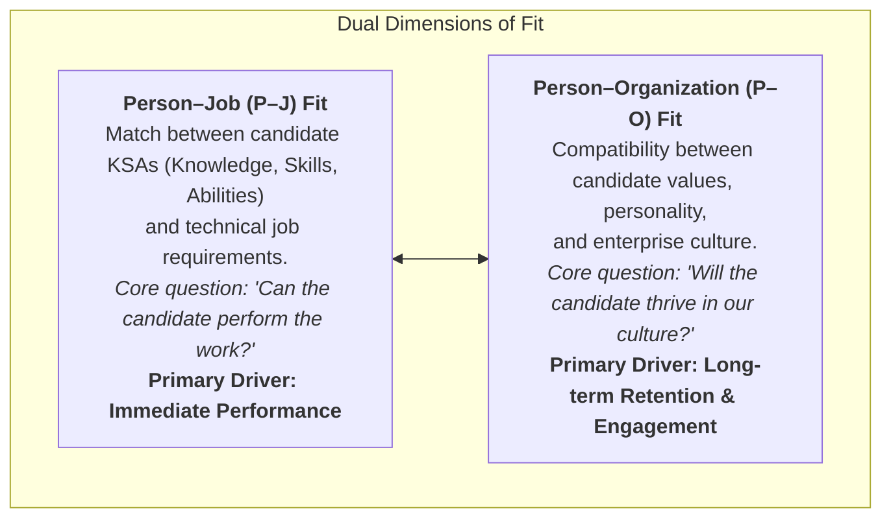
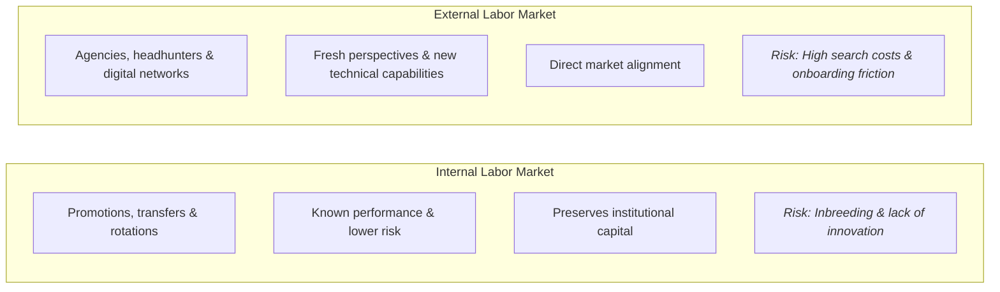
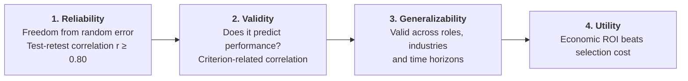
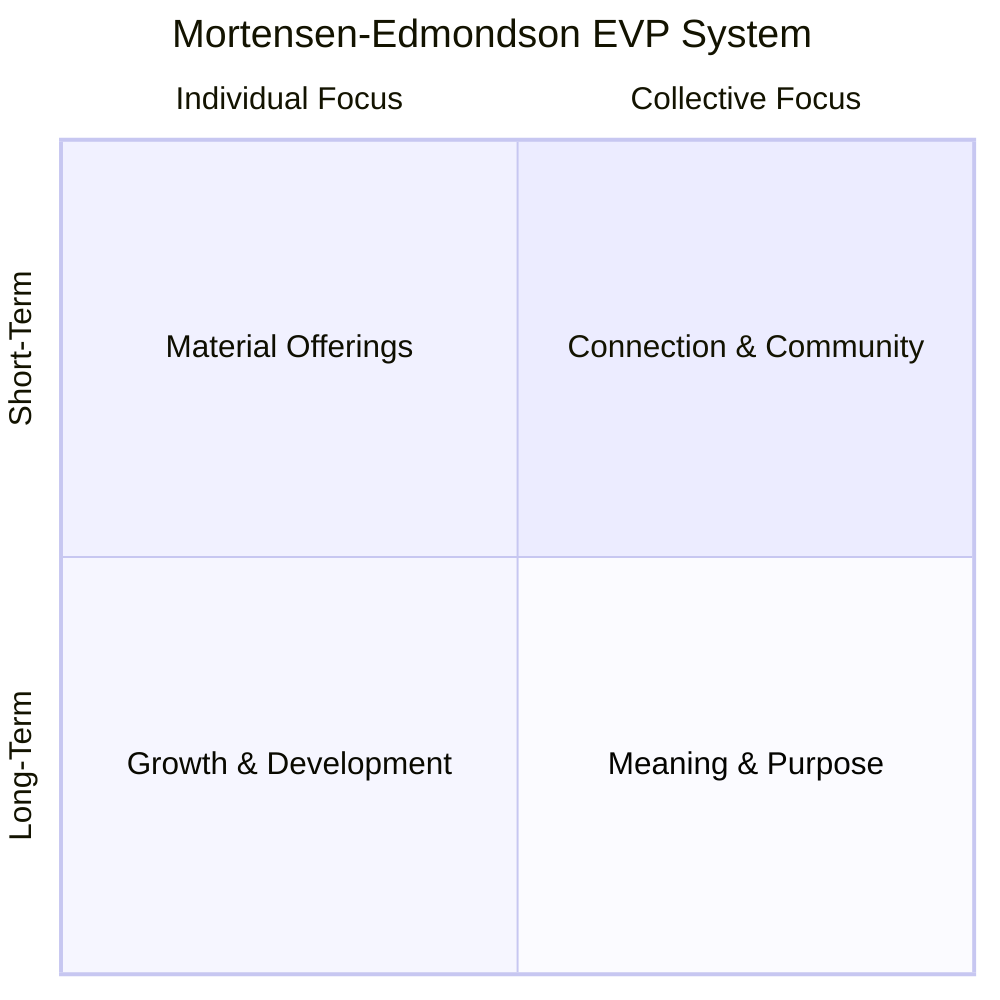
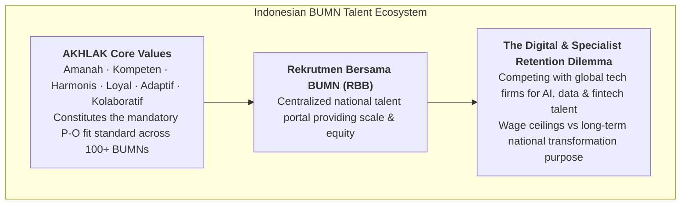

> [!NOTE] Curricular & Faculty Metadata
>
> - **Course:** MK1 Organizational Behaviour & Managing People — Week 10
> - **Teaching Team:** Dr. Ir. Madju Yuni Ros Bangun, Muhammad Yorga Permana, Ph.D., Widhyawan Prawiraatmadja, Ph.D., Yudo Anggoro, Ph.D.
> - **Primary Curricular Spine:** `archive/courses/mk1/week-10/Week 10- Strategic Talent Acquisition Employer Branding (Student Version).pdf`
> - **Academic Reading Dossier:** [[courses/mk1-organizational-behavior-managing-people/week-10/reading-mortensen-rethink-evp|Mortensen & Edmondson (2023): Rethink Your Employee Value Proposition]]
> - **Cohort Assignment Brief:** [[courses/mk1-organizational-behavior-managing-people/week-10/assignment-pre-assignment-brief|Cohort Pre-Class Brief: Strategic Talent Acquisition & EVP]]
> - **Core Lattice Concept:** [[concepts/employee-value-proposition|Employee Value Proposition (EVP) Framework]]

---

## 1. The Opening Provocation: Beyond the Wage Bidding War

As macroeconomic conditions shift and industries face demographic transitions and digital disruption, enterprises confront an inescapable reality:

> _"If your talent strategy relies solely on outbidding competitors on salary, you are not building an organizational moat—you are merely renting mercenaries until the next highest bidder arrives."_

Traditional managerial intuition treats recruitment as an administrative matching function: post a vacancy, filter résumés, and offer competitive pay. However, in tight labor markets where skilled knowledge workers, digital architects, and strategic operators are scarce, organizations must master **Strategic Talent Acquisition** and **Employer Branding (EB)**.

Talent acquisition is not an isolated HR chore. It represents the primary external filter through which an enterprise shapes its corporate culture, capabilities, and strategic agility.

---

## 2. Employer Branding & Value Proposition Architecture

Employer branding defines how an organization communicates its identity, values, and work environment to prospective and current employees. As defined across foundational literature:

- **SHRM:** _"What the organization communicates as its identity to both potential and current employees."_
- **Walker (2007):** _"A set of attributes and qualities—often intangible—that make an organization distinctive, promise a particular kind of employment experience, and appeal to people who will thrive and perform their best in its culture."_
- **Adams (HBR, 2022):** The employer brand rests on three primary pillars: **Reputation** (public perception), **Value Proposition** (the reciprocal offering), and **Experience** (the lived daily reality).

### The Origins of Employer Branding

The discipline emerged directly from **labor market pressures** and competition for specialized human capital. Under "tight" labor market conditions—where demand for technical and managerial capabilities outstrips supply—organizations cannot maintain profitability if wage inflation is their sole recruiting tool. Employer branding creates differentiation based on culture, career velocity, autonomy, and organizational purpose.

---

## 3. Strategic Human Resource Planning (HRP)

Before an enterprise goes to market to recruit, it must execute systematic **Human Resource Planning** across three structured phases:

### Stage 1: Forecasting Labor Demand and Supply

1. **Labor Demand Forecasting:** Derived directly from projected demand for the firm's products or services. External in nature (macro trends, sales pipelines, technological shifts).
2. **Labor Supply Forecasting:** Evaluates internal workforce dynamics using **Transitional Matrices**—tracking historical probabilities of employee movement across job grades via promotions, lateral transfers, voluntary turnover, and retirements.
3. **Reconciling Gaps:** Determines whether the firm faces a net labor **surplus** (requiring structural reallocation) or **shortage** (requiring aggressive talent acquisition).

### Managing Workforce Adjustments: Strategic Trade-offs

| Strategic Context  | Managerial Options                 | Operational Speed | Human & Cultural Friction   | Long-Term Strategic Risk                                                                                             |
| :----------------- | :--------------------------------- | :---------------- | :-------------------------- | :------------------------------------------------------------------------------------------------------------------- |
| **Labor Surplus**  | **Downsizing / Redundancies**      | Fast              | High (Severe morale trauma) | Loss of irreplaceable institutional knowledge; "survivor syndrome" where remaining staff become risk-averse.         |
|                    | **Early Retirement Packages**      | Slow              | Low                         | Costly financial payouts; unpredictable loss of critical senior experts.                                             |
|                    | **Hiring Freezes / Attrition**     | Slow              | Very Low                    | Creates age/skill imbalances across teams.                                                                           |
| **Labor Shortage** | **Temporary / Contingent Workers** | Fast              | Low                         | Eliminates administrative overhead during demand swings, but lacks organizational loyalty and proprietary knowledge. |
|                    | **Outsourcing & Offshoring**       | Fast to Moderate  | Moderate                    | Cost-effective for non-core workflows, but requires tight vendor governance and IP security safeguards.              |
|                    | **Overtime / Extended Hours**      | Immediate         | Low to Moderate             | Short-term surge capacity; induces chronic burnout and quality defects if sustained.                                 |

---

## 4. Recruitment Foundations: Sourcing & Person-Environment Fit

Recruitment is the process of generating a qualified pool of candidates for organizational vacancies. It is governed by the structural tension between **Person-Job (P-J) Fit** and **Person-Organization (P-O) Fit**:

### Schneider's ASA Model: The Attraction-Selection-Attrition Trap

Formulated by Benjamin Schneider (1987), the **ASA Framework** posits that _"People make the place"_:

1. **Attraction:** Individuals are drawn to enterprises whose stated culture and values mirror their own personalities.
2. **Selection:** Organizations hire candidates who comfortably conform to existing cultural norms.
3. **Attrition:** Misfits who clash with the prevailing culture either voluntarily depart or are marginalized.

> [!WARNING] The Dark Side of ASA: Homogeneity Paralysis
> While cultural compatibility reduces interpersonal friction, excessive reliance on P-O fit generates cognitive homogeneity. When everyone thinks alike and shares identical backgrounds, organizational creativity evaporates, blind spots multiply, and adaptability to market disruption collapses.

### Internal vs. External Labor Markets

---

## 5. The Science of Personnel Selection

Selection is the systematic process of evaluating candidate pools to identify those both capable of and motivated to excel in the vacancy. High-performing organizations evaluate selection instruments against four psychometric and economic criteria:

### The Schmidt & Hunter (1998) 85-Year Meta-Analysis

In their landmark study analyzing 85 years of empirical personnel selection research, Frank Schmidt and John Hunter established the predictive validity of various selection methods for overall job performance:

| Selection Instrument                   | Operational Validity ($r$) | Practical Implementation Insight                                                                                 |
| :------------------------------------- | :------------------------: | :--------------------------------------------------------------------------------------------------------------- |
| **General Mental Ability (GMA) Tests** |          **0.51**          | Highest standalone predictor across all job complexities; evaluates learning speed and analytical reasoning.     |
| **Work Sample Tests**                  |          **0.54**          | Direct simulation of actual job tasks; exceptionally valid for technical and operational roles.                  |
| **Structured Interviews**              |          **0.51**          | Standardized, behavior-anchored questions evaluated against rigorous scoring rubrics.                            |
| **Integrity Tests**                    |          **0.41**          | High predictive power for counterproductive work behaviors (theft, absenteeism); excellent when paired with GMA. |
| **Conscientiousness Tests**            |          **0.31**          | Best single personality trait predictor (Big Five); measures diligence, persistence, and reliability.            |
| **Job Knowledge Tests**                |          **0.48**          | Evaluates specialized technical domain knowledge; critical for senior technical specialists.                     |
| **Unstructured Interviews**            |          **0.38**          | Prone to confirmation bias, similarity-attraction effects, and superficial charism.                              |
| **Reference Checks**                   |          **0.26**          | Weak standalone predictor due to positive-recommendation skew and legal restrictions.                            |
| **Years of Job Experience**            |          **0.18**          | Surprisingly weak beyond the initial learning curve (first 2–3 years).                                           |
| **Graphology (Handwriting Analysis)**  |          **0.02**          | Zero scientific validity; equivalent to pure chance.                                                             |

---

## 6. The Systemic Employee Value Proposition (EVP)

Drawing directly from [[courses/mk1-organizational-behavior-managing-people/week-10/reading-mortensen-rethink-evp|Mortensen and Edmondson (2023)]], the modern EVP transcends cafeteria menus of isolated perks by treating talent value as an interdependent four-factor architecture:

1. **Material Offerings:** Base salary, bonuses, physical benefits, flexibility. Necessary hygiene baseline.
2. **Growth & Development:** Upskilling, career pathways, mentorship, lateral rotations.
3. **Connection & Community:** Daily camaraderie, psychological safety, team trust, inclusive relationships.
4. **Meaning & Purpose:** Societal mission, environmental impact, solving meaningful customer problems.

### The Systemic Breakdown: Why Balance Matters

When organizations over-index on one factor while neglecting others, the system collapses:

- Over-indexing on **Material** breeds mercenary culture with high flight risk.
- Over-indexing on **Purpose** leads to employee burnout, moral exploitation, and the tragic cultural breakdown documented in the **UNICEF** humanitarian crisis.

---

## 7. Indonesian BUMN Context: AKHLAK & Strategic Talent Architecture

In the Indonesian state-owned enterprise (BUMN) ecosystem, talent acquisition and employer branding face unique institutional dynamics under the stewardship of the Ministry of BUMN and Danantara:

1. **AKHLAK as the Canonical P-O Fit Framework:**
   - Every BUMN selection process integrates the **Core Values AKHLAK** assessment. Candidates are screened not merely for technical proficiency (P-J fit), but for moral integrity (_Amanah_), mutual respect (_Harmonis_), and national dedication (_Loyal_).
2. **Leveraging Meaning & Purpose Against Global Salaries:**
   - Leading BUMN flagships (Bank Mandiri, Telkom Indonesia, Pertamina, PT Semen Indonesia) cannot always match Silicon Valley or hedge fund compensation for top-tier digital talent.
   - Instead, successful BUMN employer branding leads with **Meaning & Purpose** (building national energy transition, banking 100M unbanked citizens, managing critical state infrastructure) paired with structured **Growth & Development** academies (e.g., Mandiri Corporate University).

---

## 🔗 Curricular Satellites & Further Study

- **Academic Reading:** [[courses/mk1-organizational-behavior-managing-people/week-10/reading-mortensen-rethink-evp|Mortensen & Edmondson (2023) HBR Study Dossier]]
- **Cohort Pre-Class Brief:** [[courses/mk1-organizational-behavior-managing-people/week-10/assignment-pre-assignment-brief|Cohort Pre-Class Brief: EVP & Talent Acquisition]]
- **Core Concept Page:** [[concepts/employee-value-proposition|Employee Value Proposition (EVP) Framework]]
- **Course Syllabus Hub:** [[courses/mk1-organizational-behavior-managing-people/index|MK1 Course Table of Contents]]
