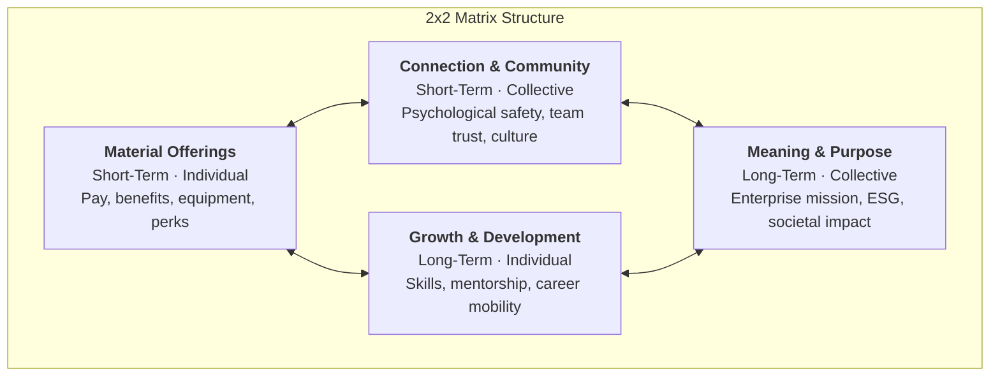
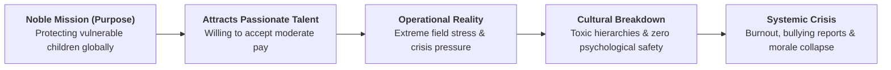

> [!NOTE] Curricular & Reading Metadata
>
> - **Source Citation:** Mortensen, M., & Edmondson, A. C. (2023). _Rethink your employee value proposition: Offer your people more than just flexibility_. Harvard Business Review, 101(1), 44–51.
> - **Course:** MK1 Organizational Behaviour & Managing People — Week 10
> - **Primary Curricular Spine:** [[courses/mk1-organizational-behavior-managing-people/week-10/index|Week 10 Master Lecture Hub: Strategic Talent Acquisition & Employer Branding]]
> - **Companion Concept:** [[concepts/employee-value-proposition|Employee Value Proposition (EVP) Framework]]

---

## 1. Executive Summary & Thesis

In the aftermath of the global pandemic and widespread remote-work experiments, corporate leaders faced historic employee turnover, disengagement, and demands for flexibility. Many responded by treating talent retention as a transactional negotiation—offering higher compensation, signing bonuses, and permanent work-from-home options.

Mark Mortensen (INSEAD) and Amy C. Edmondson (Harvard Business School) argue that this response represents a dangerous oversimplification:

1. **The Transactional Trap:** Simply giving employees what they demand in the short term (material perks and maximum autonomy) ignores what humans need to thrive in the long term (meaningful challenge, community, and personal growth).
2. **The 4-Factor System:** An effective EVP is an **integrated system** composed of Material Offerings, Opportunities to Grow & Develop, Connection & Community, and Meaning & Purpose.
3. **The Core Vulnerability:** Organizations that rely solely on one factor (whether high compensation or noble purpose) inevitably suffer systemic failure when the other pillars are neglected.

---

## 2. Theoretical Architecture: The Four Factors

Mortensen and Edmondson structure the Employee Value Proposition across two orthogonal axes:

- **Temporal Orientation:** Short-Term (daily lived reality) vs. Long-Term (future capability and security).
- **Social Orientation:** Individual (personal rewards and growth) vs. Collective (group culture and enterprise impact).

### 1. Material Offerings (Short-Term, Individual)

- **Scope:** Base salary, performance bonuses, health insurance, parental leave, equipment allowances, and geographical flexibility.
- **Role in the System:** Necessary baseline hygiene. If material offerings fall below market equity, talent exits immediately.
- **Limitation:** Material offerings possess low psychological stickiness. Competitors with deeper balance sheets can easily match or exceed financial packages. Furthermore, negotiations focused exclusively on money foster transactional, mercenary work relationships.

### 2. Opportunities to Grow & Develop (Long-Term, Individual)

- **Scope:** Skill acquisition, formal education sponsorships, stretch assignments, job rotation, and transparent promotional ladders.
- **Role in the System:** Fuels employee self-actualization and future career viability.
- **Limitation:** If disconnected from community and purpose, employees acquire expensive capabilities at the firm's expense, then depart for higher compensation elsewhere ("train-and-exit" vulnerability).

### 3. Connection & Community (Short-Term, Collective)

- **Scope:** Psychological safety, camaraderie, mutual accountability, diversity, equity, and inclusive daily interactions.
- **Role in the System:** Determines daily energy, emotional well-being, and social belonging.
- **Limitation:** When hyper-isolated from performance rigor or organizational mission, team culture degenerates into an unchallenging country-club dynamic where mediocrity is protected.

### 4. Meaning & Purpose (Long-Term, Collective)

- **Scope:** The core raison d'être of the enterprise—how the firm improves society, serves critical customer needs, or solves existential environmental/technological problems.
- **Role in the System:** Provides intrinsic motivation, resilience during crises, and a sense of legacy.
- **Limitation:** An inspiring mission can lead managers to exploit employee dedication ("passion tax"), underpaying staff and burning them out under the banner of sacrifice.

---

## 3. Case Analysis: Systemic Failure at UNICEF

To demonstrate that non-material factors can also fail when mismanaged, Mortensen and Edmondson analyze the internal crisis at **UNICEF (United Nations Children's Fund)**:

### The Analytical Diagnosis:

- UNICEF possessed an unassailable **Meaning & Purpose** factor. Professionals joined not for high pay, but out of moral devotion to saving children's lives.
- However, leadership neglected **Connection & Community** and **Growth & Development**. Under grueling humanitarian field deployments, senior directors instituted authoritarian management practices, dismissed employee distress, and silenced dissent.
- Employees found that raising concerns endangered their career progression. Psychological safety evaporated.
- The outcome was an independent investigation revealing widespread bullying, harassment, and severe executive turnover.
- **Managerial Takeaway:** _A noble mission cannot substitute for a supportive, psychologically safe workplace._ Leaders must manage all four factors as an interdependent, mutually reinforcing portfolio.

---

## 4. Strategic Prescription: "Changing the Conversation"

Mortensen and Edmondson urge leaders to reject passive talent surveys and initiate authentic, reciprocal dialogues during recruitment and onboarding:

| Traditional Managerial Approach                                                                  | Mortensen-Edmondson Prescriptive Approach                                                                             |
| :----------------------------------------------------------------------------------------------- | :-------------------------------------------------------------------------------------------------------------------- |
| **"Tell us what you want"** (Yields endless lists of perks, remote days, and compensation asks). | **"Here is who we are, what we offer, and what our mission demands"** (Establishes mutual accountability).            |
| **Siloed HR ownership** (Comp & benefits managed separately from learning and culture).          | **Integrated leadership ownership** (Executive committee balances the 4-factor portfolio).                            |
| **One-size-fits-all corporate EVP** (Standard glossy recruiting brochure).                       | **Segmented, life-cycle aware customization** (Adapting emphasis to early-career, mid-career, and specialist talent). |
| **Glossy recruiting promises** (Hiding organizational bottlenecks).                              | **Realistic Job Previews (RJP)** (Transparently communicating operational hardships before hiring).                   |

---

## 🔗 Related Portals

- Master Lecture Hub: [[courses/mk1-organizational-behavior-managing-people/week-10/index|Week 10: Strategic Talent Acquisition & Employer Branding]]
- Pre-Class Brief: [[courses/mk1-organizational-behavior-managing-people/week-10/assignment-pre-assignment-brief|Cohort Pre-Class Brief: EVP & Talent Acquisition]]
- Concept Page: [[concepts/employee-value-proposition|Employee Value Proposition (EVP)]]
