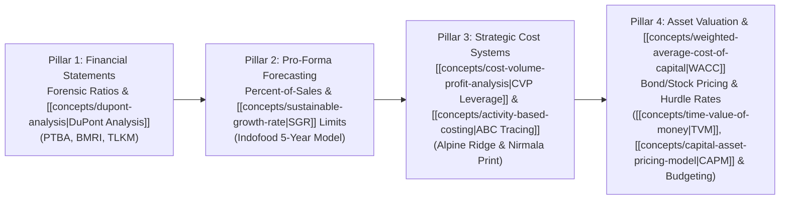
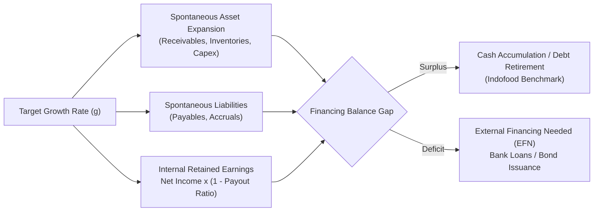
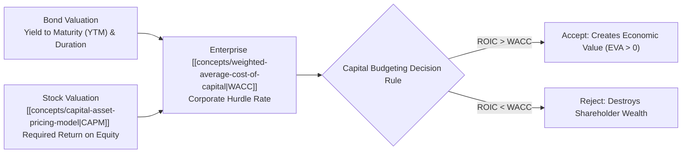

> [!NOTE] Curricular Metadata & Cohort Attribution
>
> - **Course:** MK2 Financial Management and Strategy — Mid-Term Comprehensive Evaluation
> - **Teaching Team:** Dr. Arif Zamani (Lead Lecturer), Dr. Subiakto Soekarno, Dr. Aswin Rahadi, Yunieta Anny Nainggolan Ph.D., Oktofa Yudha Sudrajat Ph.D.
> - **Curricular Scope:** Integrated examination synthesizing Weeks 01 through 08.
> - **Synthesis Contribution:** Compiled for the cohort by **`F9 (Class F / Syndicate 9) & the Portal Maintainer`**.
> - **Primary Source Document:** `[P3MD] MK02 TakehomeExam.pdf`.

## 1. Executive Overview: The Mid-Term Synthesis Blueprint

The **MK02 Mid-Term Examination** tests executive candidates on their ability to integrate accounting information, operational cost behavior, and capital market valuation into a cohesive corporate strategy.

Rather than treating financial topics in departmental silos, the examination evaluates four interconnected curricular pillars:

---

## 2. Pillar I: Forensic Financial Statement Analysis & DuPont Diagnostics

### Core Analytical Mandate

Move beyond mechanical ratio calculation to identify the economic story behind the numbers using the **[[concepts/dupont-analysis|DuPont Analysis Framework]]**:

$$\mathbf{\text{ROE} = \underbrace{\left(\frac{\text{Net Income}}{\text{Sales}}\right)}_{\text{Operating Margin}} \times \underbrace{\left(\frac{\text{Sales}}{\text{Assets}}\right)}_{\text{Asset Velocity}} \times \underbrace{\left(\frac{\text{Assets}}{\text{Equity}}\right)}_{\text{Financial Leverage}}}$$

### Benchmark Diagnostic Findings from Cohort Cases (PTBA)

- **The Commodity Trap**: In natural resource enterprises, physical volume records (e.g., PTBA mining 45.43 million tonnes) can co-exist with severe profit collapses (-51.6% net income) due to global benchmark price softening and rising domestic royalties.
- **Asset Structure Misalignment**: Expanding total assets (+13.3%) during a top-line revenue stagnation directly depresses asset turnover ($1.10\text{x} \to 0.97\text{x}$) and return on assets ($15.8\% \to 6.7\%$).
- **Gearing Limits**: Expanding the Equity Multiplier ($1.80\text{x} \to 1.94\text{x}$) cannot rescue ROE when the underlying return on invested capital falls below the cost of debt.

---

## 3. Pillar II: Pro-Forma Financial Projections & Sustainable Growth

### The External Financing Needed (EFN) Architecture

$$\mathbf{\text{EFN} = \left(\frac{A^*}{S_0}\right) \Delta S - \left(\frac{L^*}{S_0}\right) \Delta S - \left(M \times S_1 \times (1 - d)\right)}$$

### Growth Boundary Comparison

- **Internal Growth Rate ($\text{IGR}$)**: $\text{ROA} \times b / (1 - \text{ROA} \times b)$. Growth achieved with zero external debt or equity.
- **[[concepts/sustainable-growth-rate|Sustainable Growth Rate (SGR)]]**: $\text{ROE} \times b / (1 - \text{ROE} \times b)$. Growth achieved with constant Debt-to-Equity ratio without issuing new equity shares.

---

## 4. Pillar III: Cost Behavior, CVP Operating Leverage & [[concepts/activity-based-costing|Activity-Based Costing]]

### Cost Structure & Break-Even Formulations via CVP Analysis

Using **[[concepts/cost-volume-profit-analysis|Cost-Volume-Profit (CVP) Analysis]]** alongside **[[concepts/job-order-costing|Job-Order Costing Architecture]]**:

$$\mathbf{\text{BEP}_{\text{units}} = \frac{\text{Fixed Costs}}{P - V}} \qquad \mathbf{\text{BEP}_{\text{sales \$}} = \frac{\text{Fixed Costs}}{\text{CM Ratio}}} \qquad \mathbf{\text{DOL} = \frac{\text{Contribution Margin}}{\text{Operating Income}}}$$

### [[concepts/activity-based-costing|Activity-Based Costing (ABC)]] Elimination of Cross-Subsidization

Under the **[[concepts/activity-based-costing|Activity-Based Costing (ABC) Hierarchy]]**:

$$\mathbf{\text{Activity Pool Rate}} = \frac{\text{Total Estimated Activity Overhead}}{\text{Total Activity Driver Capacity}}$$

| Strategic Factor      | Traditional Costing (Nusantara / Nirmala)                   | [[concepts/activity-based-costing                                                             \| Activity-Based Costing (ABC)]] Solution |
| :-------------------- | :---------------------------------------------------------- | :--------------------------------------------------------------------------------------------------------------------------------------- |
| **Allocation Base**   | Single volume metric (Direct Labor Hours or Machine Hours). | Multiple causal drivers (Setups, Inspections, Engineering Hours).                                                                        |
| **High-Volume Lines** | **Over-costed**: Subsidize complex specialty runs.          | **True Low Cost**: Revealed to have high margins (SB margin rises from $27.3\%$ to $32.1\%$).                                            |
| **Low-Volume Lines**  | **Under-costed**: Mask severe operational losses.           | **True High Cost**: Overhead explodes (CBP margin drops from $17.9\%$ to $5.4\%$).                                                       |
| **Executive Action**  | Indiscriminately pursuing custom bids.                      | Reprice custom jobs, impose setup surcharges, enforce minimum order quantities.                                                          |

---

## 5. Pillar IV: Asset Valuation, Cost of Capital & Capital Budgeting

### Valuation & Discounting Matrix via TVM, DDM & CAPM

Grounded in the **[[concepts/time-value-of-money|Time Value of Money (TVM)]]** and the **[[concepts/dividend-discount-model|Dividend Discount Model (DDM)]]**:

$$\mathbf{\text{Bond Price } (V_B)} = \text{INT} \times \left[\frac{1 - (1 + r_d)^{-n}}{r_d}\right] + \frac{M}{(1 + r_d)^n}$$

$$\mathbf{\text{Constant Equity Value } (P_0)} = \frac{D_1}{r_s - g} \qquad \mathbf{\text{Two-Stage Value}} = \sum_{t=1}^N \frac{D_t}{(1 + r_s)^t} + \frac{P_N}{(1 + r_s)^N}$$

Using the **[[concepts/capital-asset-pricing-model|Capital Asset Pricing Model (CAPM)]]** to determine the cost of common equity ($r_s$) within the **[[concepts/weighted-average-cost-of-capital|Weighted Average Cost of Capital (WACC)]]**:

$$\mathbf{\text{WACC}} = \left[w_d \times r_d \times (1 - T)\right] + \left[w_e \times r_s\right] \quad \text{where } r_s = r_{\text{RF}} + \beta \times (r_M - r_{\text{RF}})$$

---

## 6. Executive Defense Rubrics & Common Analytical Traps

When preparing executive arguments for the take-home examination, avoid these three fatal analytical traps:

1. **The Single-WACC Fallacy**: Never apply a uniform corporate **[[concepts/weighted-average-cost-of-capital|WACC]]** to every investment project. Low-risk operational expansions must not be penalized with exploratory venture hurdle rates, and high-risk speculative ventures must not be subsidized with cheap corporate debt.
2. **The Plantwide Overhead Illusion**: Never evaluate product-line profitability using a single direct labor overhead rate when manufacturing processes contain distinct manual and automated departments; use an **[[concepts/activity-based-costing|ABC]]** system.
3. **The Book Value Capital Structure Error**: Always compute WACC weights ($w_d, w_e$) using current **market values** of debt and equity rather than historical balance-sheet book values.

---

## 🔗 Integrated Curriculum Bridges

- [[courses/mk2-financial-management-strategy/week-01/index|Week 01: Statement Architecture & Governance]]
- [[courses/mk2-financial-management-strategy/week-02/index|Week 02: Ratio Analysis & DuPont Decomposition]]
- [[courses/mk2-financial-management-strategy/week-03/index|Week 03: Pro-Forma Projections & Sustainable Growth]]
- [[courses/mk2-financial-management-strategy/week-04/index|Week 04: Management Accounting & Job Costing]]
- [[courses/mk2-financial-management-strategy/week-05/index|Week 05: Cost Analysis, CVP & [[concepts/activity-based-costing|Activity-Based Costing]]]]
- [[courses/mk2-financial-management-strategy/week-06/index|Week 06: [[concepts/time-value-of-money|Time Value of Money]] & Annuities]]
- [[courses/mk2-financial-management-strategy/week-07/index|Week 07: Applications of TVM (Bond & Stock Valuation)]]
- [[courses/mk2-financial-management-strategy/week-08/index|Week 08: Risk, Return & Cost of Capital (WACC)]]
- **Curriculum Concepts in Knowledge Matrix**:
  - [[concepts/dupont-analysis|DuPont Analysis Framework]]
  - [[concepts/sustainable-growth-rate|Sustainable Growth Rate (SGR)]]
  - [[concepts/cost-volume-profit-analysis|Cost-Volume-Profit (CVP) Analysis]]
  - [[concepts/activity-based-costing|Activity-Based Costing (ABC)]]
  - [[concepts/job-order-costing|Job-Order Costing Architecture]]
  - [[concepts/time-value-of-money|Time Value of Money (TVM)]]
  - [[concepts/capital-asset-pricing-model|Capital Asset Pricing Model (CAPM)]]
  - [[concepts/dividend-discount-model|Dividend Discount Model (DDM)]]
  - [[concepts/weighted-average-cost-of-capital|Weighted Average Cost of Capital (WACC)]]
- Return to **[[courses/mk2-financial-management-strategy/index|MK 2 Course Overview]]**
