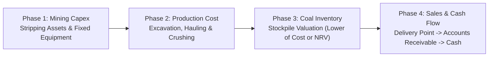
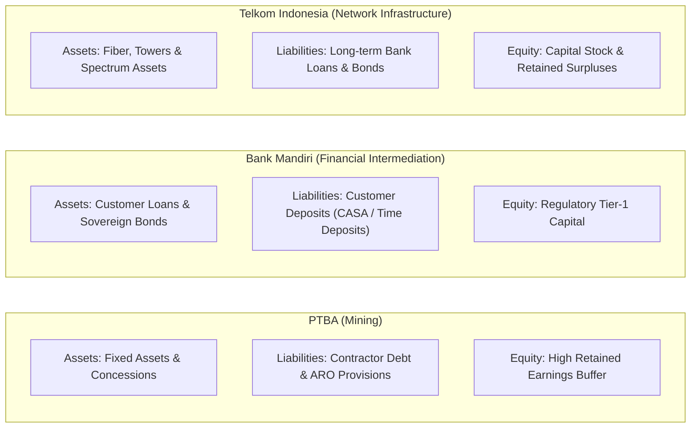

> [!NOTE] Cohort Attribution & Academic Context
>
> - **Course:** MK2 Financial Management and Strategy — Week 01
> - **Case Entity:** PT Bukit Asam (Persero) Tbk (IDX: PTBA)
> - **Comparative Benchmarks:** PT Bank Mandiri (Persero) Tbk (BMRI), PT Telekomunikasi Indonesia (Persero) Tbk (TLKM)
> - **Analytical Contribution:** Synthesized from the core submissions of **`F9 (Class F / Syndicate 9)`**.
> - **Primary Source Filings:** PTBA Consolidated Audited Financial Statements FY2025, Notes 4–30.

## 1. Executive Summary & Statement Headline Profile

PT Bukit Asam Tbk (PTBA) is one of Indonesia's largest integrated state-owned coal mining enterprises and a primary member of the MIND ID mining holding. Analyzing PTBA’s financial statements requires understanding how capital expenditures in geological exploration and stripping transition into inventory stockpiles, and ultimately into revenue upon delivery at train-loading and seaport terminals.

| Metric                      | PTBA FY2025 (IDR Billion) | Structural Ratio / Balance Profile             |
| :-------------------------- | :------------------------ | :--------------------------------------------- |
| **Total Revenue**           | Rp 42,651.7               | Annual top-line scale                          |
| **Cost of Revenue**         | Rp 36,394.6               | 85.3% of revenue (heavy operational cost base) |
| **Gross Profit**            | Rp 6,257.1                | 14.7% gross margin                             |
| **Net Profit for the Year** | Rp 2,959.2                | 6.9% net margin                                |
| **Total Assets**            | Rp 43,925.0               | Capital intensity index                        |
| **Total Liabilities**       | Rp 21,300.5               | 48.5% total debt-to-assets                     |
| **Total Equity**            | Rp 22,624.5               | 51.5% equity-to-assets cushion                 |

---

## 2. The Accounting Architecture of Coal Mining: The Four Operational Phases

The financial statements of PTBA represent a continuous physical cycle across four interconnected accounting stages:

### Phase 1: Mining Exploration, Development & Stripping Assets

- Heavy capital deployment into geological surveys, exploration rights, and mine development.
- **Overburden Removal Costs (Stripping)**: In the development phase, stripping costs are capitalized as mining properties under fixed assets. During the commercial production phase, stripping costs that produce inventory are treated as production costs, while excess stripping that improves access to future ore is capitalized as an **advance stripping asset** and depleted using the unit-of-production method.

### Phase 2: Production Cost Incurrence

- Contractor mining fees (e.g., third-party heavy machinery operators), diesel fuel expenses, crushing, train freight charges (PT KAI hauling fees), and port handling.
- These costs bypass direct expensing upon payment and are absorbed into **Work in Process and Coal Inventory**.

### Phase 3: Coal Inventory Stockpiles & Valuation

- Valuation is anchored to the strict accounting rule: **Lower of Cost or Net Realizable Value (NRV)** (PSAK 14 / IAS 2).
- When global thermal coal price benchmarks (such as ICI 3, ICI 4, or Newcastle) decline, high-cost stockpiles risk immediate non-cash write-downs to NRV.

### Phase 4: Commercial Delivery & Revenue Realization

- Revenue is recognized under PSAK 72 (IFRS 15) when control of the coal transfers to the buyer—typically upon loading onto railway wagons (FOB Train) or crossing the ship’s rail at Tanjung Enim / Kertapati / Tarahan ports (FOB Vessel).

---

## 3. Account Structure & Misstatement Risk Matrix

The diagnostic below breaks down major financial statement lines, normal accounting balances, economic drivers, and plausible misstatement mechanisms:

| Financial Account                     | Normal Balance | FY2025 Balance (Rp Million) | Overstatement Mechanism & Economic Incentive                                                                                                             | Understatement Mechanism & Economic Incentive                                                                                        | Interconnected Accounts Affected                               |
| :------------------------------------ | :------------: | :-------------------------: | :------------------------------------------------------------------------------------------------------------------------------------------------------- | :----------------------------------------------------------------------------------------------------------------------------------- | :------------------------------------------------------------- |
| **Coal Sales Revenue**                |     Credit     |         42,651,724          | **Overstatement:** Recognizing sales before transfer of control (e.g. while coal is still on stockpiles or unverified barges) to meet executive targets. | **Understatement:** Delaying invoice cut-off near year-end into the next period to smooth profits across volatile commodity cycles.  | Accounts Receivable, Deferred Revenue, Royalties Payable       |
| **Cost of Revenue**                   |     Debit      |         36,394,624          | **Overstatement:** Artificially loading general administrative overhead into production costs to minimize taxable net income.                            | **Understatement:** Improperly capitalizing routine excavation or contractor fees into stripping assets instead of recognizing COGS. | Coal Inventory, Advance Stripping Assets, Corporate Income Tax |
| **Coal Inventories**                  |     Debit      |          4,688,675          | **Overstatement:** Failing to write down decaying, flooded, or low-calorie coal stockpiles to Net Realizable Value (NRV).                                | **Understatement:** Excessively conservative NRV write-downs creating hidden "cookie-jar" reserves for future reversal.              | Cost of Revenue, Allowance for Inventory Obsolescence          |
| **Mining Properties & Fixed Assets**  |     Debit      |         16,842,100          | **Overstatement:** Delaying asset impairment reviews on non-operational concessions; extending useful lives beyond economic reserve depletion.           | **Understatement:** Aggressive accelerated depreciation / depletion to artificially suppress current period taxable income.          | Accumulated Depletion, Impairment Loss, Deferred Tax Assets    |
| **Mine Reclamation Provisions (ARO)** |     Credit     |          2,891,450          | **Overstatement:** Overestimating future environmental remediation obligations to artificially suppress current enterprise valuation.                    | **Understatement:** Underestimating post-mining environmental remediation costs or using an artificially high discount rate.         | Stripping Assets, Environmental Operating Expenses             |

---

## 4. Cross-Sectoral Structural Comparison: PTBA vs BMRI vs TLKM

To understand balance sheet morphology, the cohort evaluated PTBA alongside a money-center commercial bank (**Bank Mandiri**) and a national infrastructure telecom operator (**Telkom Indonesia**):

| Structural Metric            | PT Bukit Asam Tbk (Mining)                                                  | Bank Mandiri (Banking)                                                   | Telkom Indonesia (Telecom)                                              |
| :--------------------------- | :-------------------------------------------------------------------------- | :----------------------------------------------------------------------- | :---------------------------------------------------------------------- |
| **Asset Liquidity Velocity** | Moderate (tied to logistics rail constraints and shipping schedules)        | Highly liquid trading assets + illiquid loan books                       | Low (fixed fiber infrastructure, microwave links, towers)               |
| **Debt Profile**             | Low interest-bearing debt; liabilities dominated by operating accruals      | Highly leveraged by nature: deposits represent >80% of liabilities       | Substantial corporate bonds and bank credit to finance 5G / fiber capex |
| **Regulatory Risk Focus**    | Domestic Market Obligation (DMO) price caps, environmental AMDAL compliance | Bank Indonesia / OJK capital adequacy (CAR) and liquidity coverage (LCR) | Frequency spectrum licensing auctions, consumer protection              |
| **Primary Financial Risk**   | Global commodity price cycle and rail hauling bottlenecks                   | Non-Performing Loans (NPL) and credit default contagion                  | Technology obsolescence and ARPU price erosion                          |

---

## 5. Strategic Defense & Audit Governance Conclusions

1. **Reconstruct the Physical-to-Financial Link**: In asset-intensive industries, an analyst cannot evaluate financial figures without cross-referencing physical metrics: coal extraction tonnage, stripping ratios ($BCM / \text{tonne}$), and average calorific value ($GAR$).
2. **Scrutinize Capitalized Stripping**: The line between routine operational mining cost and capitalized advance stripping is subjective. Sharp increases in stripping assets accompanied by declining cost of revenue indicate aggressive earnings management.
3. **Validate Environmental Obligations**: With increasing ESG scrutiny, mine rehabilitation provisions (ARO) must match physical acreage disturbed. Under-provisioning poses an existential liability once concessions approach end-of-mine life.

---

## 🔗 Related Notes

- Master Hub: [[courses/mk2-financial-management-strategy/week-01/index|Week 01: Financial Management Function & Objectives]]
- Advanced Analysis: [[courses/mk2-financial-management-strategy/week-02/case-ptba-ratio-analysis|Week 02: PTBA Ratio & DuPont Decomposition]]
- Corporate Entity: [[entities/pt-bukit-asam|PT Bukit Asam Tbk (PTBA)]]
