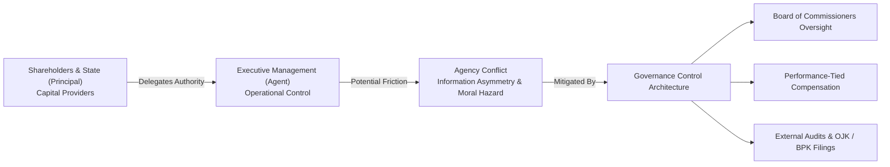
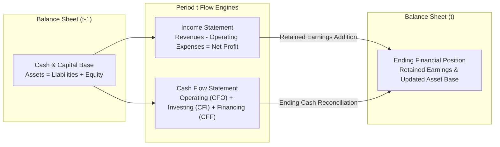

> [!NOTE] Curricular & Faculty Metadata
>
> - **Course:** MK2 Financial Management and Strategy — Week 01
> - **Teaching Team:** Dr. Arif Zamani (Lead Lecturer), Dr. Subiakto Soekarno, Dr. Aswin Rahadi, Yunieta Anny Nainggolan Ph.D., Oktofa Yudha Sudrajat Ph.D.
> - **Primary Curricular Spine:** `[P3MD] Materi Week 1 - MK2.pdf` (Dr. Arif Zamani)
> - **Direct Satellites & Problem Sets:**
>   - [[courses/mk2-financial-management-strategy/week-01/assignment-ptba-financial-statement-structure|Case Analysis: PTBA Financial Statement Structure & Misstatement Risk]]

## 1. Executive Overview: The Corporate Financial Mission

Corporate finance is fundamentally the study of how enterprise managers allocate scarce economic capital to generate returns exceeding the required hurdle rate, while preserving enterprise solvency and liquidity.

In traditional neoclassical economics, the financial objective of the firm is defined narrowly as **Shareholder Wealth Maximization**—operationalized as maximizing the market value of the firm's common equity over the long run. In modern executive governance, particularly within state-owned enterprises (BUMN) and strategic emerging-market holdings, this mandate expands into **Stakeholder Value Creation**: balancing commercial profitability with public infrastructure mandates, developmental externalities, and regulatory compliance.

| Dimension                   | Shareholder Wealth Maximization                                                       | Stakeholder Value Governance (BUMN Model)                                                    |
| :-------------------------- | :------------------------------------------------------------------------------------ | :------------------------------------------------------------------------------------------- |
| **Primary Beneficiary**     | Equity holders and capital providers                                                  | Dual mandate: State shareholder (dividends/tax) + Public society (public service obligation) |
| **Time Horizon**            | Long-term intrinsic equity value                                                      | Intergenerational infrastructure resilience and fiscal contribution                          |
| **Capital Allocation Test** | $\text{ROIC} > \mathbf{\text{[[concepts/weighted-average-cost-of-capital \| WACC]]}}$ | Commercial viability + Economic developmental multiplier                                     |
| **Failure Mode**            | Short-term quarterly earnings gaming                                                  | Bureaucratic inertia or capital misallocation masked by policy mandates                      |

---

## 2. Theoretical Architecture: Agency Theory & Governance Controls

The separation of ownership (shareholders/principal) and control (executive management/agent) creates inherent **Agency Costs**. Managers may pursue personal perquisites, risk-averse empire building, or aggressive accounting maneuvers to inflate performance bonuses.

$$\mathbf{\text{Agency Costs} = \text{Monitoring Expenditures} + \text{Bonding Expenditures} + \text{Residual Loss}}$$

### The Three Agency Governance Levers

1. **Internal Governance & Alignment**: Executive stock ownership or performance-tied key performance indicators (KPIs) linked to economic profit rather than raw revenue.
2. **Monitoring & Fiduciary Oversight**: The two-tier board system mandated in Indonesian corporate law (Undang-Undang Perseroan Terbatas), where the _Dewan Komisaris_ (Board of Commissioners) directly supervises the _Direksi_ (Board of Directors) and commands the Audit Committee.
3. **External Market Disciplines**: The threat of hostile takeovers (for public firms), debt covenants enforced by syndicated lenders, and capital market scrutiny via regular financial reporting.

---

## 3. The Triad Financial Statement Architecture

A financial statement is not an isolated ledger; it is an integrated triple-lens snapshot of an ongoing corporate operating cycle.

$$
\begin{aligned}
\mathbf{\text{Balance Sheet (Position)}} &: \quad \text{Assets} = \text{Liabilities} + \text{Equity} \\
\mathbf{\text{Income Statement (Flow)}} &: \quad \text{Net Income} = \text{Revenues} - \text{Expenses} \\
\mathbf{\text{Cash Flow Statement (Liquidity)}} &: \quad \Delta \text{Cash} = \text{CFO} + \text{CFI} + \text{CFF}
\end{aligned}
$$

### Comparative Statement Architectures across Indonesian Enterprises

The nature of an enterprise's industry dictates the mechanical structure and risk points of its balance sheet:

| Industry Sector                        | Benchmark Entity             | Dominant Asset Class                                                | Primary Financing Structure                                         | Key Misstatement / Valuation Vulnerability                                                   |
| :------------------------------------- | :--------------------------- | :------------------------------------------------------------------ | :------------------------------------------------------------------ | :------------------------------------------------------------------------------------------- |
| **Heavy Mining & Natural Resources**   | **PT Bukit Asam Tbk (PTBA)** | Fixed assets, mining properties, exploration/stripping assets       | Retained equity + trade payables + mining rehabilitation provisions | Overburden stripping capitalization, coal inventory lower-of-cost-or-NRV, reclamation timing |
| **Banking & Financial Intermediation** | **Bank Mandiri (BMRI)**      | Loans and advances to customers, government bonds                   | Customer deposits (CASA and time deposits)                          | Expected Credit Loss (ECL / CKPN) provisioning under IFRS 9 / PSAK 71                        |
| **Telecommunications & Digital Infra** | **Telkom Indonesia (TLKM)**  | Property, plant and equipment (fiber network, towers, data centers) | Long-term bank loans, bonds, retained earnings                      | Network asset impairment, lease capitalization (PSAK 73), spectrum license amortization      |

---

## 4. Cross-Functional Implementation & Enterprise Trade-offs

The Chief Financial Officer (CFO) must continuously balance three structural enterprise tensions:

1. **Liquidity vs Profitability**: Idle cash reduces solvency risk to zero but penalizes Return on Equity via **[[concepts/dupont-analysis|DuPont Analysis]]** ($\text{ROE} = \text{Margin} \times \text{Turnover} \times \text{Leverage}$). Aggressive working capital minimization boosts asset turnover but exposes the company to supply-chain stockouts.
2. **Growth vs Solvency**: Debt financing provides an interest tax shield and accelerates capacity expansion without equity dilution, but increases the probability of financial distress during economic downturns, governed by **[[concepts/sustainable-growth-rate|Sustainable Growth Rate]]** boundaries.
3. **Operational Disclosures vs Competitive Secrecy**: Granular segment disclosures build capital market trust and lower the firm's cost of capital, evaluated under the **[[concepts/time-value-of-money|Time Value of Money]]** discounting logic.

---

## 📚 Direct Satellite Notes

- [[courses/mk2-financial-management-strategy/week-01/assignment-ptba-financial-statement-structure|Case Analysis: PTBA Financial Statement Structure & Misstatement Risk]]: Full comparative diagnostic of PT Bukit Asam Tbk vs Bank Mandiri and Telkom Indonesia, detailing account behaviors and misstatement risk simulations.

---

## 🔗 Knowledge Graph & Curriculum Bridges

- **Featured Concept in Knowledge Matrix**:
  - [[concepts/dupont-analysis|DuPont Analysis Framework]]
- **Enterprise Profiles**:
  - [[entities/pt-bukit-asam|PT Bukit Asam Tbk (PTBA)]]
  - [[entities/arif-zamani|Dr. Arif Zamani]]
- **Next Curricular Module**: [[courses/mk2-financial-management-strategy/week-02/index|Week 02: Financial Statement Analysis & Ratio Decomposition]]
- Return to **[[courses/mk2-financial-management-strategy/index|MK 2 Course Overview]]**
