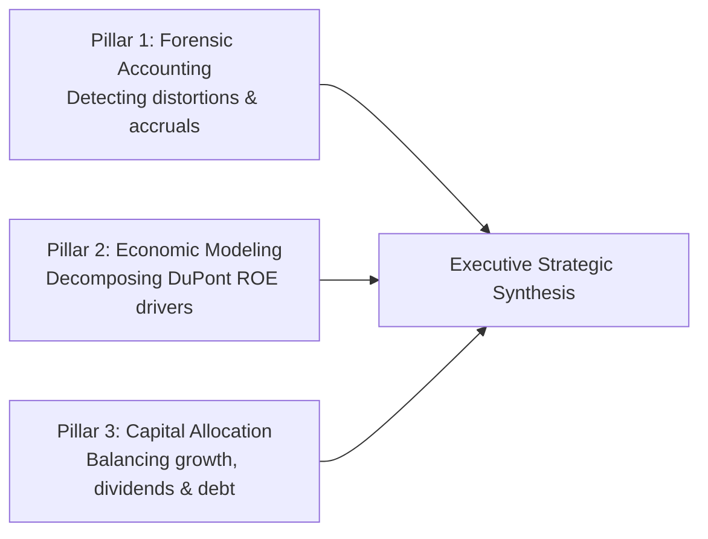

> [!NOTE] Cohort Attribution & Synthesis Context
>
> - **Course:** MK2 Financial Management and Strategy — Week 02
> - **Case Entity:** PT Bukit Asam (Persero) Tbk (IDX: PTBA)
> - **Analytical Voice:** Authored by **`the Portal Maintainer`** in synthesis with cohort plenary debriefs.
> - **Core Theme:** Moving from mechanical formula computation to strategic executive financial diagnosis.

## 1. Executive Summary: What We Realized After Plenary Debriefs

Prior to class discussions, financial statement analysis is often approached as a mechanical accounting drill: calculate fifteen to twenty standard ratios, observe whether each figure rose or fell relative to the prior year, and label the result "positive" or "negative."

The in-depth classroom examination of **PT Bukit Asam Tbk (PTBA)** fundamentally upended this narrow perspective. A financial statement is not a standalone balance sheet; it is a financial diagnosis. True financial intelligence does not terminate at computing what a ratio is; it explains:

1. **What has changed across the underlying accounts over time?**
2. **Why did those changes occur in the physical and macroeconomic world?**
3. **How does the enterprise compare against external industry benchmarks?**
4. **What are the strategic implications for forward-looking capital allocation?**

---

## 2. Key Pedagogical Insights from the PTBA Case

### Insight 1: Trend Analysis Trumps Isolated Ratios

Comparing individual ratios in a vacuum generates misleading conclusions. For PTBA, revenue between FY2024 and FY2025 was virtually unchanged at approximately **Rp 42.65 trillion** versus **Rp 42.76 trillion**. However:

- Cost of revenue surged from **Rp 34.56 trillion** to **Rp 36.39 trillion**.
- Net income halved from **Rp 6.11 trillion** to **Rp 2.96 trillion**.
- Total assets expanded to **Rp 43.92 trillion**, driven by fixed capex and inventory accumulation.
- Financial leverage increased as liabilities grew to **Rp 21.30 trillion**.

Connecting these lines reveals the true executive narrative: **PTBA did not suffer a demand or sales volume collapse; it suffered acute operational margin compression**.

### Insight 2: Contextualizing Financial Statements in the Global Market

Judging PTBA purely against its own past numbers creates an internal attribution error. Commodity producers are price-takers in international markets.

While PTBA set a physical sales record of **45.43 million tonnes** in FY2025, softening global coal benchmark indices (ICI and Newcastle) combined with government-mandated Domestic Market Obligations (DMO capped at \$70/tonne for PLN power plants) depressed average realized selling prices. Concurrently, fuel expenses and government mining royalties increased.

Consequently, the profit decline was not exclusively an operational failure; it reflected global commodity downcycles compounded by structural cost rigidities.

### Insight 3: Financial Analysis Must Power Forward-Looking Scenarios

Historical financial analysis is backward-looking; executive decisions are forward-looking. An analyst must use historical ratio behavior to construct calibrated scenarios for subsequent periods:

$$\mathbf{\text{Forward Operating Income}} = f\big(\text{Sales Volume}, \text{Average Selling Price}, \text{Cash Cost / Tonne}, \text{Rail Logistics Throughput}\big)$$

Rather than projecting a single guaranteed point estimate, financial analysts must model sensitivity matrices:

- **Bull Case**: Coal price benchmark stabilization, expansion of rail hauling capacity via PT KAI, and lower contractor diesel costs.
- **Bear Case**: Further commodity index erosion, rising domestic freight tariffs, and continued working capital drag.

---

## 3. The Three Diagnostic Pillars of Modern Financial Leadership

1. **Forensic Accounting Discipline**: Scrutinize non-operating line items, changes in accounting estimates (useful lives, asset retirement obligations), and working capital build-ups before trusting reported net earnings.
2. **Economic Return Decomposition**: Utilize the DuPont framework to distinguish between real operational productivity (asset turnover and operating margins) and financial leverage gearing.
3. **Disciplined Capital Allocation**: Protect enterprise liquidity during cyclical windfalls rather than committing 100% of profits to unhedged dividends, preserving an investment war chest for cyclical downswings.

---

## 🔗 Related Notes

- Master Hub: [[courses/mk2-financial-management-strategy/week-02/index|Week 02: Financial Statement Analysis & Ratio Decomposition]]
- Worked Quantitative Model: [[courses/mk2-financial-management-strategy/week-02/case-ptba-ratio-analysis|Week 02: PTBA 25+ Ratio Deep-Dive]]
- Foundation Hub: [[courses/mk2-financial-management-strategy/week-01/index|Week 01: Financial Management Function & Objectives]]
