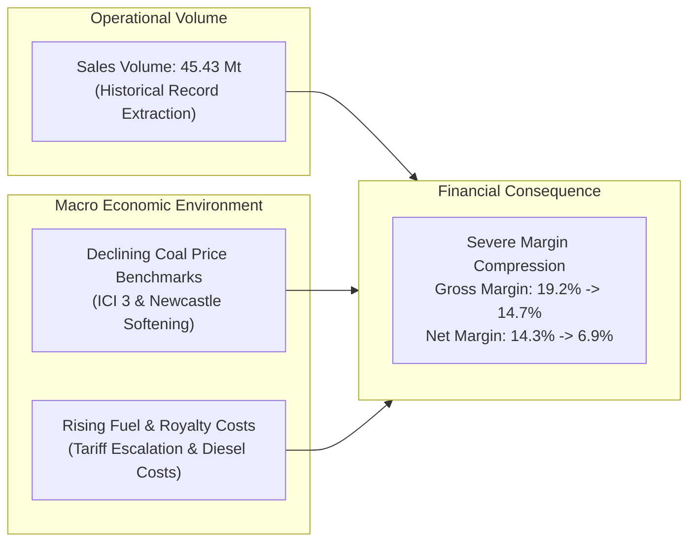
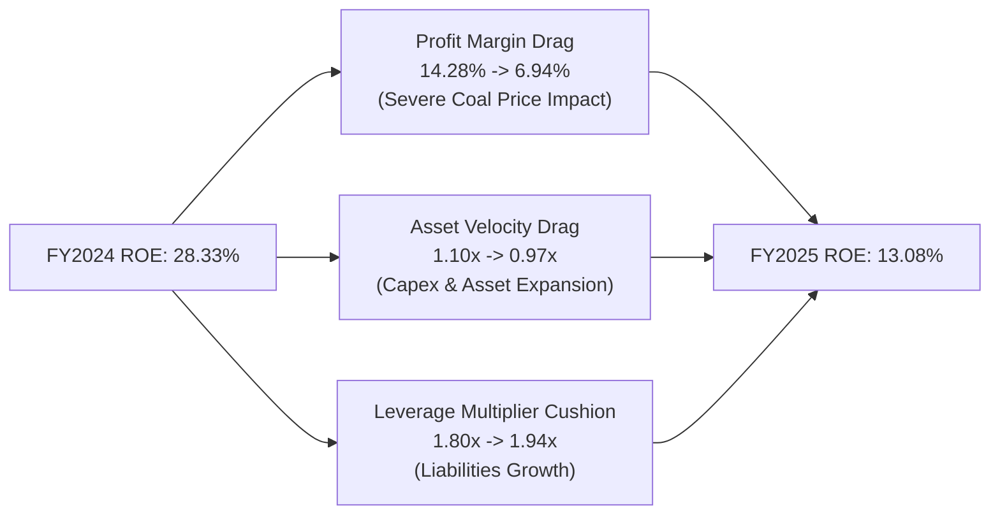

> [!NOTE] Cohort Attribution & Source Data
>
> - **Course:** MK2 Financial Management and Strategy — Week 02
> - **Case Entity:** PT Bukit Asam (Persero) Tbk (IDX: PTBA)
> - **Analytical Contribution:** Synthesized from the working models and submissions of **`F9 (Class F / Syndicate 9)`**.
> - **Source Data:** PTBA Audited Consolidated Financial Statements FY2025 & FY2024 (Expressed in Millions of IDR unless noted).

## 1. Executive Summary & The Diagnostic Puzzle

During FY2025, PT Bukit Asam Tbk achieved a record operational milestone: total coal sales volume increased to **45.43 million tonnes**. Yet despite higher physical volume, headline financial performance told a sharply contrasting story:

- **Net Revenue** was practically flat: **Rp 42.65 trillion** in FY2025 vs **Rp 42.76 trillion** in FY2024 (-0.26%).
- **Operating Profit** declined by **43.2%** from **Rp 5.65 trillion** to **Rp 3.21 trillion**.
- **Net Profit for the Year** fell by **51.6%** from **Rp 6.11 trillion** to **Rp 2.96 trillion**.
- **Return on Equity (ROE)** collapsed from **28.3%** in FY2024 to **13.1%** in FY2025.

This case diagnostic proves that in commodity-driven state-owned enterprises, **operational volume expansion without pricing power leads directly to severe margin compression**.

---

## 2. Comprehensive 25+ Ratio Diagnostic Matrix (FY2025 vs FY2024)

All calculations follow the official P3MD MK02 financial ratio specifications using audited consolidated financial statement lines:

| Ratio Category & Specific Indicator       |    FY2025     |    FY2024     | Strategic Direction & Diagnostic Interpretation                                                                   |
| :---------------------------------------- | :-----------: | :-----------: | :---------------------------------------------------------------------------------------------------------------- |
| **I. LIQUIDITY RATIOS**                   |               |               |                                                                                                                   |
| **Current Ratio**                         |   **1.71x**   |   **1.94x**   | Tightening short-term liquidity; current assets cover current obligations comfortably, but buffer is compressed.  |
| **Quick Ratio (Acid-Test)**               |   **1.21x**   |   **1.45x**   | Excluding coal inventory stockpiles, immediate cash and receivables provide adequate coverage.                    |
| **Cash Ratio**                            |   **0.44x**   |   **0.55x**   | Direct cash liquidity declined slightly as operating cash flows absorbed higher working capital.                  |
| **II. ACTIVITY & WORKING CAPITAL RATIOS** |               |               |                                                                                                                   |
| **Inventory Turnover**                    |   **8.53x**   |   **9.64x**   | Slower inventory velocity; coal stockpiles accumulated at port terminals amid rail logistics bottlenecks.         |
| **Days Sales in Inventory (DSI)**         | **42.8 days** | **37.9 days** | Coal sits on stockpiles 4.9 days longer before bill of lading issuance.                                           |
| **Receivables Turnover**                  |  **10.72x**   |  **11.83x**   | Slower collection from domestic industrial power plant customers and international off-takers.                    |
| **Days Sales Outstanding (DSO)**          | **34.0 days** | **30.9 days** | Average collection period widened by 3.1 days.                                                                    |
| **Accounts Payable Turnover**             |   **6.42x**   |   **6.88x**   | Mining contractor payment terms remained relatively stable.                                                       |
| **Days Payable Outstanding (DPO)**        | **56.9 days** | **53.1 days** | PTBA extended trade credit terms by 3.8 days to preserve cash liquidity.                                          |
| **Cash Conversion Cycle (CCC)**           | **19.9 days** | **15.7 days** | Operating cash cycle elongated by 4.2 days ($\text{DSI} + \text{DSO} - \text{DPO}$).                              |
| **Total Asset Turnover**                  |   **0.97x**   |   **1.10x**   | Asset velocity decreased as total assets grew (+13.3%) while revenues remained flat.                              |
| **III. SOLVENCY & LEVERAGE RATIOS**       |               |               |                                                                                                                   |
| **Debt-to-Assets Ratio**                  |   **48.5%**   |   **44.4%**   | Financial gearing expanded as total liabilities grew to Rp 21.30 trillion.                                        |
| **Debt-to-Equity Ratio (DER)**            |   **94.1%**   |   **79.8%**   | Leverage increased, largely driven by trade payables, contractor accruals, and mining rehabilitation liabilities. |
| **Financial Leverage Multiplier**         |   **1.94x**   |   **1.80x**   | Assets supported per rupiah of equity capital increased.                                                          |
| **Times Interest Earned (TIE)**           |   **12.4x**   |   **24.6x**   | Operating profit covers annual interest expense easily, though safety margin was halved.                          |
| **IV. PROFITABILITY RATIOS**              |               |               |                                                                                                                   |
| **Gross Profit Margin**                   |  **14.67%**   |  **19.18%**   | Direct mining costs and rail transport swallowed 85.3% of revenue.                                                |
| **Operating Profit Margin**               |   **7.52%**   |  **13.22%**   | Operating margin compressed by 570 bps amid fixed G&A and logistics costs.                                        |
| **Net Profit Margin**                     |   **6.94%**   |  **14.28%**   | Net bottom-line margin contracted by more than half (-734 bps).                                                   |
| **Return on Assets (ROA)**                |   **6.74%**   |  **15.76%**   | Asset productivity plummeted due to lower net earnings on a larger asset base.                                    |
| **Return on Equity (ROE)**                |  **13.08%**   |  **28.33%**   | Shareholder surplus return contracted by 1,525 bps.                                                               |

---

## 3. The DuPont Decomposition Diagnostic: Unpacking the ROE Collapse

Using the 3-Stage DuPont identity, the cohort decomposed PTBA's Return on Equity across both fiscal years:

$$\mathbf{\text{ROE} = \text{Net Profit Margin} \times \text{Total Asset Turnover} \times \text{Equity Multiplier}}$$

### Comparative 3-Stage DuPont Walkthrough

| DuPont Driver                  | FY2024 Actual  | FY2025 Actual  | Variance / Impact on ROE                                                              |
| :----------------------------- | :------------: | :------------: | :------------------------------------------------------------------------------------ |
| **Net Profit Margin**          |   $14.28\%$    |    $6.94\%$    | **-51.4% change**: The dominant source of ROE destruction.                            |
| **Total Asset Turnover**       | $1.10\text{x}$ | $0.97\text{x}$ | **-11.8% change**: Secondary drag from asset asset expansion without top-line growth. |
| **Equity Multiplier**          | $1.80\text{x}$ | $1.94\text{x}$ | **+7.8% change**: Minor positive cushion from increased financial leverage.           |
| **Resulting Return on Equity** |   **28.33%**   |   **13.08%**   | **Severe Contraction (-15.25 percentage points)**                                     |

### The 5-Stage DuPont Breakdown

To isolate tax and interest structure from operating performance:

$$\mathbf{\text{ROE} = \left(\frac{\text{Net Income}}{\text{EBT}}\right) \times \left(\frac{\text{EBT}}{\text{EBIT}}\right) \times \left(\frac{\text{EBIT}}{\text{Sales}}\right) \times \left(\frac{\text{Sales}}{\text{Assets}}\right) \times \left(\frac{\text{Assets}}{\text{Equity}}\right)}$$

1. **Tax Burden ($\text{NI}/\text{EBT}$)**: $2,959.2 / 3,820.1 = 0.775$ (Effective tax rate of $22.5\%$, stable).
2. **Interest Burden ($\text{EBT}/\text{EBIT}$)**: $3,820.1 / 3,208.1 = 1.191$ (Aided by net finance income and joint venture earnings).
3. **Operating Margin ($\text{EBIT}/\text{Sales}$)**: $3,208.1 / 42,651.7 = 0.0752$ ($7.52\%$, down from $13.22\%$).
4. **Asset Turnover**: $0.971\text{x}$.
5. **Equity Multiplier**: $1.941\text{x}$.

$$\mathbf{\text{ROE}} = 0.775 \times 1.191 \times 0.0752 \times 0.971 \times 1.941 \approx \mathbf{13.08\%}$$

---

## 4. Strategic Analysis & Executive Takeaways

1. **The Cost of Gearing in a Downcycle**: Higher financial leverage (Equity Multiplier rising from $1.80\text{x}$ to $1.94\text{x}$) failed to boost ROE because the underlying return on invested capital fell below the cost of debt.
2. **Logistics Bottlenecks and Working Capital Drag**: Days Sales in Inventory (DSI) widened to 42.8 days and receivables stretched to 34 days, indicating that while PTBA mined record coal volumes, railway transport constraints (South Sumatra rail link to Tarahan port) restricted delivery velocity.
3. **Dividend Sustainability Alert**: PTBA historically distributed high dividend payout ratios (up to 80–100% of net income). With net income halved to Rp 2.96 trillion and ongoing capital expenditure required for railway infrastructure and mine expansion, maintaining historical absolute dividend levels would severely impair cash reserves.

---

## 🔗 Related Notes

- Master Hub: [[courses/mk2-financial-management-strategy/week-02/index|Week 02: Financial Statement Analysis & Ratio Decomposition]]
- Pre-Assignment Diagnostic: [[courses/mk2-financial-management-strategy/week-01/assignment-ptba-financial-statement-structure|Week 01: PTBA Statement Structure]]
- Post-Class Synthesis: [[courses/mk2-financial-management-strategy/week-02/assignment-post-ptba-reflection|Cohort Reflective Debrief on Ratio Analysis]]
- Corporate Entity: [[entities/pt-bukit-asam|PT Bukit Asam Tbk (PTBA)]]
- Applied Concepts:
  - [[concepts/dupont-analysis|DuPont Analysis Framework]]
  - [[concepts/dupont-analysis#1-the-3-stage-dupont-identity|3-Stage DuPont Identity]]
  - [[concepts/dupont-analysis#2-the-5-stage-extended-dupont-identity|5-Stage Extended DuPont Identity]]
  - [[concepts/sustainable-growth-rate|Sustainable Growth Rate (SGR)]]
  - [[concepts/weighted-average-cost-of-capital|Weighted Average Cost of Capital (WACC)]]
