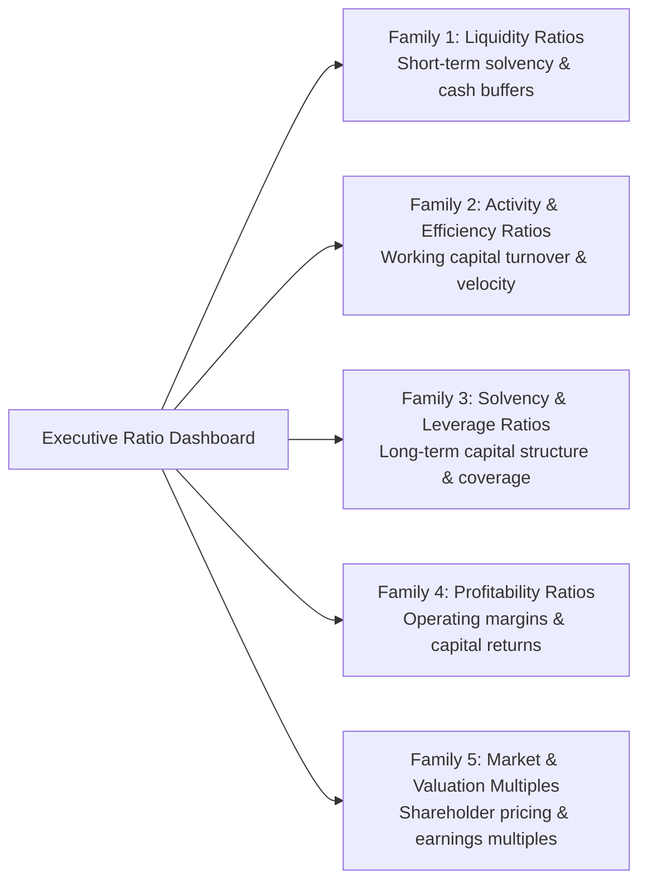
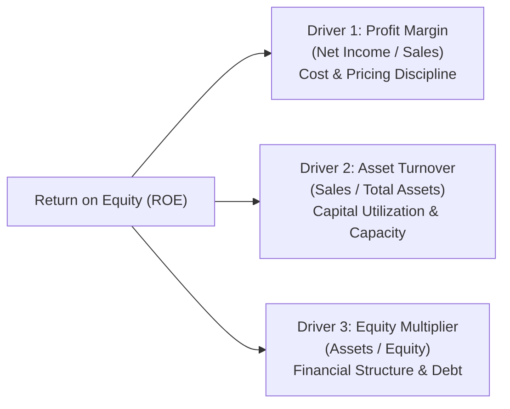

> [!NOTE] Curricular & Faculty Metadata
>
> - **Course:** MK2 Financial Management and Strategy — Week 02
> - **Teaching Team:** Dr. Arif Zamani (Lead Lecturer), Dr. Subiakto Soekarno, Dr. Aswin Rahadi, Yunieta Anny Nainggolan Ph.D., Oktofa Yudha Sudrajat Ph.D.
> - **Primary Curricular Spine:** `[P3MD] MK 02 Week 2.pdf` (Dr. Arif Zamani)
> - **Direct Satellites & Problem Sets:**
>   - [[courses/mk2-financial-management-strategy/week-02/case-ptba-ratio-analysis|Model Case Analysis: PTBA 25+ Ratio Deep-Dive & DuPont Decomposition]]
>   - [[courses/mk2-financial-management-strategy/week-02/assignment-post-ptba-reflection|Cohort Reflective Debrief: Strategic Lessons from the PTBA Diagnostic]]

## 1. Executive Overview: Financial Ratios as Diagnostic Mirrors

Raw financial statements convey scale; financial ratios convey economic efficiency and strategic risk. A multi-trillion rupiah revenue figure is commercially meaningless without assessing the asset base mobilized to generate it, the operational margin retained, and the debt burden contracted.

Financial statement analysis transforms static accounting data into an executive diagnostic dashboard. However, as emphasized in cohort deliberations, **a ratio is an indicator of symptoms, not the root disease itself**. A falling current ratio might indicate impending insolvency—or it might reflect world-class just-in-time inventory management and superior treasury cash-pooling. Analysis requires contextualizing ratios across time-series trends and macroeconomic industry cycles.

| Dimension            | Static Accounting View             | Strategic Financial Diagnostic                                                  |
| :------------------- | :--------------------------------- | :------------------------------------------------------------------------------ |
| **Analytical Unit**  | Single-period financial balance    | Multi-year trajectory + Macro-industry context                                  |
| **Evaluation Focus** | Compliance with GAAP / PSAK / IFRS | Economic cash generation and sustainable enterprise return                      |
| **Core Question**    | "Did the balance sheet balance?"   | "Is the return on invested capital above our weighted average cost of capital?" |

---

## 2. The Five Foundational Ratio Families

Financial ratios are organized into five primary functional categories, each probing a distinct facet of enterprise operations:

### 1. Liquidity Ratios (Short-Term Survival Buffer)

Assess the enterprise's ability to settle obligations due within twelve months without liquidating core operating assets:

$$\mathbf{\text{Current Ratio} = \frac{\text{Current Assets}}{\text{Current Liabilities}}} \qquad \mathbf{\text{Quick Ratio} = \frac{\text{Cash} + \text{Marketable Securities} + \text{Receivables}}{\text{Current Liabilities}}}$$

$$\mathbf{\text{Cash Ratio} = \frac{\text{Cash \& Cash Equivalents}}{\text{Current Liabilities}}}$$

### 2. Activity & Efficiency Ratios (Asset Velocity)

Measure the speed and productivity with which the firm converts its working capital and fixed investments into cash:

$$\mathbf{\text{Inventory Turnover} = \frac{\text{Cost of Goods Sold}}{\text{Average Inventory}}} \qquad \mathbf{\text{Days Sales of Inventory (DSI)} = \frac{365}{\text{Inventory Turnover}}}$$

$$\mathbf{\text{Receivables Turnover} = \frac{\text{Net Credit Sales}}{\text{Average Accounts Receivable}}} \qquad \mathbf{\text{Days Sales Outstanding (DSO)} = \frac{365}{\text{Receivables Turnover}}}$$

$$\mathbf{\text{Cash Conversion Cycle (CCC)} = \text{DSI} + \text{DSO} - \text{Days Payable Outstanding (DPO)}}$$

### 3. Solvency & Leverage Ratios (Capital Structure Cushion)

Quantify the degree of financial gearing and the margin of safety for fixed financing charges:

$$\mathbf{\text{Debt-to-Assets Ratio} = \frac{\text{Total Debt}}{\text{Total Assets}}} \qquad \mathbf{\text{Debt-to-Equity Ratio} = \frac{\text{Total Debt}}{\text{Total Equity}}}$$

$$\mathbf{\text{Times Interest Earned (Interest Coverage)} = \frac{\text{Operating Profit (EBIT)}}{\text{Interest Expense}}}$$

### 4. Profitability Ratios (Operating Engine Return)

Assess how effectively management translates sales volume into bottom-line shareholder surplus:

$$\mathbf{\text{Gross Profit Margin} = \frac{\text{Gross Profit}}{\text{Revenue}}} \qquad \mathbf{\text{Operating Margin} = \frac{\text{EBIT}}{\text{Revenue}}} \qquad \mathbf{\text{Net Profit Margin} = \frac{\text{Net Income}}{\text{Revenue}}}$$

$$\mathbf{\text{Return on Assets (ROA)} = \frac{\text{Net Income}}{\text{Total Assets}}} \qquad \mathbf{\text{Return on Equity (ROE)} = \frac{\text{Net Income}}{\text{Shareholders' Equity}}}$$

### 5. Market Valuation Metrics (Capital Market Perception)

Connect accounting performance on the books to equity valuation in secondary capital markets:

$$\mathbf{\text{Price-to-Earnings (P/E)} = \frac{\text{Market Price per Share}}{\text{Earnings per Share (EPS)}}} \qquad \mathbf{\text{Price-to-Book (P/B)} = \frac{\text{Market Price per Share}}{\text{Book Value per Share (BVPS)}}}$$

---

## 3. Theoretical Architecture: The DuPont Decomposition Framework

The DuPont framework deconstructs **Return on Equity (ROE)** into its fundamental underlying operational, managerial, and financing drivers, as codified in the **[[concepts/dupont-analysis|DuPont Analysis Framework]]**.

### The 3-Stage DuPont Identity

Grounded in the **[[concepts/dupont-analysis#1-the-3-stage-dupont-identity|3-Stage DuPont Identity]]**:

$$\mathbf{\text{ROE} = \left(\frac{\text{Net Income}}{\text{Sales}}\right) \times \left(\frac{\text{Sales}}{\text{Assets}}\right) \times \left(\frac{\text{Assets}}{\text{Equity}}\right)}$$

$$\mathbf{\text{ROE} = \underbrace{\text{Net Profit Margin}}_{\text{Operating Efficiency}} \times \underbrace{\text{Total Asset Turnover}}_{\text{Asset Velocity}} \times \underbrace{\text{Equity Multiplier}}_{\text{Financial Leverage}}}$$

### The 5-Stage Extended DuPont Identity

The **[[concepts/dupont-analysis#2-the-5-stage-extended-dupont-identity|5-Stage Extended DuPont Identity]]** isolates operational performance from the effects of debt burden and sovereign tax policy:

$$\mathbf{\text{ROE} = \underbrace{\frac{\text{Net Income}}{\text{EBT}}}_{\text{Tax Burden}} \times \underbrace{\frac{\text{EBT}}{\text{EBIT}}}_{\text{Interest Burden}} \times \underbrace{\frac{\text{EBIT}}{\text{Sales}}}_{\text{Operating Margin}} \times \underbrace{\frac{\text{Sales}}{\text{Assets}}}_{\text{Asset Turnover}} \times \underbrace{\frac{\text{Assets}}{\text{Equity}}}_{\text{Equity Multiplier}}}$$

1. **Tax Burden Factor**: Indicates the percentage of pre-tax earnings retained after paying corporate income tax (lower number indicates higher tax drag).
2. **Interest Burden Factor**: Quantifies the erosion of operating profit caused by interest payments on debt (an interest burden close to $1.0$ indicates negligible debt drag).
3. **Operating Margin ($\text{EBIT} / \text{Sales}$)**: Measures pure business-model profitability prior to capital structure choices.

These drivers set the foundation for the firm's **[[concepts/sustainable-growth-rate|Sustainable Growth Rate (SGR)]]** and determine whether ROE exceeds the hurdle rate set by the **[[concepts/weighted-average-cost-of-capital|Weighted Average Cost of Capital (WACC)]]**.

---

## 4. Managerial Crucible: The Limits of Accounting Ratios

While indispensable, financial ratios present three critical analytical hazards that executive leaders must actively manage:

1. **Accounting Policy Distortion**: Different inventory valuation methods (FIFO vs Weighted Average), depreciation schedules (Straight-Line vs Accelerated), and capital leases (PSAK 73) make cross-firm comparisons misleading without prior normalization.
2. **Window Dressing**: Companies approaching balance-sheet reporting dates may temporarily defer equipment purchases, delay invoice payments, or draw down short-term credit lines to cosmetically inflate liquidity ratios.
3. **The Commodity Illusion**: In natural resource enterprises (such as coal, oil palm, or base metals), a collapse in profitability ratios often stems not from operational management failure, but from macroeconomic cyclicality and global price benchmark contractions.

---

## 📚 Direct Satellite Notes

- [[courses/mk2-financial-management-strategy/week-02/case-ptba-ratio-analysis|Model Case Analysis: PTBA 25+ Ratio Deep-Dive & DuPont Decomposition]]: Comprehensive longitudinal calculation across 25+ ratios comparing FY2025 vs FY2024 for PT Bukit Asam Tbk.
- [[courses/mk2-financial-management-strategy/week-02/assignment-post-ptba-reflection|Cohort Reflective Debrief: Strategic Lessons from the PTBA Diagnostic]]: High-level synthesis on moving beyond isolated accounting ratios to longitudinal trend diagnostics and commodity cycle management.

---

## 🔗 Knowledge Graph & Curriculum Bridges

- **Featured Concept in Knowledge Matrix**:
  - [[concepts/dupont-analysis|DuPont Analysis Framework]]
- **Enterprise Profiles**:
  - [[entities/pt-bukit-asam|PT Bukit Asam Tbk (PTBA)]]
- **Previous Curricular Module**: [[courses/mk2-financial-management-strategy/week-01/index|Week 01: Financial Management Function & Objectives]]
- **Next Curricular Module**: [[courses/mk2-financial-management-strategy/week-03/index|Week 03: Financial Statement Projections & EFN Modeling]]
- Return to **[[courses/mk2-financial-management-strategy/index|MK 2 Course Overview]]**
