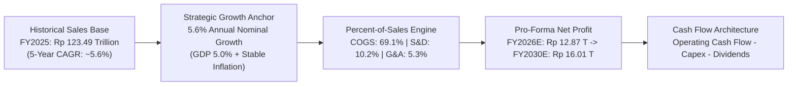
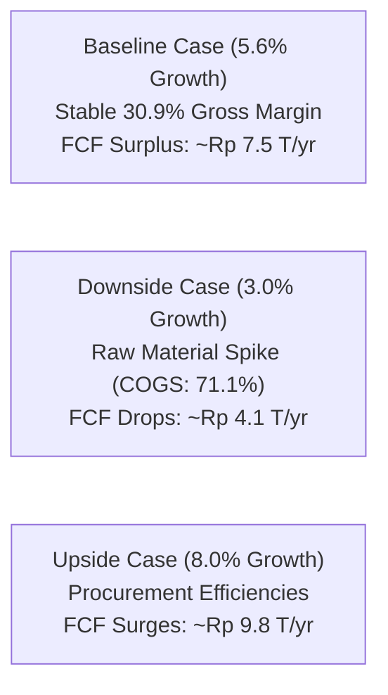

> [!NOTE] Cohort Attribution & Model Foundations
>
> - **Course:** MK2 Financial Management and Strategy — Week 03
> - **Case Entity:** PT Indofood Sukses Makmur Tbk (IDX: INDF)
> - **Analytical Contribution:** Synthesized from the integrated financial projection models of **`F9 (Class F / Syndicate 9)`**.
> - **Baseline Data:** Audited Consolidated Financial Statements FY2024–FY2025 (Figures in Millions of IDR unless noted).

## 1. Executive Summary & Corporate Profile

PT Indofood Sukses Makmur Tbk is Indonesia's dominant food solutions provider, operating across four strategic business groups: Consumer Branded Products (ICBP—including Indomie noodles, dairy, snack foods), Bogasari flour milling, Agribusiness (plantations and cooking oils), and Nationwide Distribution.

Forecasting a consumer staple giant with annual revenues exceeding **Rp 123 trillion** requires balancing volume expansion against raw material volatility (wheat import costs and crude palm oil prices) and distribution cost inflation.

---

## 2. Key Modeling Assumptions & Strategic Justification

The 5-year model applies the **Percent-of-Sales Method** anchored to FY2025 actual performance, adjusted for macroeconomic trends:

| Forecast Parameter                 |      Assumption Value      | Strategic & Empirical Rationale                                                                                                                                                                                                                                                                                                                                                                   |
| :--------------------------------- | :------------------------: | :------------------------------------------------------------------------------------------------------------------------------------------------------------------------------------------------------------------------------------------------------------------------------------------------------------------------------------------------------------------------------------------------ |
| **Annual Net Sales Growth ($g$)**  |     **5.60% per year**     | • IMF & BI project Indonesia real GDP growth around $5.0\%$ with inflation at $2.5\text{–}3.2\%$. • Historical sales expanded from Rp 99.35 T (2021) to Rp 123.49 T (2025), a CAGR of $5.6\%$. • While FY2025 actual growth spiked to $6.66\%$, management guidance projects mid-single digit growth; $5.6\%$ reflects steady-state demand without assuming an unproven consumption boom. |
| **Cost of Goods Sold (COGS)**      |    **69.10% of sales**     | Maintained at the FY2025 audited level. Scale procurement benefits in Bogasari offset ongoing global wheat price fluctuations.                                                                                                                                                                                                                                                                    |
| **Selling & Distribution (S&D)**   |    **10.20% of sales**     | Improved from $10.59\%$ in 2024 to $10.20\%$ in 2025. Held flat at $10.20\%$ to reflect nationwide logistics scale without assuming unproven cost cutting.                                                                                                                                                                                                                                        |
| **General & Administrative (G&A)** |     **5.30% of sales**     | Corporate governance overhead, digitizing SAP supply chain systems, and labor cost indexation.                                                                                                                                                                                                                                                                                                    |
| **Non-Operating Volatile Items**   | **Set to Rp 0 (Excluded)** | Swings in biological asset fair values and joint venture gains fluctuated wildly between 2024 and 2025. Conservative modeling excludes them from forward operating projections.                                                                                                                                                                                                                   |
| **Effective Corporate Tax Rate**   |         **22.00%**         | Aligned with Indonesian statutory corporate income tax law (UU HPP).                                                                                                                                                                                                                                                                                                                              |
| **Dividend Payout Ratio ($d$)**    |         **45.00%**         | Consistent with Indofood's historical dividend policy, returning capital while retaining $55\%$ for capex reinvestment.                                                                                                                                                                                                                                                                           |

---

## 3. Five-Year Pro-Forma Income Statement Projections (FY2026E–FY2030E)

The table below presents the consolidated pro-forma trajectory (expressed in **IDR Billions**):

| Financial Line Item               | FY2025 Actual |   FY2026E   |   FY2027E   |   FY2028E   |   FY2029E   |   FY2030E   |
| :-------------------------------- | :-----------: | :---------: | :---------: | :---------: | :---------: | :---------: |
| **Net Sales**                     |  **123,492**  | **130,408** | **137,710** | **145,422** | **153,566** | **162,166** |
| _YoY Sales Growth_                |   _+6.66%_    |  _+5.60%_   |  _+5.60%_   |  _+5.60%_   |  _+5.60%_   |  _+5.60%_   |
| **Cost of Goods Sold (COGS)**     |   (85,333)    |  (90,112)   |  (95,158)   |  (100,487)  |  (106,114)  |  (112,057)  |
| **Gross Profit**                  |  **38,159**   | **40,296**  | **42,552**  | **44,935**  | **47,452**  | **50,109**  |
| _Gross Margin_                    |   _30.90%_    |  _30.90%_   |  _30.90%_   |  _30.90%_   |  _30.90%_   |  _30.90%_   |
| Selling & Distribution Expenses   |   (12,596)    |  (13,302)   |  (14,046)   |  (14,833)   |  (15,664)   |  (16,541)   |
| General & Administrative Expenses |    (6,545)    |   (6,912)   |   (7,299)   |   (7,707)   |   (8,139)   |   (8,595)   |
| Other Operating Income (Net)      |     1,842     |    1,945    |    2,054    |    2,169    |    2,291    |    2,419    |
| **Income from Operations (EBIT)** |  **20,860**   | **22,027**  | **23,261**  | **24,564**  | **25,940**  | **27,392**  |
| _Operating Margin_                |   _16.89%_    |  _16.89%_   |  _16.89%_   |  _16.89%_   |  _16.89%_   |  _16.89%_   |
| Finance Costs & Other (Net)       |    (4,360)    |   (5,528)   |   (5,630)   |   (5,740)   |   (5,860)   |   (5,990)   |
| **Income Before Income Tax**      |  **16,500**   | **16,499**  | **17,631**  | **18,824**  | **20,080**  | **21,402**  |
| Income Tax Expense (22%)          |    (3,630)    |   (3,630)   |   (3,879)   |   (4,141)   |   (4,418)   |   (4,708)   |
| **Net Income for the Year**       |  **12,870**   | **12,869**  | **13,752**  | **14,683**  | **15,662**  | **16,694**  |
| Non-Controlling Interests         |    (4,118)    |   (4,118)   |   (4,401)   |   (4,699)   |   (5,012)   |   (5,342)   |
| **Net Income to Parent Equity**   |   **8,752**   |  **8,751**  |  **9,351**  |  **9,984**  | **10,650**  | **11,352**  |

---

## 4. Cash Flow & External Financing Feasibility (EFN)

Because Indofood generates substantial operating cash flows from its consumer staple franchise, the financing dynamic is fundamentally different from a capital-constrained startup:

$$\mathbf{\text{Operating Cash Flow}} = \text{Net Income} + \text{D\&A} - \Delta \text{Working Capital}$$

$$\mathbf{\text{Free Cash Flow to Firm (FCFF)}} = \text{CFO} - \text{Capex}$$

### Key Cash Flow Inferences

1. **Capex Coverage**: Capital expenditures are projected at approximately **$3.5\%$ of sales** (~Rp 4.5–5.6 trillion annually) to support packaging line automation and regional warehouse expansion. Indofood's projected operating cash flow (averaging >Rp 14 trillion/year) self-finances this capex more than two times over.
2. **External Financing Needed ($\text{EFN}$)**: Under the baseline $5.6\%$ growth trajectory, **$\text{EFN}$ is negative** (an internal cash surplus). Indofood does not require new debt or equity issuance to fund operations.
3. **Capital Return Flexibility**: The surplus cash flow enables Indofood to either deleverage outstanding foreign-currency debt (reducing FX exposure on USD-denominated bank borrowings) or raise its dividend payout ratio above $45\%$.

---

## 5. Scenario Stress Testing & Sensitivity Analysis

The model was tested across three macroeconomic scenarios:

| Operating Metric        |      Downside Case (Stagflation)       |   Baseline Case (Stable Growth)    |           Upside Case (Consumer Boom)            |
| :---------------------- | :------------------------------------: | :--------------------------------: | :----------------------------------------------: |
| **Annual Sales Growth** |                $3.0\%$                 |              $5.6\%$               |                     $8.0\%$                      |
| **COGS % of Sales**     |     $71.1\%$ (+200 bps inflation)      |              $69.1\%$              |            $68.1\%$ (-100 bps scale)             |
| **FY2030E Net Income**  |            **Rp 11,420 B**             |          **Rp 16,694 B**           |                 **Rp 20,850 B**                  |
| **Financing Position**  | Self-sufficient, lower debt retirement | Solid surplus, active debt paydown | Significant surplus, potential special dividends |

---

## 🔗 Related Notes

- Master Hub: [[courses/mk2-financial-management-strategy/week-03/index|Week 03: Financial Statement Projections & Sustainable Growth]]
- Prior Diagnostic: [[courses/mk2-financial-management-strategy/week-02/case-ptba-ratio-analysis|Week 02: PTBA Ratio & DuPont Case]]
- Corporate Entity: [[entities/pt-indofood-sukses-makmur|PT Indofood Sukses Makmur Tbk]]
