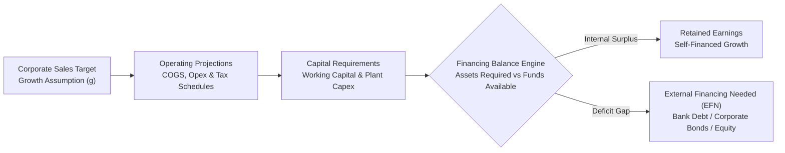
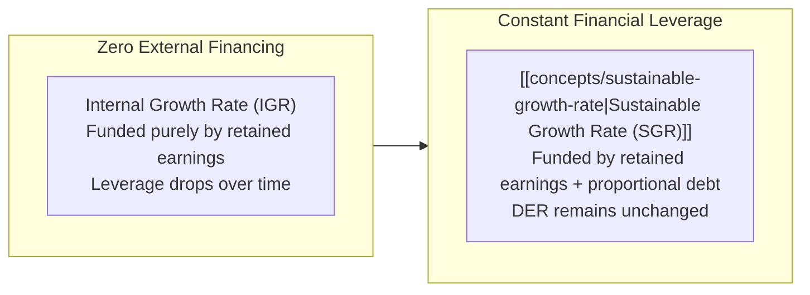

> [!NOTE] Curricular & Faculty Metadata
>
> - **Course:** MK2 Financial Management and Strategy — Week 03
> - **Teaching Team:** Dr. Arif Zamani (Lead Lecturer), Dr. Subiakto Soekarno, Dr. Aswin Rahadi, Yunieta Anny Nainggolan Ph.D., Oktofa Yudha Sudrajat Ph.D.
> - **Primary Curricular Spine:** `Materi Week 3 - MK02.pdf` (Dr. Arif Zamani)
> - **Direct Satellites & Problem Sets:**
>   - [[courses/mk2-financial-management-strategy/week-03/case-indofood-financial-projections|Model Case Dossier: 5-Year Financial Projection of PT Indofood Sukses Makmur Tbk]]

## 1. Executive Overview: Forecasting as Strategic Resource Architecture

A corporate strategy without a financial projection is merely an aspiration. Enterprise expansion—launching product lines, commissioning manufacturing plants, or entering export markets—requires capital before it generates cash receipts. If a business grows faster than its internal financing capacity without securing external capital, it faces the paradox of **growth-induced insolvency** (overtrading).

Financial forecasting provides executive leadership with three essential capabilities:

1. **Capital Requirement Sizing**: Determining exactly how much new cash is required to fund working capital and fixed asset additions.
2. **Financing Feasibility Testing**: Evaluating whether required funds can be raised through debt without breaching leverage covenants or whether equity dilution is necessary.
3. **Strategic Scenario Stress-Testing**: Assessing corporate resilience under margin compression, interest rate hikes, or slowing economic growth.

---

## 2. Theoretical Architecture: The Percent-of-Sales Forecasting Method

The **Percent-of-Sales Method** is the foundational corporate forecasting technique. It assumes that key operational costs and balance sheet accounts maintain a direct, stable relationship with net sales volume.

### Step-by-Step Forecasting Methodology

1. **Sales Growth Anchor**: Establish the forward net sales trajectory based on macroeconomic growth (GDP), industry expansion, and historical compound annual growth rates (CAGR):
   $$S_{t+1} = S_t \times (1 + g)$$
2. **Spontaneous Cost Modeling**: Express operating expenses (Cost of Goods Sold, Selling & Distribution, General & Administrative) as historical percentages of net sales.
3. **Pro-Forma Income Statement**: Deduct projected operating costs, calculate depreciation and interest expenses, apply statutory corporate tax ($22\%$ in Indonesia), and derive Projected Net Income.
4. **Dividend Payout and Retained Earnings**: Allocate projected net income between dividends ($d$) and retained additions to equity ($b = 1 - d$):
   $$\Delta \text{Retained Earnings} = \text{Projected Net Income} \times (1 - d)$$
5. **Asset and Liability Sizing**: Scale spontaneous operating assets (receivables, inventory) and spontaneous liabilities (accounts payable, accrued expenses) with sales growth.
6. **Determine External Financing Needed ($\text{EFN}$)**.

---

## 3. The External Financing Needed (EFN) Equation

The $\text{EFN}$ equation isolates the exact cash shortfall that management must fund through external debt or new equity issuance:

$$\mathbf{\text{EFN} = \underbrace{\left(\frac{A^*}{S_0}\right) \Delta S}_{\text{Required Asset Expansion}} - \underbrace{\left(\frac{L^*}{S_0}\right) \Delta S}_{\text{Spontaneous Liability Funding}} - \underbrace{\left(M \times S_1 \times (1 - d)\right)}_{\text{Internal Retained Earnings Addition}}}$$

Where:

- $A^* / S_0$: Capital intensity ratio (assets that increase spontaneously with sales divided by base sales).
- $L^* / S_0$: Spontaneous liabilities ratio (payables and accruals that expand spontaneously with sales divided by base sales).
- $\Delta S$: Projected increase in annual sales ($S_1 - S_0$).
- $S_1$: Forecasted total sales for the coming period ($S_0 \times (1 + g)$).
- $M$: Projected net profit margin ($\text{Net Income} / S_1$).
- $d$: Dividend payout ratio ($\text{Dividends} / \text{Net Income}$); $(1 - d)$ is the retention ratio ($b$).

### Three Strategic Scenarios for EFN

- **$\text{EFN} > 0$ (Financing Deficit)**: Operations require more capital than internal cash generation provides. Management must secure new bank lines, issue commercial paper/bonds, or issue equity.
- **$\text{EFN} = 0$ (Balanced Equilibrium)**: Sales grow at precisely the rate that retained earnings can support.
- **$\text{EFN} < 0$ (Cash Surplus)**: Internal cash generation exceeds operational reinvestment needs. The enterprise builds cash reserves, retires outstanding debt, or expands dividend payouts.

---

## 4. Growth Limits: Internal vs [[concepts/sustainable-growth-rate|Sustainable Growth Rate]]s

Unconstrained growth can destroy enterprise value if return on capital falls below financing costs. Corporate finance defines two mathematical boundaries for growth:

### 1. Internal Growth Rate (IGR)

The maximum sales growth rate achievable **without any external financing** (neither debt nor equity), where growth is funded solely by retained earnings:

$$\mathbf{\text{IGR} = \frac{\text{ROA} \times b}{1 - (\text{ROA} \times b)}}$$

### 2. [[concepts/sustainable-growth-rate|Sustainable Growth Rate (SGR)]]

The maximum sales growth rate achievable **without issuing new equity**, while maintaining a **constant Debt-to-Equity Ratio (DER)** and constant dividend payout policy:

$$\mathbf{\text{SGR} = \frac{\text{ROE} \times b}{1 - (\text{ROE} \times b)}}$$

$$\mathbf{\text{SGR} = \frac{\text{Profit Margin} \times \text{Asset Turnover} \times \text{Equity Multiplier} \times b}{1 - (\text{Profit Margin} \times \text{Asset Turnover} \times \text{Equity Multiplier} \times b)}}$$

### The Four Managerial Levers to Accelerate Sustainable Growth

If executive management targets a sales growth rate exceeding the current $\text{SGR}$, it must pull at least one of four structural levers:

1. **Improve Profit Margin ($M$)**: Increase pricing power, optimize procurement, or reduce SG&A overhead.
2. **Accelerate Asset Velocity ($S/A$)**: Reduce working capital tie-up (shorten cash conversion cycle) or divest underperforming capital assets.
3. **Increase Financial Leverage ($A/E$)**: Take on additional debt up to safe covenant boundaries.
4. **Reduce Dividend Payout ($d$)**: Retain a higher proportion of annual net earnings ($b$).

---

## 📚 Direct Satellite Notes

- [[courses/mk2-financial-management-strategy/week-03/case-indofood-financial-projections|Model Case Dossier: 5-Year Financial Projection of PT Indofood Sukses Makmur Tbk]]: Comprehensive 2026–2030 pro-forma financial statement model, percent-of-sales cost calibration, and cash flow sensitivity analysis.

---

## 🔗 Knowledge Graph & Curriculum Bridges

- **Featured Concepts in Knowledge Matrix**:
  - [[concepts/sustainable-growth-rate|Sustainable Growth Rate Framework]]
  - [[concepts/dupont-analysis|DuPont Analysis]]
- **Enterprise Profiles**:
  - [[entities/pt-indofood-sukses-makmur|PT Indofood Sukses Makmur Tbk]]
- **Previous Curricular Module**: [[courses/mk2-financial-management-strategy/week-02/index|Week 02: Financial Statement Analysis & Ratio Decomposition]]
- **Next Curricular Module**: [[courses/mk2-financial-management-strategy/week-04/index|Week 04: Management Accounting & [[concepts/job-order-costing|Job-Order Costing]]]]
- Return to **[[courses/mk2-financial-management-strategy/index|MK 2 Course Overview]]**
