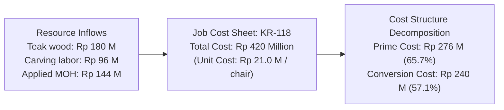
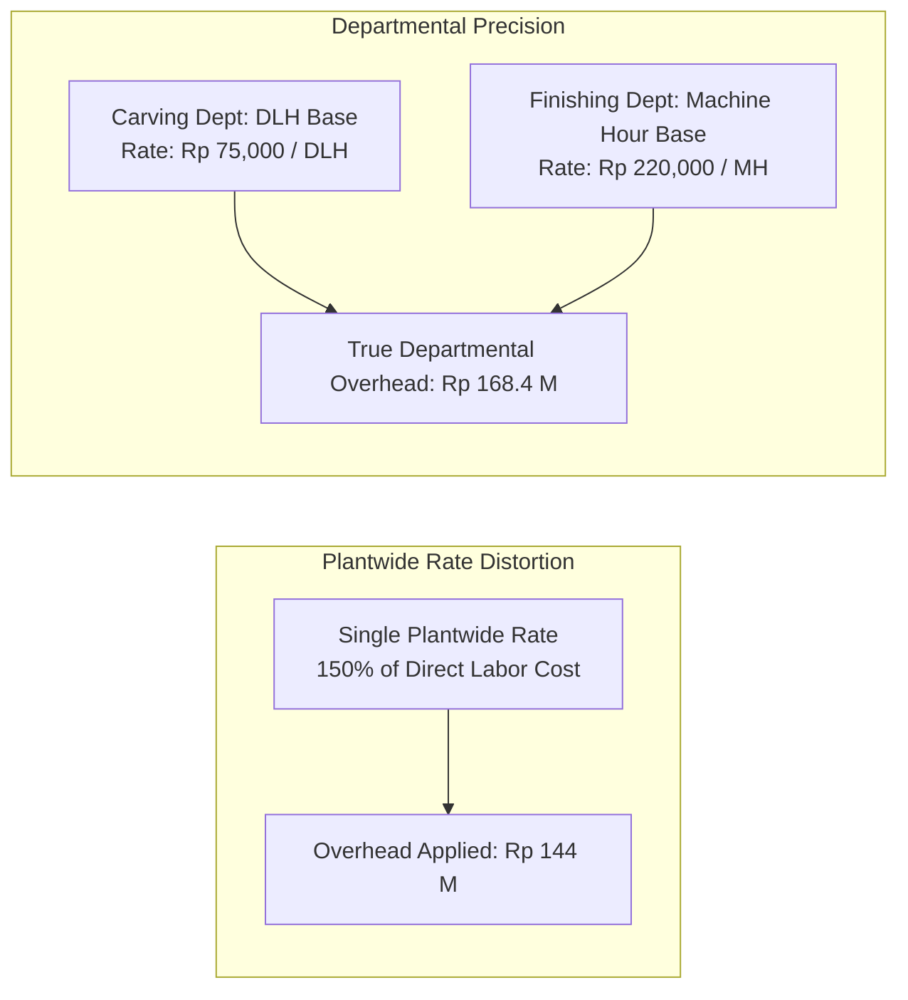

> [!NOTE] Cohort Attribution & Problem Setup
>
> - **Course:** MK2 Financial Management and Strategy — Week 04
> - **Case Entity:** Nusantara CraftWorks (Custom Artisan & Teak Resort Furniture)
> - **Analytical Contribution:** Synthesized from the worked cost models of **`F9 (Class F / Syndicate 9)`**.
> - **Job Under Review:** Job KR-118 (Contract for 20 custom hand-carved teak dining chairs for a luxury Bali resort).

## 1. Executive Summary & Production Crucible

Nusantara CraftWorks is a high-end Indonesian furniture manufacturer based in Central Java that combines traditional Jepara wood-carving craftsmanship with modern semi-automated finishing. Management recently faced a strategic pricing dispute: a major hospitality client ordered **20 custom luxury teak dining chairs (Job KR-118)**.

While the sales team applied standard percentage markups, the CFO suspected that custom orders were absorbing excessive overhead and undercutting the company’s operating profitability.

---

## 2. Comprehensive Cost Classification Matrix (Job KR-118)

Management accounting requires classifying costs along three distinct dimensions: direct vs indirect, manufacturing function, and product vs period timing:

| Cost Item Description                                      | Direct / Indirect |     Functional Area      | Product / Period Cost | Economic & Accounting Rationale                                                                  |
| :--------------------------------------------------------- | :---------------: | :----------------------: | :-------------------: | :----------------------------------------------------------------------------------------------- |
| **Grade-A Teak wood lumber for 20 chairs**                 |      Direct       |      Manufacturing       |      **Product**      | Physically traceable raw material incorporated directly into Job KR-118.                         |
| **Master carpenters' and carvers' wages**                  |      Direct       |      Manufacturing       |      **Product**      | Traced directly to Job KR-118 via individual shop-floor time tickets.                            |
| **Sandpaper, wood dowels, and industrial glue**            |     Indirect      |      Manufacturing       |   **Product (MOH)**   | Consumed across multiple jobs; economically insignificant to trace to individual chairs.         |
| **Client-specified gold-leaf lacquer finish**              |      Direct       |      Manufacturing       |      **Product**      | Specialized finishing material purchased specifically and solely for Job KR-118.                 |
| **Factory production supervisor monthly salary**           |     Indirect      |      Manufacturing       |   **Product (MOH)**   | Supervisory labor overseeing overall factory operations; not traceable to KR-118.                |
| **Depreciation on carving and CNC machinery**              |     Indirect      |      Manufacturing       |   **Product (MOH)**   | Capital asset consumption allocated across all jobs using machine capacity.                      |
| **Electricity for shared factory floor**                   |     Indirect      |      Manufacturing       |   **Product (MOH)**   | Shared facility power running lighting, exhaust fans, and general machinery.                     |
| **Sales commission paid for securing the resort contract** |      Direct       |   Selling / Commercial   |      **Period**       | Traceable to Job KR-118, but selling costs are never capitalized into inventory under PSAK/GAAP. |
| **Outbound flatbed freight delivery to Bali resort**       |      Direct       | Distribution / Logistics |      **Period**       | Post-production transportation; expensed immediately as a selling and freight cost.              |
| **Showroom administrative staff compensation**             |     Indirect      | General & Administrative |      **Period**       | Corporate overhead supporting general brand presence; independent of factory production.         |

---

## 3. Prime Cost and Conversion Cost Calculations

$$\mathbf{\text{Prime Cost} = \text{Direct Materials} + \text{Direct Labor} = \text{Rp } 180,000,000 + \text{Rp } 96,000,000 = \mathbf{\text{Rp } 276,000,000}}$$

$$\mathbf{\text{Conversion Cost} = \text{Direct Labor} + \text{Manufacturing Overhead} = \text{Rp } 96,000,000 + \text{Rp } 144,000,000 = \mathbf{\text{Rp } 240,000,000}}$$

$$\mathbf{\text{Total Manufacturing Cost (Job KR-118)} = \text{Rp } 180\text{M} + \text{Rp } 96\text{M} + \text{Rp } 144\text{M} = \mathbf{\text{Rp } 420,000,000}}$$

$$\mathbf{\text{Unit Manufacturing Cost}} = \frac{\text{Rp } 420,000,000}{20\text{ chairs}} = \mathbf{\text{Rp } 21,000,000\text{ per chair}}$$

---

## 4. Predetermined Overhead Rates (POHR): Plantwide vs Departmental

Nusantara CraftWorks traditionally applied a single **plantwide overhead rate** based on Direct Labor Cost ($\text{POHR} = 150\%$ of direct labor). Because Job KR-118 incurred Rp 96 million of direct labor, applied overhead equaled $\text{Rp } 96\text{M} \times 1.50 = \text{Rp } 144\text{M}$.

However, the workshop operates two fundamentally different departments:

1. **Carving Department**: Highly labor-intensive (master carvers with chisels).
2. **Finishing & Assembly Department**: Highly capital-intensive (automated spray booths and curing ovens).

### The Cost Distortion Finding

When re-calculated under departmental rates:

- Carving Department overhead: $\text{Rp } 72,000,000$
- Finishing Department overhead: $\text{Rp } 96,400,000$
- **True Departmental Overhead**: **Rp 168,400,000** (versus Rp 144,000,000 applied under the plantwide rate).

Under plantwide costing, **Job KR-118 was undercosted by Rp 24.4 million**. Nusantara CraftWorks was undercharging the resort client, mistakenly believing custom carving orders were more profitable than they actually were.

---

## 5. Year-End Overhead Disposition & Audit Settlement

At fiscal year-end, actual manufacturing overhead totaled **Rp 1,820,000,000**, while total applied overhead across all jobs equaled **Rp 1,750,000,000**:

$$\mathbf{\text{Underapplied Overhead} = \text{Actual MOH} - \text{Applied MOH} = \text{Rp } 1,820\text{M} - \text{Rp } 1,750\text{M} = \mathbf{\text{Rp } 70,000,000}}$$

### Accounting Settlement

Because the Rp 70 million variance is immaterial relative to annual sales, management closes the underapplied overhead balance directly to **Cost of Goods Sold (COGS)**:

- **Debit**: Cost of Goods Sold (Rp 70,000,000)
- **Credit**: Manufacturing Overhead Control (Rp 70,000,000)

This increases annual COGS and reduces reported pre-tax operating income, ensuring reported earnings accurately reflect actual cash outlays incurred on the factory floor.

---

## 🔗 Related Notes

- Master Hub: [[courses/mk2-financial-management-strategy/week-04/index|Week 04: Management Accounting Fundamentals]]
- Next Module: [[courses/mk2-financial-management-strategy/week-05/index|Week 05: Cost Analysis & [[concepts/activity-based-costing|Activity-Based Costing (ABC)]]]]
- Theoretical Concept: [[concepts/job-order-costing|Job-Order Costing Architecture]]
