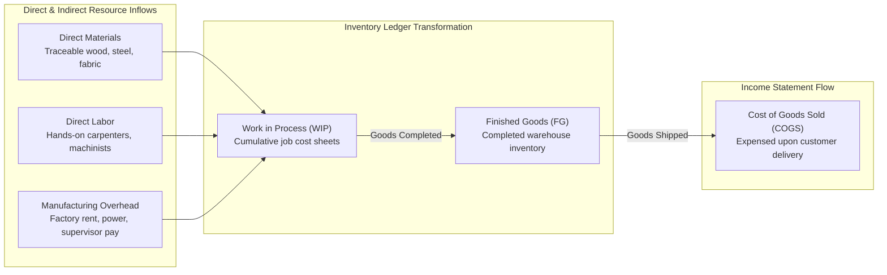
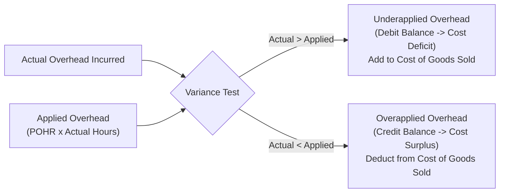

> [!NOTE] Curricular & Faculty Metadata
>
> - **Course:** MK2 Financial Management and Strategy — Week 04
> - **Teaching Team:** Dr. Arif Zamani (Lead Lecturer), Dr. Subiakto Soekarno, Dr. Aswin Rahadi, Yunieta Anny Nainggolan Ph.D., Oktofa Yudha Sudrajat Ph.D.
> - **Primary Curricular Spine:** `[P3MD] Week 4 MK02.pdf` (Dr. Arif Zamani)
> - **Direct Satellites & Problem Sets:**
>   - [[courses/mk2-financial-management-strategy/week-04/case-nusantara-craftworks|Model Case Study: Nusantara CraftWorks Job Costing & POHR]]

## 1. Executive Overview: Cost Information as an Operational Compass

While financial accounting records transactions for external stakeholders (investors, tax authorities, and regulators) under strict GAAP/PSAK compliance, **management accounting provides internal decision-support architecture for executive leaders**.

Management accounting answers three operational dilemmas:

1. **Product Pricing & Profitability**: What does it actually cost to produce one unit of a customized good or service?
2. **Cost Control & Responsibility Accounting**: Where are resources being wasted across manufacturing and administrative functions?
3. **Capacity Allocation**: Which jobs, clients, or production lines generate surplus margins, and which destroy economic value?

| Dimension              | Financial Accounting                        | Managerial Accounting                                      |
| :--------------------- | :------------------------------------------ | :--------------------------------------------------------- |
| **Primary Audience**   | External: Shareholders, creditors, OJK, tax | Internal: Directors, plant managers, CFO, project leads    |
| **Regulatory Mandate** | Strict PSAK / IFRS / statutory GAAP rules   | No external rules; optimized purely for decision relevance |
| **Time Horizon**       | Historical (backward-looking audit trail)   | Present and Future (forward-looking operational budgets)   |
| **Data Aggregation**   | Highly aggregated company-wide statements   | Granular: by product, job batch, department, or customer   |

---

## 2. Theoretical Architecture: Cost Classifications & Manufacturing Flows

### The Tripartite Manufacturing Cost Structure

$$\mathbf{\text{Total Manufacturing Cost} = \text{Direct Materials (DM)} + \text{Direct Labor (DL)} + \text{Manufacturing Overhead (MOH)}}$$

$$\mathbf{\text{Prime Cost} = \text{Direct Materials} + \text{Direct Labor}} \qquad \mathbf{\text{Conversion Cost} = \text{Direct Labor} + \text{Manufacturing Overhead}}$$

### Product vs Period Costs

- **Product Costs (Inventoriable Costs)**: Costs involved in acquiring or making a product. They attach to inventory on the balance sheet until goods are sold, then transfer to Cost of Goods Sold.
- **Period Costs (Operating Expenses)**: Non-manufacturing costs (Selling, General & Administrative). They are expensed immediately on the income statement in the period incurred.

---

## 3. [[concepts/job-order-costing|Job-Order Costing]] & Predetermined Overhead Rates (POHR)

[[concepts/job-order-costing|Job-order costing]] is deployed when products are manufactured in distinct batches or customized specifications (e.g., custom furniture, construction projects, aircraft assembly, legal advisory mandates).

Because actual manufacturing overhead (factory rent, utility bills, maintenance) fluctuates irregularly across seasons and is not known until period-end, management applies overhead to jobs using a **Predetermined Overhead Rate (POHR)**:

$$\mathbf{\text{POHR} = \frac{\text{Estimated Total Manufacturing Overhead Cost for the Period}}{\text{Estimated Total Allocation Base for the Period}}}$$

Common allocation bases include **Direct Labor Hours (DLH)**, **Direct Labor Cost (DLC)**, and **Machine Hours (MH)**.

### Overhead Application Mechanics

$$\mathbf{\text{Applied Overhead} = \text{POHR} \times \text{Actual Quantity of Allocation Base Consumed by Job}}$$

### Underapplied vs Overapplied Overhead

At the close of an accounting period, applied overhead rarely equals actual overhead incurred:

$$\mathbf{\text{Overhead Variance} = \text{Actual Overhead Incurred} - \text{Applied Overhead}}$$

1. **Underapplied Overhead ($\text{Actual} > \text{Applied}$)**: Costs were underestimated during the year. COGS is debited (increased), reducing reported net income.
2. **Overapplied Overhead ($\text{Actual} < \text{Applied}$)**: Costs were overestimated during the year. COGS is credited (decreased), increasing reported net income.

---

## 4. Managerial Crucible: Plantwide vs Departmental Rates

Using a single **plantwide overhead rate** assumes all jobs consume indirect factory resources in identical proportions. In complex manufacturing operations:

- A **labor-intensive department** (e.g., hand-carving or custom embroidery) should allocate overhead based on Direct Labor Hours.
- A **capital-intensive department** (e.g., automated CNC cutting or laser finishing) should allocate overhead based on Machine Hours.

Forcing a single plantwide rate causes **cost distortion**: simple, standardized jobs over-subsidize complex, custom jobs, leading to uncompetitive pricing and lost bids.

---

## 📚 Direct Satellite Notes

- [[courses/mk2-financial-management-strategy/week-04/case-nusantara-craftworks|Model Case Study: Nusantara CraftWorks Job Costing & POHR]]: Complete worked job cost sheet (Job KR-118), prime/conversion cost analysis, plantwide vs departmental POHR reconciliation, and underapplied overhead closing.

---

## 🔗 Knowledge Graph & Curriculum Bridges

- **Featured Concept in Knowledge Matrix**:
  - [[concepts/job-order-costing|Job-Order Costing Architecture]]
- **Next Curricular Module**: [[courses/mk2-financial-management-strategy/week-05/index|Week 05: Cost Analysis & [[concepts/activity-based-costing|Activity-Based Costing (ABC)]]]]
- Return to **[[courses/mk2-financial-management-strategy/index|MK 2 Course Overview]]**
