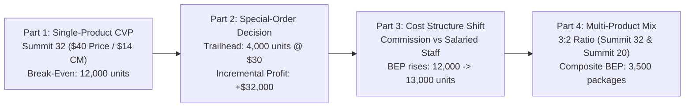
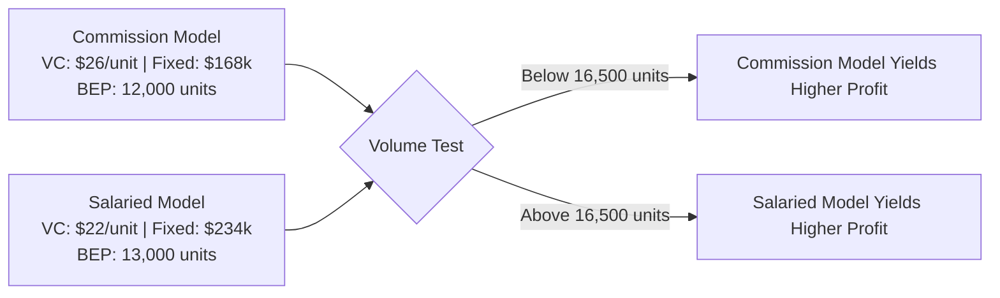

> [!NOTE] Cohort Attribution & Case Background
>
> - **Course:** MK2 Financial Management and Strategy — Week 05
> - **Case Entity:** Alpine Ridge Outfitters (Technical Outdoor Equipment)
> - **Analytical Contribution:** Synthesized from the multi-product CVP models of **`F9 (Class F / Syndicate 9)`**.
> - **Core Products:** Summit 32 Technical Backpack & Summit 20 Daypack.

## 1. Executive Summary & Cost Structure Profile

Alpine Ridge Outfitters manufactures premium technical outdoor gear. The company is evaluating key strategic initiatives for its flagship **Summit 32 backpack**: evaluating pricing discipline, sizing a special-order discount from a national retail chain, assessing a structural transition from commissioned sales agents to an in-house salaried sales team, and modeling multi-product break-even thresholds.

---

## 2. Part 1: Single-Product Baseline Economics (Summit 32)

### Baseline Unit Economics

- **Selling Price ($P$)**: **$40.00 per unit**
- **Direct Materials**: $12.00
- **Direct Labor**: $6.00
- **Variable Manufacturing Overhead**: $4.00
- **Sales Commission (10% of Selling Price)**: $4.00
- **Total Variable Cost ($V$)**: **$26.00 per unit**
- **Unit Contribution Margin ($CM$)**: $\mathbf{\$14.00}$ ($\text{CM Ratio} = 35.0\%$)
- **Annual Fixed Expenses**: **$168,000**
- **Current Annual Sales Volume**: **15,000 units**

### Break-Even and Safety Metrics

$$\mathbf{\text{BEP}_{\text{units}}} = \frac{\$168,000}{\$14.00} = \mathbf{12,000\text{ units}} \qquad \mathbf{\text{BEP}_{\text{sales}}} = \frac{\$168,000}{0.35} = \mathbf{\$480,000}$$

$$\mathbf{\text{Operating Income at 15,000 units}} = (15,000 \times \$14) - \$168,000 = \mathbf{\$42,000}$$

$$\mathbf{\text{Margin of Safety (MoS)}} = 15,000 - 12,000 = \mathbf{3,000\text{ units (\$120,000 or 20.0\%)Cent}}$$

$$\mathbf{\text{Degree of Operating Leverage (DOL)}} = \frac{\text{Total Contribution Margin}}{\text{Operating Income}} = \frac{15,000 \times \$14}{\$42,000} = \mathbf{5.0\text{x}}$$

A $\text{DOL}$ of $5.0\text{x}$ indicates that a $10\%$ increase in sales volume produces a **$50\%$ surge in operating income** (from \$42,000 to \$63,000). Conversely, a $20\%$ drop in volume completely wipes out operating profit.

---

## 3. Part 2: Special-Order Opportunity (Trailhead Provisions)

Trailhead Provisions requested a one-time special order for **4,000 units of the Summit 32 at \$30.00 per unit** (a 25% discount). Alpine Ridge possesses sufficient idle factory capacity, and the order will not cannibalize regular retail sales.

| Cost Component per Unit    | Regular Sales | Special Order | Relevant / Irrelevant Rationale                          |
| :------------------------- | :-----------: | :-----------: | :------------------------------------------------------- |
| **Selling Price**          |  **$40.00**   |  **$30.00**   | Relevant incremental revenue                             |
| Direct Materials           |   ($12.00)    |   ($12.00)    | Relevant incremental cash outlay                         |
| Direct Labor               |    ($6.00)    |    ($6.00)    | Relevant incremental cash outlay                         |
| Variable MOH               |    ($4.00)    |    ($4.00)    | Relevant incremental cash outlay                         |
| Sales Commission           |    ($4.00)    |   **$0.00**   | **Irrelevant**: Order bypasses commissioned sales agents |
| **Net Incremental Margin** |  **$14.00**   |  **+$8.00**   | **Positive Contribution Margin**                         |

$$\mathbf{\text{Total Incremental Profit Contribution}} = 4,000\text{ units} \times \$8.00 = \mathbf{+\$32,000}$$

**Decision**: **Accept the special order**. The order yields \$32,000 of incremental operating profit while utilizing existing fixed capacity.

---

## 4. Part 3: Strategic Cost Structure Shift (Salaried Sales Team)

Management evaluated replacing external commissioned agents with an in-house salaried sales team costing **\$66,000 in fixed annual salaries**, eliminating the \$4.00/unit variable commission:

### Comparative Structural Matrix

| Operational Metric                   | Current Commission Model | Proposed Salaried Model | Strategic Consequence                           |
| :----------------------------------- | :----------------------: | :---------------------: | :---------------------------------------------- |
| **Unit Selling Price**               |          $40.00          |         $40.00          | Unchanged                                       |
| **Unit Variable Cost**               |          $26.00          |       **$22.00**        | Drops by \$4.00                                 |
| **Unit Contribution Margin**         |          $14.00          |       **$18.00**        | Expands by \$4.00                               |
| **Annual Fixed Costs**               |         $168,000         |      **$234,000**       | Increases by \$66,000                           |
| **Break-Even Volume**                |     **12,000 units**     |    **13,000 units**     | Higher operating risk                           |
| **Operating Income at 15,000 units** |       **$42,000**        |       **$36,000**       | **Commission model is \$6,000 more profitable** |

### Indifference Volume Calculation

$$\mathbf{Q_{\text{indifference}} = \frac{\Delta \text{Fixed Costs}}{\Delta \text{Unit CM}} = \frac{\$234,000 - \$168,000}{\$18.00 - \$14.00} = \frac{\$66,000}{\$4.00} = \mathbf{16,500\text{ units}}}$$

- At current volume (15,000 units), the commission model is superior.
- Only if annual volume expands beyond **16,500 units** does the in-house salaried team become more profitable.

---

## 5. Part 4: Multi-Product Sales Mix Break-Even Analysis

Alpine Ridge also produces the **Summit 20 Daypack** ($P = \$25, V = \$15, CM = \$10$). Products sell in a constant **3:2 sales mix** (3 Summit 32 for every 2 Summit 20). Combined company fixed costs total **\$217,000**.

### The Composite Package Architecture

1. **Package Content**: $(3 \times \text{Summit 32}) + (2 \times \text{Summit 20}) = 5\text{ physical units}$.
2. **Package Revenue**: $(3 \times \$40) + (2 \times \$25) = \$120 + \$50 = \mathbf{\$170.00}$.
3. **Package Contribution Margin**: $(3 \times \$14) + (2 \times \$10) = \$42 + \$20 = \mathbf{\$62.00}$.
4. **Weighted-Average CM Ratio**: $\$62.00 / \$170.00 = \mathbf{36.47\%}$.

$$\mathbf{\text{Break-Even Composite Packages}} = \frac{\$217,000}{\$62.00\text{ per package}} = \mathbf{3,500\text{ composite packages}}$$

$$\mathbf{\text{Break-Even Physical Units}} = 3,500 \times 5 = \mathbf{17,500\text{ units}} \quad \begin{cases} \text{Summit 32 (3)}: 10,500\text{ units} \\ \text{Summit 20 (2)}: 7,000\text{ units} \end{cases}$$

$$\mathbf{\text{Break-Even Sales Revenue}} = 3,500 \times \$170.00 = \mathbf{\$595,000}$$

At actual sales of 25,000 units (15,000 Summit 32 + 10,000 Summit 20 = \$850,000 revenue), the **Margin of Safety is 7,500 units (\$255,000 or 30.0%)**.

---

## 🔗 Related Notes

- Master Hub: [[courses/mk2-financial-management-strategy/week-05/index|Week 05: Cost Analysis, CVP & ABC]]
- Parallel Case: [[courses/mk2-financial-management-strategy/week-05/case-nirmala-print-abc|Nirmala Print & Packaging ABC Case]]
- Theoretical Concept: [[concepts/cost-volume-profit-analysis|Cost-Volume-Profit Analysis Framework]]
