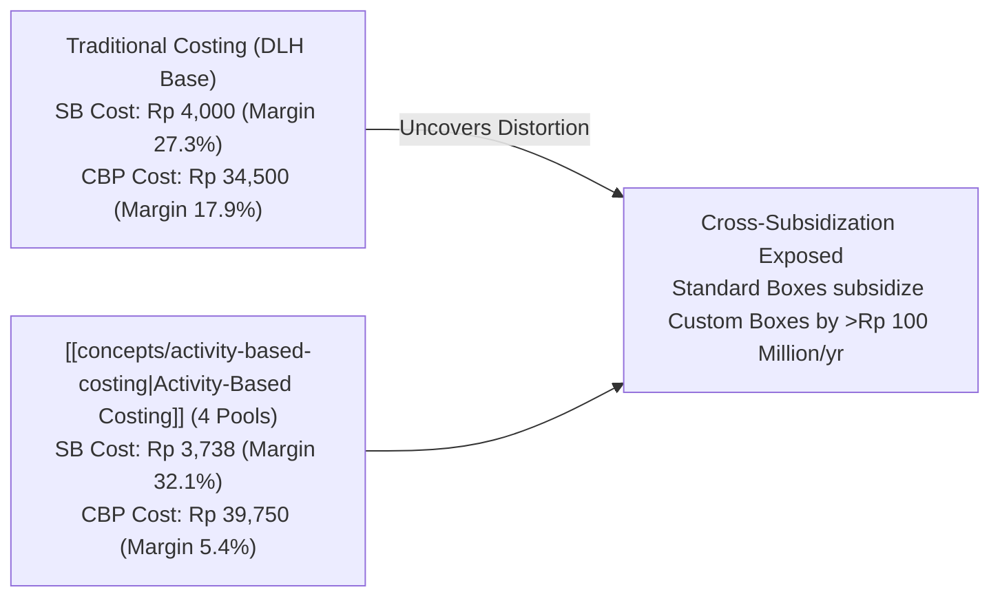
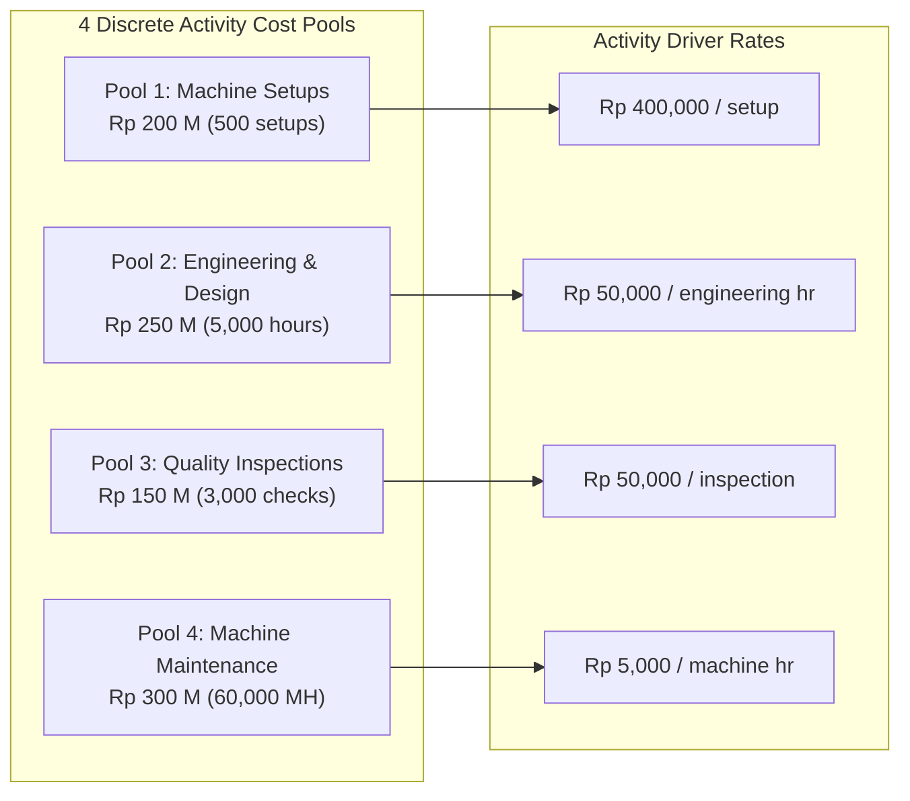
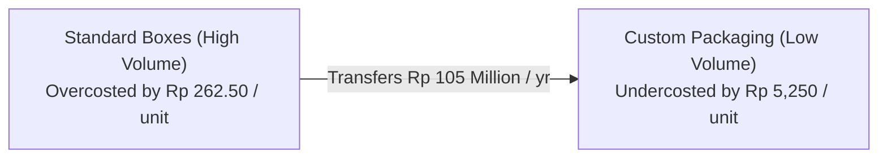

> [!NOTE] Cohort Attribution & Case Foundations
>
> - **Course:** MK2 Financial Management and Strategy — Week 05
> - **Case Entity:** Nirmala Print & Packaging (Industrial Printing & Packaging Solutions)
> - **Analytical Contribution:** Synthesized from the comparative ABC cost models of **`F9 (Class F / Syndicate 9)`**.
> - **Product Lines:** Standard Boxes (SB - High Volume) vs Custom Branded Packaging (CBP - Low Volume).

## 1. Executive Summary & The Cost Distortion Dilemma

Nirmala Print & Packaging operates an industrial printing and container manufacturing facility in West Java. The company produces two distinct product lines:

1. **Standard Boxes (SB)**: High-volume, standardized corrugated packaging produced for fast-moving consumer goods manufacturers (**400,000 units/year**).
2. **Custom Branded Packaging (CBP)**: Low-volume, luxury embossed, specialty packaging for cosmetics and artisan exporters (**20,000 units/year**).

Management faced a pricing crisis: low-cost competitors were aggressively underbidding Nirmala on standard boxes, while luxury clients inundated the plant with complex custom orders that management believed were highly profitable.

---

## 2. The Traditional Volume-Based Costing System

Under the existing system, Nirmala applies total annual manufacturing overhead of **Rp 900,000,000** using a single plantwide rate based on **Direct Labor Hours (DLH)**:

$$\mathbf{\text{Plantwide POHR} = \frac{\text{Total Estimated MOH}}{\text{Total Direct Labor Hours}} = \frac{\text{Rp } 900,000,000}{60,000\text{ DLH}} = \mathbf{\text{Rp } 15,000\text{ per DLH}}}$$

- **Standard Boxes (SB)**: $0.08\text{ DLH/unit} \times 400,000\text{ units} = 32,000\text{ DLH}$ ($53.3\%$ of total labor).
- **Custom Packaging (CBP)**: $1.40\text{ DLH/unit} \times 20,000\text{ units} = 28,000\text{ DLH}$ ($46.7\%$ of total labor).

### Traditional Unit Cost & Margin Structure

| Financial Line Item                               |       Standard Boxes (SB)       |  Custom Branded Packaging (CBP)  |
| :------------------------------------------------ | :-----------------------------: | :------------------------------: |
| **Annual Production Volume**                      |        **400,000 units**        |         **20,000 units**         |
| **Direct Materials per Unit**                     |            Rp 2,000             |             Rp 9,000             |
| **Direct Labor per Unit**                         |             Rp 800              |             Rp 4,500             |
| **Applied Overhead ($15,000 \times \text{DLH}$)** | Rp 1,200 ($0.08 \times 15,000$) | Rp 21,000 ($1.40 \times 15,000$) |
| **Total Unit Product Cost**                       |          **Rp 4,000**           |          **Rp 34,500**           |
| **Unit Selling Price**                            |          **Rp 5,500**           |          **Rp 42,000**           |
| **Gross Margin per Unit**                         |          **Rp 1,500**           |           **Rp 7,500**           |
| **Gross Margin Percentage**                       |           **27.27%**            |            **17.86%**            |
| **Total Annual Gross Profit**                     |       **Rp 600,000,000**        |        **Rp 150,000,000**        |

Under traditional costing, management concluded that CBP generated a massive rupiah gross margin of Rp 7,500 per unit, justifying aggressive sales pursuit.

---

## 3. The [[concepts/activity-based-costing|Activity-Based Costing (ABC)]] Model

An engineering audit decomposed the Rp 900 million overhead into four discrete activity cost pools, identifying the causal cost drivers:

### Activity Pool Rates & Driver Consumption

| Activity Cost Pool         |  Total Pool Cost   | Cost Driver Metric | Total Driver Capacity |  Activity Driver Rate  |  SB Driver Qty  |   CBP Driver Qty   |
| :------------------------- | :----------------: | :----------------- | :-------------------: | :--------------------: | :-------------: | :----------------: |
| **1. Machine Setups**      |   Rp 200,000,000   | Number of Setups   |      500 setups       | **Rp 400,000 / setup** |  100 ($20\%$)   |  **400 ($80\%$)**  |
| **2. Engineering Support** |   Rp 250,000,000   | Engineering Hours  |      5,000 hours      |  **Rp 50,000 / hour**  | 1,000 ($20\%$)  | **4,000 ($80\%$)** |
| **3. Quality Inspection**  |   Rp 150,000,000   | Inspection Checks  |     3,000 checks      | **Rp 50,000 / check**  |  900 ($30\%$)   | **2,100 ($70\%$)** |
| **4. Machine Running**     |   Rp 300,000,000   | Machine Hours      |       60,000 MH       |   **Rp 5,000 / MH**    | 48,000 ($80\%$) |  12,000 ($20\%$)   |
| **Total Factory Overhead** | **Rp 900,000,000** |                    |                       |                        |                 |                    |

### Assignment of Overhead under ABC

| Activity Cost Pool           |                    Standard Boxes (SB)                    |              Custom Branded Packaging (CBP)               |
| :--------------------------- | :-------------------------------------------------------: | :-------------------------------------------------------: |
| **Machine Setups**           |  $100 \times \text{Rp } 400,000 = \text{Rp } 40,000,000$  | $400 \times \text{Rp } 400,000 = \text{Rp } 160,000,000$  |
| **Engineering & Design**     | $1,000 \times \text{Rp } 50,000 = \text{Rp } 50,000,000$  | $4,000 \times \text{Rp } 50,000 = \text{Rp } 200,000,000$ |
| **Quality Inspection**       |  $900 \times \text{Rp } 50,000 = \text{Rp } 45,000,000$   | $2,100 \times \text{Rp } 50,000 = \text{Rp } 105,000,000$ |
| **Machine Running**          | $48,000 \times \text{Rp } 5,000 = \text{Rp } 240,000,000$ | $12,000 \times \text{Rp } 5,000 = \text{Rp } 60,000,000$  |
| **Total Assigned Overhead**  |                    **Rp 375,000,000**                     |                    **Rp 525,000,000**                     |
| **Annual Production Volume** |                       400,000 units                       |                       20,000 units                        |
| **Overhead Cost per Unit**   |                       **Rp 937.50**                       |                     **Rp 26,250.00**                      |

---

## 4. Head-to-Head Comparison: Revealing the Cross-Subsidization

$$\mathbf{\text{True ABC Unit Cost (SB)}} = \text{Rp } 2,000\text{ (DM)} + \text{Rp } 800\text{ (DL)} + \text{Rp } 937.50\text{ (OH)} = \mathbf{\text{Rp } 3,737.50}$$

$$\mathbf{\text{True ABC Unit Cost (CBP)}} = \text{Rp } 9,000\text{ (DM)} + \text{Rp } 4,500\text{ (DL)} + \text{Rp } 26,250.00\text{ (OH)} = \mathbf{\text{Rp } 39,750.00}$$

| Product Line               | Traditional Unit Cost |  ABC Unit Cost   |        Variance per Unit        | Traditional Margin % | True ABC Margin % | Strategic Reality                                                                           |
| :------------------------- | :-------------------: | :--------------: | :-----------------------------: | :------------------: | :---------------: | :------------------------------------------------------------------------------------------ |
| **Standard Boxes (SB)**    |      Rp 4,000.00      | **Rp 3,737.50**  |  **-Rp 262.50 (Over-costed)**   |      $27.27\%$       |    **32.05%**     | **Subsidizer**: Highly profitable cash cow; company was overpricing in competitive tenders. |
| **Custom Packaging (CBP)** |     Rp 34,500.00      | **Rp 39,750.00** | **+Rp 5,250.00 (Under-costed)** |      $17.86\%$       |     **5.36%**     | **Subsidized**: Barely breaking even after consuming 80% of engineering and setup capacity. |

---

## 5. Strategic Executive Decisions & Action Plan

1. **Reprice Custom Branded Packaging**: Immediately increase the selling price of CBP from Rp 42,000 to at least **Rp 48,000–50,000** to restore gross margins to an acceptable $20\%+$.
2. **Defend the Standard Box Core**: With true cost revealed at Rp 3,737.50, Nirmala has room to lower selling prices from Rp 5,500 to Rp 4,900 in high-volume tenders, winning back market share from competitors while still enjoying healthy $23.7\%$ margins.
3. **Impose Minimum Order Quantities (MOQs) & Setup Charges**: Introduce explicit setup and design fees for custom orders under 5,000 units to deter low-run orders that bottleneck the factory floor.

---

## 🔗 Related Notes

- Master Hub: [[courses/mk2-financial-management-strategy/week-05/index|Week 05: Cost Analysis, CVP & ABC]]
- Parallel Case: [[courses/mk2-financial-management-strategy/week-05/case-alpine-ridge-cvp|Alpine Ridge Outfitters CVP Case]]
- Foundational Concept: [[concepts/activity-based-costing|Activity-Based Costing Architecture]]
