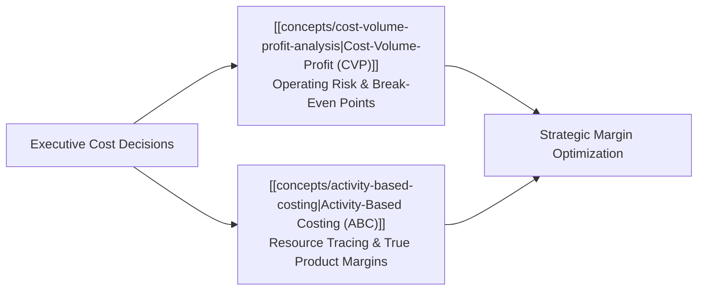
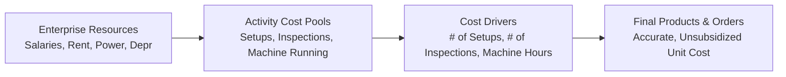

> [!NOTE] Curricular & Faculty Metadata
>
> - **Course:** MK2 Financial Management and Strategy — Week 05
> - **Teaching Team:** Dr. Arif Zamani (Lead Lecturer), Dr. Subiakto Soekarno, Dr. Aswin Rahadi, Yunieta Anny Nainggolan Ph.D., Oktofa Yudha Sudrajat Ph.D.
> - **Primary Curricular Spine:** `P3MD Week 5 - CVP & ABC_AZ.pdf` (Dr. Arif Zamani)
> - **Direct Satellites & Problem Sets:**
>   - [[courses/mk2-financial-management-strategy/week-05/case-alpine-ridge-cvp|Case Study: Alpine Ridge Outfitters CVP & Operating Leverage]]
>   - [[courses/mk2-financial-management-strategy/week-05/case-nirmala-print-abc|Case Study: Nirmala Print & Packaging [[concepts/activity-based-costing|Activity-Based Costing]]]]

## 1. Executive Overview: Profit Economics & The Cost Structure Dilemma

Every commercial decision—setting price points, accepting discount special orders, automating manufacturing lines, or phasing out products—requires understanding how costs behave in response to operational activity.

Traditional accounting models assume all overhead varies linearly with production volume (such as machine hours or labor hours). In modern enterprise reality, this assumption creates severe **cost distortion**:

1. High-volume, simple commodity products are over-allocated overhead, making them appear artificially unprofitable.
2. Low-volume, highly complex custom products consume vast amounts of setup, engineering, and quality-testing resources, but are allocated tiny overhead fractions, making them appear artificially lucrative.

To navigate this dilemma, executive leaders rely on two synergistic frameworks: **[[concepts/cost-volume-profit-analysis|Cost-Volume-Profit (CVP) Analysis]]** for operating leverage and volume risk, and **[[concepts/activity-based-costing|Activity-Based Costing (ABC)]]** for resource tracing.

---

## 2. Theoretical Architecture: [[concepts/cost-volume-profit-analysis|Cost-Volume-Profit (CVP)]] Mechanics

CVP analysis models the relationships between selling prices, sales volume, unit variable costs, total fixed costs, and operating income.

### Core CVP Equations

$$\mathbf{\text{Unit Contribution Margin (CM)}} = P - V$$

$$\mathbf{\text{Contribution Margin Ratio (CM Ratio)}} = \frac{P - V}{P} = \frac{\text{Total CM}}{\text{Total Revenue}}$$

$$\mathbf{\text{Operating Income}} = (\text{Price} \times Q) - (\text{Variable Cost} \times Q) - \text{Fixed Costs} = (CM \times Q) - \text{Fixed Costs}$$

### Break-Even Point (BEP) Formulation

$$\mathbf{\text{BEP}_{\text{units}} = \frac{\text{Total Fixed Costs}}{P - V} = \frac{\text{Fixed Costs}}{\text{Unit CM}}} \qquad \mathbf{\text{BEP}_{\text{sales \$}} = \frac{\text{Total Fixed Costs}}{\text{CM Ratio}}}$$

### Target Operating Profit Target

When management requires a specific target pre-tax operating profit ($\text{TOI}$):

$$\mathbf{Q_{\text{target}} = \frac{\text{Fixed Costs} + \text{Target Operating Income}}{\text{Unit CM}}}$$

### Margin of Safety (MoS)

The buffer between actual sales and the break-even threshold before the enterprise incurs an operating loss:

$$\mathbf{\text{Margin of Safety (\$)}} = \text{Actual Sales} - \text{Break-Even Sales} \qquad \mathbf{\text{MoS \%}} = \frac{\text{Margin of Safety (\text{\$})}}{\text{Actual Sales}}$$

### Degree of Operating Leverage (DOL)

The multiplier measuring how sensitive operating income is to percentage changes in sales revenue:

$$\mathbf{\text{DOL} = \frac{\text{Total Contribution Margin}}{\text{Operating Income (EBIT)}}}$$

$$\mathbf{\% \Delta \text{Operating Income}} = \text{DOL} \times \% \Delta \text{Sales Revenue}$$

A higher proportion of fixed costs creates a higher DOL, magnifying profit gains during economic booms and magnifying catastrophic losses during downturns.

---

## 3. Theoretical Architecture: [[concepts/activity-based-costing|Activity-Based Costing (ABC)]]

[[concepts/activity-based-costing|Activity-Based Costing]] recognizes that **activities consume resources, and products consume activities**.

### The 4-Level ABC Cost Hierarchy

1. **Unit-Level Activities**: Performed each time a single unit is produced (e.g., machine electricity, direct cutting labor).
2. **Batch-Level Activities**: Performed each time a production batch is run, regardless of unit count (e.g., machine setup calibration, shipment packing, invoice processing).
3. **Product-Sustaining Activities**: Performed to maintain and support individual product lines (e.g., CAD engineering design, regulatory compliance testing, marketing collateral).
4. **Facility-Sustaining Activities**: Incurred to sustain overall factory capacity (e.g., plant security, factory roof depreciation, plant manager salary).

### ABC Implementation Algorithm

1. Identify and group indirect manufacturing costs into discrete **Activity Cost Pools**.
2. Identify a causal **Activity Measure (Cost Driver)** for each pool.
3. Compute the **Activity Rate (Pool Rate)**:
   $$\text{Activity Rate} = \frac{\text{Total Estimated Overhead in Pool}}{\text{Total Activity Capacity of Cost Driver}}$$
4. Assign overhead to products based on actual driver consumption.

---

## 4. Managerial Crucible: The Cross-Subsidization Trap

When companies replace traditional volume-based allocation with ABC, they almost universally uncover **Product Cross-Subsidization**:

| Costing Methodology                   | High-Volume Standard Products                                                        | Low-Volume Custom / Specialty Products                                                         |
| :------------------------------------ | :----------------------------------------------------------------------------------- | :--------------------------------------------------------------------------------------------- | -------------------------------------------------------------------------------------- |
| **Traditional Volume-Based Costing**  | **Over-costed**: Charged for machine hours they barely consume in setup/engineering. | **Under-costed**: Subsidized by high-volume lines despite driving complex setups and QA tests. |
| \*\*[[concepts/activity-based-costing | Activity-Based Costing (ABC)]]\*\*                                                   | **True Low Cost**: Cost drops; true gross margin is substantially higher.                      | **True High Cost**: Overhead explodes; product often operates at a severe hidden loss. |
| **Strategic Executive Action**        | Protect pricing; defend against low-cost competitors; aggressively scale volume.     | Implement minimum order sizes; re-price for complexity; streamline setups or exit line.        |

---

## 📚 Direct Satellite Notes

- [[courses/mk2-financial-management-strategy/week-05/case-alpine-ridge-cvp|Case Study: Alpine Ridge Outfitters CVP & Operating Leverage]]: Multi-product break-even packages, sales mix shifts, special order pricing, and cost-structure restructuring.
- [[courses/mk2-financial-management-strategy/week-05/case-nirmala-print-abc|Case Study: Nirmala Print & Packaging [[concepts/activity-based-costing|Activity-Based Costing]]]]: Revealing massive cross-subsidization between standard boxes and custom packaging across 4 activity pools.

---

## 🔗 Knowledge Graph & Curriculum Bridges

- **Featured Concepts in Knowledge Matrix**:
  - [[concepts/cost-volume-profit-analysis|Cost-Volume-Profit Analysis]]
  - [[concepts/activity-based-costing|Activity-Based Costing Hierarchy]]
- **Previous Curricular Module**: [[courses/mk2-financial-management-strategy/week-04/index|Week 04: Management Accounting & [[concepts/job-order-costing|Job-Order Costing]]]]
- **Next Curricular Module**: [[courses/mk2-financial-management-strategy/week-06/index|Week 06: [[concepts/time-value-of-money|Time Value of Money]] & Annuities]]
- Return to **[[courses/mk2-financial-management-strategy/index|MK 2 Course Overview]]**
