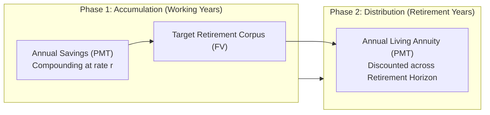
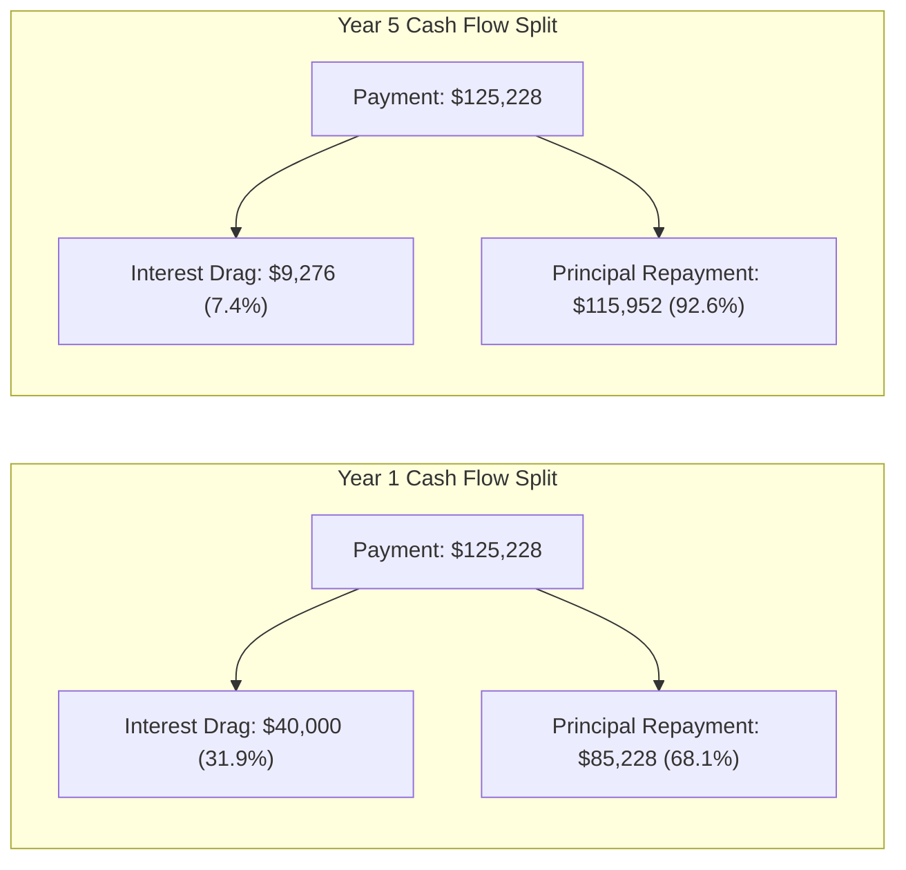

> [!NOTE] Cohort Attribution & Model Foundations
>
> - **Course:** MK2 Financial Management and Strategy — Week 06
> - **Analytical Contribution:** Synthesized from the integrated financial models and case solutions of **`F9 (Class F / Syndicate 9)`**.
> - **Scope:** Case I (Executive Wealth Accumulation & Retirement Planning) & Case II (Tuition Endowment & Structured Amortization).

## 1. Executive Summary: The Mathematical Engine of Long-Term Wealth

Financial strategy requires translating multi-decade corporate and personal goals into actionable periodic capital commitments. The cohort examined two foundational business crucibles:

1. **Case I: Executive Wealth Accumulation & Retirement Sizing**: Determining how an executive builds an inflation-hedged retirement corpus across active working years.
2. **Case II: Structured Liability Amortization & Education Endowment**: Structuring multi-stage tuition obligations and deconstructing a long-term commercial loan amortization schedule.

---

## 2. Case I: Executive Wealth Accumulation & Retirement Target

### Problem Parameters

- **Current Age**: 30 years old | **Retirement Age**: 60 years old ($n_1 = 30\text{ years of active career}$).
- **Life Expectancy**: 85 years old ($n_2 = 25\text{ years in retirement}$).
- **Target Annual Retirement Consumption**: **\$120,000 per year** (payable at the beginning of each year as an **Annuity Due**).
- **Conservative Portfolio Yield in Retirement**: **$6.0\%$ per annum**.
- **Aggressive Portfolio Yield during Accumulation**: **$9.0\%$ per annum**.

### Step 1: Sizing the Required Retirement Corpus at Age 60

At age 60, the executive requires a capital pool capable of funding a 25-year annuity due of \$120,000 at a 6.0% discount rate:

$$\mathbf{\text{PVA}_{\text{due}}} = \text{PMT} \times \left[\frac{1 - (1 + r)^{-n}}{r}\right] \times (1 + r)$$

$$\mathbf{\text{PVA}_{\text{due}}} = \$120,000 \times \left[\frac{1 - (1.06)^{-25}}{0.06}\right] \times 1.06$$

$$\mathbf{\text{PVA}_{\text{due}}} = \$120,000 \times 12.78336 \times 1.06 \approx \mathbf{\$1,626,108.74}$$

The executive must accumulate a target nest egg of **\$1,626,108.74** by age 60.

### Step 2: Calculating Annual Required Career Savings

To build \$1,626,108.74 over 30 years at an accumulation yield of $9.0\%$ per annum (ordinary annuity contributions at year-end):

$$\mathbf{\text{FVA}} = \text{PMT} \times \left[\frac{(1 + r)^n - 1}{r}\right] \implies \text{PMT} = \frac{\text{FV}}{\left[\frac{(1 + r)^n - 1}{r}\right]}$$

$$\mathbf{\text{PMT}} = \frac{\$1,626,108.74}{\left[\frac{(1.09)^{30} - 1}{0.09}\right]} = \frac{\$1,626,108.74}{\left[\frac{13.26768 - 1}{0.09}\right]} = \frac{\$1,626,108.74}{136.3075} \approx \mathbf{\$11,929.71\text{ per year}}$$

**Executive Takeaway**: Saving **\$11,930 per year** (less than \$1,000 per month) for 30 years accumulates into a **\$1.626 million** nest egg, fully sustaining a \$120,000 annual retirement lifestyle for 25 years. This proves the staggering power of early compounding.

---

## 3. Case II: Structured Loan Amortization Schedule

### Problem Parameters

- **Loan Principal**: **\$500,000** (Commercial equipment expansion loan).
- **Annual Nominal Interest Rate**: **$8.0\%$**.
- **Tenure**: **5 years ($n = 5$)** with annual debt service payments.

### Step 1: Determining Fixed Annual Debt Service (PMT)

$$\mathbf{\text{PMT}} = \frac{\text{Loan Principal}}{\left[\frac{1 - (1 + r)^{-n}}{r}\right]} = \frac{\$500,000}{\left[\frac{1 - (1.08)^{-5}}{0.08}\right]} = \frac{\$500,000}{3.99271} \approx \mathbf{\$125,228.23\text{ per year}}$$

### Step 2: Complete 5-Year Loan Amortization Schedule

Every payment is partitioned into an **Interest Portion** (tax-deductible operating cost) and a **Principal Repayment Portion** (balance sheet liability reduction):

| Year ($t$) | Beginning Balance | Total Payment (PMT) | Interest Portion ($8\% \times \text{Beg. Bal}$) | Principal Reduction ($\text{PMT} - \text{Interest}$) | Ending Balance ($\text{Beg. Bal} - \text{Principal}$) |
| :--------: | :---------------: | :-----------------: | :---------------------------------------------: | :--------------------------------------------------: | :---------------------------------------------------: |
| **Year 1** |   \$500,000.00    |    \$125,228.23     |                   \$40,000.00                   |                     \$85,228.23                      |                     \$414,771.77                      |
| **Year 2** |   \$414,771.77    |    \$125,228.23     |                   \$33,181.74                   |                     \$92,046.49                      |                     \$322,725.28                      |
| **Year 3** |   \$322,725.28    |    \$125,228.23     |                   \$25,818.02                   |                     \$99,410.21                      |                     \$223,315.07                      |
| **Year 4** |   \$223,315.07    |    \$125,228.23     |                   \$17,865.21                   |                     \$107,363.02                     |                     \$115,952.05                      |
| **Year 5** |   \$115,952.05    |    \$125,228.23     |                   \$9,276.16                    |                     \$115,952.05                     |                      **\$0.00**                       |
| **Total**  |                   |  **\$626,141.15**   |                **\$126,141.15**                 |                   **\$500,000.00**                   |                                                       |

---

## 4. Strategic Financial Inferences & Sensitivity

1. **The Compounding Asymmetry**: Delaying career retirement savings by just 10 years (starting at age 40 instead of age 30) nearly triples the required annual savings from **\$11,930 to \$31,785** to reach the identical \$1.626M corpus.
2. **Effective Annual Rate ($\text{EAR}$) Vigilance**: Corporate loans frequently quote nominal annual percentage rates with monthly compounding. A nominal $8.0\%$ loan compounded monthly carries an effective annual cost of:
   $$\mathbf{\text{EAR}} = \left(1 + \frac{0.08}{12}\right)^{12} - 1 = \mathbf{8.30\%}$$
   Corporate treasurers must always model debt service using $\text{EAR}$ rather than stated nominal rates.

---

## 🔗 Related Notes

- Master Hub: [[courses/mk2-financial-management-strategy/week-06/index|Week 06: [[concepts/time-value-of-money|Time Value of Money]] & Annuities]]
- Subsequent Application: [[courses/mk2-financial-management-strategy/week-07/index|Week 07: Bond & Stock Valuation]]
- Theoretical Concept: [[concepts/time-value-of-money|Time Value of Money Foundations]]
