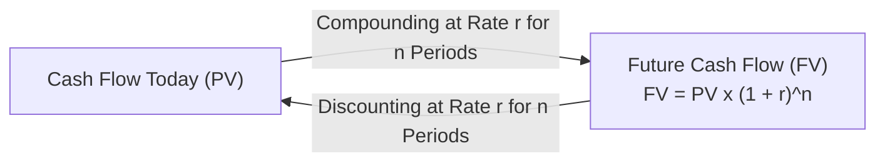
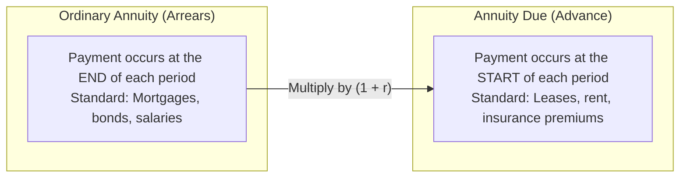
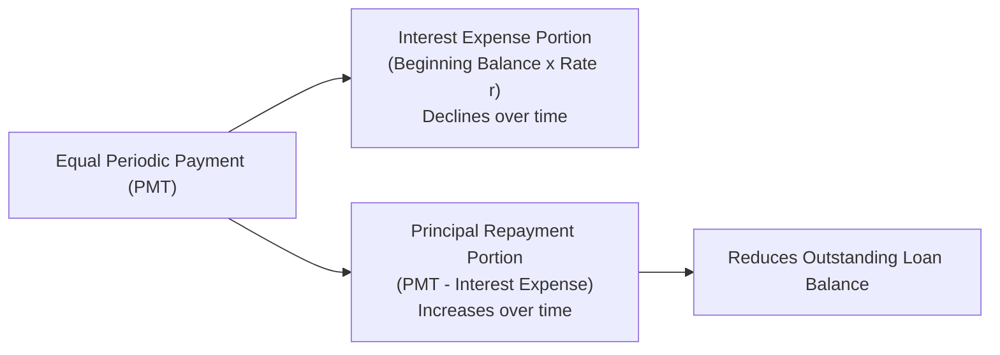

> [!NOTE] Curricular & Faculty Metadata
>
> - **Course:** MK2 Financial Management and Strategy — Week 06
> - **Teaching Team:** Dr. Arif Zamani (Lead Lecturer), Dr. Subiakto Soekarno, Dr. Aswin Rahadi, Yunieta Anny Nainggolan Ph.D., Oktofa Yudha Sudrajat Ph.D.
> - **Primary Curricular Spine:** `[P3MD] Week 6 - [[concepts/time-value-of-money|Time Value of Money]]_AZ.pdf` (Dr. Arif Zamani)
> - **Direct Satellites & Problem Sets:**
>   - [[courses/mk2-financial-management-strategy/week-06/case-tvm-wealth-and-annuities|Case Dossier: TVM Cases I & II (Retirement Wealth & Educational Amortization)]]

## 1. Executive Overview: The Time-Preference Principle

The fundamental axiom of corporate finance states that **a rupiah today is worth more than a rupiah expected in the future**.

This relationship is driven by three universal economic forces:

1. **Opportunity Cost of Capital**: Money received today can be immediately deployed in productive enterprise assets or interest-bearing securities.
2. **Inflation Drag**: General price level increases erode the future purchasing power of currency units.
3. **Credit and Uncertainty Risk**: A promised future cash flow carries inherent default risk; a cash receipt in hand is guaranteed.

[[concepts/time-value-of-money|Time Value of Money]] ($\text{TVM}$) provides the mathematical bridge linking cash flows across time, forming the foundation of bond pricing, equity valuation, capital budgeting, and loan structuring.

---

## 2. Theoretical Architecture: Single-Sum Cash Flows

### Future Value ($\text{FV}$) and Present Value ($\text{PV}$)

$$\mathbf{\text{FV}_n = \text{PV} \times (1 + r)^n} \qquad \mathbf{\text{PV} = \frac{\text{FV}_n}{(1 + r)^n} = \text{FV}_n \times (1 + r)^{-n}}$$

Where:

- $\text{PV}$: Present value (discounted cash flow at time zero).
- $\text{FV}_n$: Future value after $n$ periods.
- $r$: Periodic interest / discount rate.
- $n$: Number of compounding / discounting periods.

### Compounding Frequency and Effective Annual Rate (EAR)

When interest compounds $m$ times per year (e.g., semiannually $m=2$, quarterly $m=4$, monthly $m=12$, daily $m=365$), the nominal annual rate ($r_{\text{nom}}$) understates the true annualized yield:

$$\mathbf{\text{Periodic Rate}} = \frac{r_{\text{nom}}}{m} \qquad \mathbf{\text{Total Compounding Periods}} = n \times m$$

$$\mathbf{\text{FV} = \text{PV} \times \left(1 + \frac{r_{\text{nom}}}{m}\right)^{n \times m}}$$

The **Effective Annual Rate (EAR)** standardizes all compounding conventions into an equivalent annual rate:

$$\mathbf{\text{EAR} = \left(1 + \frac{r_{\text{nom}}}{m}\right)^m - 1}$$

$$\mathbf{\text{Continuous Compounding (as } m \to \infty\text{)}}: \quad \text{EAR} = e^{r_{\text{nom}}} - 1 \quad \text{and} \quad \text{FV} = \text{PV} \times e^{r \times n}$$

---

## 3. Theoretical Architecture: Annuity Streams and Perpetuities

An **Annuity** is a series of equal cash payments ($\text{PMT}$) occurring at uniform intervals across a finite time horizon.

### Ordinary Annuity Formulas

$$\mathbf{\text{FVA}_{\text{ord}} = \text{PMT} \times \left[\frac{(1 + r)^n - 1}{r}\right]} \qquad \mathbf{\text{PVA}_{\text{ord}} = \text{PMT} \times \left[\frac{1 - (1 + r)^{-n}}{r}\right]}$$

### Annuity Due Relationship

Because every payment in an annuity due earns interest for one additional compounding period:

$$\mathbf{\text{FVA}_{\text{due}} = \text{FVA}_{\text{ord}} \times (1 + r)} \qquad \mathbf{\text{PVA}_{\text{due}} = \text{PVA}_{\text{ord}} \times (1 + r)}$$

### Perpetuities (Infinite Streams)

An annuity with cash flows that continue indefinitely ($n \to \infty$):

$$\mathbf{\text{PV}_{\text{perpetuity}} = \frac{\text{PMT}}{r}}$$

$$\mathbf{\text{Growing Perpetuity (Cash flow grows at rate } g\text{)}}: \quad \mathbf{\text{PV} = \frac{\text{PMT}_1}{r - g}} \quad (\text{valid for } r > g)$$

---

## 4. Managerial Applications: Loan Amortization Architecture

An **Amortized Loan** requires the borrower to make equal periodic payments that cover both interest on the outstanding debt balance and principal reduction.

$$\mathbf{\text{Annual Payment (PMT)}} = \frac{\text{Loan Principal (PVA)}}{\left[\frac{1 - (1 + r)^{-n}}{r}\right]}$$

### Amortization Schedule Dynamics

1. **Early Periods**: The outstanding principal is at its maximum; therefore, the interest portion swallows the majority of the payment, and principal reduction is minimal.
2. **Later Periods**: As accumulated principal payments shrink the outstanding loan balance, interest charges drop dramatically, and the vast majority of the payment accelerates loan payoff.

---

## 📚 Direct Satellite Notes

- [[courses/mk2-financial-management-strategy/week-06/case-tvm-wealth-and-annuities|Case Dossier: TVM Cases I & II (Retirement Wealth & Educational Amortization)]]: Complete worked analytical walkthroughs of Case I (Executive Wealth Accumulation) and Case II (Higher Education Endowment & Staggered Amortization).

---

## 🔗 Knowledge Graph & Curriculum Bridges

- **Featured Concept in Knowledge Matrix**:
  - [[concepts/time-value-of-money|Time Value of Money Foundations]]
- **Previous Curricular Module**: [[courses/mk2-financial-management-strategy/week-05/index|Week 05: Cost Analysis, CVP & ABC]]
- **Next Curricular Module**: [[courses/mk2-financial-management-strategy/week-07/index|Week 07: Applications of TVM (Bond & Stock Valuation)]]
- Return to **[[courses/mk2-financial-management-strategy/index|MK 2 Course Overview]]**
