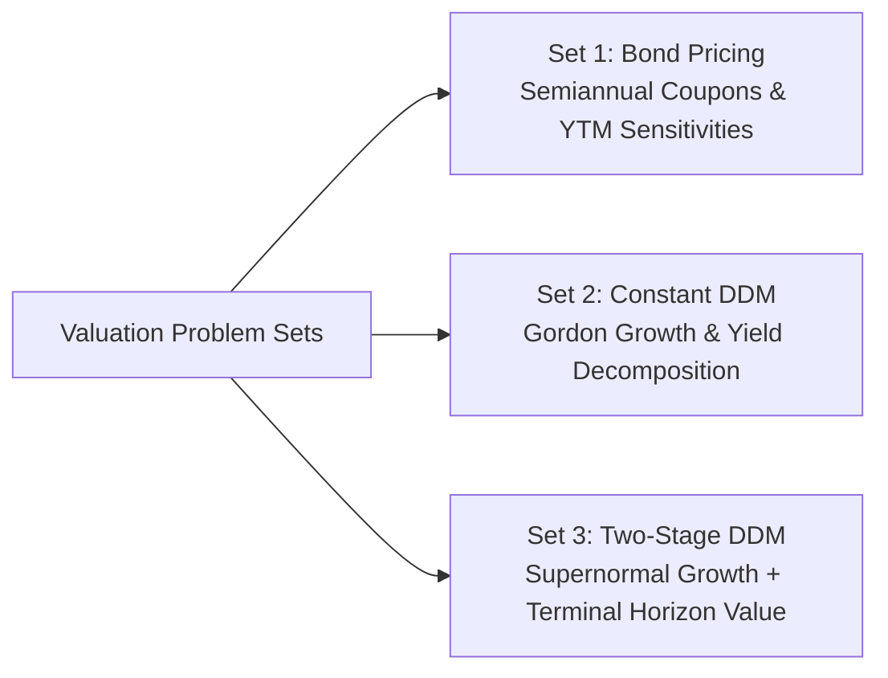
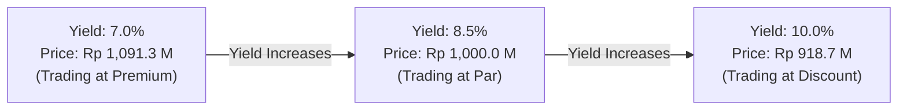
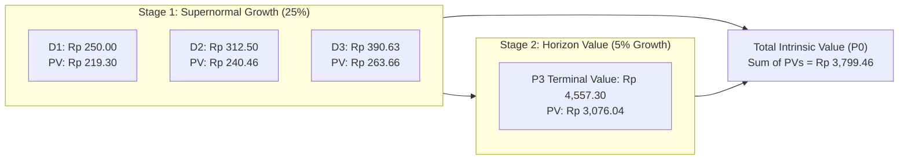

> [!NOTE] Cohort Attribution & Academic Scope
>
> - **Course:** MK2 Financial Management and Strategy — Week 07
> - **Analytical Contribution:** Synthesized from the core quantitative models of **`F9 (Class F / Syndicate 9)`**.
> - **Source Problem Sets:** P3MD MM5007 Week 7 Valuation Exercises (Fixed-Income & Capital Assets).

## 1. Executive Summary & Problem Scope

Asset valuation links financial statement performance to secondary capital markets. The cohort worked through three core analytical problem sets:

1. **Problem Set 1: Corporate Bond Pricing Across Yield Environments**: Sizing premium, par, and discount pricing for semiannual corporate debt.
2. **Problem Set 2: Constant Growth [[concepts/dividend-discount-model|Dividend Discount Model]]ing**: Evaluating equity value, dividend yield, and capital gains yield.
3. **Problem Set 3: Multi-Stage Supernormal Equity Valuation**: Modeling high-growth expansion transitioning into mature perpetual stability.

---

## 2. Problem Set 1: Semiannual Corporate Bond Valuation

### Problem Parameters

- **Par Value ($M$)**: **Rp 1,000,000,000** (Indonesian institutional bond denomination).
- **Stated Coupon Rate**: **$8.50\%$ per annum**, paid semiannually.
- **Tenure ($n$)**: **8 years** to maturity ($2n = 16\text{ semiannual periods}$).
- **Semiannual Coupon Payment ($\text{INT}/2$)**:
  $$\frac{\text{Rp } 1,000,000,000 \times 0.085}{2} = \mathbf{\text{Rp } 42,500,000\text{ every six months}}$$

### Required Task

Calculate the bond's intrinsic price under three market yield ($\text{YTM}$) environments:

- **Scenario A (Premium)**: Required market yield falls to **$7.00\%$** ($r_d/2 = 3.5\%$).
- **Scenario B (Par)**: Required market yield equals the coupon rate at **$8.50\%$** ($r_d/2 = 4.25\%$).
- **Scenario C (Discount)**: Required market yield rises to **$10.00\%$** ($r_d/2 = 5.0\%$).

### Semiannual Pricing Formula

$$\mathbf{V_B = \text{PMT} \times \left[\frac{1 - \left(1 + \frac{r_d}{2}\right)^{-2n}}{\frac{r_d}{2}}\right] + \frac{M}{\left(1 + \frac{r_d}{2}\right)^{2n}}}$$

### Comprehensive Valuation Results

| Market Yield Environment        | Semiannual Discount Rate ($r_d/2$) | Present Value of Coupons (PVA) | Present Value of Par Value (PV) | Total Bond Price ($V_B$) |    Pricing Status     |
| :------------------------------ | :--------------------------------: | :----------------------------: | :-----------------------------: | :----------------------: | :-------------------: |
| **Scenario A ($r_d = 7.0\%$)**  |              $3.50\%$              |         Rp 514,642,887         |         Rp 576,705,913          |   **Rp 1,091,348,800**   | **Premium (+9.13%)**  |
| **Scenario B ($r_d = 8.5\%$)**  |              $4.25\%$              |         Rp 487,276,432         |         Rp 512,723,568          |   **Rp 1,000,000,000**   |   **Par (100.0%)**    |
| **Scenario C ($r_d = 10.0\%$)** |              $5.00\%$              |         Rp 460,601,365         |         Rp 458,111,521          |    **Rp 918,712,886**    | **Discount (-8.13%)** |

**Key Takeaway**: When market interest rates rise from $7.0\%$ to $10.0\%$, the bond's market price drops by **$15.82\%$** (from Rp 1.091B to Rp 918.7M), illustrating the acute interest rate duration risk borne by institutional bondholders.

---

## 3. Problem Set 2: Constant Growth [[concepts/dividend-discount-model|Dividend Discount Model]] (Gordon Model)

### Problem Parameters

- **Dividend Just Paid ($D_0$)**: **Rp 450 per share** (audited annual dividend).
- **Constant Perpetual Dividend Growth Rate ($g$)**: **$6.00\%$ per annum**.
- **Required Rate of Return on Common Equity ($r_s$)**: **$12.00\%$ per annum**.

### Step 1: Calculate Next Year's Expected Dividend ($D_1$)

$$\mathbf{D_1 = D_0 \times (1 + g) = \text{Rp } 450 \times (1 + 0.06) = \mathbf{\text{Rp } 477.00\text{ per share}}}$$

### Step 2: Calculate Current Intrinsic Stock Price ($P_0$)

$$\mathbf{P_0 = \frac{D_1}{r_s - g} = \frac{\text{Rp } 477.00}{0.12 - 0.06} = \frac{\text{Rp } 477.00}{0.06} = \mathbf{\text{Rp } 7,950.00\text{ per share}}}$$

### Step 3: Deconstruct Total Expected Shareholder Return

$$\mathbf{\text{Expected Return } (\hat{r}_s) = \underbrace{\frac{D_1}{P_0}}_{\text{Dividend Yield}} + \underbrace{g}_{\text{Capital Gains Yield}}}$$

$$\mathbf{\text{Dividend Yield}} = \frac{\text{Rp } 477}{\text{Rp } 7,950} = \mathbf{6.00\%} \qquad \mathbf{\text{Capital Gains Yield}} = \mathbf{6.00\%} \qquad \mathbf{\text{Total Return}} = \mathbf{12.00\%}$$

---

## 4. Problem Set 3: Two-Stage (Supernormal) Equity Growth Valuation

### Problem Parameters

- **Current Dividend Just Paid ($D_0$)**: **Rp 200.00 per share**.
- **Supernormal Growth Phase ($N = 3\text{ years}$)**: High annual dividend growth of **$g_s = 25.0\%$** during rapid market adoption.
- **Normal Perpetual Growth Phase ($t \ge 4$)**: Long-term sustainable growth decelerates to **$g_n = 5.0\%$**.
- **Required Rate of Return on Equity ($r_s$)**: **$14.00\%$ per annum**.

### Step 1: Forecast Discrete Dividends during Supernormal Phase

- **$D_1$**: $\text{Rp } 200 \times 1.25 = \mathbf{\text{Rp } 250.00}$
- **$D_2$**: $\text{Rp } 250 \times 1.25 = \mathbf{\text{Rp } 312.50}$
- **$D_3$**: $\text{Rp } 312.50 \times 1.25 = \mathbf{\text{Rp } 390.63}$

### Step 2: Forecast First Dividend of Normal Phase ($D_4$)

$$\mathbf{D_4 = D_3 \times (1 + g_n) = \text{Rp } 390.625 \times 1.05 = \mathbf{\text{Rp } 410.156}}$$

### Step 3: Compute Horizon (Terminal) Value at $t = 3$ ($P_3$)

$$\mathbf{P_3 = \frac{D_4}{r_s - g_n} = \frac{\text{Rp } 410.156}{0.14 - 0.05} = \frac{\text{Rp } 410.156}{0.09} = \mathbf{\text{Rp } 4,557.29}}$$

### Step 4: Discount All Cash Flows to Present Value ($t = 0$)

$$
\begin{aligned}
\mathbf{\text{PV}(D_1)} &= \frac{\text{Rp } 250.00}{(1.14)^1} = \mathbf{\text{Rp } 219.30} \\
\mathbf{\text{PV}(D_2)} &= \frac{\text{Rp } 312.50}{(1.14)^2} = \mathbf{\text{Rp } 240.46} \\
\mathbf{\text{PV}(D_3)} &= \frac{\text{Rp } 390.63}{(1.14)^3} = \mathbf{\text{Rp } 263.66} \\
\mathbf{\text{PV}(P_3)} &= \frac{\text{Rp } 4,557.29}{(1.14)^3} = \mathbf{\text{Rp } 3,076.04}
\end{aligned}
$$

$$\mathbf{P_0 = \text{PV}(D_1) + \text{PV}(D_2) + \text{PV}(D_3) + \text{PV}(P_3) = \mathbf{\text{Rp } 3,799.46\text{ per share}}}$$

**Strategic Takeaway**: In high-growth enterprises, **terminal horizon value ($P_3$) accounts for over $80\%$ of total current equity value** ($\text{Rp } 3,076.04 / \text{Rp } 3,799.46 = 80.96\%$). Minor changes in long-term terminal assumptions ($g_n$ or $r_s$) create massive swings in equity valuation.

---

## 🔗 Related Notes

- Master Hub: [[courses/mk2-financial-management-strategy/week-07/index|Week 07: Applications of TVM]]
- Advanced Cost of Capital: [[courses/mk2-financial-management-strategy/week-08/index|Week 08: Risk, Return & Cost of Capital (WACC)]]
- Theoretical Concept: [[concepts/dividend-discount-model|Dividend Discount Model Architecture]]
