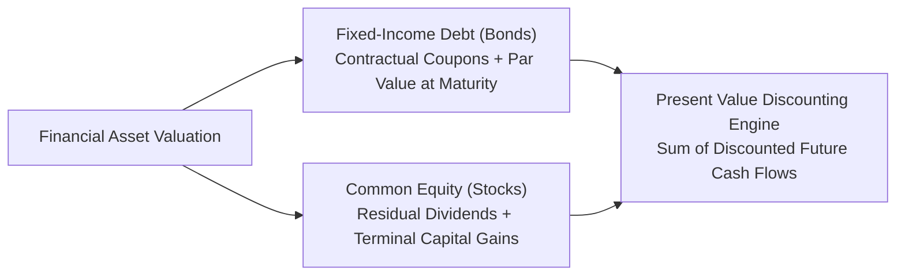
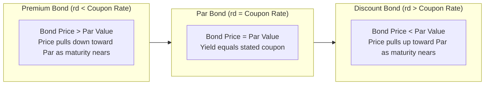
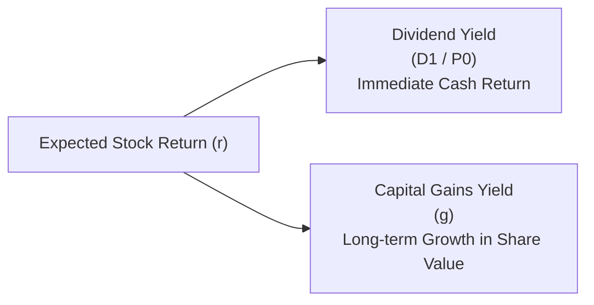

> [!NOTE] Curricular & Faculty Metadata
>
> - **Course:** MK2 Financial Management and Strategy — Week 07
> - **Teaching Team:** Dr. Arif Zamani (Lead Lecturer), Dr. Subiakto Soekarno, Dr. Aswin Rahadi, Yunieta Anny Nainggolan Ph.D., Oktofa Yudha Sudrajat Ph.D.
> - **Primary Curricular Spine:** `[P3MD] Week 7 Applications of TVM.pdf` (Dr. Arif Zamani)
> - **Direct Satellites & Problem Sets:**
>   - [[courses/mk2-financial-management-strategy/week-07/assignment-bond-stock-valuation|Analytical Guide: Fixed-Income Pricing & Two-Stage Equity DDM]]

## 1. Executive Overview: The Capital Asset Pricing Foundation

The intrinsic value of any financial asset—whether a corporate bond issued by a state-owned enterprise or a common equity share traded on the Indonesia Stock Exchange (IDX)—is mathematically equal to **the present value of all expected future cash flows, discounted at a rate reflecting the security's risk profile**.

$$\mathbf{\text{Intrinsic Value } (V_0) = \sum_{t=1}^n \frac{\text{Expected Cash Flow}_t}{(1 + r)^t}}$$

When secondary market prices diverge from intrinsic present value:

- If $\mathbf{\text{Market Price } (P_0) < \text{Intrinsic Value } (V_0)}$: The asset is **undervalued** (a buying opportunity; expected return exceeds required return).
- If $\mathbf{\text{Market Price } (P_0) > \text{Intrinsic Value } (V_0)}$: The asset is **overvalued** (expected return falls below the required risk hurdle).

---

## 2. Theoretical Architecture: Fixed-Income Valuation (Bond Pricing)

A corporate bond is a contractual debt instrument where the issuer promises periodic interest payments (**Coupons**) and full redemption of face value (**Par Value / Maturity Value**) on the maturity date.

### General Bond Pricing Formula

$$\mathbf{V_B = \sum_{t=1}^n \frac{\text{INT}}{(1 + r_d)^t} + \frac{M}{(1 + r_d)^n} = \text{INT} \times \left[\frac{1 - (1 + r_d)^{-n}}{r_d}\right] + \frac{M}{(1 + r_d)^n}}$$

Where:

- $V_B$: Bond market price / intrinsic value.
- $\text{INT}$: Annual coupon payment ($\text{Coupon Rate} \times \text{Par Value } M$).
- $r_d$: Yield to Maturity ($\text{YTM}$) or market required rate of return.
- $n$: Years to maturity.
- $M$: Par value (typically Rp 1,000,000,000 for Indonesian institutional bonds, or \$1,000).

### Semiannual Coupon Conventions

Most Indonesian corporate and government bonds (Surat Berharga Negara / SBN) pay coupons semiannually:

$$\mathbf{V_B = \frac{\text{INT}}{2} \times \left[\frac{1 - \left(1 + \frac{r_d}{2}\right)^{-2n}}{\frac{r_d}{2}}\right] + \frac{M}{\left(1 + \frac{r_d}{2}\right)^{2n}}}$$

### Key Fixed-Income Principles

1. **Inverse Price-Yield Relationship**: As market interest rates ($r_d$) rise, bond prices fall; as interest rates fall, bond prices rise.
2. **Maturity Sensitivity (Duration Risk)**: For a given change in interest rates, longer-term bonds fluctuate more dramatically in price than short-term bonds.
3. **Coupon Sensitivity**: Lower-coupon bonds carry greater percentage price volatility than high-coupon bonds because a larger proportion of their total cash flow is weighted at terminal maturity.

---

## 3. Theoretical Architecture: Common Stock Valuation

Unlike debt securities with legally binding cash obligations, common equity represents a residual claim on enterprise earnings. Cash flows to shareholders take the form of **Dividends** and **Terminal Capital Gains**.

### 1. Constant Growth [[concepts/dividend-discount-model|Dividend Discount Model]] (Gordon Growth Model)

When dividends are expected to grow at a constant perpetual rate ($g$), where required return exceeds growth ($r_s > g$):

$$\mathbf{P_0 = \frac{D_1}{r_s - g} = \frac{D_0 \times (1 + g)}{r_s - g}}$$

Where:

- $P_0$: Current intrinsic value per share.
- $D_0$: Dividend recently paid.
- $D_1$: Expected dividend in the coming year ($D_0 \times (1 + g)$).
- $r_s$: Required rate of return on equity.
- $g$: Constant perpetual dividend growth rate.

$$\mathbf{\text{Expected Equity Return}} = \hat{r}_s = \underbrace{\frac{D_1}{P_0}}_{\text{Dividend Yield}} + \underbrace{g}_{\text{Capital Gains Yield}}$$

### 2. Non-Constant (Multi-Stage / Supernormal) Growth Model

High-growth enterprises often experience rapid, supernormal growth ($g_s$) for several years during product adoption, followed by a deceleration to a mature sustainable growth rate ($g_n$):

$$\mathbf{P_0 = \sum_{t=1}^N \frac{D_t}{(1 + r_s)^t} + \frac{P_N}{(1 + r_s)^N}}$$

Where the **Horizon Value / Terminal Value ($P_N$)** at the end of the supernormal period ($N$) is computed using the Gordon Growth Model:

$$\mathbf{P_N = \frac{D_{N+1}}{r_s - g_n} = \frac{D_N \times (1 + g_n)}{r_s - g_n}}$$

---

## 4. Managerial Applications & Corporate Governance Crucible

1. **Financing Cost Calibration**: Understanding bond pricing allows corporate treasurers to time debt issuances. If benchmark yields drop, issuing new bonds or executing debt liability management (refinancing higher-coupon legacy debt) lowers enterprise financing drag.
2. **Dividend Policy Signalling**: Under the Gordon model, cutting dividends increases retained earnings, but if markets interpret the cut as a signal of deteriorating future earnings, share prices plummet.
3. **M&A and Takeover Valuation**: The multi-stage DDM provides the foundation for discounted cash flow (DCF) enterprise valuation when pricing strategic corporate acquisitions.

---

## 📚 Direct Satellite Notes

- [[courses/mk2-financial-management-strategy/week-07/assignment-bond-stock-valuation|Analytical Guide: Fixed-Income Pricing & Two-Stage Equity DDM]]: Step-by-step problem sets covering semiannual bond valuation, YTM interpolation, and multi-stage equity growth modeling.

---

## 🔗 Knowledge Graph & Curriculum Bridges

- **Featured Concept in Knowledge Matrix**:
  - [[concepts/dividend-discount-model|Dividend Discount Model Architecture]]
- **Previous Curricular Module**: [[courses/mk2-financial-management-strategy/week-06/index|Week 06: [[concepts/time-value-of-money|Time Value of Money]] & Compounding]]
- **Next Curricular Module**: [[courses/mk2-financial-management-strategy/week-08/index|Week 08: Risk, Return & Cost of Capital (WACC)]]
- Return to **[[courses/mk2-financial-management-strategy/index|MK 2 Course Overview]]**
